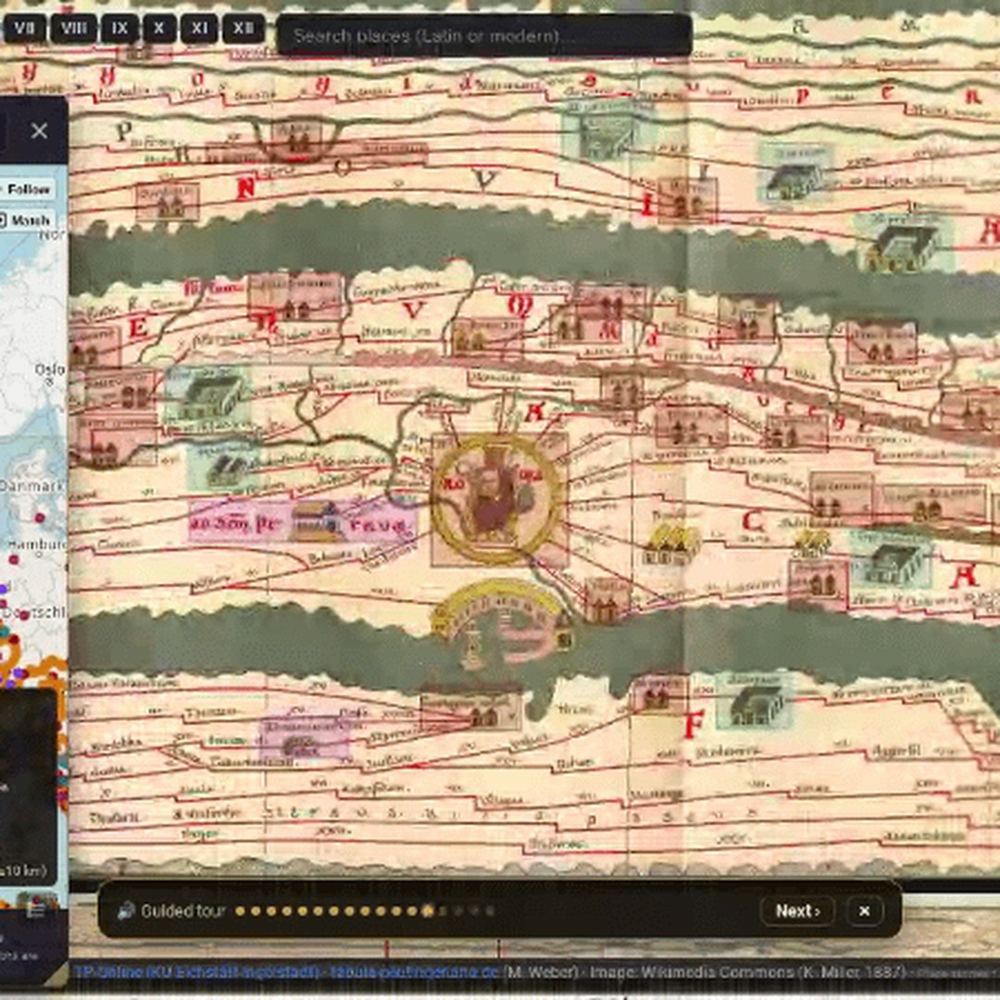

# Geoawesome reposts, 2026-11-01

1 post(s) ready. Each has a 1080×1080 image and its own text for Facebook, Instagram, YouTube Community and X. Nothing has been posted.

**To publish:** tick the box under a post. It is queued for the next free time slot and posted to Facebook and Instagram; a comment here confirms the time. Edit a text in this issue first if you want to change it (what is in the box is what gets posted). Untick before the slot to cancel. When it is live, a comment @mentions you with the YouTube Community text and the X text for Buffer.

---

## 1. How to Navigate the Roman Empire

<!-- post:2026-11-01-1-how-to-navigate-the-roman-empire -->
- [ ] **Publish on Facebook + Instagram**



[Download square image](https://raw.githubusercontent.com/walczakagh/geoawesome-social-agent/main/drafts/images/2026-11-01-1-how-to-navigate-the-roman-empire.jpg) · square crop, from 450px of source width (low resolution: upscaled, check sharpness)

**Source:** [Maps Mania](http://googlemapsmania.blogspot.com/2026/10/how-to-navigate-roman-empire.html) · score 8.0/10 · Tabula Peutingeriana road map with image; historical cartography with a clear hook.
**Rights:** Someone else's map: the credit line names them; ask them first if unsure. Licence on page: not stated.

**What it shows:** The Tabula Peutingeriana, a medieval copy of a Roman road map held at the Austrian National Library in Vienna. It was originally drawn on a parchment scroll almost seven metres long and 34 centimetres high, showing the Roman road network from the British Isles and the Atlantic coast to the Middle East and India, with thousands of place names, roads and distances in Roman miles. It is not to scale: the Mediterranean is compressed into a narrow strip because the map's purpose was to show connections between settlements; Maps Mania features an interactive version where users can navigate the map and search ancient and modern place names.

**Check before posting:**
- No image credit on the page; credit built as 'Tabula Peutingeriana via Maps Mania'. The maker of the interactive website is not named, so check it and add the site name if possible.
- Reuse policy is link_only and no image licence is stated. Confirm reposting the image is acceptable.
- Image is a square crop from only 450px of source width and has been upscaled. Check sharpness; place names may be illegible.
- Page text is cut off ('alongside a contemporary geographic...'), so the exact comparison feature of the interactive map is not fully described.
- The page does not say which section of the scroll the image shows. Check the alt text against the actual crop.
- The page gives no date for the medieval copy or the Roman original. This was left out.

**Facebook**

```text
Almost seven metres long and 34 centimetres high: the Tabula Peutingeriana fits the Roman road network from the British Isles to India onto one scroll.

This medieval copy of a Roman original ignores scale and squashes the Mediterranean into a thin strip, because it maps connections, with distances in Roman miles. An interactive version lets you pan along it and search ancient and modern place names.

Read more: http://googlemapsmania.blogspot.com/2026/10/how-to-navigate-roman-empire.html

Map: Tabula Peutingeriana via Maps Mania

#Cartography #History #Rome #Geoawesome
```

**Instagram**

```text
The Mediterranean as a thin ribbon: this is how a Roman road map saw the world.

The Tabula Peutingeriana, a medieval copy held in Vienna, trades scale for routes, with thousands of place names and distances from the British Isles to India.

Find out more: http://googlemapsmania.blogspot.com/2026/10/how-to-navigate-roman-empire.html

Map: Tabula Peutingeriana via Maps Mania

#Maps #Antiquity #Cartography #Geoawesome
```

**YouTube Community**

```text
Thousands of place names, roads and distances in Roman miles, all on a scroll just 34 centimetres high.

The Tabula Peutingeriana is a medieval copy of a Roman road map, held at the Austrian National Library. It works more like a network diagram than a scaled map: the elongated format compresses the Mediterranean so the routes between settlements stay readable. The interactive version lets you search ancient and modern place names and compare its locations with present-day geography.

Learn more: http://googlemapsmania.blogspot.com/2026/10/how-to-navigate-roman-empire.html

Map: Tabula Peutingeriana via Maps Mania

#Cartography #Rome #Archaeology #Geoawesome
```

**X (via Buffer)**

```text
Scale was optional: a Roman road map stretching from the British Isles to India on a scroll 34 cm high.
http://googlemapsmania.blogspot.com/2026/10/how-to-navigate-roman-empire.html
Map: Tabula Peutingeriana via Maps Mania
#Cartography #History #Maps #Geoawesome
```

**Alt text:** A section of the long, narrow Tabula Peutingeriana, an ancient road map with routes drawn as lines between named settlements and land and sea stretched horizontally.

---

### Skipped after reading the page
- [Simon Kuestenmacher on X: " This map shows what the Americas would look like if borders ...](https://x.com/simongerman600/status/2116462771713794526): The source gives only a truncated tweet title and X boilerplate, so the map's premise, maker and data cannot be described without guessing.
- [Tracking fires in Benton, Oregon | WFCA Fire Map - Western Fire Chiefs Association](https://wfca.com/fire-map/detection/1565fbbb8fc84efb): No image on the page (link-only alert): an automated listing of a single 0.7-acre satellite fire detection with no visual and too little context to explain without guessing.
- [Tracking fires in Larimer, Colorado | WFCA Fire Map - Western Fire Chiefs Association](https://wfca.com/fire-map/detection/1b583f8a032e4476): No image on the page and the link is link-only: this is an automated fire-detection alert page (VIIRS NOAA-21, 208.9 acres, 4 merged observations), not a visual we can repost.
- [Tracking the Conway 222 Fire in Arkansas | WFCA Fire Map](https://wfca.com/fire-map/arkansas/conway_222): No image on the page, and the only content is a one-line automated fire-tracker entry (a 1-acre fire in Conway, Arkansas) with no visual or story to caption.
- [Tracking the West Trailer Fire in South Dakota | WFCA Fire Map](https://wfca.com/fire-map/south-dakota/west_trailer): No image on the page and no usable content: an auto-generated fire-tracker stub for a 0-acre fire, with no visual, sensor, date or image credit.
- [Tracking the Deep South 2026 Rx Fire in Idaho | WFCA Fire Map](https://wfca.com/fire-map/idaho/deep_south_2026_rx): No image on the page and only one line of text (a 50-acre prescribed fire listing), so there is no visual to post.
- [Tracking fires in Clearwater, Idaho | WFCA Fire Map - Western Fire Chiefs Association](https://wfca.com/fire-map/detection/5decc98983f240b5): No image on the page and reuse is link-only: this is an automated satellite fire-detection listing with no visual to post.
- [Tracking the Ruben Ridge Fire in Kentucky | WFCA Fire Map](https://wfca.com/fire-map/kentucky/ruben_ridge): No image on the page, link-only reuse policy, and the source is a one-line status note (1-acre fire, 50% contained) with no striking visual to repost.

---

### Sources checked
- Google Alerts #1: 14 in feed, 14 new
- Google Alerts #2: 20 in feed, 20 new
- Google Alerts #3: 20 in feed, 20 new
- Google Alerts #4: 20 in feed, 20 new
- Google Alerts #5: 20 in feed, 20 new
- Google Alerts #6: 20 in feed, 5 new, 15 already found via another source
- Google Alerts #7: 20 in feed, 20 new
- Google Alerts #8: 3 in feed, 0 new
- NASA Earth Observatory: 10 in feed, 0 new
- ESA Observing the Earth: 15 in feed, 0 new
- EUMETSAT: 10 in feed, 0 new
- Copernicus Atmosphere Monitoring Service: 10 in feed, 0 new
- NASA JPL: 100 in feed, 0 new
- Planet Pulse: 50 in feed, 0 new
- Maps Mania: 25 in feed, 1 new
- Visual Capitalist (maps): 10 in feed, 2 new
- FlowingData: 10 in feed, 0 new
- Google Maps blog: 20 in feed, 0 new
- Google Research blog: 100 in feed, 0 new
- Overture Maps blog: 20 in feed, 0 new
- Bellingcat: 10 in feed, 0 new
- Reddit r/MapPorn: 25 in feed, 6 new
- Reddit r/dataisbeautiful: 23 in feed, 6 new
