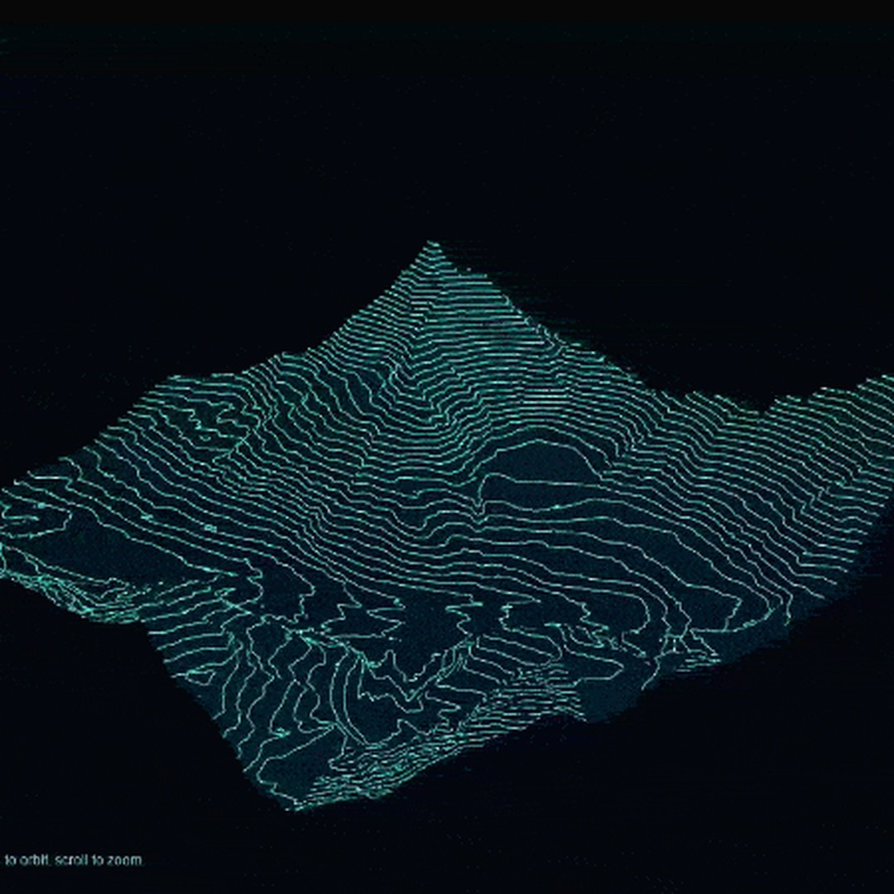
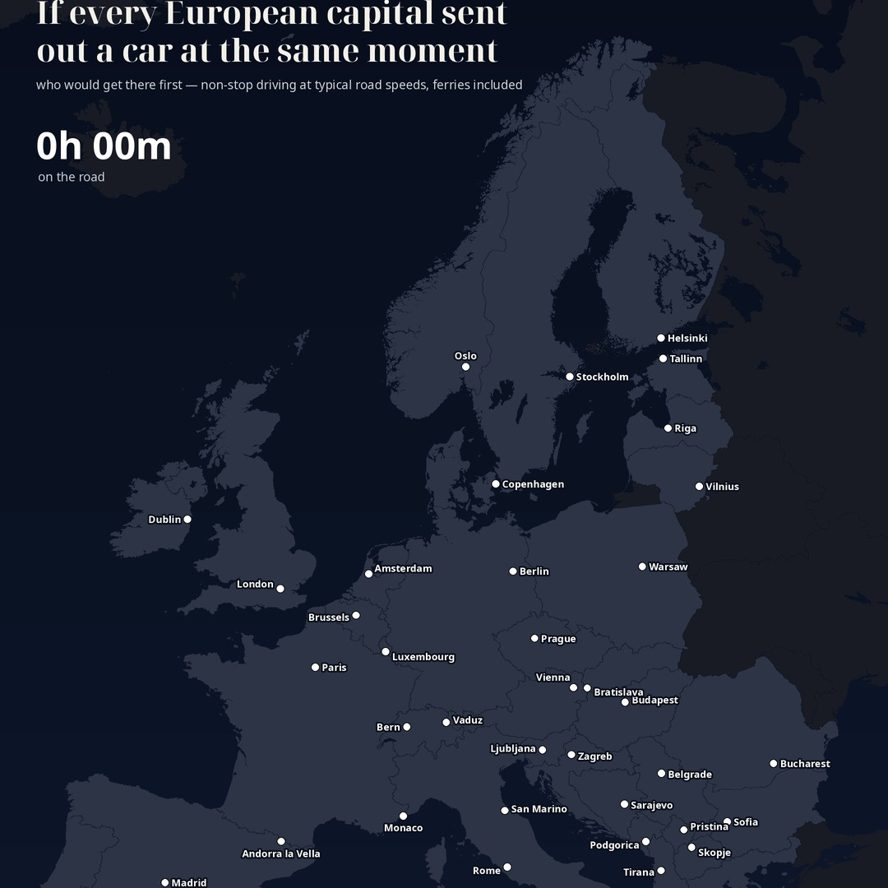
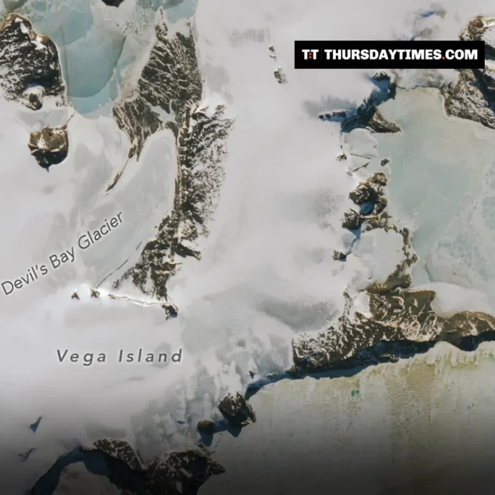
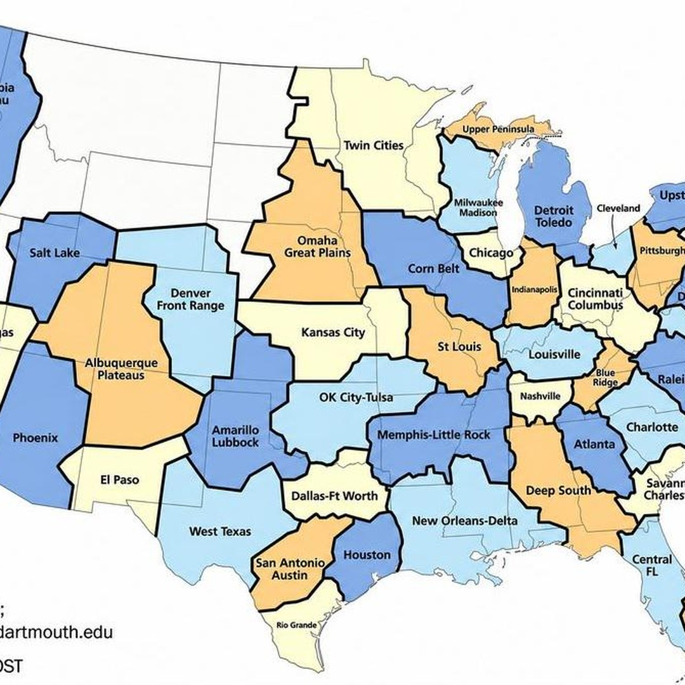

# Geoawesome reposts, 2026-11-02

5 post(s) ready. Each has a 1080×1080 image and its own text for Facebook, Instagram, YouTube Community and X. Nothing has been posted.

**To publish:** tick the box under a post. It is queued for the next free time slot and posted to Facebook and Instagram; a comment here confirms the time. Edit a text in this issue first if you want to change it (what is in the box is what gets posted). Untick before the slot to cancel. When it is live, a comment @mentions you with the YouTube Community text and the X text for Buffer.

---

## 1. A Neon Matterhorn

<!-- post:2026-11-02-4-a-neon-matterhorn -->
- [ ] **Publish on Facebook + Instagram**



[Download square image](https://raw.githubusercontent.com/walczakagh/geoawesome-social-agent/main/drafts/images/2026-11-02-4-a-neon-matterhorn.jpg) · square crop, from 450px of source width (low resolution: upscaled, check sharpness)

**Source:** [Maps Mania](http://googlemapsmania.blogspot.com/2026/11/a-neon-matterhorn.html) · score 8.0/10 · Interactive 3D neon contour terrain map of the Matterhorn; striking glowing visual, explorable.
**Rights:** Someone else's map: the credit line names them; ask them first if unsure. Licence on page: not stated.

**What it shows:** MapterGLOW is an interactive 3D terrain map built by Maps Mania for Day 2 (theme: Lines) of the 30 Day Map Challenge. Elevation tiles from Mapterhorn are loaded into the browser with Three.js, turned into a terrain mesh and overlaid with glowing cyan contour lines at 50-metre intervals. The featured view is the Matterhorn, but users can load other places by entering latitude and longitude in the URL hash.

**Check before posting:**
- Reuse policy is link_only and no image licence is stated on the page. Check whether posting the image itself is permitted.
- No image credit or author name appears on the page. The credit falls back to the tool name plus Maps Mania.
- The source image is only 450px wide and has been upscaled. Check sharpness before posting.
- The resolution and underlying source of the Mapterhorn elevation data are not stated.
- The page text is cut off at the end. Nothing from the missing part is used.
- The direct URL of the MapterGLOW map is not in the source material, so the posts link to the blog post.
- The page does not describe the background colour or lighting in the featured image. Confirm the alt text matches what the image shows.

**Facebook**

```text
Every 50 metres of the Matterhorn, traced as a glowing cyan line.

MapterGLOW, Maps Mania's Day 2 entry for the 30 Day Map Challenge (theme: Lines), builds a 3D terrain model from Mapterhorn elevation tiles. You can rotate, tilt and zoom, or change the coordinates in the URL hash to load Mont Blanc, the Eiger or anywhere else.

Read more: http://googlemapsmania.blogspot.com/2026/11/a-neon-matterhorn.html

Map: MapterGLOW via Maps Mania

#Cartography #Contours #Matterhorn #Terrain #Geoawesome
```

**Instagram**

```text
The Matterhorn, redrawn in neon.

Cyan contour lines at 50 m intervals glow over a 3D terrain model you can spin and tilt in the browser.

Find out more: http://googlemapsmania.blogspot.com/2026/11/a-neon-matterhorn.html

Map: MapterGLOW via Maps Mania

#Matterhorn #Neon #Contours #Alps #Geoawesome
```

**YouTube Community**

```text
A Three.js experiment that turns raw elevation tiles into an electric-blue contour map.

Mapterhorn's elevation tiles are loaded directly into the browser, decoded and resampled into a terrain mesh, then contoured at 50-metre intervals with neon lighting effects on top. The map reads latitude and longitude from the URL hash, so the same view works for the Jungfrau or any range you choose. Made for Day 2 (Lines) of the 30 Day Map Challenge.

Learn more: http://googlemapsmania.blogspot.com/2026/11/a-neon-matterhorn.html

Map: MapterGLOW via Maps Mania

#Topography #Terrain #Cartography #Elevation #Geoawesome
```

**X (via Buffer)**

```text
Neon contours at 50 m intervals, wrapped around a 3D Matterhorn you can rotate in your browser.

http://googlemapsmania.blogspot.com/2026/11/a-neon-matterhorn.html

Map: MapterGLOW via Maps Mania

#Cartography #Matterhorn #Contours #Geoawesome
```

**Alt text:** A 3D model of the Matterhorn's terrain traced with glowing cyan contour lines.

---

## 2. Europe Divided by Driving Time

<!-- post:2026-11-02-5-europe-divided-by-driving-time -->
- [ ] **Publish on Facebook + Instagram**



[Download square image](https://raw.githubusercontent.com/walczakagh/geoawesome-social-agent/main/drafts/images/2026-11-02-5-europe-divided-by-driving-time.jpg) · square crop, from 1080px of source width

**Source:** [Maps Mania](http://googlemapsmania.blogspot.com/2026/11/europe-divided-by-driving-time.html) · score 8.0/10 · Interactive map of European driving-time territories from 38 capitals; clever geo concept with a clear hook.
**Rights:** Someone else's map: the credit line names them; ask them first if unsure. Licence on page: not stated.

**What it shows:** An interactive map by Copilot Travel, featured on Maps Mania, that imagines 38 cars leaving 38 European capitals at the same moment and driving outwards along the road network at typical driving speeds. Every location in Europe is assigned to the capital whose car reaches it first, producing 38 coloured territories. The page describes it as a time-based Voronoi diagram: travel time, not straight-line distance, sets the boundaries.

**Check before posting:**
- Reuse policy is 'link_only' and no image licence is stated: confirm we may post the image itself, or post as a link only.
- No image credit on the page; credit built from the map maker named in the text (Copilot Travel) plus Maps Mania.
- The road network data source and the speed values behind 'typical driving speeds' are not stated.
- The page does not list the 38 capitals or say which capital claims the most territory. The page text is cut off, so results may appear further down.
- The page does not say what the interactive version lets users do beyond viewing the map, so the posts avoid naming specific features.
- Colours are arbitrary territory colours. The page does not give a legend.

**Facebook**

```text
Thirty-eight cars leave thirty-eight European capitals at the same instant, and every town goes to whichever car arrives first.

That is the premise of an interactive map from Copilot Travel, which assigns every location in Europe to the capital that can reach it fastest along the road network at typical driving speeds. The result works like a Voronoi diagram with travel time in place of straight-line distance, and it asks how far each capital's reach extends beyond its own national borders.

Read more: http://googlemapsmania.blogspot.com/2026/11/europe-divided-by-driving-time.html

Map: Copilot Travel via Maps Mania

#Geoawesome #Cartography #Voronoi #Europe
```

**Instagram**

```text
Europe, redrawn by who gets there first by car.

38 capitals, 38 cars, one start time: each colour is the territory one capital can reach faster than any other.

Find out more: http://googlemapsmania.blogspot.com/2026/11/europe-divided-by-driving-time.html

Map: Copilot Travel via Maps Mania

#Geoawesome #Maps #Europe #Roads
```

**YouTube Community**

```text
Swap kilometres for minutes behind the wheel and the Voronoi diagram of Europe changes shape.

Copilot Travel's interactive map sends cars out from 38 European capitals simultaneously, travelling along the road network at typical driving speeds, and gives each location to the first car that reaches it. A classic Voronoi diagram splits space by straight-line distance to the nearest seed point. Here travel time sets the boundaries, which yields 38 network-based territories.

Learn more: http://googlemapsmania.blogspot.com/2026/11/europe-divided-by-driving-time.html

Map: Copilot Travel via Maps Mania

#Geoawesome #Voronoi #Networks #Cartography #Mobility
```

**X (via Buffer)**

```text
What does a Voronoi diagram of Europe look like when distance is measured in driving time? 38 capitals race to claim every town.
http://googlemapsmania.blogspot.com/2026/11/europe-divided-by-driving-time.html
Map: Copilot Travel via Maps Mania
#Geoawesome #Voronoi #Maps #Europe
```

**Alt text:** A map of Europe divided into 38 differently coloured territories, one for each capital city.

---

## 3. White storks - One year of migrations

⚠️ No square image: image download failed: image larger than 40 MB. Screenshot it from the [source page](https://www.reddit.com/r/MapPorn/comments/1xmaqtm/white_storks_one_year_of_migrations/).

**Source:** [Reddit r/MapPorn](https://www.reddit.com/r/MapPorn/comments/1xmaqtm/white_storks_one_year_of_migrations/) · score 8.0/10 · Animated map of white stork migration routes over a year; striking movement visual.
**Rights:** Someone else's map: the credit line names them; ask them first if unsure. Licence on page: not stated.

**What it shows:** A map posted to r/MapPorn by u/vladgrinch titled 'White storks - One year of migrations'. The title is the only description: no data source, tracking method, number of birds, year or colour meaning is given.

**Check before posting:**
- Image download failed (file larger than 40 MB). The editor must fetch the original and make the 1080x1080 square manually. The posts and alt text could not be checked against the actual image.
- Reuse policy is link_only and no licence is stated. Ask u/vladgrinch for permission before reposting the image itself.
- The map's data source is not stated (tracking dataset, number of birds, which year).
- Routes, regions covered and the meaning of colours or lines are unknown. Check the Reddit thread or comments for details before posting.
- A very large file may be a high-resolution or very tall image that crops poorly to a square. Check legibility.

**Facebook**

```text
One species, one year, one map: white stork migration plotted across a full annual cycle.

Reddit user u/vladgrinch shared this map of a year of white stork migrations on r/MapPorn. The post names no data source or time period, so read it as a visual overview rather than a dataset. It is still a neat example of how animal movement turns into cartography.

Read more: https://www.reddit.com/r/MapPorn/comments/1xmaqtm/white_storks_one_year_of_migrations/

Map: u/vladgrinch via r/MapPorn

#Geoawesome #Storks #Migration #Maps
```

**Instagram**

```text
Twelve months of white storks on the move, in a single frame.

A year of migrations, mapped by u/vladgrinch.

Full story: https://www.reddit.com/r/MapPorn/comments/1xmaqtm/white_storks_one_year_of_migrations/

Map: u/vladgrinch via r/MapPorn

#Geoawesome #Storks #Birds #Wildlife
```

**YouTube Community**

```text
How do you show a year of bird migration on one static map?

This post on r/MapPorn by u/vladgrinch attempts it for white storks. The title is the only description: no tracking source, bird count or dates are given, so check the thread before treating it as data. For anyone working with movement data, it is a useful reference for compressing a full annual cycle into one view.

Find out more: https://www.reddit.com/r/MapPorn/comments/1xmaqtm/white_storks_one_year_of_migrations/

Map: u/vladgrinch via r/MapPorn

#Geoawesome #Migration #Cartography #Dataviz
```

**X (via Buffer)**

```text
A full annual cycle of white stork migration, squeezed into one map.
https://www.reddit.com/r/MapPorn/comments/1xmaqtm/white_storks_one_year_of_migrations/
Map: u/vladgrinch via r/MapPorn
#Storks #Migration #Cartography #Geoawesome
```

**Alt text:** A map showing the migration movements of white storks over the course of one year.

---

## 4. NASA images show a grinning 'skull' in the ice on Antarctica's Vega Island, and melting ...

<!-- post:2026-11-02-12-nasa-images-show-a-grinning-skull-in-the -->
- [ ] **Publish on Facebook + Instagram**



[Download square image](https://raw.githubusercontent.com/walczakagh/geoawesome-social-agent/main/drafts/images/2026-11-02-12-nasa-images-show-a-grinning-skull-in-the.jpg) · square crop, from 675px of source width (low resolution: upscaled, check sharpness)

**Source:** [Google Alerts #3](https://thursdaytimes.com/2026/11/02/science/nasa-skull-antarctica-vega-island-landsat-ice/) · score 7.0/10 · Landsat imagery of a skull-shaped ice pattern on Vega Island; striking Earth visual with ice-loss story.
**Rights:** Someone else's map: the credit line names them; ask them first if unsure. Licence on page: not stated.

**What it shows:** Landsat 9 imagery of Vega Island in the Weddell Sea, off the eastern Antarctic Peninsula. Rock and ice there resemble a grinning skull in profile: a nunatak is the eye socket, a lateral moraine the mouth and Devil's Bay (Bahía del Diablo) Glacier the jawbone. The island was imaged on 22 March 2025, under a snow layer, and on 10 October 2026, when snow was absent from large areas and darker ice showed through.

**Check before posting:**
- No image credit or licence on the page. The images are attributed to NASA and Landsat 9 in the text, but the original NASA page (likely NASA Earth Observatory) should be found to confirm the exact credit and the reuse terms.
- Reuse policy for this source is link_only. Check whether the image can be posted, ideally by sourcing it directly from NASA.
- The source is a third-party outlet (The Thursday Times, found via Google Alerts), not NASA. Quotes from Mauri Pelto should ideally be checked against the NASA original.
- The IMAGE NOTE does not say whether the square shows one date or a before/after pair. The posts and alt text do not specify which date is shown. Confirm before posting.
- Low resolution: the square was upscaled from 675 px source width, so check sharpness.
- Band combination and colour rendering are not stated (natural colour is not confirmed). Resolution is not stated.
- Warm winter is described as only 'partly responsible'. That hedge is kept in the posts.

**Facebook**

```text
On Vega Island, a nunatak, a moraine and a glacier line up into a grinning skull in profile.

Landsat 9 captured it on 22 March 2025 under a coat of snow, then on 10 October 2026 with snow gone from large areas and darker ice showing through. Glaciologist Mauri Pelto (Nichols College) says an above-average winter, especially June, was partly responsible. Bare ice absorbs more of the sun's energy, so melt is poised to speed up.

Read more: https://thursdaytimes.com/2026/11/02/science/nasa-skull-antarctica-vega-island-landsat-ice/

Image: NASA, Landsat 9, via The Thursday Times

#Landsat #Antarctica #Glaciers #Geoawesome
```

**Instagram**

```text
Antarctica has a skull, and its snow cover is thinning.

On Vega Island, a rocky nunatak forms the eye socket and a moraine the grin. By 10 October 2026, Landsat 9 showed snow missing from large areas.

Learn more: https://thursdaytimes.com/2026/11/02/science/nasa-skull-antarctica-vega-island-landsat-ice/

Image: NASA, Landsat 9, via The Thursday Times

#Landsat9 #Antarctica #Ice #Geoawesome
```

**YouTube Community**

```text
The jawbone of this 'skull' is Devil's Bay Glacier, measured losing mass since the 1998-1999 summer.

Landsat 9 imaged Vega Island on 22 March 2025 and 10 October 2026. By the later date, darker ice was exposed across large areas. Mauri Pelto reads it as limited winter snowfall, further reduced by sublimation and wind. A 1982 study using early Landsat images counted 29 glaciers on the island.

Full story: https://thursdaytimes.com/2026/11/02/science/nasa-skull-antarctica-vega-island-landsat-ice/

Image: NASA, Landsat 9, via The Thursday Times

#Landsat #Glaciers #Cryosphere #Geoawesome
```

**X (via Buffer)**

```text
A 1982 study using early Landsat images counted 29 glaciers on Vega Island. One now forms the jaw of a 'skull' in the ice, and Landsat 9 shows its snow cover thinning.
https://thursdaytimes.com/2026/11/02/science/nasa-skull-antarctica-vega-island-landsat-ice/
Image: NASA, Landsat 9
#Landsat #Antarctica #Glaciers #Geoawesome
```

**Alt text:** Satellite view of Vega Island in Antarctica, where dark rock, a debris ridge and glacier ice form the shape of a grinning skull in profile.

---

## 5. How the US could be divided if state lines followed economic regions

<!-- post:2026-11-02-14-how-the-us-could-be-divided-if-state-lin -->
- [ ] **Publish on Facebook + Instagram**



[Download square image](https://raw.githubusercontent.com/walczakagh/geoawesome-social-agent/main/drafts/images/2026-11-02-14-how-the-us-could-be-divided-if-state-lin.jpg) · square crop, from 670px of source width (low resolution: upscaled, check sharpness)

**Source:** [Reddit r/MapPorn](https://www.reddit.com/r/MapPorn/comments/1xm8yi6/how_the_us_could_be_divided_if_state_lines/) · score 7.0/10 · Alternative US map redrawing states around economic regions; strong geo concept.
**Rights:** Someone else's map: the credit line names them; ask them first if unsure. Licence on page: not stated.

**What it shows:** A Reddit map by u/vladgrinch, posted to r/MapPorn, that shows how the United States could be divided if state lines followed economic regions. The post title is the only description: no data source, method, date of data or legend explanation is given.

**Check before posting:**
- The map's data source is not stated, and neither is how 'economic regions' were defined (for example GDP, commuting, trade or metro areas).
- The number of regions, their names and what the colours mean are not described in the source, so they are left out of the captions.
- Reuse policy is 'link_only' and the image licence is not stated. Check with the creator or confirm policy before reposting the image itself.
- The square was cropped from only 670px of source width and upscaled. Check sharpness and legibility of any labels before posting.
- The alt text is based on the title only. Adjust it to match what is actually visible in the image.

**Facebook**

```text
What if US state boundaries were drawn around economic regions instead of today's state lines?

This map from r/MapPorn redraws the country along economic regions, replacing the familiar state outlines with a different set of territories. It is a thought experiment, not an official proposal, and the post names no data source or method, so read the borders as one mapmaker's interpretation.

Full story: https://www.reddit.com/r/MapPorn/comments/1xm8yi6/how_the_us_could_be_divided_if_state_lines/

Map: u/vladgrinch via r/MapPorn

#Geoawesome #Cartography #USA #Economy
```

**Instagram**

```text
The US map, with state lines swapped for economic regions.

A what-if redraw of the United States where borders follow the economy, not current state boundaries.

Learn more: https://www.reddit.com/r/MapPorn/comments/1xm8yi6/how_the_us_could_be_divided_if_state_lines/

Map: u/vladgrinch via r/MapPorn

#Geoawesome #Maps #USA #Geography
```

**YouTube Community**

```text
Administrative borders rarely match how an economy actually works, and this map asks what happens if they did.

Posted on r/MapPorn, it divides the United States into territories based on economic regions rather than existing states. The post does not say which data or criteria define a region, so the method is open: worth comparing with how you would delineate functional economic areas yourself.

Find out more: https://www.reddit.com/r/MapPorn/comments/1xm8yi6/how_the_us_could_be_divided_if_state_lines/

Map: u/vladgrinch via r/MapPorn

#Geoawesome #Cartography #Regions #USA
```

**X (via Buffer)**

```text
Redraw US state lines around economic regions and you get this what-if map from r/MapPorn. Data source not stated.
https://www.reddit.com/r/MapPorn/comments/1xm8yi6/how_the_us_could_be_divided_if_state_lines/
Map: u/vladgrinch via r/MapPorn
#Geoawesome #Maps #Economy
```

**Alt text:** A map of the United States divided into new regions based on economic areas instead of the current state lines.

---

### Skipped after reading the page
- [Three bridges now cross the strait that divides Europe from Asia, and in places it is only 700 ...](https://www.reddit.com/r/MapPorn/comments/1xm4vqn/three_bridges_now_cross_the_strait_that_divides/): No image was found, the creator and credit are unknown, the title is cut off mid-number, and the page text is a mix of unrelated alert snippets, so nothing can be described without guessing.
- [Autumnal Colors in the Ridge-and-Valley Region | NASA Earthdata](https://www.earthdata.nasa.gov/news/worldview-image-archive/autumnal-colors-ridge-valley-region): No image was found on the page, no image credit or licence is given, the page text is only a fragment, and the reuse policy is link_only, so there is no visual to post.
- [India after dark, as seen from space . Millions of lights reveal the extraordinary geography of ...](https://www.instagram.com/p/DfPsYMGo8iz/): No image or credit found on the page, the reuse policy is link-only, and the truncated Instagram text names no sensor, date or maker, so the post could not be written without guessing.
- [Russia is building a giant radar in Kaliningrad capable of tracking targets at distances of up ... - УНН](https://unn.ua/en/news/russia-is-building-a-giant-radar-in-kaliningrad-capable-of-tracking-targets-at-distances-of-up-to-3000-km): The image is uncredited and unlicensed, the reuse policy is link_only, and we cannot confirm the page image is the ICEYE satellite scene rather than a stock or file photo.
- [Can you pronounce this lake's name on the first try? Meet Lake ... - Instagram](https://www.instagram.com/p/DfPmwpSl89R/): No image was found, no credit is given, reuse is link-only, and the truncated text does not name the lake, so the post could not be written without guessing.
- [India - after dark, as seen from - #space - . Millions of lights reveal the extraordinary - TikTok](https://www.tiktok.com/@the.world.in.maps/photo/7703605997125864706): No image was retrieved, no credit or licence is given, and the truncated TikTok text names no sensor, date or source, so the post could not be written without guessing.
- [NASA Spots Skull-Shaped Antarctic Island Losing Its Snow Cover - NDTV](https://www.ndtv.com/science/nasa-spots-skull-shaped-antarctic-island-losing-its-snow-cover-12272695): No image was found on the page, the reuse policy is link-only, there is no image credit, and the only text is a short snippet with no sensor or dates, so there is nothing to post square or caption without guessing.
- [Novokuibyshevsk Oil Refinery | Satellite images show massive smoke cloud after ... - Facebook](https://www.facebook.com/OnGeoIntelligence/posts/novokuibyshevsk-oil-refinery-satellite-images-show-massive-smoke-cloud-after-mul/122290751066189100/): No image or credit on the page, truncated third-party text with unverified strike claims, and a link-only reuse policy, so there is nothing we can repost or describe without guessing.
- [One in three Brussels residents at risk of basement flooding, new map reveals](https://www.brusselstimes.com/belgium/2388241/one-in-three-brussels-residents-at-risk-of-basement-flooding-new-map-reveals): The only image is a Belga agency news photo (credit Belga/Anthony Dehez, licence not stated, reuse policy link_only, 683px upscaled), not the flood map itself, and its content cannot be described without guessing.
- [Tracking fires in Coffee, Georgia | WFCA Fire Map - Western Fire Chiefs Association](https://wfca.com/fire-map/detection/ce420a5757154e0a): No image on the page (link-only reuse policy) and the content is an automated 0.4-acre Landsat fire detection entry with no striking visual.
- [Tracking fires in Pacific, Washington | WFCA Fire Map - Western Fire Chiefs Association](https://wfca.com/fire-map/detection/418b535911bf4e90): No image on the page: this is an auto-generated satellite fire detection entry for Pacific, Washington with one line of text, no visual and no image credit.
- [Tracking fires in Kittitas, Washington | WFCA Fire Map - Western Fire Chiefs Association](https://wfca.com/fire-map/detection/5c438a9106964240): No image on the page: it is an auto-generated fire detection stub (VIIRS NOAA-21, 360.9 acres from 7 merged observations) with a link-only reuse policy and no credit or licence.
- [Tracking fires in Colusa, California | WFCA Fire Map - Western Fire Chiefs Association](https://wfca.com/fire-map/detection/c5d369d1f38641f7): No image on the page and only one line of text (an automated fire detection listing), so there is nothing to post square and no story to tell without guessing.
- [Tracking fires in Grant, Oregon | WFCA Fire Map - Western Fire Chiefs Association](https://wfca.com/fire-map/detection/b90aadc36de142da): No image on the page (link-only reuse policy); it is an auto-generated detection stub with one line of text and no visual to post.
- [Tracking fires in Chelan, Washington | WFCA Fire Map - Western Fire Chiefs Association](https://wfca.com/fire-map/detection/e8d64ef7533d47ad): No image on the page (reuse policy link_only): an auto-generated fire-detection listing (VIIRS NOAA-21, 94 acres from 2 merged observations) with no visual to repost.

---

### Sources checked
- Google Alerts #1: 15 in feed, 12 new
- Google Alerts #2: 17 in feed, 15 new
- Google Alerts #3: 20 in feed, 18 new, 2 already found via another source
- Google Alerts #4: 11 in feed, 8 new
- Google Alerts #5: 20 in feed, 19 new, 1 already found via another source
- Google Alerts #6: 16 in feed, 5 new, 11 already found via another source
- Google Alerts #7: 20 in feed, 16 new
- Google Alerts #8: 5 in feed, 0 new
- NASA Earth Observatory: 10 in feed, 0 new
- ESA Observing the Earth: 15 in feed, 0 new
- EUMETSAT: 10 in feed, 1 new
- Copernicus Atmosphere Monitoring Service: 10 in feed, 0 new
- NASA JPL: 100 in feed, 0 new
- Planet Pulse: 50 in feed, 0 new
- Maps Mania: 25 in feed, 2 new
- Visual Capitalist (maps): 10 in feed, 2 new
- FlowingData: 10 in feed, 2 new
- Google Maps blog: 20 in feed, 0 new
- Google Research blog: 100 in feed, 0 new
- Overture Maps blog: 20 in feed, 0 new
- Bellingcat: 10 in feed, 1 new
- Reddit r/MapPorn: 25 in feed, 6 new
- Reddit r/dataisbeautiful: 25 in feed, 6 new
