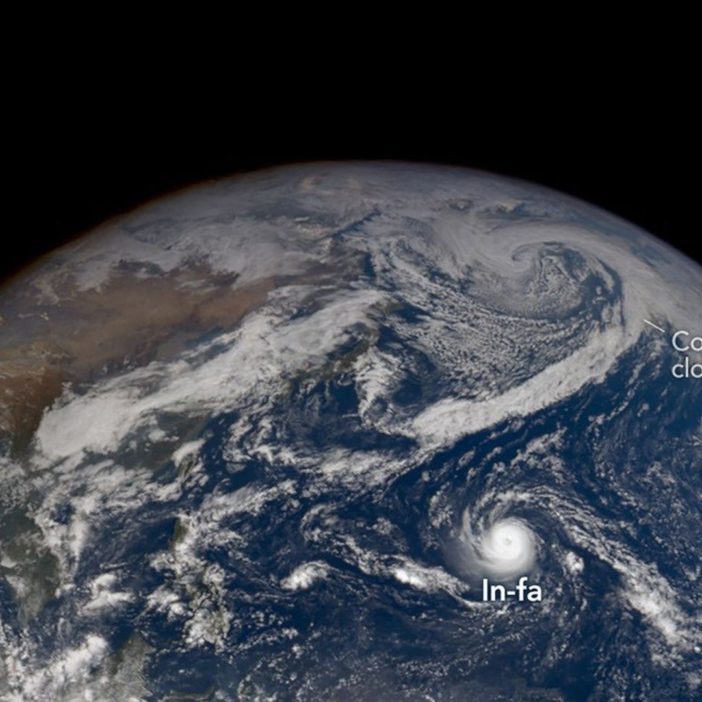
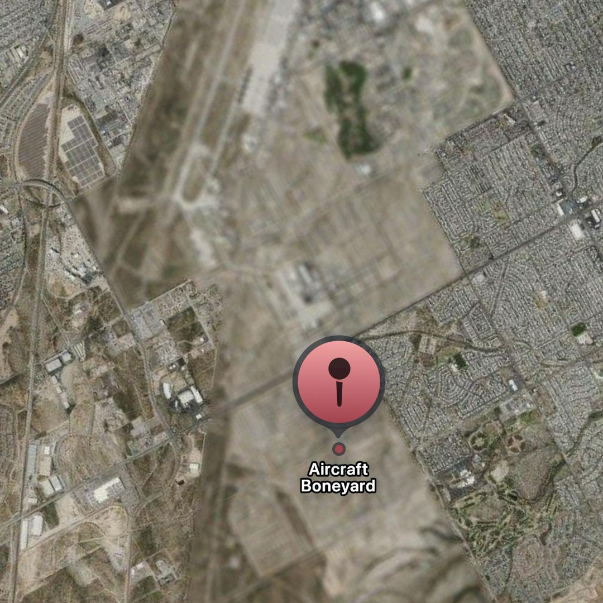
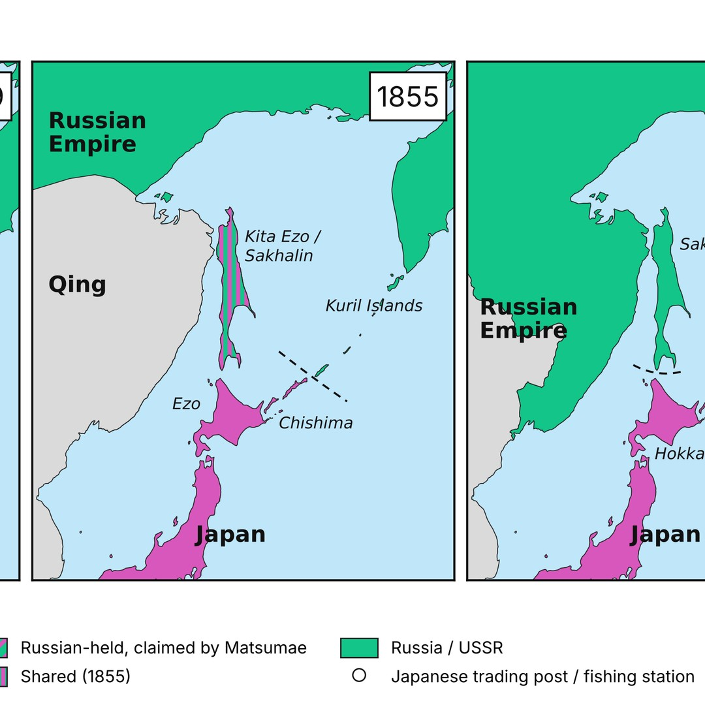
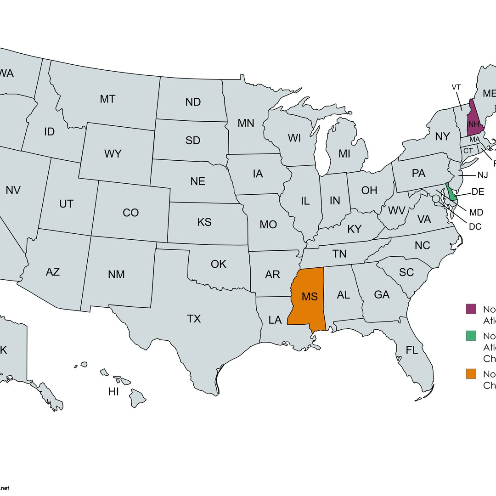
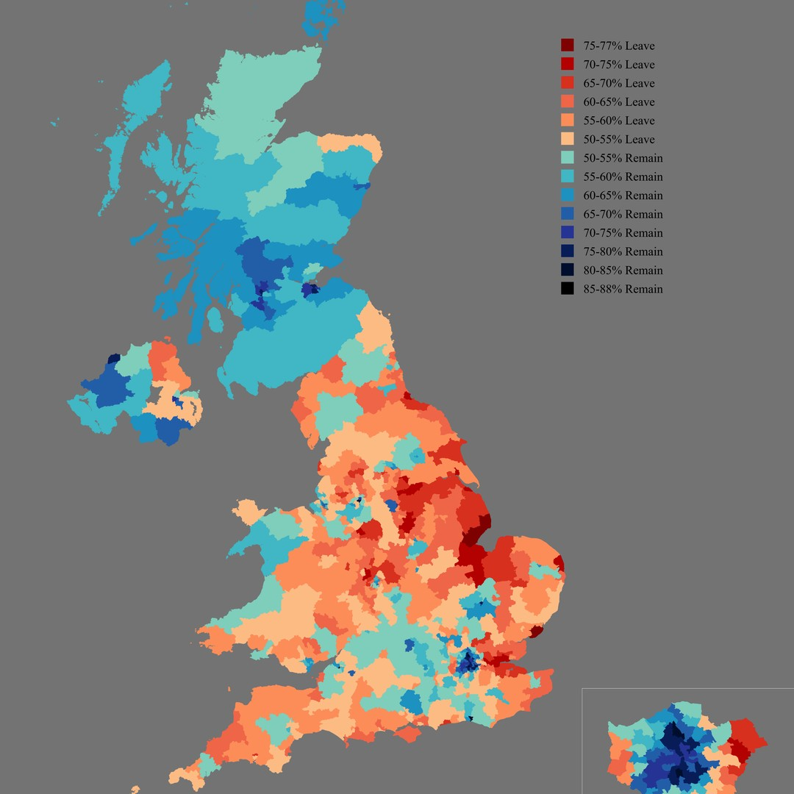
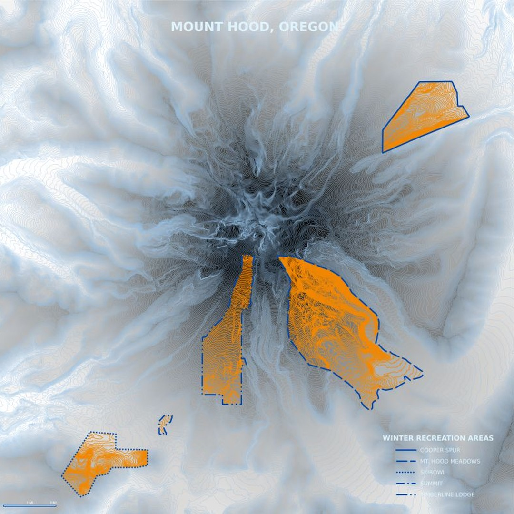

# Geoawesome reposts, 2026-11-03

6 post(s) ready. Each has a 1080×1080 image and its own text for Facebook, Instagram, YouTube Community and X. Nothing has been posted.

**To publish:** tick the box under a post. It is queued for the next free time slot and posted to Facebook and Instagram; a comment here confirms the time. Edit a text in this issue first if you want to change it (what is in the box is what gets posted). Untick before the slot to cancel. When it is live, a comment @mentions you with the YouTube Community text and the X text for Buffer.

---

## 1. The Pacific’s Busy Storm Season

<!-- post:2026-11-03-1-the-pacific-s-busy-storm-season -->
- [ ] **Publish on Facebook + Instagram**



[Download square image](https://raw.githubusercontent.com/walczakagh/geoawesome-social-agent/main/drafts/images/2026-11-03-1-the-pacific-s-busy-storm-season.jpg) · square crop, from 942px of source width

**Source:** [NASA Earth Observatory](https://science.nasa.gov/earth/earth-observatory/the-pacifics-busy-storm-season/) · score 8.0/10 · Earth Observatory image of typhoon eye and Alaska storm; strong satellite scene, editor favourite site.
**Rights:** Publisher allows reuse with credit. Licence on page: not stated.

**What it shows:** A view of the North Pacific captured by the EPIC (Earth Polychromatic Imaging Camera) on the DSCOVR satellite on 29 October 2026. It shows Super Typhoon In-fa churning near the Mariana Islands and the remnants of Typhoon Champi, which had become an extratropical storm, approaching Alaska amid a parade of storms in the Bering Sea. The article also includes a Terra MODIS image of In-fa from 30 October showing its nearly circular shape and large eye, traits of an annular storm.

**Check before posting:**
- The page has two images (DSCOVR EPIC, 29 October, and Terra MODIS, 30 October). The IMAGE NOTE does not say which one the square was cropped from. The captions assume the lead EPIC image, so check before posting.
- Image licence not stated on page. The page credit line reads 'NASA Earth Observatory images by Michala Garrison, using data from DSCOVR EPIC and MODIS data from NASA EOSDIS LANCE and GIBS/Worldview'. Consider whether to name Michala Garrison.
- The 4 percent annular-storm figure comes from 'one analysis', and the captions keep that hedge.
- Alaska impacts (high winds, heavy rain and snowfall) are 'according to news reports'. They are left out of the captions.
- El Niño is described only as a 'likely contributor'. It is left out of the captions.
- Colour rendering (natural colour or otherwise) is not stated explicitly.
- The 1080x1080 square crop from 942px of source width may not include both storms. Check that In-fa and Champi's remnants are both visible.

**Facebook**

```text
Two Pacific storms in one view of Earth: Super Typhoon In-fa near the Mariana Islands and the remnants of Typhoon Champi heading for Alaska.

The EPIC camera on DSCOVR captured this on 29 October 2026, after Champi had undergone extratropical transition. University of Alaska Fairbanks climatologist Rick Thoman counts it as the fourth ex-typhoon to enter Alaskan waters this year. The strong El Niño autumns of 1997 and 2015 had three each.

Read more: https://science.nasa.gov/earth/earth-observatory/the-pacifics-busy-storm-season/

Image: NASA Earth Observatory

#Geoawesome #Typhoon #Alaska #DSCOVR
```

**Instagram**

```text
In-fa was the fifth typhoon to affect the Mariana Islands in 2026.

Here it churns near the islands on 29 October, seen by DSCOVR's EPIC camera, while Champi's remnants, now an extratropical storm, close in on Alaska.

Find out more: https://science.nasa.gov/earth/earth-observatory/the-pacifics-busy-storm-season/

Image: NASA Earth Observatory

#Geoawesome #Typhoon #Pacific #EPIC
```

**YouTube Community**

```text
Annular storms make up about 4 percent of western North Pacific tropical cyclones, according to one analysis, and In-fa had the traits of one.

DSCOVR's EPIC camera caught it near the Mariana Islands on 29 October 2026, while Champi's remnants, transformed into a typically cold-core extratropical storm, approached Alaska. Terra MODIS imaged In-fa's large eye the next day.

Learn more: https://science.nasa.gov/earth/earth-observatory/the-pacifics-busy-storm-season/

Image: NASA Earth Observatory

#Geoawesome #DSCOVR #MODIS #Typhoon
```

**X (via Buffer)**

```text
Champi peaked at nearly 300 km/h sustained winds, then turned extratropical and headed for Alaska. DSCOVR EPIC, 29 Oct 2026, with Super Typhoon In-fa near the Marianas.
https://science.nasa.gov/earth/earth-observatory/the-pacifics-busy-storm-season/
Image: NASA Earth Observatory
#Geoawesome #Typhoon #Alaska
```

**Alt text:** Satellite view of the North Pacific with a tightly wound typhoon near the Mariana Islands and large swirling cloud bands of another storm system near Alaska and the Bering Sea.

---

## 2. Apple Maps has blurred out the entire aircraft boneyard at Davis-Monthan Air Force Base in Tucson, Arizona. The surrounding city remains perfectly clear.

<!-- post:2026-11-03-3-apple-maps-has-blurred-out-the-entire-ai -->
- [ ] **Publish on Facebook + Instagram**



[Download square image](https://raw.githubusercontent.com/walczakagh/geoawesome-social-agent/main/drafts/images/2026-11-03-3-apple-maps-has-blurred-out-the-entire-ai.jpg) · square crop, from 1320px of source width

**Source:** [Reddit r/MapPorn](https://www.reddit.com/r/MapPorn/comments/1xm98zy/apple_maps_has_blurred_out_the_entire_aircraft/) · score 7.0/10 · Apple Maps blurred boneyard amid clear city; a striking map quirk readers will click.
**Rights:** Someone else's map: the credit line names them; ask them first if unsure. Licence on page: not stated.

**What it shows:** A map shared on r/MapPorn by u/UngratefulChinaman showing that Apple Maps has blurred out the entire aircraft boneyard at Davis-Monthan Air Force Base in Tucson, Arizona, while the surrounding city remains clear. The post title is the only description.

**Check before posting:**
- The data source of the map is not stated; it is presumably an Apple Maps screenshot, but the post gives no other text.
- No date is given for when the screenshot was taken, so it is unclear whether the blur is still current in Apple Maps.
- It is not stated whether the view is the satellite or aerial imagery layer, or at what zoom level.
- The reason for the blur is not given; do not attribute it to the military, Apple or any regulation.
- The claim comes from a single Reddit user and has not been independently checked; worth opening Apple Maps to confirm before posting.
- Reuse policy is link_only and the image licence is not stated: confirm the image may be reposted, or seek permission from the poster, before publishing the square.

**Facebook**

```text
In Apple Maps, the aircraft boneyard at Davis-Monthan Air Force Base in Tucson, Arizona, has been blurred out in its entirety.

According to this post on r/MapPorn, the surrounding city stays perfectly clear, so the obscured base stands out as one soft patch in otherwise sharp imagery. The post gives no date and no reason for the blur, but it is a useful reminder that commercial basemap imagery can be edited before it reaches you.

Read more: https://www.reddit.com/r/MapPorn/comments/1xm98zy/apple_maps_has_blurred_out_the_entire_aircraft/

Map: u/UngratefulChinaman via r/MapPorn

#Geoawesome #Maps #Imagery #Tucson
```

**Instagram**

```text
A whole aircraft boneyard, reduced to a blur.

Apple Maps obscures the boneyard at Davis-Monthan Air Force Base in Tucson, while the city around it stays crisp.

Find out more: https://www.reddit.com/r/MapPorn/comments/1xm98zy/apple_maps_has_blurred_out_the_entire_aircraft/

Map: u/UngratefulChinaman via r/MapPorn

#Geoawesome #Aviation #Tucson #Arizona
```

**YouTube Community**

```text
Apple Maps blurs one part of Tucson, Arizona, and leaves the rest of the city perfectly clear.

A Reddit user reports that the entire aircraft boneyard at Davis-Monthan Air Force Base has been blurred out in Apple Maps. The post does not say when the screenshot was taken, which imagery layer it comes from or whether other providers treat the site the same way. Treat it as a single observation worth checking yourself.

Learn more: https://www.reddit.com/r/MapPorn/comments/1xm98zy/apple_maps_has_blurred_out_the_entire_aircraft/

Map: u/UngratefulChinaman via r/MapPorn

#Geoawesome #Imagery #Aircraft #Arizona
```

**X (via Buffer)**

```text
Sharp city, blurred boneyard: Apple Maps hides the aircraft storage area at Davis-Monthan Air Force Base, Tucson, according to a Reddit post.
https://www.reddit.com/r/MapPorn/comments/1xm98zy/apple_maps_has_blurred_out_the_entire_aircraft/
Map: u/UngratefulChinaman via r/MapPorn
#Geoawesome #Maps #Aviation
```

**Alt text:** Apple Maps imagery of Tucson, Arizona, in which the aircraft boneyard at Davis-Monthan Air Force Base is blurred out while the surrounding city is shown clearly.

---

## 3. The Evolution of the Japanese-Russo North Border (1700-1945)

<!-- post:2026-11-03-4-the-evolution-of-the-japanese-russo-nort -->
- [ ] **Publish on Facebook + Instagram**



[Download square image](https://raw.githubusercontent.com/walczakagh/geoawesome-social-agent/main/drafts/images/2026-11-03-4-the-evolution-of-the-japanese-russo-nort.jpg) · square crop, from 1540px of source width

**Source:** [Reddit r/MapPorn](https://www.reddit.com/r/MapPorn/comments/1xmapac/the_evolution_of_the_japaneserusso_north_border/) · score 7.0/10 · Historical border evolution map 1700-1945 with a clear hook and cartographic appeal.
**Rights:** Someone else's map: the credit line names them; ask them first if unsure. Licence on page: not stated.

**What it shows:** A historical map posted to r/MapPorn by u/forestkane showing how the northern border between Japan and Russia evolved from 1700 to 1945. The post title is the only description: no data sources, base map, method or legend explanation is given.

**Check before posting:**
- The data source of the map is not stated.
- No sources, method or explanation of colours and lines are given; border positions and dates should be checked against historical references before posting.
- Specific territories, islands and treaties shown on the map are not named in the source, so the captions do not name them.
- Reuse policy is link_only and the image licence is not stated. Check whether the image may be reposted, or ask u/forestkane for permission.
- The square crop comes from 1540px of the source width, so parts of the map, legend or timeline panels may be cut off. Check that the crop still reads correctly.

**Facebook**

```text
245 years of a moving frontier: this map traces the northern border between Japan and Russia from 1700 to 1945.

Posted to r/MapPorn by u/forestkane, it charts how the line between the two neighbours shifted over nearly two and a half centuries. The post names no data sources or method, so treat it as a visual overview rather than a reference.

Read more: https://www.reddit.com/r/MapPorn/comments/1xmapac/the_evolution_of_the_japaneserusso_north_border/

Map: u/forestkane via r/MapPorn

#Geoawesome #Cartography #Japan #Russia #History
```

**Instagram**

```text
A border that would not sit still, 1700 to 1945.

The shifting northern frontier between Japan and Russia, mapped by u/forestkane on r/MapPorn.

Find out more: https://www.reddit.com/r/MapPorn/comments/1xmapac/the_evolution_of_the_japaneserusso_north_border/

Map: u/forestkane via r/MapPorn

#Geoawesome #Borders #Japan #History
```

**YouTube Community**

```text
From 1700 to 1945, the line where Japan's north met Russia did not stay put.

This r/MapPorn post by u/forestkane maps the evolution of that border across the period. The title is the only description: no data sources, base map or method are given, so cross-check dates and line positions against historical atlases before citing it.

Learn more: https://www.reddit.com/r/MapPorn/comments/1xmapac/the_evolution_of_the_japaneserusso_north_border/

Map: u/forestkane via r/MapPorn

#Geoawesome #Cartography #Borders #Russia #Maps
```

**X (via Buffer)**

```text
How did the northern Japan-Russia border change between 1700 and 1945? Nearly 250 years of frontier history in one map.
https://www.reddit.com/r/MapPorn/comments/1xmapac/the_evolution_of_the_japaneserusso_north_border/
Map: u/forestkane via r/MapPorn
#Geoawesome #Borders #Japan #History
```

**Alt text:** A historical map showing how the northern border between Japan and Russia changed between 1700 and 1945.

---

## 4. No US airport have flights to all 50 states

<!-- post:2026-11-03-6-no-us-airport-have-flights-to-all-50-sta -->
- [ ] **Publish on Facebook + Instagram**



[Download square image](https://raw.githubusercontent.com/walczakagh/geoawesome-social-agent/main/drafts/images/2026-11-03-6-no-us-airport-have-flights-to-all-50-sta.jpg) · square crop, from 3500px of source width

**Source:** [Reddit r/MapPorn](https://www.reddit.com/r/MapPorn/comments/1xmfdvx/no_us_airport_have_flights_to_all_50_states/) · score 6.0/10 · Map of US airports reaching all 50 states; clear geo insight, simple and shareable.
**Rights:** Someone else's map: the credit line names them; ask them first if unsure. Licence on page: not stated.

**What it shows:** A map posted by u/Weekly_Sort147 on r/MapPorn titled 'No US airport have flights to all 50 states'. The title is the only description: it claims that no single US airport has flights to every one of the 50 states. No data source, date, flight definition or colour key is given in the post text.

**Check before posting:**
- The data source of the map is not stated.
- No date or schedule period is given, so it is unclear when the claim applies.
- The title does not say whether 'flights' means nonstop or direct flights only, or which carriers are counted.
- What the colours or symbols on the map mean is not described in the post.
- Reuse policy is 'link_only' and no image licence is stated. Check with the creator before posting the image itself.
- The caption claim rests on a single Reddit user's map and has not been independently verified.

**Facebook**

```text
Not a single US airport has flights to all 50 states, according to this map.

Shared on r/MapPorn, the map sets out to show that every US airport falls short of the full 50-state set, the biggest hubs included. The creator gives no data source or schedule date, so treat it as a snapshot worth checking rather than a reference.

Read more: https://www.reddit.com/r/MapPorn/comments/1xmfdvx/no_us_airport_have_flights_to_all_50_states/

Map: u/Weekly_Sort147 via r/MapPorn

#Geoawesome #Flights #Aviation #Airports
```

**Instagram**

```text
Fifty states, zero airports that reach them all.

This r/MapPorn map claims every US airport misses at least one state from its flight network.

Learn more: https://www.reddit.com/r/MapPorn/comments/1xmfdvx/no_us_airport_have_flights_to_all_50_states/

Map: u/Weekly_Sort147 via r/MapPorn

#Geoawesome #Maps #Airports #USA
```

**YouTube Community**

```text
Pick any US airport and, according to this map, at least one state is missing from its destinations.

The creator does not say which schedules or year the map is built on, or whether only nonstop flights are counted. Still, it frames airline route coverage as a geographic question, and it is a good prompt to check the underlying data yourself.

Full story: https://www.reddit.com/r/MapPorn/comments/1xmfdvx/no_us_airport_have_flights_to_all_50_states/

Map: u/Weekly_Sort147 via r/MapPorn

#Geoawesome #Cartography #Aviation #Airports #USA
```

**X (via Buffer)**

```text
Even the biggest US hubs miss at least one state, says this r/MapPorn map. Data source not stated.
https://www.reddit.com/r/MapPorn/comments/1xmfdvx/no_us_airport_have_flights_to_all_50_states/
Map: u/Weekly_Sort147 via r/MapPorn
#Geoawesome #Maps #Aviation #Airports
```

**Alt text:** A map of the United States about US airports and the states they have flights to.

---

## 5. Results of the 2016 Brexit Referendum by constituency (OC)

<!-- post:2026-11-03-7-results-of-the-2016-brexit-referendum-by -->
- [ ] **Publish on Facebook + Instagram**



[Download square image](https://raw.githubusercontent.com/walczakagh/geoawesome-social-agent/main/drafts/images/2026-11-03-7-results-of-the-2016-brexit-referendum-by.jpg) · square crop, from 5100px of source width

**Source:** [Reddit r/MapPorn](https://www.reddit.com/r/MapPorn/comments/1xm5e59/results_of_the_2016_brexit_referendum_by/) · score 6.0/10 · Constituency-level Brexit referendum map; detailed geo visual, though a familiar political subject.
**Rights:** Someone else's map: the credit line names them; ask them first if unsure. Licence on page: not stated.

**What it shows:** An original (OC) map posted to r/MapPorn by u/That_Band_7598 showing the results of the 2016 Brexit Referendum broken down by constituency. The post title is the only description: no data source, colour key or method is given. The source image is about 5,100 pixels wide.

**Check before posting:**
- The data source of the map is not stated.
- The colour scheme and legend are not described. Check the image before captioning colours.
- The method behind the constituency figures is not given. Check the thread for how the figures were produced. If they turn out to be modelled estimates rather than declared counts, say so in the caption.
- Reuse policy is 'link_only' and no image licence is stated on the page. Confirm with the creator or editor that posting the image itself (not just a link) is allowed.
- Election maps can attract political comment threads. The title itself is neutral, but moderate replies accordingly.

**Facebook**

```text
The 2016 Brexit vote, redrawn one constituency at a time.

This original map by Reddit user That_Band_7598 breaks the referendum result down to constituency level, and the source file is roughly 5,100 pixels wide, so the detail holds up when you zoom in. The post comes with no text beyond its title, so there is no stated data source or legend explanation: the thread is the place to ask.

Find out more: https://www.reddit.com/r/MapPorn/comments/1xm5e59/results_of_the_2016_brexit_referendum_by/

Map: u/That_Band_7598 via r/MapPorn

#Brexit #Cartography #Elections #Geoawesome
```

**Instagram**

```text
Every constituency, one referendum.

An original map of the 2016 Brexit Referendum results, broken down constituency by constituency.

Learn more: https://www.reddit.com/r/MapPorn/comments/1xm5e59/results_of_the_2016_brexit_referendum_by/

Map: u/That_Band_7598 via r/MapPorn

#Brexit #Maps #Dataviz #Geoawesome
```

**YouTube Community**

```text
Mapping a single national vote at constituency scale changes how the result reads.

This map of the 2016 Brexit Referendum was posted to r/MapPorn as original content with no accompanying text, so the data source, method and colour scale are not given. For anyone thinking of reusing it or comparing it with other boundary sets, the comment thread is worth checking first for how the constituency figures were produced.

Read more: https://www.reddit.com/r/MapPorn/comments/1xm5e59/results_of_the_2016_brexit_referendum_by/

Map: u/That_Band_7598 via r/MapPorn

#Brexit #Choropleth #Cartography #Elections #Geoawesome
```

**X (via Buffer)**

```text
The 2016 Brexit Referendum, mapped by constituency. Original work shared on r/MapPorn.
https://www.reddit.com/r/MapPorn/comments/1xm5e59/results_of_the_2016_brexit_referendum_by/
Map: u/That_Band_7598 via r/MapPorn
#Brexit #Maps #Elections #Geoawesome
```

**Alt text:** A map of the United Kingdom divided into constituencies, each shaded to show the result of the 2016 Brexit Referendum.

---

## 6. Sophia Meyers - 30daymapchallenge #teammusa - LinkedIn

<!-- post:2026-11-03-9-sophia-meyers-30daymapchallenge-teammusa -->
- [ ] **Publish on Facebook + Instagram**



[Download square image](https://raw.githubusercontent.com/walczakagh/geoawesome-social-agent/main/drafts/images/2026-11-03-9-sophia-meyers-30daymapchallenge-teammusa.jpg) · square crop, from 792px of source width

**Source:** [Google Alerts #5](https://www.linkedin.com/posts/sophiameyers04_30daymapchallenge-teammusa-activity-7523065017483689984-x_CB) · score 5.0/10 · 30DayMapChallenge contour map of Mount Hood recreation areas using USGS 3DEP data.
**Rights:** Someone else's map: the credit line names them; ask them first if unsure. Licence on page: not stated.

**What it shows:** A contour line map of the Mount Hood recreation areas, made by Sophia Meyers for Day 2 ('Lines') of the 30DayMapChallenge. She generated the contours in Python from USGS 3DEP products and cleaned up the final map in Adobe Illustrator. The post gives no contour interval, data resolution, specific 3DEP product or colour scheme.

**Check before posting:**
- Reuse policy is link_only and no image licence is stated. Get Sophia Meyers' permission before posting her map as a square image.
- The page gives no image credit. The credit 'Map: Sophia Meyers via LinkedIn' comes from the author named in the post title, so confirm how she wants to be credited.
- The post does not say which 3DEP product (for example which DEM resolution), the contour interval or the date of the elevation data.
- The page text does not describe the image's colours or styling. Check the square crop (from 792px of source width) keeps the contours legible.
- The meaning of #teamMUSA is not explained in the post, so it is left out.
- The post's location is not given beyond 'Mount Hood recreation areas', so no state or region is named in the captions.

**Facebook**

```text
Day 2 of the 30DayMapChallenge was 'Lines', and Sophia Meyers took hers straight from the terrain of Mount Hood.

The map traces contour lines across the Mount Hood recreation areas, generated in Python from USGS 3DEP products and then cleaned up in Adobe Illustrator. It is a tidy example of a code-then-design workflow, and in her words a way to bring a piece of home into the challenge.

Full story: https://www.linkedin.com/posts/sophiameyers04_30daymapchallenge-teammusa-activity-7523065017483689984-x_CB

Map: Sophia Meyers via LinkedIn

#Cartography #Contours #Python #USGS #Geoawesome
```

**Instagram**

```text
Mount Hood, drawn in nothing but contour lines.

Sophia Meyers made this 'Lines' entry for the 30DayMapChallenge from USGS 3DEP data, scripted in Python and finished in Illustrator.

Read more: https://www.linkedin.com/posts/sophiameyers04_30daymapchallenge-teammusa-activity-7523065017483689984-x_CB

Map: Sophia Meyers via LinkedIn

#Contours #Topography #Maps #Geoawesome
```

**YouTube Community**

```text
USGS elevation products, a Python script and a final pass in Adobe Illustrator: that is the recipe behind this contour map of Mount Hood.

Sophia Meyers produced it for Day 2 (Lines) of the 30DayMapChallenge, deriving contour lines for the Mount Hood recreation areas from USGS 3DEP products. Her post does not give the contour interval or source resolution, but the split between scripted generation and manual design clean-up is a workflow many cartographers will recognise.

Learn more: https://www.linkedin.com/posts/sophiameyers04_30daymapchallenge-teammusa-activity-7523065017483689984-x_CB

Map: Sophia Meyers via LinkedIn

#Elevation #Contours #Python #Cartography #Geoawesome
```

**X (via Buffer)**

```text
30DayMapChallenge, Day 2 'Lines': the Mount Hood recreation areas as contours, built from USGS 3DEP data in Python.
https://www.linkedin.com/posts/sophiameyers04_30daymapchallenge-teammusa-activity-7523065017483689984-x_CB
Map: Sophia Meyers via LinkedIn
#Cartography #Topography #USGS #Geoawesome
```

**Alt text:** A contour line map of the Mount Hood recreation areas, with lines tracing the shape of the terrain.

---

### Skipped after reading the page
- [A satellite image shows the water level of the Kapuas River in Sanggau Regency](https://www.reutersconnect.com/item/a-satellite-image-shows-the-water-level-of-the-kapuas-river-in-sanggau-regency/dGFnOnJldXRlcnMuY29tLDIwMjY6bmV3c21sX1JDMjk0T0FPS0tCVw?lastViewed=dGFnOnJldXRlcnMuY29tLDIwMjY6bmV3c21sX1JDMjk0T0E4Qk0yRg&position=2): No image was found on the page and no credit or licence is given, so there is nothing to post; Reuters Connect is a licensed picture service and the reuse policy is link only.
- [What Was the Strongest Hurricane Ever Seen From Space ? - YouTube](https://www.youtube.com/shorts/uY1MjNmuMW4): The video is unavailable and the page gives no facts, image credit or licence (reuse policy is link-only), so there is nothing to caption without guessing.
- [3d point cloud visualization from drone photogrammetry - Facebook](https://www.facebook.com/juancarlosreal85/posts/30-day-gis-map-challenge-entry-pointpoint-cloud-visualization-in-gisa-point-clou/2701920766933238/): No image on the page, no credit or licence, and only a fragment of text from a personal Facebook challenge post, so nothing can be described without guessing.
- [This map shows the distribution of Native American ancestry across the Americas 🗺️ Rather ...](https://www.facebook.com/61558163713428/posts/this-map-shows-the-distribution-of-native-american-ancestry-across-the-americas-/122248929242272123/): No image was found on the page, there is no image credit, the licence is link-only, and the text is a truncated repost from an unidentified Facebook page with no data source for the ancestry map.
- [Tracking the Anf Rx Burn Fire in California | WFCA Fire Map](https://wfca.com/fire-map/california/anf_rx_burn): No image on the page and only one auto-generated line (a 0-acre prescribed burn listing), so there is no visual to post.
- [Allison Radmall - 30daymapchallenge - LinkedIn](https://www.linkedin.com/posts/allison-radmall-820122161_30daymapchallenge-activity-7523046495248400384-EM_N): The source's reuse policy is link_only, with no image licence or credit, so the image can't be reposted as a square. It is also a small municipal contest map whose content can only be described from a short LinkedIn post.
- [Thumbnail image for "Life of a Pixel" video | U.S. Geological Survey](https://www.usgs.gov/media/images/thumbnail-image-life-a-pixel-video): This is a promotional thumbnail for a USGS EROS video about Landsat pixels, not a map or Earth observation image, and the page gives no credit, licence, place, date or description of what the image shows.
- [Serbia's 2026 parliamentary election: municipalities, districts and regions](https://www.reddit.com/r/MapPorn/comments/1xm604i/serbias_2026_parliamentary_election/): No image was found on the page and the title is the only description, so the map could not be described without guessing.
- [Tracking fires in Allamakee, Iowa | WFCA Fire Map - Western Fire Chiefs Association](https://wfca.com/fire-map/detection/052d67ae94e147d0): No image on the page, only an automated stub for a 0.4-acre Landsat fire detection, so there is no striking visual to repost (and the reuse policy is link only).
- [Tracking fires in Albany, New York | WFCA Fire Map - Western Fire Chiefs Association](https://wfca.com/fire-map/detection/c111d41678314acd): No image on the page (link-only alert): an auto-generated VIIRS detection entry with no visual to repost.
- [Tracking fires in Polk, Oregon | WFCA Fire Map - Western Fire Chiefs Association](https://wfca.com/fire-map/detection/e2668c14f1bf4990): Auto-generated fire detection alert with no image on the page and almost no detail (no date range, fire size or explanation of 'SOF'), so there is no striking visual to post and nothing to explain without guessing.
- [Tracking fires in San Patricio, Texas | WFCA Fire Map - Western Fire Chiefs Association](https://wfca.com/fire-map/detection/74803966fb7d44a1): No image on the page and the reuse policy is link-only: this is an automated VIIRS detection stub (64.2 acres, 2 merged observations) with no striking visual to share.
- [[OC] Orientation of Metro Lines in Various World Cities](https://www.reddit.com/r/dataisbeautiful/comments/1xm2ilz/oc_orientation_of_metro_lines_in_various_world/): No image was found on the page and the reuse policy is link_only, so there is no visual to square up, and describing the map would mean guessing.

---

### Sources checked
- Google Alerts #1: 13 in feed, 1 new
- Google Alerts #2: 16 in feed, 1 new
- Google Alerts #3: 20 in feed, 6 new
- Google Alerts #4: 14 in feed, 6 new
- Google Alerts #5: 20 in feed, 6 new
- Google Alerts #6: 20 in feed, 5 new, 1 already found via another source
- Google Alerts #7: 18 in feed, 2 new
- Google Alerts #8: 6 in feed, 0 new
- NASA Earth Observatory: 10 in feed, 1 new
- ESA Observing the Earth: 15 in feed, 0 new
- EUMETSAT: 10 in feed, 0 new
- Copernicus Atmosphere Monitoring Service: 10 in feed, 0 new
- NASA JPL: 100 in feed, 0 new
- Planet Pulse: 50 in feed, 0 new
- Maps Mania: 25 in feed, 0 new
- Visual Capitalist (maps): 10 in feed, 0 new
- FlowingData: 10 in feed, 1 new
- Google Maps blog: 20 in feed, 0 new
- Google Research blog: 100 in feed, 0 new
- Overture Maps blog: 20 in feed, 0 new
- Bellingcat: 10 in feed, 0 new
- Reddit r/MapPorn: 25 in feed, 6 new
- Reddit r/dataisbeautiful: 25 in feed, 6 new
