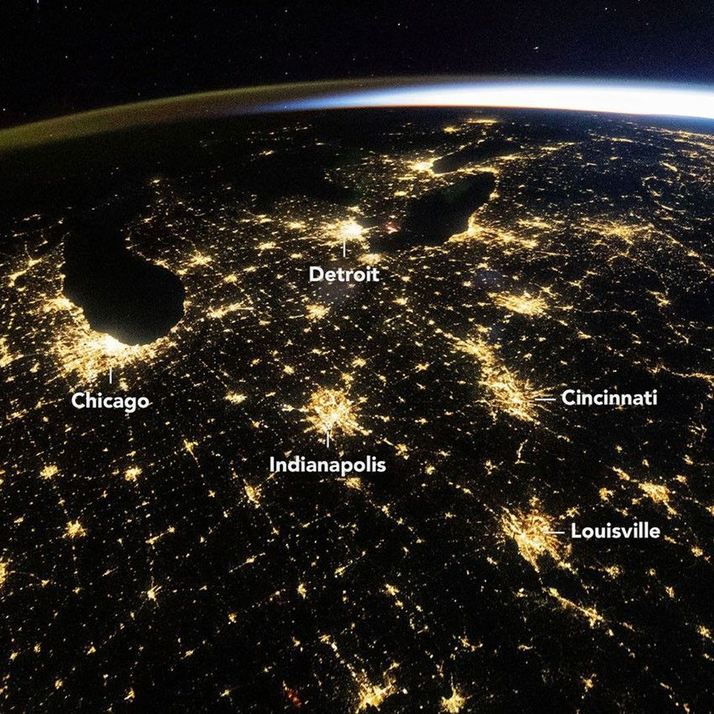
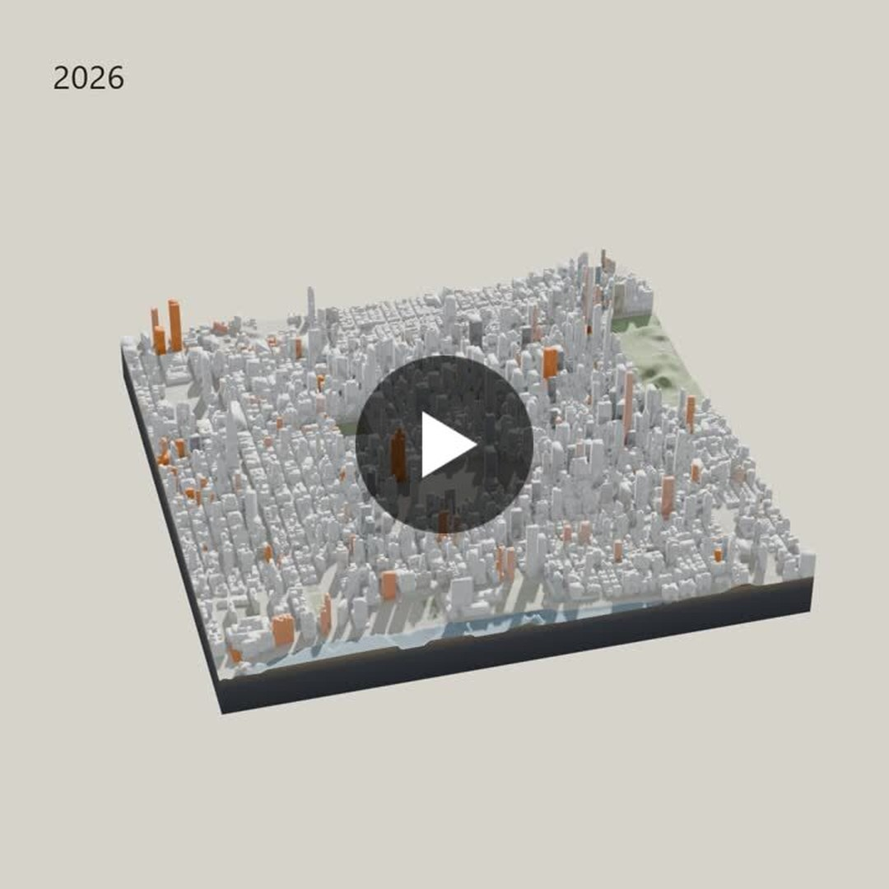
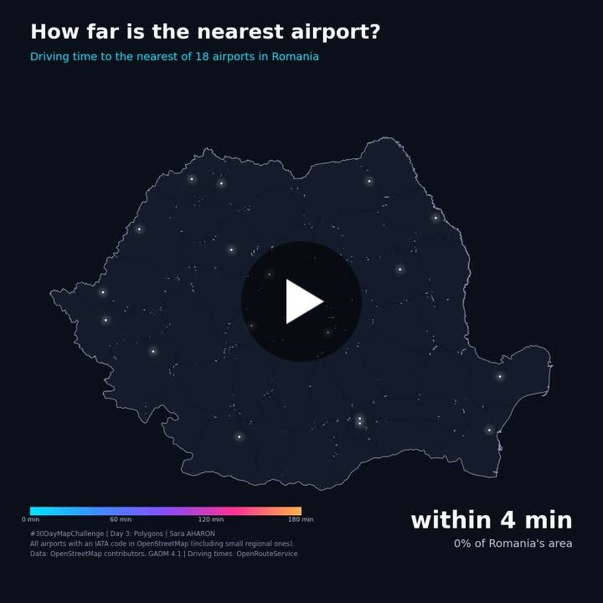
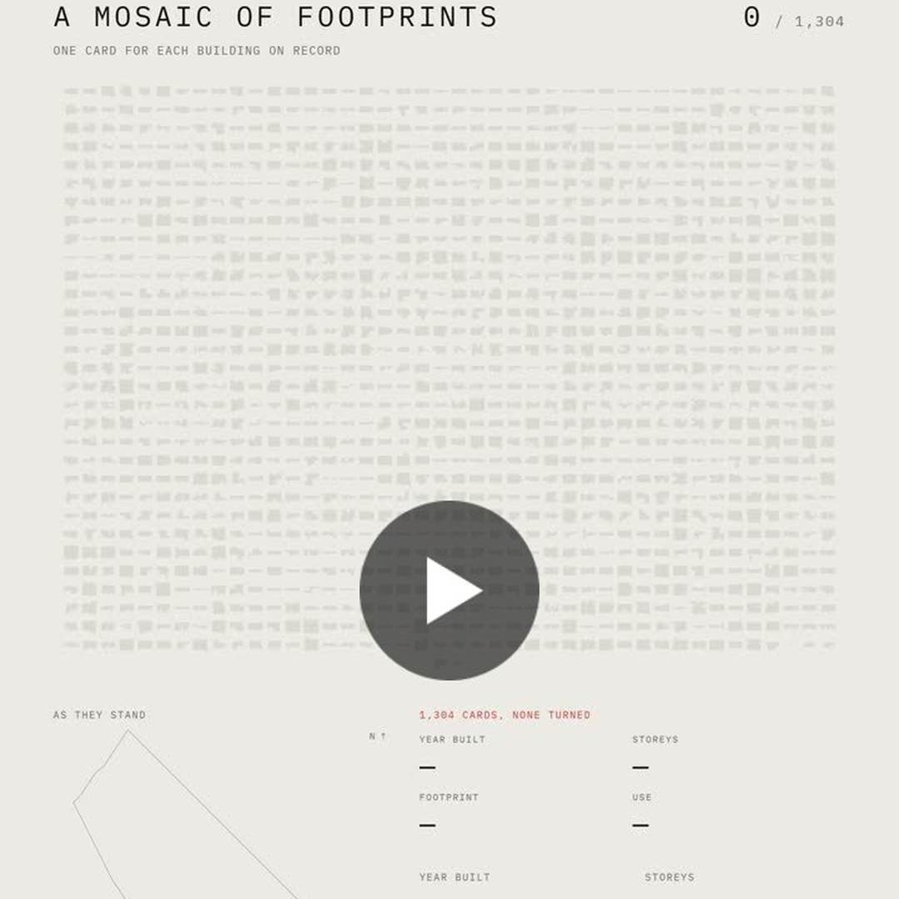
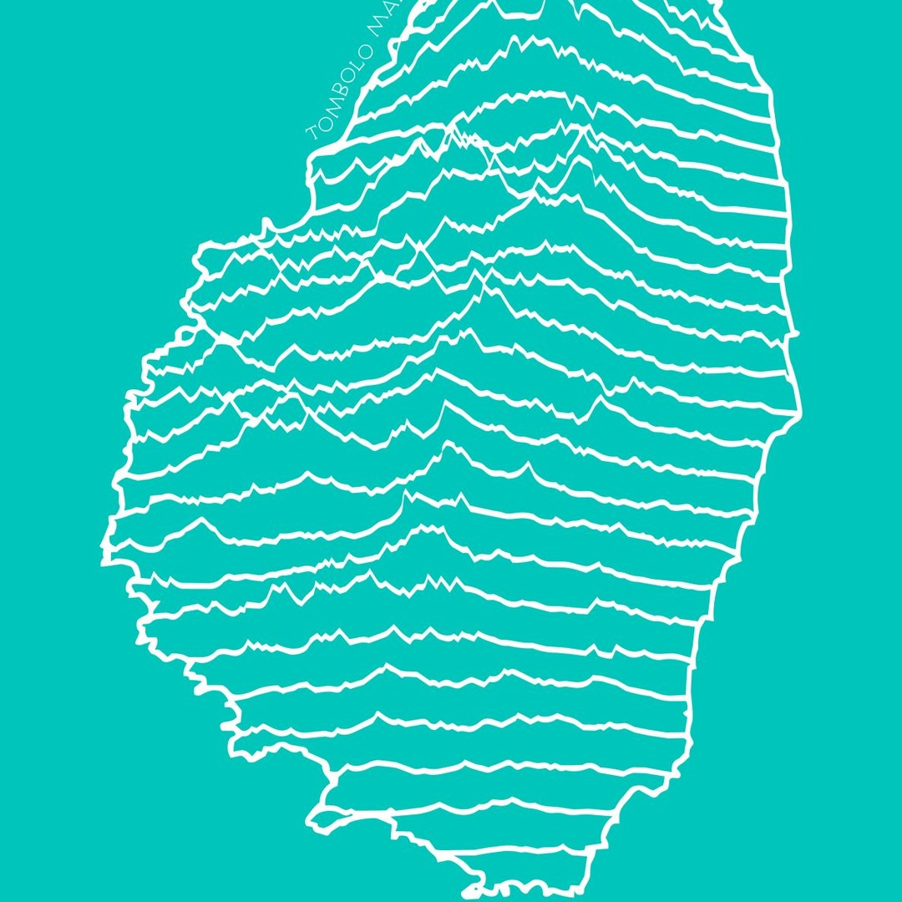

# Geoawesome reposts, 2026-11-04

5 post(s) ready. Each has a 1080×1080 image and its own text for Facebook, Instagram, YouTube Community and X. Nothing has been posted.

**To publish:** tick the box under a post. It is queued for the next free time slot and posted to Facebook and Instagram; a comment here confirms the time. Edit a text in this issue first if you want to change it (what is in the box is what gets posted). Untick before the slot to cancel. When it is live, a comment @mentions you with the YouTube Community text and the X text for Buffer.

---

## 1. Before the Dawn in America’s Heartland

<!-- post:2026-11-04-1-before-the-dawn-in-america-s-heartland -->
- [ ] **Publish on Facebook + Instagram**



[Download square image](https://raw.githubusercontent.com/walczakagh/geoawesome-social-agent/main/drafts/images/2026-11-04-1-before-the-dawn-in-america-s-heartland.jpg) · square crop, from 853px of source width

**Source:** [NASA Earth Observatory](https://science.nasa.gov/earth/earth-observatory/before-the-dawn-in-americas-heartland/) · score 8.0/10 · Astronaut photo of Midwest nighttime lights from orbit; strong Earth view with a striking visual.
**Rights:** Publisher allows reuse with credit. Licence on page: not stated.

**What it shows:** A wide-angle astronaut photograph (ISS075-E-226709) taken from the International Space Station at 4:54 a.m. CDT (09:54 UTC) on 18 October 2026 with a Nikon Z9 at 14 mm. It shows nighttime lights across the US Midwest under clear skies: Chicago and Detroit are the brightest features, and mid-sized cities such as Indianapolis, Cincinnati and Louisville are linked by lit highways. A green and orange band of airglow lies along the horizon to the left, and sunlight arcs across the horizon to the right. NASA cropped the image, enhanced its contrast and removed lens artefacts.

**Check before posting:**
- The page names no image credit. 'NASA Earth Observatory' is used as instructed. The page says the photos come from the ISS Crew Earth Observations Facility and the Earth Science and Remote Sensing Unit at NASA Johnson Space Center, which may be the better credit.
- The image licence is not stated on the page. Check NASA's reuse terms before posting.
- The square was cropped from only 853px of source width. Check that it still shows the airglow on the left horizon, the sunlight on the right, and the cities named in the captions (Chicago, Detroit, Indianapolis, Cincinnati, Louisville). If not, edit those mentions.
- The page has two photos: the wide 14 mm view from 2026 and a 400 mm Chicago detail from 1 March 2024. Confirm the square uses the wide view, which these captions describe.
- The image has been processed (cropped, contrast-enhanced, lens artefacts removed), so the colours are not raw.

**Facebook**

```text
Two hours before sunrise in Chicago, an astronaut on the International Space Station caught much of the US Midwest lit up under almost cloudless skies.

Taken at 09:54 UTC on 18 October 2026, the photo shows Chicago and Detroit as the brightest features, with Indianapolis, Cincinnati and Louisville tied together by glowing interstate corridors. Along the left horizon sits a green and orange band of airglow, while sunlight arcs in from the right.

Read more: https://science.nasa.gov/earth/earth-observatory/before-the-dawn-in-americas-heartland/

Image: NASA Earth Observatory

#ISS #Midwest #Airglow #Geoawesome
```

**Instagram**

```text
The Midwest at 4:54 a.m., seen from orbit.

Chicago and Detroit burn brightest, and highways thread the smaller cities into one web of light beneath a faint green and orange glow in the upper atmosphere.

Find out more: https://science.nasa.gov/earth/earth-observatory/before-the-dawn-in-americas-heartland/

Image: NASA Earth Observatory

#Astronaut #Cities #Airglow #Geoawesome
```

**YouTube Community**

```text
One 14 mm frame from the ISS takes in night lights from Chicago to Louisville.

An Expedition 75 crew member shot ISS075-E-226709 with a Nikon Z9 on 18 October 2026. At this scale Chicago reads as a uniform pale yellow. In detailed night photos, though, researchers using NASA's astronaut photography archive can tell lighting types apart within individual pixels, which helps them track how cities grow.

Learn more: https://science.nasa.gov/earth/earth-observatory/before-the-dawn-in-americas-heartland/

Image: NASA Earth Observatory

#ISS #Urban #Lighting #Geoawesome
```

**X (via Buffer)**

```text
Clear predawn skies gave an ISS astronaut the whole Midwest in one shot, Chicago to Louisville, with airglow on the horizon.
https://science.nasa.gov/earth/earth-observatory/before-the-dawn-in-americas-heartland/
Image: NASA Earth Observatory
#ISS #Chicago #Nighttime #Geoawesome
```

**Alt text:** Night-time photograph of the US Midwest taken from the International Space Station, showing yellow clusters of city lights joined by bright lines of highways across a dark landscape.

---

## 2. # 30daymapchallenge | Amir Zelman - LinkedIn

<!-- post:2026-11-04-9-30daymapchallenge-amir-zelman-linkedin -->
- [ ] **Publish on Facebook + Instagram**



[Download square image](https://raw.githubusercontent.com/walczakagh/geoawesome-social-agent/main/drafts/images/2026-11-04-9-30daymapchallenge-amir-zelman-linkedin.jpg) · square crop, from 720px of source width

**Source:** [Google Alerts #5](https://www.linkedin.com/posts/amir-zelman_30daymapchallenge-activity-7523464931027910657-D6qN) · score 6.0/10 · 30DayMapChallenge 3D Blender render of NYC buildings; striking visual, though no image in feed.
**Rights:** Someone else's map: the credit line names them; ask them first if unsure. Licence on page: not stated.

**What it shows:** A 3D animation by Amir Zelman, made for Day 3 (Polygons) of the 30 Day Map Challenge, showing Midtown Manhattan building itself from 1850 to today: every building still standing rises in the year it went up. It was built with Geodesic by SeerAI, which combined Overture Maps Foundation buildings with NYC's building records, and rendered in Blender. The post is a still taken from that animation.

**Check before posting:**
- The source's reuse policy is link_only and the page states no image licence. Get permission from Amir Zelman before reposting the image.
- The page gives no image credit. 'Map: Amir Zelman via LinkedIn' is based on the post author and should be confirmed.
- The source is an animation, but the square is a still crop, so we do not know which year or frame it shows.
- Any colour scheme or legend in the render is not explained in the post.
- The post does not say how building heights were derived or what date 'today' refers to in the data.
- Only buildings still standing are included, so demolished buildings are absent. The captions mention this.
- The comment on the page is from a third party and adds no verified facts. It was not used.

**Facebook**

```text
From 1850 to today, Midtown Manhattan builds itself polygon by polygon.

Amir Zelman's Day 3 entry for the 30 Day Map Challenge raises every standing building in the year it went up, joining Overture Maps Foundation buildings with NYC building records. Demolished buildings never appear, so this is the age of today's Midtown, not its full history.

Read more: https://www.linkedin.com/posts/amir-zelman_30daymapchallenge-activity-7523464931027910657-D6qN

Map: Amir Zelman via LinkedIn

#Geoawesome #Manhattan #Buildings #Polygons
```

**Instagram**

```text
Watch Midtown's skyline assemble itself, one construction year at a time.

Every building still standing in Midtown Manhattan rises in the year it went up, from 1850 to today, rendered in Blender.

Learn more: https://www.linkedin.com/posts/amir-zelman_30daymapchallenge-activity-7523464931027910657-D6qN

Map: Amir Zelman via LinkedIn

#Geoawesome #Manhattan #Blender #NYC
```

**YouTube Community**

```text
Two datasets, one join: Overture Maps Foundation buildings meet NYC's building records.

Amir Zelman combined them in Geodesic by SeerAI, then rendered Midtown Manhattan in Blender so each standing building rises in its year of construction, 1850 to today. It was his Day 3 (Polygons) entry for the 30 Day Map Challenge. Only surviving buildings are included, so lost structures leave no trace.

Full story: https://www.linkedin.com/posts/amir-zelman_30daymapchallenge-activity-7523464931027910657-D6qN

Map: Amir Zelman via LinkedIn

#Geoawesome #Overture #Blender #Cartography
```

**X (via Buffer)**

```text
Midtown Manhattan's skyline, built up year by year from 1850, using only buildings that still stand.
Overture + NYC building records, rendered in Blender.
https://www.linkedin.com/posts/amir-zelman_30daymapchallenge-activity-7523464931027910657-D6qN
Map: Amir Zelman via LinkedIn
#Geoawesome #Manhattan #Overture #Buildings
```

**Alt text:** A 3D render of Midtown Manhattan's buildings, taken from an animation in which each building rises in the year it was constructed.

---

## 3. Polygons How far is the nearest airport in Romania? Each colored zone shows the driving ...

<!-- post:2026-11-04-17-polygons-how-far-is-the-nearest-airport -->
- [ ] **Publish on Facebook + Instagram**



[Download square image](https://raw.githubusercontent.com/walczakagh/geoawesome-social-agent/main/drafts/images/2026-11-04-17-polygons-how-far-is-the-nearest-airport.jpg) · square crop, from 720px of source width

**Source:** [Google Alerts #5](https://www.linkedin.com/posts/saraaharon_day-3-of-30daymapchallenge-polygons-how-activity-7523328815465508864-ynhj) · score 5.0/10 · Drive-time polygon map of Romanian airport access; clear geo insight, no image attached.
**Rights:** Someone else's map: the credit line names them; ask them first if unsure. Licence on page: not stated.

**What it shows:** A map of Romania divided into coloured polygons showing driving time, from 0 to 3 hours, to the closest of 18 airports. Airports are all those with an IATA code in OpenStreetMap, including small regional ones, and driving times come from OpenRouteService. About 97% of the country is within 3 hours of an airport, with the mountains as the exception. Made in Python (GeoPandas + Matplotlib) for Day 3 (Polygons) of the 30DayMapChallenge.

**Check before posting:**
- Reuse policy is link_only and no image licence is stated: get the maker's permission before reposting the map image.
- No image credit on the page. The credit uses the maker's site (saraaharon.github.io) because the LinkedIn page gives no full name. Confirm the name and preferred credit with the maker.
- The colour scale for the 0 to 3 hour zones is not described beyond that range.
- It is not stated whether the 97% figure is by land area or by population.
- The source does not give the OpenStreetMap data date or the routing profile settings.
- The square crop comes from a 720px-wide source, so legibility may be limited. Check the legend survives the crop.

**Facebook**

```text
About 97% of Romania is within a three-hour drive of an airport. The mountains are the exception.

Each coloured zone shows driving time, 0 to 3 hours, to the closest of 18 airports. It counts every OpenStreetMap airport with an IATA code, small regional ones included, so this is distance to an airport, not to a scheduled flight.

Read more: https://www.linkedin.com/posts/saraaharon_day-3-of-30daymapchallenge-polygons-how-activity-7523328815465508864-ynhj

Map: saraaharon.github.io

#Geoawesome #Romania #Airports #Accessibility
```

**Instagram**

```text
18 airports, one country, three hours of driving.

Coloured polygons map the drive to Romania's nearest airport, and the gaps beyond three hours are in the mountains.

Find out more: https://www.linkedin.com/posts/saraaharon_day-3-of-30daymapchallenge-polygons-how-activity-7523328815465508864-ynhj

Map: saraaharon.github.io

#Geoawesome #Romania #Cartography #Polygons
```

**YouTube Community**

```text
Where in Romania are you more than three hours from an airport? Mostly in the mountains.

Airports with an IATA code were taken from OpenStreetMap (18 in total, regional ones included). Drive times were calculated with OpenRouteService, and the 0 to 3 hour zones were drawn in Python with GeoPandas and Matplotlib. The catch: the map measures access to the nearest airport, not to a scheduled flight.

Learn more: https://www.linkedin.com/posts/saraaharon_day-3-of-30daymapchallenge-polygons-how-activity-7523328815465508864-ynhj

Map: saraaharon.github.io

#Geoawesome #Romania #Python #GIS
```

**X (via Buffer)**

```text
Romania mapped by drive time to the nearest of 18 airports: only the mountains sit beyond three hours.
https://www.linkedin.com/posts/saraaharon_day-3-of-30daymapchallenge-polygons-how-activity-7523328815465508864-ynhj
Map: saraaharon.github.io
#Geoawesome #Romania #Airports #Maps
```

**Alt text:** Map of Romania divided into coloured zones showing the driving time to the nearest airport, from 0 to 3 hours.

---

## 4. # 30daymapchallenge #barcelona #cartography #dataviz #mapping #spatialdata #gis ... - LinkedIn

<!-- post:2026-11-04-18-30daymapchallenge-barcelona-cartography -->
- [ ] **Publish on Facebook + Instagram**



[Download square image](https://raw.githubusercontent.com/walczakagh/geoawesome-social-agent/main/drafts/images/2026-11-04-18-30daymapchallenge-barcelona-cartography.jpg) · square crop, from 720px of source width

**Source:** [Google Alerts #5](https://www.linkedin.com/posts/alejandro-quinto_30daymapchallenge-barcelona-cartography-activity-7523462788992831489-VeCv) · score 5.0/10 · Barcelona building cartography for 30DayMapChallenge; likely a striking map but feed gives little detail.
**Rights:** Someone else's map: the credit line names them; ask them first if unsure. Licence on page: CC BY 4.0)..

**What it shows:** A 30 Day Map Challenge entry (day 3: polygons) showing the 1,304 buildings that Spain's cadastre records in Barcelona's Barri Gòtic, each footprint drawn as its own card. Building data come from the Dirección General del Catastro's INSPIRE Buildings for Barcelona (municipality 08900, 2026 release), and neighbourhood boundaries come from Open Data BCN. The original is an animation in which the cards turn over from the centre of the neighbourhood outwards, each showing the building's year, storeys, footprint and use.

**Check before posting:**
- The page gives no image credit. The creator's name (Alejandro Quinto) is taken from the LinkedIn URL slug only, so confirm it before posting.
- Reuse policy is 'link_only'. Check whether reposting the image itself is allowed, or ask the author.
- The 'CC BY 4.0' licence line appears to belong to the Open Data BCN boundary data, not to the image.
- The source is an animation, so the square is a still crop from only 720px of source width. Check legibility and what the frame actually shows (for example cards flipped or not).
- Colours and the visual layout of the cards are not described in the source.

**Facebook**

```text
Spain's cadastre records 1,304 buildings in Barcelona's Barri Gòtic. This map gives each one its own card.

It was built for day 3 (polygons) of the 30 Day Map Challenge from the cadastre's 2026 INSPIRE Buildings release. In the animation the cards turn over from the centre outwards, each showing year, storeys, footprint and use.

Full story: https://www.linkedin.com/posts/alejandro-quinto_30daymapchallenge-barcelona-cartography-activity-7523462788992831489-VeCv

Map: Alejandro Quinto via LinkedIn

#Barcelona #Cadastre #Cartography #GIS #Geoawesome
```

**Instagram**

```text
1,304 footprints, one neighbourhood: Barcelona's Barri Gòtic, drawn polygon by polygon.

Each card flips to reveal the building's year, storeys and use.

Find out more: https://www.linkedin.com/posts/alejandro-quinto_30daymapchallenge-barcelona-cartography-activity-7523462788992831489-VeCv

Map: Alejandro Quinto via LinkedIn

#Barcelona #Buildings #Polygons #Geoawesome
```

**YouTube Community**

```text
Day 3 of the 30 Day Map Challenge was polygons, and this entry uses 1,304 of them from Spain's cadastre.

Python (GeoPandas, Shapely) reads the cadastre's INSPIRE Buildings data for municipality 08900 and normalises each footprint. React and TypeScript then draw everything on a single HTML canvas, with neighbourhood boundaries from Open Data BCN.

Learn more: https://www.linkedin.com/posts/alejandro-quinto_30daymapchallenge-barcelona-cartography-activity-7523462788992831489-VeCv

Map: Alejandro Quinto via LinkedIn

#Cadastre #Python #Cartography #INSPIRE #Geoawesome
```

**X (via Buffer)**

```text
Barri Gòtic, Barcelona: 1,304 cadastre buildings, each flipping over to reveal its year, storeys and use.
https://www.linkedin.com/posts/alejandro-quinto_30daymapchallenge-barcelona-cartography-activity-7523462788992831489-VeCv
Map: Alejandro Quinto via LinkedIn
#Barcelona #Cadastre #GIS #Geoawesome
```

**Alt text:** Building footprint polygons from Barcelona's Barri Gòtic neighbourhood, each drawn as a separate card-like shape.

---

## 5. # 30daymapchallenge | Alison Ollivierre, MSc, GISP - LinkedIn

<!-- post:2026-11-04-19-30daymapchallenge-alison-ollivierre-msc -->
- [ ] **Publish on Facebook + Instagram**



[Download square image](https://raw.githubusercontent.com/walczakagh/geoawesome-social-agent/main/drafts/images/2026-11-04-19-30daymapchallenge-alison-ollivierre-msc.jpg) · square crop, from 1186px of source width

**Source:** [Google Alerts #5](https://www.linkedin.com/posts/alisondegraff_30daymapchallenge-activity-7523294570567106560-bck-) · score 5.0/10 · Joy plot ridgeline topographic map of Saint Lucia; a striking, clever visual.
**Rights:** Someone else's map: the credit line names them; ask them first if unsure. Licence on page: not stated.

**What it shows:** A joy plot, or topographic ridgeline map, of the island of Saint Vincent, made by Alison Ollivierre for Day 2 ("Lines") of the 30DayMapChallenge. The terrain is drawn as stacked line profiles. She says it is her first map of this kind. The post does not state the elevation data source, resolution or processing.

**Check before posting:**
- Reuse policy is link_only and no image licence is stated: get the creator's permission before posting her image as a square.
- No image credit is given on the page. The credit uses the author's name from the post title (Alison Ollivierre, MSc, GISP).
- The elevation data source (DEM), its resolution and its date are not stated.
- Alt text is based on the post's description of a ridgeline map. Check it against the actual image.
- The square crop comes from a 1186px-wide source. Check that the whole island and any title stay in frame.
- The 'T-shirt print' line on the page is a comment from another user, not the author. It is not used.
- Part of the LinkedIn page sits behind a login prompt, so some context may be missing.
- The 30DayMapChallenge hashtag was left out because it is a joined phrase. Add it if the house style allows it for this event.

**Facebook**

```text
The 30DayMapChallenge prompt for Day 2 was "Lines", and Alison Ollivierre answered it by turning the island of Saint Vincent into a stack of ridgelines.

It is her first joy plot: each horizontal line traces a terrain profile, so the island's relief builds up line by line. She was in good company, since several other mappers took the same approach to the prompt.

Full story: https://www.linkedin.com/posts/alisondegraff_30daymapchallenge-activity-7523294570567106560-bck-

Map: Alison Ollivierre via LinkedIn

#Cartography #Topography #Caribbean #Geoawesome
```

**Instagram**

```text
Saint Vincent, drawn one line at a time.

Alison Ollivierre's first joy plot, a topographic ridgeline map made for Day 2 ("Lines") of the 30DayMapChallenge.

Learn more: https://www.linkedin.com/posts/alisondegraff_30daymapchallenge-activity-7523294570567106560-bck-

Map: Alison Ollivierre via LinkedIn

#Maps #Cartography #Elevation #Geoawesome
```

**YouTube Community**

```text
A joy plot turns elevation into a series of stacked profile lines. This one covers the island of Saint Vincent.

Alison Ollivierre made it for Day 2 ("Lines") of the 30DayMapChallenge, as her first try at the technique. The post does not name the elevation data behind it. She credits Victoria Johnson-Dahl for the font tip. Ridgelines were a popular answer to this prompt.

Read more: https://www.linkedin.com/posts/alisondegraff_30daymapchallenge-activity-7523294570567106560-bck-

Map: Alison Ollivierre via LinkedIn

#Topography #GIS #Cartography #Geoawesome
```

**X (via Buffer)**

```text
Saint Vincent as a joy plot: Alison Ollivierre's first topographic ridgeline map, made for Day 2 ("Lines") of the 30DayMapChallenge.
https://www.linkedin.com/posts/alisondegraff_30daymapchallenge-activity-7523294570567106560-bck-
Map: Alison Ollivierre via LinkedIn
#Cartography #Topography #Maps #Geoawesome
```

**Alt text:** A topographic ridgeline map of the island of Saint Vincent, drawn as stacked horizontal lines that rise where the land is higher.

---

### Skipped after reading the page
- [Tracking fires in Blair, Pennsylvania | WFCA Fire Map - Western Fire Chiefs Association](https://wfca.com/fire-map/detection/f7e97f34ff7a42be): No image on the page and reuse is link only; the page is an automated listing of a 0.4-acre Landsat fire detection with no striking visual.
- [Tracking fires in McCurtain, Oklahoma | WFCA Fire Map - Western Fire Chiefs Association](https://wfca.com/fire-map/detection/597934ca3b814f60): No image on the page, only an automated text entry for a GOES ABI fire detection (1,529.3 acres, 2 merged observations) with link-only reuse, so there is no visual to post.
- [Cesium on X: "Voxels have come to 3D Tiles, making it possible to stream and query ...](https://x.com/CesiumJS/status/2117373593625453026): No usable source material: the page text is X login boilerplate, the title is truncated, the image is unidentified, low resolution (400px upscaled) and uncredited, and reuse is link_only.
- [#gaussiansplatting # cesiumjs #geospatialai #computervision | Cory Barr - LinkedIn](https://www.linkedin.com/posts/corybarr_gaussiansplatting-cesiumjs-geospatialai-activity-7523414030816804864-ToEJ): LinkedIn tech-demo post with link-only reuse, no image credit or licence, and no description of which frame the square crop shows, so the visual cannot be described without guessing.
- [US strikes Iran despite diplomatic push | Semafor](https://www.semafor.com/article/11/03/2026/us-strikes-irans-qeshm-island-despite-peace-push): News article on US strikes on Iran's Qeshm Island with no identified map or satellite image, no image credit or licence, and a link-only reuse policy.
- [Lake Koroneia, a protected wetland north-east of Thessaloniki in northern Greece was ... - Instagram](https://www.instagram.com/p/DfSg9HbMVWE/): No usable image: none was found on the page, there is no image credit or licence, the reuse policy is link_only, and the page text is only a truncated fragment of someone else's Instagram post.
- [Licensable picture: Satellite image shows damage in Beit Hanoun, Gaza | Reuters Connect](https://www.reutersconnect.com/item/satellite-image-shows-damage-in-beit-hanoun-gaza/dGFnOnJldXRlcnMuY29tLDIwMjY6bmV3c21sX1JDMlpTTkFUSkZITw?lastViewed=dGFnOnJldXRlcnMuY29tLDIwMjY6bmV3c21sX1JDMkFZTkFLMUY5MA&position=2): No image is available (the page has no image, the reuse policy is link_only and it is a licensable Reuters picture), and the text gives only a one-line caption.
- [Tracking fires in Union, Oregon | WFCA Fire Map - Western Fire Chiefs Association](https://wfca.com/fire-map/detection/2436cdad699d4c7b): The page is an auto-generated fire detection entry with no image, no stated image credit or licence, and a link-only reuse policy, so there is nothing to repost.
- [#remotesensing #sentinel2 # geoai #climatetrace #methane #earthobservation | Ashutosh Pawar](https://www.linkedin.com/posts/pawarashutosh_remotesensing-sentinel2-geoai-activity-7523066578075217920-z6pp): This is a LinkedIn paper announcement: the page never describes the image (418px wide, no credit, no licence), so we cannot say what it shows without guessing.
- [Tracking fires in Kootenai, Idaho | WFCA Fire Map - Western Fire Chiefs Association](https://wfca.com/fire-map/detection/8ba6e4e59c1d43ac): No image on the page and the reuse policy is link-only; this is an auto-generated detection notice (one VIIRS NOAA-20 detection, 87.5 acres) with nothing visual to share.
- [Tracking the Shredded Tire Fire Fire in Maine | WFCA Fire Map](https://wfca.com/fire-map/maine/shredded_tire_fire): No image on the page and only one line of text (a tire fire in Somerset, Maine listed at 0 acres), so there is no visual to post and nothing to explain without guessing.
- [US quietly strikes Iranian island in Strait of Hormuz as Trump weighs next steps](https://www.stripes.com/theaters/middle_east/2026-11-03/us-strikes-iran-qeshm-island-hormuz-23348317.html): This is a war news story illustrated with a generic, undated ESA satellite view of Qeshm Island that does not show the strikes; there is no sensor, date or resolution, the image is low resolution (568px upscaled), no credit was found on the page and the reuse policy is link_only.
- [Russia unleashes massive assault on Ukrainian infrastructure in overnight blitz - NY Post](https://nypost.com/2026/11/03/world-news/russian-strikes-knock-out-power-to-swathes-of-ukraine-kyiv-hits-russian-refinery/): General war news article with no satellite image or map described, no image credit and a link-only reuse policy, so there is nothing from Earth observation or cartography to repost.
- [Why the Philippines Gets Hit by So Many Typhoons - YouTube](https://www.youtube.com/watch?v=wAgPJ7sT8SI): No image was found on the page, and the source is a YouTube video with only a basemap attribution snippet, so there is nothing to describe without guessing.
- [# 30DayMapChallenge 2026 · RustGIS](https://jgregoriorincon.github.io/30DayMapChallenge-2026/): No image was found on the page, the reuse policy is link-only, and the only text is a one-line snippet, so there is no visual to post or describe without guessing.

---

### Sources checked
- Google Alerts #1: 18 in feed, 18 new
- Google Alerts #2: 20 in feed, 20 new
- Google Alerts #3: 20 in feed, 20 new
- Google Alerts #4: 20 in feed, 20 new
- Google Alerts #5: 20 in feed, 20 new
- Google Alerts #6: 20 in feed, 12 new, 8 already found via another source
- Google Alerts #7: 20 in feed, 20 new
- Google Alerts #8: 9 in feed, 0 new
- NASA Earth Observatory: 10 in feed, 1 new
- ESA Observing the Earth: 15 in feed, 0 new
- EUMETSAT: 10 in feed, 2 new
- Copernicus Atmosphere Monitoring Service: 10 in feed, 1 new
- NASA JPL: 100 in feed, 0 new
- Planet Pulse: 50 in feed, 0 new
- Maps Mania: 25 in feed, 2 new
- Visual Capitalist (maps): 10 in feed, 1 new
- FlowingData: 10 in feed, 4 new
- Google Maps blog: 20 in feed, 0 new
- Google Research blog: 100 in feed, 0 new
- Overture Maps blog: 20 in feed, 0 new
- Bellingcat: 10 in feed, 0 new
- Reddit r/MapPorn: failed: https://www.reddit.com/r/MapPorn/top/.rss?t=day: HTTP 429
- Reddit r/dataisbeautiful: failed: https://www.reddit.com/r/dataisbeautiful/top/.rss?t=day: HTTP 429
