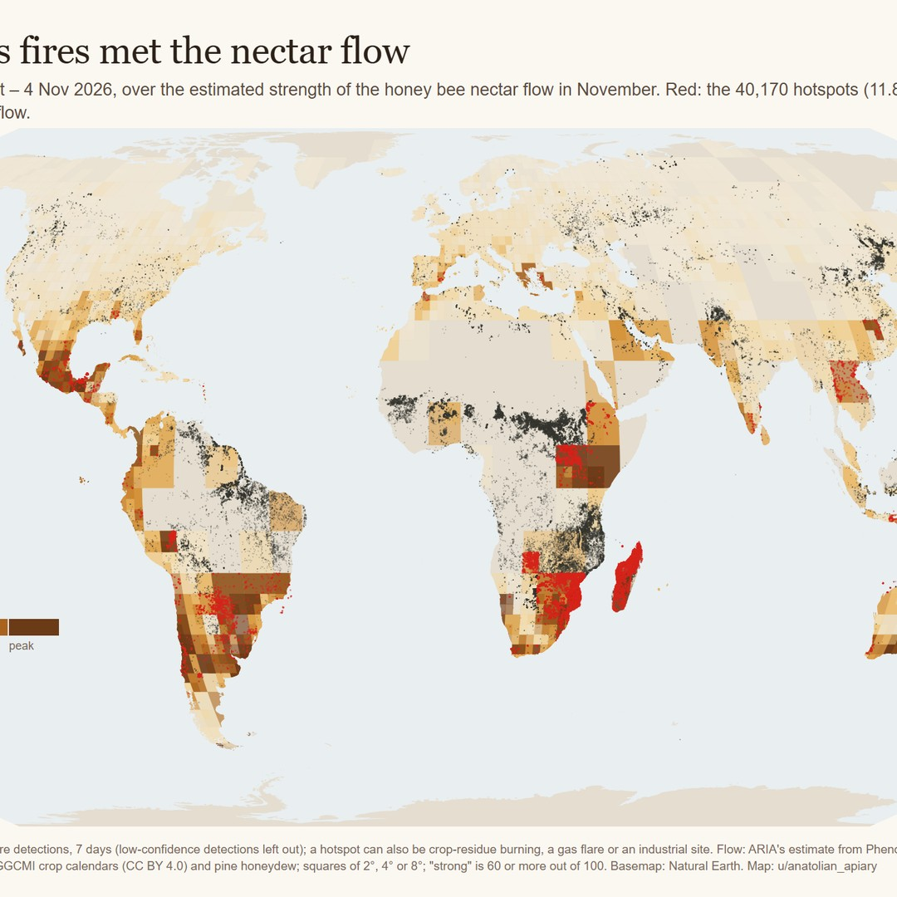
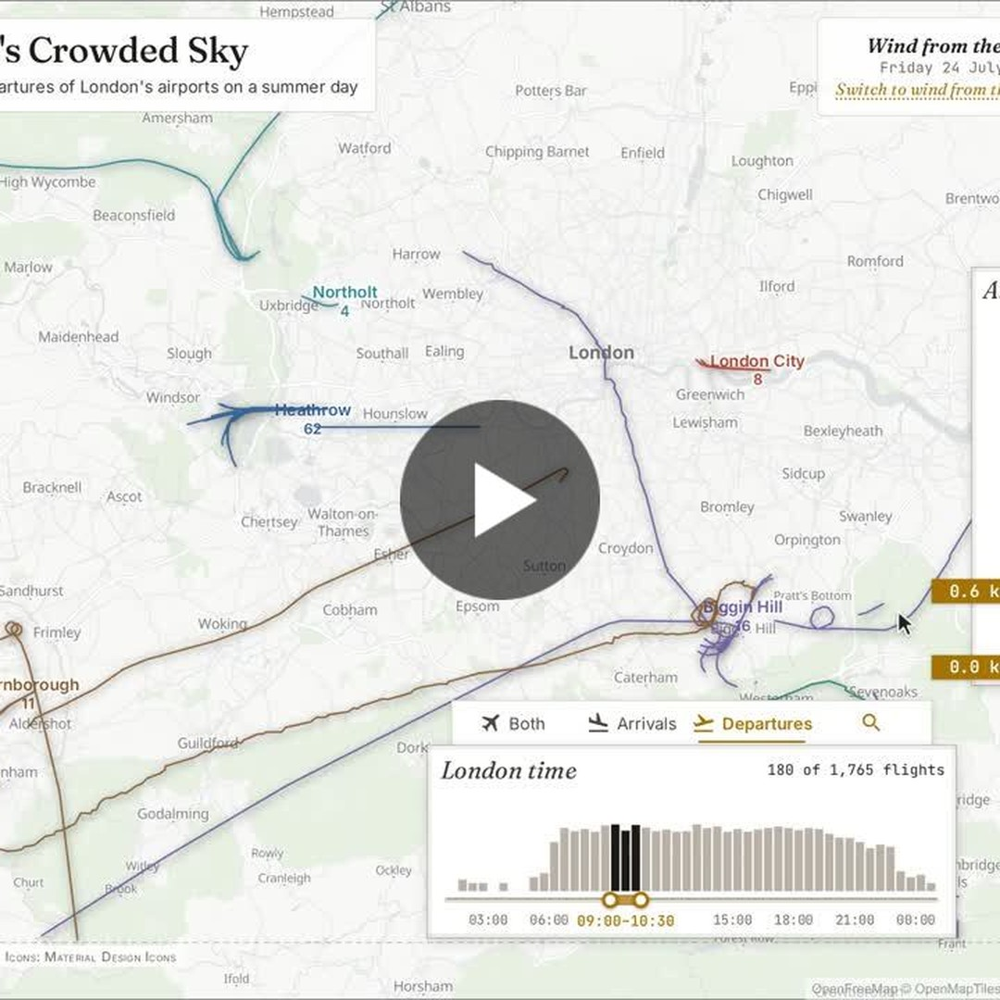
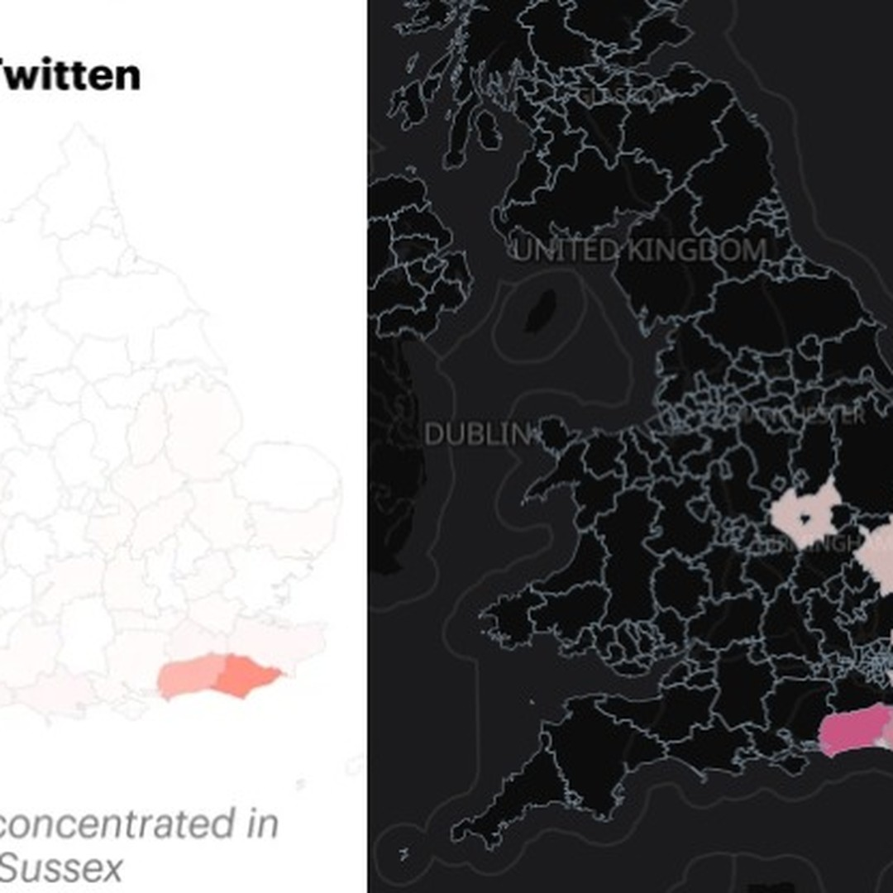
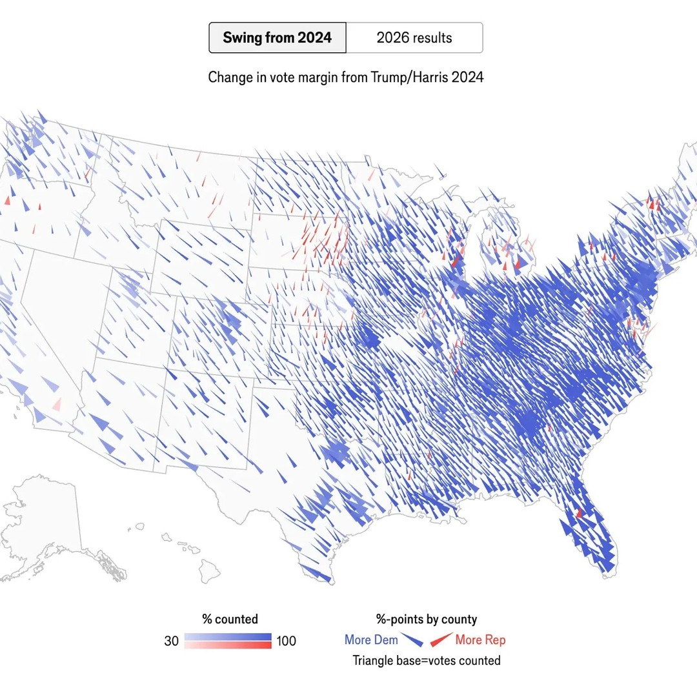
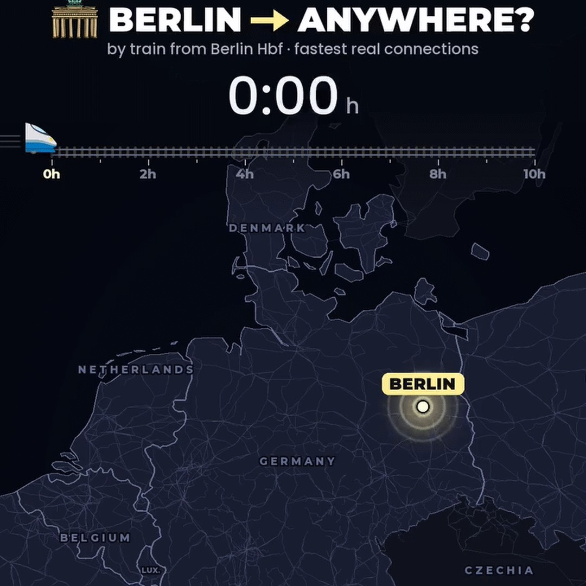
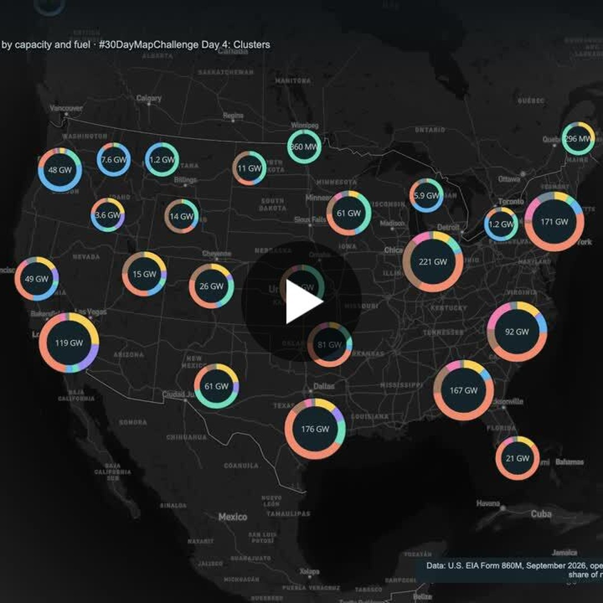

# Geoawesome reposts, 2026-11-05

8 post(s) ready. Each has a 1080×1080 image and its own text for Facebook, Instagram, YouTube Community and X. Nothing has been posted.

**To publish:** tick the box under a post. It is queued for the next free time slot and posted to Facebook and Instagram; a comment here confirms the time. Edit a text in this issue first if you want to change it (what is in the box is what gets posted). Untick before the slot to cancel. When it is live, a comment @mentions you with the YouTube Community text and the X text for Buffer.

---

## 1. The Mackenzie River Delta [OC]

<!-- post:2026-11-05-4-the-mackenzie-river-delta-oc -->
- [ ] **Publish on Facebook + Instagram**


[Download square image](https://raw.githubusercontent.com/walczakagh/geoawesome-social-agent/main/drafts/images/2026-11-05-4-the-mackenzie-river-delta-oc.jpg) · square crop, from 2667px of source width

**Source:** [Reddit r/dataisbeautiful](https://www.reddit.com/r/dataisbeautiful/comments/1xo9a3h/the_mackenzie_river_delta_oc/) · score 8.0/10 · Mackenzie River Delta aerial/satellite-style map; vivid landscape of a remote delta, fits geo audience.
**Rights:** Someone else's map: the credit line names them; ask them first if unsure. Licence on page: not stated.

**What it shows:** An original map titled "The Mackenzie River Delta", posted by u/visualgeomatics on r/dataisbeautiful and marked [OC] (the poster's own work). The post has no other text, so the data source, date and colour meaning are not stated.

**Check before posting:**
- The data source of the map is not stated (no sensor, dataset or elevation model named).
- No date or time period is given for the underlying data.
- What the colours or shading represent is not explained in the post.
- Image licence is not stated and the reuse policy is link_only: confirm permission from u/visualgeomatics before posting the image itself, or share as a link only.
- Alt text is generic because the post gives no description of the map's content; the editor should refine it after viewing the image.

**Facebook**

```text
The Mackenzie River Delta, drawn as an original map by a Reddit cartographer.

u/visualgeomatics shared it on r/dataisbeautiful with the title "The Mackenzie River Delta [OC]" and nothing else. The [OC] tag marks it as the poster's own work. No data source or date is given, so read it as a cartographic piece rather than a dated observation.

Read more: https://www.reddit.com/r/dataisbeautiful/comments/1xo9a3h/the_mackenzie_river_delta_oc/

Map: u/visualgeomatics via r/dataisbeautiful

#Geoawesome #Cartography #Rivers #Maps
```

**Instagram**

```text
A whole river delta, fitted into one square.

The Mackenzie River Delta, mapped by u/visualgeomatics as original work and shared on r/dataisbeautiful.

Find out more: https://www.reddit.com/r/dataisbeautiful/comments/1xo9a3h/the_mackenzie_river_delta_oc/

Map: u/visualgeomatics via r/dataisbeautiful

#Geoawesome #Maps #Delta #Cartography
```

**YouTube Community**

```text
No description and no legend notes: just a title and the map.

This original map of the Mackenzie River Delta was posted by u/visualgeomatics on r/dataisbeautiful. The post names no data source, sensor or date, so we cannot say what the colours encode. If you know the delta or recognise the method, tell us in the comments what you read from it.

Learn more: https://www.reddit.com/r/dataisbeautiful/comments/1xo9a3h/the_mackenzie_river_delta_oc/

Map: u/visualgeomatics via r/dataisbeautiful

#Geoawesome #Hydrology #Rivers #Cartography
```

**X (via Buffer)**

```text
One title, no caption: the Mackenzie River Delta, mapped as original work by a Reddit user.
https://www.reddit.com/r/dataisbeautiful/comments/1xo9a3h/the_mackenzie_river_delta_oc/
Map: u/visualgeomatics via r/dataisbeautiful
#Geoawesome #Cartography #Delta
```

**Alt text:** A map of the Mackenzie River Delta, created by Reddit user visualgeomatics.

---

## 2. [OC] Where this week's fires met the honey bee nectar flow: NASA fire detections over an estimated nectar-flow map, 28 Oct – 4 Nov 2026

<!-- post:2026-11-05-5-oc-where-this-week-s-fires-met-the-hone -->
- [ ] **Publish on Facebook + Instagram**



[Download square image](https://raw.githubusercontent.com/walczakagh/geoawesome-social-agent/main/drafts/images/2026-11-05-5-oc-where-this-week-s-fires-met-the-hone.jpg) · square crop, from 1400px of source width

**Source:** [Reddit r/dataisbeautiful](https://www.reddit.com/r/dataisbeautiful/comments/1xnz13k/oc_where_this_weeks_fires_met_the_honey_bee/) · score 8.0/10 · NASA fire detections overlaid on nectar-flow map; spatial story combining fires and bee habitat.
**Rights:** Someone else's map: the credit line names them; ask them first if unsure. Licence on page: not stated.

**What it shows:** An original map posted to r/dataisbeautiful by u/anatolian_apiary that overlays NASA fire detections on an estimated honey bee nectar-flow map for 28 October to 4 November 2026. The post title is the only description: it does not state the region, the specific NASA fire product, how the nectar-flow layer was estimated, or what the colours mean.

**Check before posting:**
- Reuse policy is link_only and the image licence is not stated: confirm with u/anatolian_apiary before reposting the image itself.
- The data source of the map is not fully stated: 'NASA fire detections' does not name the product or sensor, and the source or method of the nectar-flow estimate is not given.
- The geographic area covered is not stated in the title or post.
- No legend or colour key is described, so the colours cannot be explained without seeing and checking the map.
- The nectar-flow layer is described as 'estimated', so any overlap with fires is indicative only.
- Alt text is generic because the map's actual appearance is not described in the source: check it against the image.

**Facebook**

```text
One week of NASA fire detections, laid over a map of where honey bees find nectar.

The map plots fire detections from 28 October to 4 November 2026 on top of an estimated nectar-flow layer, showing where the week's fires overlapped areas of nectar flow. Treat the overlap as indicative: the nectar layer is an estimate, and the post does not name the NASA fire product or the region covered.

Find out more: https://www.reddit.com/r/dataisbeautiful/comments/1xnz13k/oc_where_this_weeks_fires_met_the_honey_bee/

Map: u/anatolian_apiary via r/dataisbeautiful

#Geoawesome #Wildfires #Bees #Dataviz
```

**Instagram**

```text
Fires and flowers, on a single map.

NASA fire detections for 28 October to 4 November 2026 sit over an estimated honey bee nectar-flow layer: an angle on fire impact that beekeepers will care about.

Learn more: https://www.reddit.com/r/dataisbeautiful/comments/1xnz13k/oc_where_this_weeks_fires_met_the_honey_bee/

Map: u/anatolian_apiary via r/dataisbeautiful

#Geoawesome #Beekeeping #Fires #Maps
```

**YouTube Community**

```text
Two layers, one question: did this week's fires burn through areas of honey bee nectar flow?

Posted as original content on r/dataisbeautiful, the map combines NASA fire detections for 28 October to 4 November 2026 with an estimated nectar-flow surface. The title is the only documentation: no fire product, region, nectar model or colour key is given, so the result is a visual overlap rather than a measured impact.

Read more: https://www.reddit.com/r/dataisbeautiful/comments/1xnz13k/oc_where_this_weeks_fires_met_the_honey_bee/

Map: u/anatolian_apiary via r/dataisbeautiful

#Geoawesome #Wildfires #Cartography #Bees
```

**X (via Buffer)**

```text
Where did this week's fires overlap the honey bee nectar flow? NASA fire detections over an estimated nectar-flow map, 28 Oct to 4 Nov 2026.
https://www.reddit.com/r/dataisbeautiful/comments/1xnz13k/oc_where_this_weeks_fires_met_the_honey_bee/
Map: u/anatolian_apiary via r/dataisbeautiful
#Geoawesome #Fires #Bees #Dataviz
```

**Alt text:** A map with NASA fire detection points overlaid on a shaded layer showing estimated honey bee nectar flow.

---

## 3. # 30daymapchallenge | Milan Janosov - LinkedIn

<!-- post:2026-11-05-8-30daymapchallenge-milan-janosov-linkedi -->
- [ ] **Publish on Facebook + Instagram**


[Download square image](https://raw.githubusercontent.com/walczakagh/geoawesome-social-agent/main/drafts/images/2026-11-05-8-30daymapchallenge-milan-janosov-linkedi.jpg) · square crop, from 800px of source width

**Source:** [Google Alerts #5](https://www.linkedin.com/posts/milan-janosov_30daymapchallenge-activity-7523782559831388160-QKLC) · score 7.0/10 · Every Paris building lined up by use, same scale: a striking, original city visual.
**Rights:** Someone else's map: the credit line names them; ask them first if unsure. Licence on page: not stated.

**What it shows:** A 30 Day Map Challenge entry by Adam Roberts that takes every building in Paris and lines them up by use, largest first, all drawn at the same scale. Roberts also built an interactive web app that recreates the chart for any district of the city. It was shared by Milan Janosov as his challenge pick of the day.

**Check before posting:**
- No image credit or licence is stated, and the reuse policy is link_only. Get permission from Adam Roberts before posting his image, or post only the link.
- The page text does not confirm that the image attached to the LinkedIn post is Roberts' chart itself rather than something else (for example a screenshot of Janosov's book). Check the actual image before cropping.
- The building data source (for example which footprint dataset) is not stated.
- The use categories and colour meanings are not described.
- The direct links to Roberts' web app and original post are shortened lnkd.in URLs. Consider linking to Roberts' original post or app once resolved.
- Which day or theme of the 30 Day Map Challenge this was made for is not stated.

**Facebook**

```text
Every building in Paris, pulled out of the street grid and lined up by what it is used for, largest first.

Adam Roberts drew them all at the same scale, so any footprint can be compared directly with the rest of its category. Milan Janosov chose it as his 30 Day Map Challenge pick of the day, and Roberts' interactive web app rebuilds the chart for any district in the city.

Read more: https://www.linkedin.com/posts/milan-janosov_30daymapchallenge-activity-7523782559831388160-QKLC

Map: Adam Roberts via Milan Janosov

#Paris #Cartography #Buildings #Geoawesome
```

**Instagram**

```text
Paris, sorted: every building in the city at one scale, grouped by use and ordered by size.

Pick a district in Adam Roberts' web app and it builds the same line-up for that neighbourhood.

Find out more: https://www.linkedin.com/posts/milan-janosov_30daymapchallenge-activity-7523782559831388160-QKLC

Map: Adam Roberts via Milan Janosov

#Paris #Maps #Architecture #Geoawesome
```

**YouTube Community**

```text
Drop location from a city map, keep only footprint and function, and Paris becomes rows of building shapes.

Adam Roberts sorted every building in Paris by use and then by size, largest first, all at the same scale so the shapes stay directly comparable. His interactive web app repeats this for any district you select. The post does not name the building dataset, so read the categories as the author's own classification.

Learn more: https://www.linkedin.com/posts/milan-janosov_30daymapchallenge-activity-7523782559831388160-QKLC

Map: Adam Roberts via Milan Janosov

#Paris #GIS #Buildings #Urbanism #Geoawesome
```

**X (via Buffer)**

```text
All of Paris's buildings at one scale, sorted by use and size. Adam Roberts' web app does the same for any district.
https://www.linkedin.com/posts/milan-janosov_30daymapchallenge-activity-7523782559831388160-QKLC
Map: Adam Roberts via Milan Janosov
#Paris #Cartography #Maps #Geoawesome
```

**Alt text:** Building footprints from Paris arranged in rows grouped by use, ordered from largest to smallest and drawn at the same scale.

---

## 4. 30daymapchallenge # 30daymapchallenge #dataviz #london #aviation #heathrow #maps - LinkedIn

<!-- post:2026-11-05-9-30daymapchallenge-30daymapchallenge-data -->
- [ ] **Publish on Facebook + Instagram**



[Download square image](https://raw.githubusercontent.com/walczakagh/geoawesome-social-agent/main/drafts/images/2026-11-05-9-30daymapchallenge-30daymapchallenge-data.jpg) · square crop, from 720px of source width

**Source:** [Google Alerts #5](https://www.linkedin.com/posts/benjamin-niedermann_30daymapchallenge-30daymapchallenge-dataviz-activity-7523832720746049537-VMGx) · score 7.0/10 · Map of plane arrivals over London and their altitudes; a clear, novel aviation-density visual.
**Rights:** Someone else's map: the credit line names them; ask them first if unsure. Licence on page: not stated.

**What it shows:** An interactive map by Benjamin Niedermann for 30DayMapChallenge Day 4 (Clusters), showing arrivals and departures at London's nine airports on two days in July 2026. It uses public ADS-B traces from adsb.lol (ODbL) on an OpenFreeMap basemap (© OpenStreetMap contributors) and was built with the VisQuill GDK. Users pick a place on the ground and view the sky one layer and one hour at a time, to see when and how low planes pass over and which airport uses which part of the sky.

**Check before posting:**
- Reuse policy is link_only and no image licence or credit is stated on the page. Get permission from Benjamin Niedermann before reposting the image.
- The credit 'Map: Benjamin Niedermann' comes from the post author named in the URL, not from an explicit image credit.
- The post does not explain the colour scheme or what the 'layers' are (they are presumably altitude bands, but this is not stated).
- The two exact July 2026 dates are not given.
- The interactive map is behind a shortened lnkd.in link (https://lnkd.in/dxkdn3MM). The posts link to the LinkedIn post, which may ask readers to sign in.
- The alt text is generic because the cropped image content was not verified. Check it against the actual square before posting.

**Facebook**

```text
Nine London airports, two July days: how low do planes pass over your street?

Benjamin Niedermann mapped public ADS-B traces from adsb.lol for 30DayMapChallenge Day 4. Pick a spot on the ground and step through the sky one layer and one hour at a time.

Read more: https://www.linkedin.com/posts/benjamin-niedermann_30daymapchallenge-30daymapchallenge-dataviz-activity-7523832720746049537-VMGx

Map: Benjamin Niedermann

#Geoawesome #Aviation #London #Heathrow
```

**Instagram**

```text
London's sky, sliced by the hour.

Every arrival and departure at the city's nine airports over two days in July 2026, sorted so you can see which airport uses which part of the sky.

Full story: https://www.linkedin.com/posts/benjamin-niedermann_30daymapchallenge-30daymapchallenge-dataviz-activity-7523832720746049537-VMGx

Map: Benjamin Niedermann

#Geoawesome #Flights #London #Maps
```

**YouTube Community**

```text
Most flight maps flatten everything into one mass of lines. This one starts from a place on the ground instead.

Built for 30DayMapChallenge Day 4, it maps public ADS-B traces (adsb.lol, ODbL) of every flight to and from London's nine airports on two days in July 2026. Choose a spot, then filter by layer and hour to see when and how low planes pass.

Learn more: https://www.linkedin.com/posts/benjamin-niedermann_30daymapchallenge-30daymapchallenge-dataviz-activity-7523832720746049537-VMGx

Map: Benjamin Niedermann

#Geoawesome #ADSB #Aviation #Cartography
```

**X (via Buffer)**

```text
Which London airport uses which slice of sky, and how low do its planes fly over you? ADS-B traces, nine airports, two July days.
https://www.linkedin.com/posts/benjamin-niedermann_30daymapchallenge-30daymapchallenge-dataviz-activity-7523832720746049537-VMGx
Map: Benjamin Niedermann
#Geoawesome #Aviation #London #Maps
```

**Alt text:** Map of London overlaid with the tracks of aircraft arriving at and departing from the city's airports.

---

## 5. The Alleyways of Britain

<!-- post:2026-11-05-11-the-alleyways-of-britain -->
- [ ] **Publish on Facebook + Instagram**



[Download square image](https://raw.githubusercontent.com/walczakagh/geoawesome-social-agent/main/drafts/images/2026-11-05-11-the-alleyways-of-britain.jpg) · square crop, from 416px of source width (low resolution: upscaled, check sharpness)

**Source:** [Maps Mania](http://googlemapsmania.blogspot.com/2026/11/the-alleyways-of-britain.html) · score 7.0/10 · Mapping regional alleyway terms across Britain; clever small-multiple style map with a hook.
**Rights:** Someone else's map: the credit line names them; ask them first if unsure. Licence on page: not stated.

**What it shows:** A map from Maps Mania (the 'Geography of Words' map) plotting places across Great Britain whose names in the Ordnance Survey Open Names dataset contain regional words for an alleyway, such as twitten, ginnel, jitty, vennel and chare. Each term is shown in a different colour, so you can see where particular words are concentrated. It is a counterpart to YouGov's October survey maps, based on 39,224 Britons, which show where people say they use each word rather than where the words appear in recorded place names.

**Check before posting:**
- Reuse policy is link_only and no image licence is stated: confirm we may post the image itself before publishing.
- Source image is only 416px wide and has been upscaled for the square: check sharpness before posting.
- No image credit on the page and the map's author is not named. The credit 'Map: Maps Mania' assumes the blog post's author made the map, as the text says ('my maps'). Confirm this wording, or use 'via Maps Mania' instead.
- The page text is cut off. It is unclear which term each colour represents, what the second map shows, the full list of terms searched, and whether the map is interactive.
- No counts of matches per term or regional findings are given, so none are stated.
- The coverage is Great Britain only (OS Open Names), not the whole UK, while the YouGov survey refers to the UK and Britons.

**Facebook**

```text
Twitten, ginnel, jitty, vennel, chare: Britain has many words for an alleyway, and they turn up in its place names.

Maps Mania searched the Ordnance Survey Open Names dataset, which holds millions of named places across Great Britain, for regional alleyway terms and plotted every match, one colour per word. It complements YouGov's October survey of 39,224 Britons: that shows who says a word, this shows where it is recorded on the map.

Read more: http://googlemapsmania.blogspot.com/2026/11/the-alleyways-of-britain.html

Map: Maps Mania

#Cartography #Toponymy #Britain #Geoawesome
```

**Instagram**

```text
One alley, five names: twitten, ginnel, jitty, vennel and chare.

Each mapped record is a British place name from Ordnance Survey Open Names, coloured by the alleyway word it uses, so regional vocabulary becomes regional colour.

Find out more: http://googlemapsmania.blogspot.com/2026/11/the-alleyways-of-britain.html

Map: Maps Mania

#Maps #Dialects #Alleyways #Geoawesome
```

**YouTube Community**

```text
A survey tells you what people call an alleyway. Street names tell you what got written down.

YouGov mapped the alleyway words that 39,224 Britons say they use, by county or region. Maps Mania instead queried the Ordnance Survey Open Names dataset for terms such as twitten, ginnel, jitty, vennel and chare, then plotted the matching records across Great Britain with a separate colour for each word.

Learn more: http://googlemapsmania.blogspot.com/2026/11/the-alleyways-of-britain.html

Map: Maps Mania

#Cartography #Dialects #Linguistics #Geoawesome
```

**X (via Buffer)**

```text
Where is an alleyway a ginnel, a jitty or a twitten? British place names from Ordnance Survey Open Names, mapped one colour per word.
http://googlemapsmania.blogspot.com/2026/11/the-alleyways-of-britain.html
Map: Maps Mania
#Cartography #Toponymy #Geoawesome
```

**Alt text:** A map of Great Britain with coloured markers showing where place names contain regional words for an alleyway, with each word in a different colour.

---

## 6. U.S. Midterm Election Maps

<!-- post:2026-11-05-12-u-s-midterm-election-maps -->
- [ ] **Publish on Facebook + Instagram**



[Download square image](https://raw.githubusercontent.com/walczakagh/geoawesome-social-agent/main/drafts/images/2026-11-05-12-u-s-midterm-election-maps.jpg) · square crop, from 1451px of source width

**Source:** [Maps Mania](http://googlemapsmania.blogspot.com/2026/11/us-midterm-election-maps.html) · score 7.0/10 · Cartogram and swing maps of US midterms; a striking geo visualisation with a clear story.
**Rights:** Someone else's map: the credit line names them; ask them first if unsure. Licence on page: not stated.

**What it shows:** A screenshot of The Economist's 'Swing from 2024' map of the US midterm election results, shared by Maps Mania the day after the vote. According to Maps Mania, almost the entire USA swung towards the Democrats, perhaps with the exception of South Dakota. The post also compares it with The Guardian's equal-size House cartogram and The New York Times' geographic map with its Shift Map view.

**Check before posting:**
- Reuse policy is 'link_only' and no image licence is stated. The image is a screenshot of a paywalled Economist interactive, so check rights before posting the square.
- The colour scheme is not explained in the source.
- The geographic unit of the swing map (district, county or state) is not stated. The Economist URL points to House results.
- The South Dakota exception is the blogger's hedged reading ('perhaps') of the screenshot, not a stated result.
- The exact election date is not given. The post says 'yesterday's midterm elections' and was published 4 November 2026.
- No vote margins, seat counts or swing percentages are given.

**Facebook**

```text
On The Economist's 'Swing from 2024' map of the US midterms, almost every part of the country moved towards the Democrats, with South Dakota perhaps the one exception.

The original is paywalled, so Maps Mania shares a screenshot and sets it beside two free alternatives: The Guardian's House cartogram, where each seat is drawn the same size regardless of geography, and The New York Times' geographic map. It is a useful comparison of how map design shapes the same result.

Read more: http://googlemapsmania.blogspot.com/2026/11/us-midterm-election-maps.html

Map: The Economist via Maps Mania

#Geoawesome #Cartography #Elections #Midterms
```

**Instagram**

```text
One map, one direction: nearly the whole US shifts towards the Democrats in The Economist's swing view of the midterms.

South Dakota may be the lone holdout, according to Maps Mania's reading of the paywalled map.

Find out more: http://googlemapsmania.blogspot.com/2026/11/us-midterm-election-maps.html

Map: The Economist via Maps Mania

#Geoawesome #Midterms #Maps #USA
```

**YouTube Community**

```text
'People vote, not land': this week's US midterms show how much map design changes the story.

The Economist's 'Swing from 2024' map shows the change since 2024 rather than who won, and on it almost the entire USA moves towards the Democrats (perhaps except South Dakota). Maps Mania contrasts it with The Guardian's cartogram, which shows each House seat at equal size, and The New York Times' geographically accurate map, where switching to the Shift Map view brings the swing back into focus.

Learn more: http://googlemapsmania.blogspot.com/2026/11/us-midterm-election-maps.html

Map: The Economist via Maps Mania

#Geoawesome #Cartography #Elections #Cartograms
```

**X (via Buffer)**

```text
Nearly the whole US swung towards the Democrats in the midterms, going by The Economist's swing-from-2024 map (South Dakota perhaps excepted).
http://googlemapsmania.blogspot.com/2026/11/us-midterm-election-maps.html
Map: The Economist via Maps Mania
#Geoawesome #Midterms #Cartography
```

**Alt text:** A map of the United States showing how the vote in the 2026 midterm elections swung compared with 2024.

---

## 7. Start at Berlin Hbf, take the fastest real trains – how far do you get in 10 hours?

<!-- post:2026-11-05-14-start-at-berlin-hbf-take-the-fastest-rea -->
- [ ] **Publish on Facebook + Instagram**



[Download square image](https://raw.githubusercontent.com/walczakagh/geoawesome-social-agent/main/drafts/images/2026-11-05-14-start-at-berlin-hbf-take-the-fastest-rea.jpg) · square crop, from 720px of source width

**Source:** [Reddit r/MapPorn](https://www.reddit.com/r/MapPorn/comments/1xnywe1/start_at_berlin_hbf_take_the_fastest_real_trains/) · score 7.0/10 · Rail reach map from Berlin showing travel-time isochrone; clever geo idea, animated GIF.
**Rights:** Someone else's map: the credit line names them; ask them first if unsure. Licence on page: not stated.

**What it shows:** A map posted by u/vladgrinch on r/MapPorn that, according to its title, shows how far you can get in 10 hours from Berlin Hauptbahnhof using the fastest real trains. The post has no description beyond the title, so the data source, timetable date and colour scheme are not stated.

**Check before posting:**
- The map's data source is not stated (which timetable or routing data was used).
- No travel date, day of week or departure time is given, and train reach can vary with these.
- Transfer assumptions (minimum change times, waiting) are not described.
- The meaning of the colours or bands on the map is not explained in the post.
- The image licence is not stated and the reuse policy is link_only. Check whether posting the image itself is permitted.
- The square crop was made from 720px of source width. Check that the labels stay legible at 1080x1080.

**Facebook**

```text
Ten hours on the fastest real trains out of Berlin Hauptbahnhof: how far does that actually get you?

This map by u/vladgrinch answers that from a single starting station. The rules are simple: one origin, real train services and a 10-hour limit. It is a neat example of a travel-time map for anyone who works on accessibility or network analysis.

Full story: https://www.reddit.com/r/MapPorn/comments/1xnywe1/start_at_berlin_hbf_take_the_fastest_real_trains/

Map: u/vladgrinch via r/MapPorn

#Geoawesome #Trains #Berlin #Cartography
```

**Instagram**

```text
One station, a 10-hour budget, only the fastest real trains.

Where does that leave you if you set off from Berlin Hbf?

Find out more: https://www.reddit.com/r/MapPorn/comments/1xnywe1/start_at_berlin_hbf_take_the_fastest_real_trains/

Map: u/vladgrinch via r/MapPorn

#Geoawesome #Railways #Berlin #Maps
```

**YouTube Community**

```text
Distance on a map is one thing, distance on a timetable is another.

u/vladgrinch's map starts at Berlin Hauptbahnhof and asks how far the fastest real trains can take you within 10 hours. The post does not say which timetable data, travel date or transfer rules were used. Read it as a visual answer to the question rather than a planning tool.

Learn more: https://www.reddit.com/r/MapPorn/comments/1xnywe1/start_at_berlin_hbf_take_the_fastest_real_trains/

Map: u/vladgrinch via r/MapPorn

#Geoawesome #Trains #Accessibility #Mobility
```

**X (via Buffer)**

```text
Berlin Hbf, 10 hours, fastest real trains only. Where is the edge of your reach?
https://www.reddit.com/r/MapPorn/comments/1xnywe1/start_at_berlin_hbf_take_the_fastest_real_trains/
Map: u/vladgrinch via r/MapPorn
#Geoawesome #Railways #Berlin
```

**Alt text:** Map showing how far a traveller can get by train from Berlin Hauptbahnhof within 10 hours using the fastest real services.

---

## 8. # 30daymapchallenge | Kyle Walker - LinkedIn

<!-- post:2026-11-05-19-30daymapchallenge-kyle-walker-linkedin -->
- [ ] **Publish on Facebook + Instagram**



[Download square image](https://raw.githubusercontent.com/walczakagh/geoawesome-social-agent/main/drafts/images/2026-11-05-19-30daymapchallenge-kyle-walker-linkedin.jpg) · square crop, from 720px of source width

**Source:** [Google Alerts #5](https://www.linkedin.com/posts/walkerke_30daymapchallenge-activity-7523762848225878017-HHmd) · score 6.0/10 · 14,797 US power plants as donut clusters on Mapbox; a clean, data-rich map.
**Rights:** Someone else's map: the credit line names them; ask them first if unsure. Licence on page: not stated.

**What it shows:** Kyle Walker's Day 4 (Clusters) entry for the 30 Day Map Challenge maps 14,797 operating US power plants from EIA data as donut clusters, built with Mapbox and R's mapgl package. The ring segments of each cluster show generating capacity by fuel type. Walker highlights that about half of US plants are solar but hold only 12% of capacity, while gas is 13% of plants and 41% of capacity. Texas leads battery storage with 19.4 GW, ahead of California with 16.5 GW.

**Check before posting:**
- No image credit or licence on the page, and the reuse policy is link_only: confirm permission from Kyle Walker before posting the image itself.
- The vintage of the EIA data (which year or month) is not stated.
- The colour assigned to each fuel type is not described in the text, so the legend is not explained in the captions.
- It is unclear whether the posted image is a static screenshot or comes from an interactive web map. Mapbox/mapgl suggests interactive, but this is not stated, so the captions do not claim interactivity.
- The capacity measure (for example nameplate or summer capacity) is not specified.
- The square crop was made from only 720px of source width and may look soft.
- The page text includes unrelated LinkedIn comments (for example a UK auction arbitrage map). These were ignored.

**Facebook**

```text
About half of the operating power plants in the US are solar, yet they account for only 12% of generating capacity.

Kyle Walker mapped 14,797 operating US power plants from EIA data as donut clusters for Day 4 of the 30 Day Map Challenge, using Mapbox and R's mapgl package. The ring segments show capacity by fuel type. Gas is the mirror image of solar: 13% of plants, 41% of capacity.

Full story: https://www.linkedin.com/posts/walkerke_30daymapchallenge-activity-7523762848225878017-HHmd

Map: Kyle Walker

#Geoawesome #Energy #Cartography #Solar
```

**Instagram**

```text
Texas, not California, leads US battery storage: 19.4 GW against 16.5 GW.

The map groups 14,797 power plants into donut clusters, with each ring split by fuel type.

Find out more: https://www.linkedin.com/posts/walkerke_30daymapchallenge-activity-7523762848225878017-HHmd

Map: Kyle Walker

#Geoawesome #Energy #Batteries #Mapbox
```

**YouTube Community**

```text
One map, 14,797 power plants, and every cluster is a donut chart.

Kyle Walker built this Clusters entry for the 30 Day Map Challenge from EIA data, using Mapbox and the mapgl package for R. Ring segments encode capacity by fuel type, which shows the gap between plant count and capacity: solar is about half of plants but 12% of capacity.

Learn more: https://www.linkedin.com/posts/walkerke_30daymapchallenge-activity-7523762848225878017-HHmd

Map: Kyle Walker

#Geoawesome #Cartography #Infrastructure #Mapbox
```

**X (via Buffer)**

```text
Gas makes up 13% of US power plants but 41% of capacity. Kyle Walker's donut-cluster map of 14,797 plants shows the split.
https://www.linkedin.com/posts/walkerke_30daymapchallenge-activity-7523762848225878017-HHmd
Map: Kyle Walker
#Geoawesome #Energy #Cartography
```

**Alt text:** A map of the United States with power plants grouped into circular donut-chart clusters, each ring divided into coloured segments by fuel type.

---

### Skipped after reading the page
- [Geoawesome on X: "Sediment plumes trace Spain's flooded coast south of Valencia, seen ...](https://x.com/geoawesome_dgtl/status/2117855115184885933): This is Geoawesome's own X post with no recoverable content (only X login boilerplate), no image credit, no licence and a link-only reuse policy, so it cannot be described or credited without guessing.
- [26 years of Landsat dry season composites over one Brazilian municipality, with the change ...](https://www.reddit.com/r/remotesensing/comments/1xnvi0o/26_years_of_landsat_dry_season_composites_over/): No image was found on the page, no creator or credit is given, and the title and text are truncated, so there is nothing to post square or credit correctly.
- [Recent Satellite images show a spill of heavy fuel oil from a ship north of Qeshm Island in ... - Reddit](https://www.reddit.com/r/oil/comments/1xo5r8g/recent_satellite_images_show_a_spill_of_heavy/): No image was found on the page and no credit or licence is given; the only source is a one-line Reddit title (with an 'Iran War' tag) making an unverified claim about an oil spill.
- [Copernicus EU on X: " Autumn colours in Slovakia! 🛰️ #CopernicusEU Sentinel-2 ...](https://x.com/CopernicusEU/status/2118010359143661874): Reuse policy is link_only and no image credit or licence appears on the page, and the source gives only a truncated title (Sentinel-2, Slovakia, autumn colours), so the image could not be reposted or described without guessing.
- [Tracking fires in Cascade, Montana | WFCA Fire Map - Western Fire Chiefs Association](https://wfca.com/fire-map/detection/69dc5faf727c48c1): There is no image to post: the page is an auto-generated fire-detection entry (one 0.2-acre Landsat detection) with no visual and a link-only reuse policy.
- [Mountain peaks to show the shifts](https://flowingdata.com/2026/11/04/mountain-peaks-to-show-the-shifts/): The page does not say which election, which years are compared or what geographic unit is mapped, and the reuse policy is link_only (FlowingData, all rights reserved, map by Bloomberg), so we cannot post the image or caption it without guessing.
- [GeoAI model maps landslide risk across central Nepal with 88.3% accuracy - Scienmag](https://scienmag.com/geoai-model-maps-landslide-risk-across-central-nepal-with-88-3-accuracy/): The page never describes its image and gives no image credit or licence (link-only reuse), so the square crop cannot be captioned or credited without guessing.
- [This Sentinel-2 image clearly shows the full carrier strike group centered on the USS ... - X](https://x.com/MoloWarMonitor/status/2117895558740214076): The page text is empty and the image has no credit or licence, so the claim of a carrier strike group in Sentinel-2 imagery cannot be verified or captioned without guessing.
- [Rich Tedd ✈️ on X: "Before and after satellite images show damage to the Aroma ...](https://x.com/AfriMEOSINT/status/2117981043986731393): Only a truncated X post title and boilerplate page text are available, with no image credit, licence, location, date or sensor (reuse policy is link_only), so the image cannot be described without guessing.
- [This map shows all places that are likely to have more than 5cm of snow for more than ... - Threads](https://www.threads.com/@simongerman600/post/DfU4dUeIFEZ/media): No image was found on the page, there is no image credit or licence, and the description is cut off ('more than half of the ...'), so the map cannot be described without guessing.

---

### Sources checked
- Google Alerts #1: 20 in feed, 20 new
- Google Alerts #2: 20 in feed, 18 new
- Google Alerts #3: 20 in feed, 20 new
- Google Alerts #4: 20 in feed, 20 new
- Google Alerts #5: 20 in feed, 19 new
- Google Alerts #6: 15 in feed, 6 new, 8 already found via another source
- Google Alerts #7: 20 in feed, 20 new
- Google Alerts #8: 8 in feed, 0 new
- NASA Earth Observatory: 10 in feed, 1 new
- ESA Observing the Earth: failed: https://www.esa.int/rssfeed/Applications/Observing_the_Earth: HTTP 404
- EUMETSAT: 10 in feed, 3 new
- Copernicus Atmosphere Monitoring Service: 10 in feed, 0 new
- NASA JPL: 100 in feed, 0 new
- Planet Pulse: 50 in feed, 1 new
- Maps Mania: 25 in feed, 2 new
- Visual Capitalist (maps): 10 in feed, 1 new
- FlowingData: 10 in feed, 3 new
- Google Maps blog: 20 in feed, 0 new
- Google Research blog: 100 in feed, 1 new
- Overture Maps blog: 20 in feed, 0 new
- Bellingcat: 10 in feed, 0 new
- Reddit r/MapPorn: 25 in feed, 6 new
- Reddit r/dataisbeautiful: 23 in feed, 6 new
