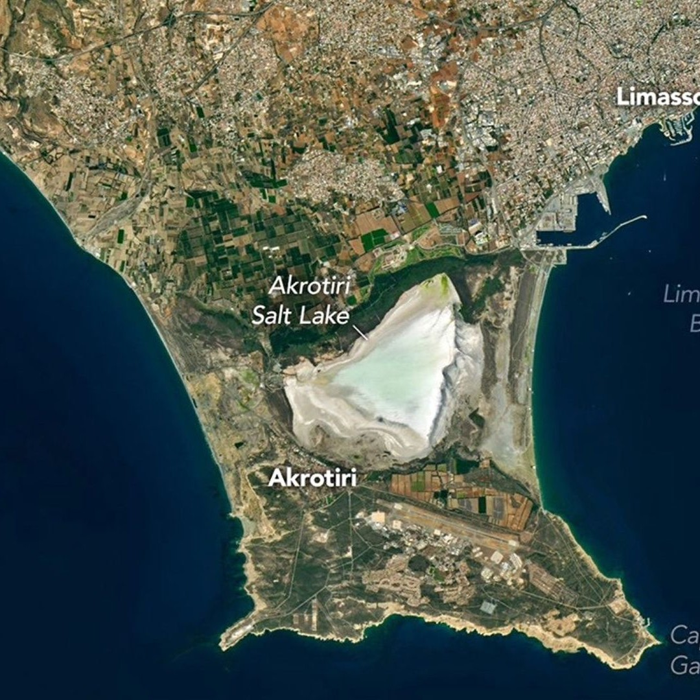
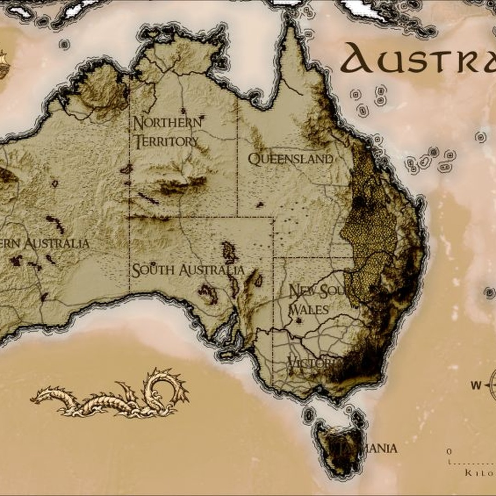
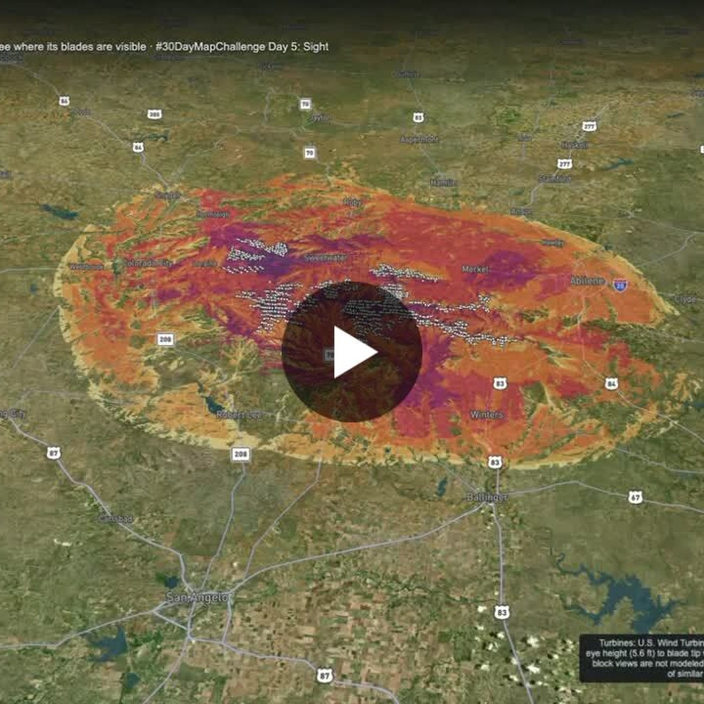

# Geoawesome reposts, 2026-11-06

3 post(s) ready. Each has a 1080×1080 image and its own text for Facebook, Instagram, YouTube Community and X. Nothing has been posted.

**To publish:** tick the box under a post. It is queued for the next free time slot and posted to Facebook and Instagram; a comment here confirms the time. Edit a text in this issue first if you want to change it (what is in the box is what gets posted). Untick before the slot to cancel. When it is live, a comment @mentions you with the YouTube Community text and the X text for Buffer.

---

## 1. A lost sea channel shaped this striking corner of Cyprus - Earth.com

<!-- post:2026-11-06-5-a-lost-sea-channel-shaped-this-striking -->
- [ ] **Publish on Facebook + Instagram**



[Download square image](https://raw.githubusercontent.com/walczakagh/geoawesome-social-agent/main/drafts/images/2026-11-06-5-a-lost-sea-channel-shaped-this-striking.jpg) · square crop, from 1080px of source width

**Source:** [Google Alerts #3](https://www.earth.com/earth-science/a-lost-sea-channel-shaped-this-striking-corner-of-cyprus/) · score 7.0/10 · Landsat 8 scene of Cyprus salt lake and lost sea channel; a visual geo story.
**Rights:** Someone else's map: the credit line names them; ask them first if unsure. Licence on page: not stated.

**What it shows:** A Landsat 8 image from 10 October 2026 of the Akrotiri Peninsula on the southern tip of Cyprus. It shows the peninsula's sandy margins and Akrotiri Salt Lake, which fills a former arm of the Mediterranean enclosed by two tombolos linking Cyprus to a smaller former island to the south. The western tombolo began forming about 50,000 years ago from Kouris River sediment, and the lagoon was finally cut off from the sea within the past 2,000 years.

**Check before posting:**
- Band combination and colour rendering are not stated (natural or false colour unknown).
- Spatial resolution and processing details are not given.
- The page does not say whether the lake held water on 10 October 2026. It says water typically returns in late autumn and winter.
- The 2025 flamingo count of 30 birds comes from news reports, not a cited survey, so it was kept out of the posts.
- The source is an Earth.com article republishing a NASA Earth Observatory image. Reuse policy is link_only and no image licence is stated, so check the original NASA Earth Observatory release before posting the image.
- Confirm the 2026 dates against the original NASA Earth Observatory page.

**Facebook**

```text
Akrotiri Salt Lake fills a former arm of the Mediterranean that was sealed off from the open sea only within the past 2,000 years.

Landsat 8 imaged the peninsula on 10 October 2026. Two tombolos tie it to Cyprus: the western one began about 50,000 years ago from Kouris River sediment, and the eastern one formed later.

Read more: https://www.earth.com/earth-science/a-lost-sea-channel-shaped-this-striking-corner-of-cyprus/

Image: NASA Earth Observatory/Michala Garrison

#Geoawesome #Landsat #Cyprus #Geology
```

**Instagram**

```text
Two islands, two sediment bridges, one trapped lake.

Landsat 8's view of Cyprus's Akrotiri Peninsula on 10 October 2026 shows the salt lake left behind when sand and gravel closed a sea channel.

Find out more: https://www.earth.com/earth-science/a-lost-sea-channel-shaped-this-striking-corner-of-cyprus/

Image: NASA Earth Observatory/Michala Garrison

#Geoawesome #Cyprus #Satellite #Coastlines
```

**YouTube Community**

```text
Cyprus's Akrotiri Peninsula was once two separate islands.

In this Landsat 8 scene from 10 October 2026, the salt lake marks the channel that once separated them, closed by two tombolos of river and marine sediment. The southern part of the peninsula is built from Miocene chalk, limestone and marl that were uplifted into a smaller offshore island.

Learn more: https://www.earth.com/earth-science/a-lost-sea-channel-shaped-this-striking-corner-of-cyprus/

Image: NASA Earth Observatory/Michala Garrison

#Geoawesome #Landsat #Geomorphology #Mediterranean
```

**X (via Buffer)**

```text
Kouris River gravel began stitching two islands together about 50,000 years ago. Landsat 8 shows the result on Cyprus's Akrotiri Peninsula.
https://www.earth.com/earth-science/a-lost-sea-channel-shaped-this-striking-corner-of-cyprus/
Image: NASA Earth Observatory/Michala Garrison
#Geoawesome #Landsat #Cyprus #Tombolo
```

**Alt text:** Satellite view of the Akrotiri Peninsula on the southern coast of Cyprus, with a salt lake enclosed between strips of land joining the peninsula to the main island.

---

## 2. # 30daymapchallenge | Jonathan Gray - LinkedIn

<!-- post:2026-11-06-14-30daymapchallenge-jonathan-gray-linkedi -->
- [ ] **Publish on Facebook + Instagram**



[Download square image](https://raw.githubusercontent.com/walczakagh/geoawesome-social-agent/main/drafts/images/2026-11-06-14-30daymapchallenge-jonathan-gray-linkedi.jpg) · square crop, from 565px of source width (low resolution: upscaled, check sharpness)

**Source:** [Google Alerts #5](https://www.linkedin.com/posts/jonathan-gray-903179275_30daymapchallenge-activity-7524217902317588482-hO32) · score 6.0/10 · Vintage LOTR-style map of Australia; a stylised cartographic piece with an eye-catching look.
**Rights:** Someone else's map: the credit line names them; ask them first if unsure. Licence on page: not stated.

**What it shows:** A Lord of the Rings style map of the whole of Australia by Jonathan Gray, made for Day 6 (theme: Vintage) of the 30DayMapChallenge. The background is a hill-shade rendered in Blender, and the styling uses his own modified version of John Nelson's LOTR workflow in Esri's ArcGIS Pro. Data comes from DCS Spatial Services and Geoscience Australia. He reduced the vertical exaggeration compared with an earlier attempt because the hill-shading was hiding the map's details.

**Check before posting:**
- Reuse policy is link_only and no image licence is stated on the page. Get permission from Jonathan Gray before posting the image itself.
- No image credit is given on the page. The credit 'Map: Jonathan Gray via LinkedIn' is based on the post author's name, so confirm how he wants to be credited.
- The image comes from only 565px of source width and was upscaled. Check sharpness, because fine typography may blur. Asking the author for a higher-resolution file would help.
- A square crop of a whole-continent map may cut off parts of Australia or the labels. Check the framing.
- The source does not name which DCS Spatial Services or Geoscience Australia datasets were used (for example, which elevation model), their resolution, or the vertical exaggeration value.
- The praise for the coastline typography comes from a LinkedIn commenter, not the author, so it is not used as a fact.
- Possible LinkedIn handles for Jonathan Gray, John Nelson and Esri were not checked, so the names are written plainly.

**Facebook**

```text
Australia, drawn as if it were Middle-earth.

Jonathan Gray's Day 6 (Vintage) entry for the 30DayMapChallenge runs his own modified version of John Nelson's Lord of the Rings workflow over a Blender hill-shade, finished in ArcGIS Pro. He toned down the vertical exaggeration this time because the relief was swallowing the map's details.

Read more: https://www.linkedin.com/posts/jonathan-gray-903179275_30daymapchallenge-activity-7524217902317588482-hO32

Map: Jonathan Gray via LinkedIn

#Geoawesome #Cartography #Australia #Blender
```

**Instagram**

```text
A whole continent, styled like a map from Tolkien.

Australia's relief comes from a Blender hill-shade, softened so it does not bury the map's details.

Find out more: https://www.linkedin.com/posts/jonathan-gray-903179275_30daymapchallenge-activity-7524217902317588482-hO32

Map: Jonathan Gray via LinkedIn

#Geoawesome #Maps #Australia #LOTR
```

**YouTube Community**

```text
Less relief, more legibility: that was the fix in Jonathan Gray's latest Lord of the Rings style map.

This one covers the whole of Australia and was made for Day 6 (Vintage) of the 30DayMapChallenge. The background is a hill-shade rendered in Blender, styled with his modified version of John Nelson's LOTR workflow in Esri's ArcGIS Pro. Data comes from DCS Spatial Services and Geoscience Australia.

Learn more: https://www.linkedin.com/posts/jonathan-gray-903179275_30daymapchallenge-activity-7524217902317588482-hO32

Map: Jonathan Gray via LinkedIn

#Geoawesome #Cartography #Tolkien #Blender
```

**X (via Buffer)**

```text
Australia as Middle-earth: a 30DayMapChallenge entry (Day 6, Vintage) built on a Blender hill-shade and ArcGIS Pro.
https://www.linkedin.com/posts/jonathan-gray-903179275_30daymapchallenge-activity-7524217902317588482-hO32
Map: Jonathan Gray via LinkedIn
#Geoawesome #Cartography #LOTR
```

**Alt text:** A vintage, Lord of the Rings style map of Australia with shaded relief and decorative lettering.

---

## 3. # 30daymapchallenge | Kyle Walker - LinkedIn

<!-- post:2026-11-06-16-30daymapchallenge-kyle-walker-linkedin -->
- [ ] **Publish on Facebook + Instagram**



[Download square image](https://raw.githubusercontent.com/walczakagh/geoawesome-social-agent/main/drafts/images/2026-11-06-16-30daymapchallenge-kyle-walker-linkedin.jpg) · square crop, from 720px of source width

**Source:** [Google Alerts #5](https://www.linkedin.com/posts/walkerke_30daymapchallenge-activity-7524172184479686658-hSPj) · score 6.0/10 · Viewshed analysis of wind turbines in Texas counties; a spatial analysis map with a clear subject.
**Rights:** Someone else's map: the credit line names them; ask them first if unsure. Licence on page: not stated.

**What it shows:** Kyle Walker's Day 5 entry for the 30DayMapChallenge (theme: Sight): a viewshed analysis of wind turbines in Nolan and Taylor counties, Texas, mapped with Mapbox. Colours show how many turbine blade tips are in line of sight from each spot on the ground, out to 25 miles. Viewsheds were pre-computed in R with terra from USGS 3DEP elevation, use the blade tip as observer and a person's eye about 5.6 feet above ground as target, correct for Earth's curvature and atmospheric refraction, and use Argonne National Laboratory field research for estimated visibility. Zooming in shows turbines as 3D models built in Blender at real size, via new 3D model support in R's mapgl package.

**Check before posting:**
- Reuse policy is link_only and no image licence is stated. Confirm permission before posting the image itself.
- No image credit on the page. 'Map: Kyle Walker' is taken from the post author.
- The colour scale and legend values are not described, and the number of turbines is not given.
- Unclear whether the cropped image shows a single turbine's viewshed (loaded on click) or a combined view, or whether it shows the 3D model view.
- USGS 3DEP resolution used is not stated.
- Source image is only 720px wide, so the square crop may look soft.
- The question about modelling hub height versus blade tip is a reader comment and is not answered in the source.
- Source uses miles and feet. Kept as given.

**Facebook**

```text
Each colour on this map counts how many wind turbine blade tips you could see from that spot, out to 25 miles.

Kyle Walker's Day 5 entry for the 30DayMapChallenge (theme: Sight) maps turbine viewsheds in Nolan and Taylor counties, Texas. Click a turbine to load its viewshed, or zoom in to see 3D models at real scale.

Read more: https://www.linkedin.com/posts/walkerke_30daymapchallenge-activity-7524172184479686658-hSPj

Map: Kyle Walker

#Geoawesome #Viewshed #Texas #Wind
```

**Instagram**

```text
Zoom in and these Texas wind turbines rise as 3D models, built in Blender and scaled to their real size.

Underneath, the colours show how many blade tips are visible from each patch of ground.

Find out more: https://www.linkedin.com/posts/walkerke_30daymapchallenge-activity-7524172184479686658-hSPj

Map: Kyle Walker

#Geoawesome #Turbines #Mapbox #Cartography
```

**YouTube Community**

```text
This viewshed runs from the blade tip down to a person's eye about 5.6 feet above the ground.

Kyle Walker pre-computed the viewshed rasters in R with terra, using USGS 3DEP elevation and correcting for Earth's curvature and atmospheric refraction. Estimated visibility draws on Argonne National Laboratory field research, and the map is built with Mapbox and new 3D model support in R's mapgl package.

Learn more: https://www.linkedin.com/posts/walkerke_30daymapchallenge-activity-7524172184479686658-hSPj

Map: Kyle Walker

#Geoawesome #Viewshed #Elevation #Turbines
```

**X (via Buffer)**

```text
How many turbine blade tips are in sight from any spot in Nolan and Taylor counties, Texas? A viewshed map out to 25 miles.
https://www.linkedin.com/posts/walkerke_30daymapchallenge-activity-7524172184479686658-hSPj
Map: Kyle Walker
#Geoawesome #Viewshed #GIS
```

**Alt text:** A map of part of Texas shaded in colours that show how many wind turbine blade tips are visible from each location on the ground.

---

### Skipped after reading the page
- [Before and after: Satellite images show Southwest flood destruction - LeadStory](https://www.leadstory.com/v/before-and-after-satellite-images-show-southwest-flood-destruction-202611557): No image credit or licence on the page, reuse policy is link_only, and the square crop cannot be identified as the 'before' or 'after' frame, so it cannot be credited or captioned without guessing.
- [Taking a Gander at Utah’s Goosenecks](https://science.nasa.gov/earth/earth-observatory/taking-a-gander-at-utahs-goosenecks/): The image picked for the square is credited 'Photo by Bob Wick (BLM)', a third-party photo the page flags as not reusable without permission. Re-run with the ISS astronaut photo (ISS075-E-188830) as the source image.
- [Before and after: Satellite images show Southwest flood destruction - Yahoo](https://www.yahoo.com/news/videos/satellite-images-show-southwest-flood-155306778.html): No image credit or licence, a link-only reuse policy and a low-resolution video still, so the image cannot be credited or reposted without guessing.
- [This Is an Oil Field, Seen From Space 🛰️ - YouTube](https://www.youtube.com/shorts/AXDtwyNanE4): The video is unavailable and the page gives no location, sensor, date, creator or image credit, so the image cannot be described or credited without guessing.
- [How Online Maps Lay Bare the US Military Bases Targeted by Iran](https://www.bellingcat.com/news/2026/11/05/how-online-maps-lay-bare-the-us-military-bases-targeted-by-iran/): The source does not identify the lead image, gives no image credit or licence, and has a link_only reuse policy, so it cannot be described or reposted without guessing.
- [Tracking the Dunstone Fire in California | WFCA Fire Map - Western Fire Chiefs Association](https://wfca.com/fire-map/california/dunstone): No image on the page, and the only text is an auto-generated tracker line saying the Dunstone fire in Butte, California is 0 acres.
- [Creek Fire Snow Persistence GeoAI - Mohammadreza Narimani](https://mohammadrezanarimaniucdavis.github.io/pages/research/Creek_Wildfire_GeoAI/): The image itself is not described anywhere, so its contents, alt text and credit would be guesses, and the reuse policy is link_only.
- [Tracking fires in Henry, Tennessee | WFCA Fire Map - Western Fire Chiefs Association](https://wfca.com/fire-map/detection/9d20c635760e42be): No image on the page (link-only reuse), and the page is an automated WFCA fire map detection entry for one small VIIRS hotspot, not a striking visual to post.
- [These Circles Can Be Seen From Space 🛰️ - YouTube](https://www.youtube.com/shorts/F3xK0kYBIcY): Third-party YouTube Short with no image credit, link-only reuse policy, a 405px upscaled frame, fragmentary page text and an 'AI' label; better to repost NASA's original Landsat image of Kansas centre-pivot irrigation directly.
- [Utah sees big improvement with latest drought map](https://www.fox13now.com/news/utah-drought/utah-sees-big-improvement-with-latest-drought-map): Local TV news item with an unidentified image: no image credit, no licence, link-only reuse policy, and the article never describes the map's date, extent or colour classes.
- ['God created the world, but the Dutch created The Netherlands'. This map shows the land ... - Threads](https://www.threads.com/@simongerman600/post/DfX93gSj_mz/god-created-the-world-but-the-dutch-created-the-netherlands-this-map-shows-the/): No image was found on the page, the post text is cut off and there is no credit or licence, so the map could not be described without guessing.
- [Mapbox on X](https://x.com/Mapbox/status/2118387617138196722): The page text is only X's generic login prompt, with no description of the image, no credit and a link-only reuse policy, so any caption would be guesswork.
- [Tracking the Schoolhouse Understory Rx Fire in California | WFCA Fire Map](https://wfca.com/fire-map/california/schoolhouse_understory_rx): No image on the page and only a one-line auto-generated fire tracker entry (0 acres, prescribed burn), so there is no striking visual or story to share.
- [Super El Niño nearing a record, and the weather pattern looks like it](https://weather.com/2026/11/05/forecast/national/super-el-nino-nearing-a-record-us-weather-pattern): No image credit, no licence and a link-only reuse policy, and the page has four different visuals (SST anomaly animation, RONI graph, typical El Niño pattern map, fall temperature rankings map), so we cannot tell which one the square shows without guessing.
- [Tracking fires in Howard, Texas | WFCA Fire Map - Western Fire Chiefs Association](https://wfca.com/fire-map/detection/05b065dbea434547): No image on the page (link-only policy, no credit or licence), and the page is an auto-generated VIIRS detection stub with no striking visual.
- [Introducing the Planet AI App: Search. Explore. Act.](https://www.planet.com/pulse/introducing-the-planet-ai-app-search-explore-act/): Product launch announcement for the Planet AI app; the page describes no specific image (no place, date or sensor), so the visual could not be captioned without guessing.

---

### Sources checked
- Google Alerts #1: 20 in feed, 20 new
- Google Alerts #2: 7 in feed, 7 new
- Google Alerts #3: 20 in feed, 19 new, 1 from excluded sites
- Google Alerts #4: 20 in feed, 19 new, 1 already found via another source
- Google Alerts #5: 20 in feed, 20 new
- Google Alerts #6: 20 in feed, 18 new, 1 already found via another source
- Google Alerts #7: 20 in feed, 20 new
- Google Alerts #8: 11 in feed, 0 new
- NASA Earth Observatory: 10 in feed, 1 new
- ESA Observing the Earth: failed: https://www.esa.int/rssfeed/Applications/Observing_the_Earth: HTTP 404
- EUMETSAT: 10 in feed, 0 new
- Copernicus Atmosphere Monitoring Service: 10 in feed, 0 new
- NASA JPL: 100 in feed, 0 new
- Planet Pulse: 50 in feed, 1 new
- Maps Mania: 25 in feed, 1 new
- Visual Capitalist (maps): 10 in feed, 1 new
- FlowingData: 10 in feed, 3 new
- Google Maps blog: 20 in feed, 0 new
- Google Research blog: 100 in feed, 1 new
- Overture Maps blog: 20 in feed, 0 new
- Bellingcat: 10 in feed, 1 new
- Reddit r/MapPorn: failed: https://www.reddit.com/r/MapPorn/top/.rss?t=day: HTTP 403
- Reddit r/dataisbeautiful: failed: https://www.reddit.com/r/dataisbeautiful/top/.rss?t=day: HTTP 429
