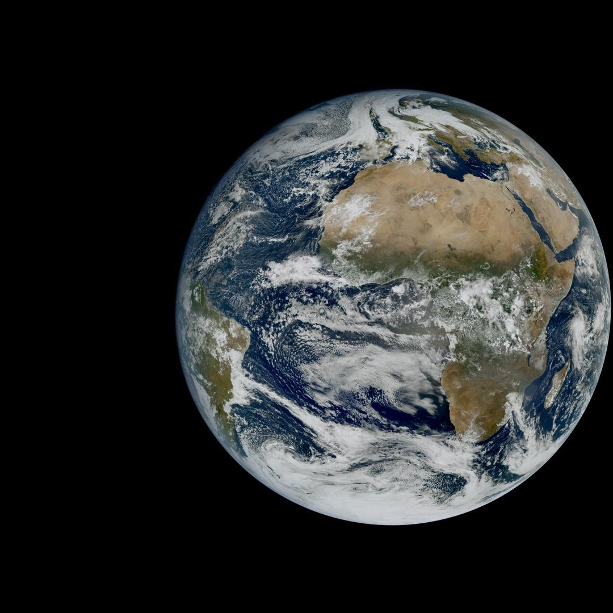
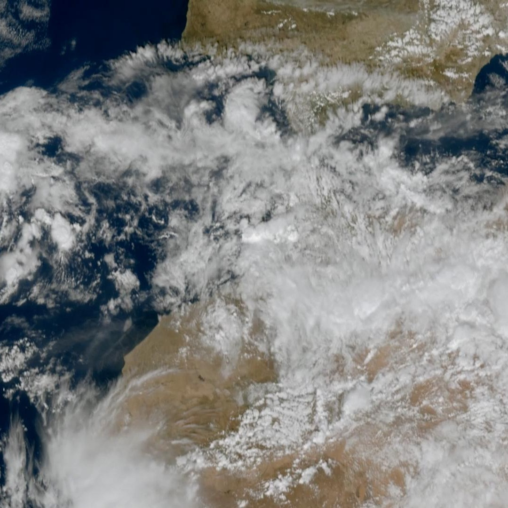
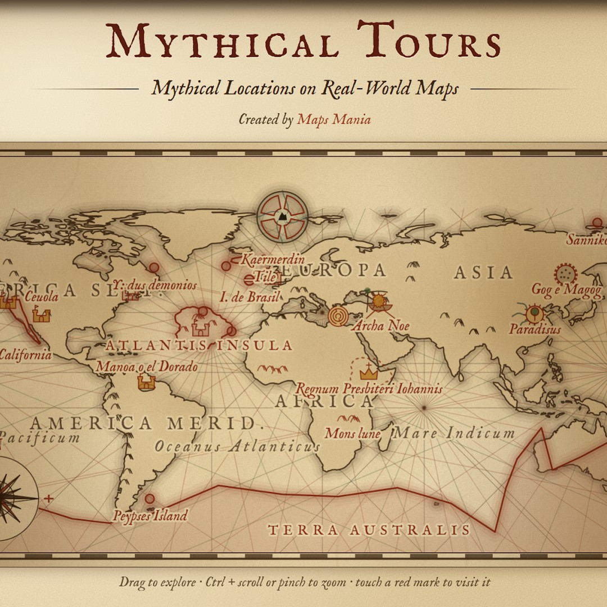

# Geoawesome reposts, 2026-11-07

3 post(s) ready. Each has a 1080×1080 image and its own text for Facebook, Instagram, YouTube Community and X. Nothing has been posted.

**To publish:** tick the box under a post. It is queued for the next free time slot and posted to Facebook and Instagram; a comment here confirms the time. Edit a text in this issue first if you want to change it (what is in the box is what gets posted). Untick before the slot to cancel. When it is live, a comment @mentions you with the YouTube Community text and the X text for Buffer.

---

## 1. MTG-I2 first images

<!-- post:2026-11-07-2-mtg-i2-first-images -->
- [ ] **Publish on Facebook + Instagram**



[Download square image](https://raw.githubusercontent.com/walczakagh/geoawesome-social-agent/main/drafts/images/2026-11-07-2-mtg-i2-first-images.jpg) · square crop, from 1080px of source width

**Source:** [EUMETSAT](http://www.eumetsat.int/mtg-i2-first-images) · score 8.0/10 · First full-disc MTG-I2 images of Europe weather, a new Earth-observation satellite debut.
**Rights:** Someone else's map: the credit line names them; ask them first if unsure. Licence on page: not stated.

**What it shows:** The first full-disc image from the Flexible Combined Imager (FCI) on EUMETSAT's Meteosat Third Generation Imager 2 (MTG-I2), acquired on 20 October 2026 from geostationary orbit about 36,000 km up. It covers Europe, Africa and the Atlantic, with cloud formations across the North Atlantic and largely clear skies over the Sahara. The satellite launched on 27 August 2026 and is still in calibration and validation, with its 2.5-minute rapid scan service over Europe expected to start in Q2 2027.

**Check before posting:**
- The source does not say which FCI channel(s) or composite the image uses, or whether the colours are true or false colour.
- No spatial resolution is given for the image.
- The square is cropped from 1,080 px of the source width, so it may not show the whole disc. Check what the crop contains before describing it as a full disc.
- The rapid-scan animation mentioned on the page is not part of the square image.
- The image licence is not stated on the page (reuse policy: link only).

**Facebook**

```text
Two months after launch, Meteosat Third Generation Imager 2 has sent back its first full-disc view of Earth.

Acquired on 20 October by the Flexible Combined Imager from geostationary orbit, some 36,000 km up, it shows cloud formations stretching across the North Atlantic against largely clear skies over the Sahara. It is still a calibration-phase image: the rapid scan service, refreshing Europe every 2.5 minutes, is expected to go operational in the second quarter of 2027.

Read more: http://www.eumetsat.int/mtg-i2-first-images

Image: EUMETSAT

#Geoawesome #Meteosat #Weather #EUMETSAT
```

**Instagram**

```text
Clouds over the North Atlantic, clear skies over the Sahara: the first look from MTG-I2.

Captured on 20 October from 36,000 km up, while the satellite is still being calibrated.

Find out more: http://www.eumetsat.int/mtg-i2-first-images

Image: EUMETSAT

#Geoawesome #Meteosat #Clouds #Satellite
```

**YouTube Community**

```text
Every 2.5 minutes: that is how often MTG-I2 will refresh its view of Europe once operational.

This first image comes from the satellite's Flexible Combined Imager. It was acquired on 20 October and released just over two months after the 27 August launch. Calibration and validation with ESA and European industry are still under way, and EUMETSAT has not published band or resolution details with the image. An accompanying rapid-scan animation previews how weather systems will be tracked at that cadence from Q2 2027.

Learn more: http://www.eumetsat.int/mtg-i2-first-images

Image: EUMETSAT

#Geoawesome #MTG #Meteorology #Meteosat
```

**X (via Buffer)**

```text
@eumetsat's newest geostationary satellite, MTG-I2, has delivered its first full-disc image (20 October), still in calibration.
http://www.eumetsat.int/mtg-i2-first-images
Image: EUMETSAT
#Geoawesome #Meteosat #Weather
```

**Alt text:** Satellite view of Earth from geostationary orbit, showing swirling cloud bands over the North Atlantic and Europe and largely cloud-free desert across North Africa.

---

## 2. Image of the week: Imagery every 2.5 minutes from MTG-I2

<!-- post:2026-11-07-4-image-of-the-week-imagery-every-2-5-minu -->
- [ ] **Publish on Facebook + Instagram**



[Download square image](https://raw.githubusercontent.com/walczakagh/geoawesome-social-agent/main/drafts/images/2026-11-07-4-image-of-the-week-imagery-every-2-5-minu.jpg) · square crop, from 1080px of source width

**Source:** [EUMETSAT](http://www.eumetsat.int/image-week-imagery-every-25-minutes-mtg-i2) · score 7.0/10 · True-colour and IR imagery of Saharan storms every 2.5 minutes; vivid Earth scene.
**Rights:** Someone else's map: the credit line names them; ask them first if unsure. Licence on page: not stated.

**What it shows:** Animations from EUMETSAT's MTG-I2 geostationary imager, launched on 27 August 2026 and expected to be operational in Q2 2027. One sequence (3-4 November 2026) shows deep convective clouds building over the north-western Sahara, starting in true colour and then switching to a mix of high-resolution visible and infrared imagery. In that mix, infrared shows cloud-top temperatures and heights and visible shows cloud structure and texture. A second sequence (2 November 2026) shows Storm Agneta, a deep Mediterranean low, over southern Italy.

**Check before posting:**
- The source is an animation. Confirm which frame and which sequence the square crop comes from (Sahara convection or Storm Agneta, true colour or visible/infrared). The alt text assumes the Sahara true-colour view.
- The satellite is not yet operational (expected Q2 2027), so this is pre-operational imagery. The page gives no spatial resolution figure.
- No image credit is given on the page, so the credit falls back to EUMETSAT. No licence is stated and the reuse policy is link_only, so check before posting the image itself.
- The page does not name the instrument or the specific spectral channels used in the visible/infrared mix.

**Facebook**

```text
A new image every 2.5 minutes: that is the rapid scan cadence Meteosat Third Generation Imager 2 (MTG-I2) will bring to Europe and North Africa.

The satellite launched on 27 August 2026 and is expected to be operational in Q2 2027, but it is already returning imagery like this: deep convective clouds over the north-western Sahara on 3-4 November 2026. Infrared shows cloud-top temperatures and heights, while visible imagery picks out the texture.

Read more: http://www.eumetsat.int/image-week-imagery-every-25-minutes-mtg-i2

Image: EUMETSAT

#Geoawesome #Meteosat #Weather #Sahara
```

**Instagram**

```text
Storms over the Sahara, refreshed every two and a half minutes.

MTG-I2 caught deep convective clouds towering over the north-western Sahara on 3-4 November 2026, months before it is due to enter service.

Full story: http://www.eumetsat.int/image-week-imagery-every-25-minutes-mtg-i2

Image: EUMETSAT

#Geoawesome #EUMETSAT #Storms #Satellite
```

**YouTube Community**

```text
Visible for texture, infrared for cloud-top temperature and height: MTG-I2 combines both to follow storms as they grow.

The 3-4 November 2026 sequence starts in true colour over the north-western Sahara, then switches to high-resolution visible and infrared. A second sequence tracks Storm Agneta, a deep Mediterranean low, over southern Italy on 2 November. Operational service, with rapid scans of Europe and North Africa every 2.5 minutes, is expected in Q2 2027.

Learn more: http://www.eumetsat.int/image-week-imagery-every-25-minutes-mtg-i2

Image: EUMETSAT

#Geoawesome #Meteosat #Convection #Weather
```

**X (via Buffer)**

```text
Deep convection over the Sahara, seen by a weather satellite that is not operational yet. MTG-I2's 2.5-minute rapid scans are expected from Q2 2027.
http://www.eumetsat.int/image-week-imagery-every-25-minutes-mtg-i2
Image: EUMETSAT
#Geoawesome #Meteosat #Storms #Sahara
```

**Alt text:** Satellite view of large, bright convective cloud clusters building over the desert of the north-western Sahara.

---

## 3. Noah's Ark found on Vintage Maps

<!-- post:2026-11-07-10-noah-s-ark-found-on-vintage-maps -->
- [ ] **Publish on Facebook + Instagram**



[Download square image](https://raw.githubusercontent.com/walczakagh/geoawesome-social-agent/main/drafts/images/2026-11-07-10-noah-s-ark-found-on-vintage-maps.jpg) · square crop, from 1034px of source width

**Source:** [Maps Mania](http://googlemapsmania.blogspot.com/2026/11/noahs-ark-found-on-vintage-maps.html) · score 6.0/10 · Historical maps with a mythical-places hook; cartography with a story, though image is a map scan.
**Rights:** Someone else's map: the credit line names them; ask them first if unsure. Licence on page: not stated.

**What it shows:** A square crop from the Maps Mania post about Mythical Tours, a narrated guided map tour by TripGeo. The tour uses centuries of historical maps to show where cartographers placed legendary and biblical locations: Atlantis, Hy-Brasil, the city of Merlin, the Garden of Eden and Noah's Ark. The source does not say which historical map or location the image shows.

**Check before posting:**
- The page does not say which historical map, location or date the image shows. Check the crop before posting and adjust the alt text to match what is actually visible.
- No image credit or licence is stated on the page, and the reuse policy is link_only. Confirm that a square repost is acceptable.
- The page names no individual historical maps, map dates or number of maps used in the tour.
- Possible conflict of interest: the Maps Mania author says Mythical Tours carries a 'Maps Mania' credit, although their involvement was limited to suggesting the theme to TripGeo.
- The map maker is credited as TripGeo, inferred from the tour URL (tours.tripgeo.com) and the page text.

**Facebook**

```text
Medieval and early modern mapmakers put Atlantis, Hy-Brasil and the Garden of Eden on the same sheets as real coastlines.

Mythical Tours from TripGeo is a narrated map tour that uses centuries of historical maps to track where cartographers placed legendary places, from Hy-Brasil, the phantom island supposedly off the west coast of Ireland, to the city of Merlin. It also follows biblical geography, including where old maps located Noah's Ark.

Read more: http://googlemapsmania.blogspot.com/2026/11/noahs-ark-found-on-vintage-maps.html

Map: TripGeo via Maps Mania

#Cartography #Mythology #Atlantis #Geoawesome
```

**Instagram**

```text
Noah's Ark has a location, if you trust the right vintage map.

Mythical Tours is a narrated journey through centuries of historical maps, stopping at Atlantis, Hy-Brasil and the Garden of Eden.

Full story: http://googlemapsmania.blogspot.com/2026/11/noahs-ark-found-on-vintage-maps.html

Map: TripGeo via Maps Mania

#Maps #Folklore #Cartography #Geoawesome
```

**YouTube Community**

```text
Hy-Brasil, a phantom island supposedly off the west coast of Ireland, is one stop on a narrated tour of places that exist only in legend.

Mythical Tours is one of TripGeo's guided map tours. It steps through historical maps to show where cartographers placed Atlantis, the city of Merlin, the Garden of Eden and Noah's Ark, and you follow the narration from one location to the next. The other TripGeo tours include Solar Tour, Cosmic Trip and Spooky Tours.

Learn more: http://googlemapsmania.blogspot.com/2026/11/noahs-ark-found-on-vintage-maps.html

Map: TripGeo via Maps Mania

#Cartography #History #Mythology #Maps #Geoawesome
```

**X (via Buffer)**

```text
Atlantis, the city of Merlin and Noah's Ark, as located by centuries of mapmakers. A narrated map tour from TripGeo.
http://googlemapsmania.blogspot.com/2026/11/noahs-ark-found-on-vintage-maps.html
Map: TripGeo via Maps Mania
#Cartography #Folklore #History #Geoawesome
```

**Alt text:** A view from the Mythical Tours map showing an old historical map with legendary and biblical places marked alongside real geography.

---

### Skipped after reading the page
- [A loopy typhoon, as seen from space - YouTube](https://www.youtube.com/watch?v=q3s0-rC5GDI): No usable visual: no image found on the page, no image credit, link-only reuse policy, and the snippet gives no typhoon name, location, sensor or date.
- [How Israel has redrawn the map since the October 7 terrorist attack - YouTube](https://www.youtube.com/watch?v=QpQYd-N5zpE): No image on the page, no credit or licence, and only a one-line text fragment from a YouTube video on a contested political topic, so a caption would require guessing.
- [Tracking fires in McLean, Kentucky | WFCA Fire Map - Western Fire Chiefs Association](https://wfca.com/fire-map/detection/4e7c212aeca445fd): The page has no image to repost, the reuse policy is link only, and the text is an auto-generated detection notice (VIIRS NOAA-20, about 174.5 acres in McLean, Kentucky), not a striking visual.
- [Tracking fires in Hill, Texas | WFCA Fire Map - Western Fire Chiefs Association](https://wfca.com/fire-map/detection/b3370b1209cc4436): No image on the page and reuse is link-only; this is an auto-generated MODIS detection stub (496.1 acres, 2 merged observations) with no visual to repost.
- [Tracking the Wildcat Fire in Wyoming | WFCA Fire Map - Western Fire Chiefs Association](https://wfca.com/fire-map/wyoming/wildcat): No image on the page and the only text is an auto-generated fire tracker entry (Wildcat fire, Campbell, Wyoming, '0 acres'), so there is no striking visual to share.
- [Tracking fires in Lewis, Washington | WFCA Fire Map - Western Fire Chiefs Association](https://wfca.com/fire-map/detection/254c04aabe164395): No image on the page and only a one-line automated detection notice (two merged satellite fire detections in Lewis, Washington, sensor not named), so there is no visual to post and nothing to explain without guessing.
- [Tracking fires in Thurston, Washington | WFCA Fire Map - Western Fire Chiefs Association](https://wfca.com/fire-map/detection/f189deebcb43408b): No image on the page (link-only reuse) and the text is an automated fire-detection stub with no date, sensor detail or context to caption without guessing.
- [Tracking the Wanaket Uma 004 Broadcast Rx Fire in Oregon | WFCA Fire Map](https://wfca.com/fire-map/oregon/wanaket_uma_004_broadcast_rx): No image on the page and the text is a one-line automated fire-tracker entry (a prescribed burn listed at 0 acres), so there is no visual to repost.
- [Alarming satellite images show construction near Iran missile bases: report - X](https://x.com/nypost/status/2118806015806226844/photo/1): The source is an NY Post tweet with no readable content, image credit, licence, sensor, date or location, so the image cannot be explained or credited without guessing.
- [Satellite images show new construction at Iran's missile bases - Vesper](https://www.vespernews.com/en/news/dea2b882-a5ce-47e7-b2c8-fa3be6f21b58): The visual cannot be explained or credited without guessing: no image credit or licence, no named site, sensor, provider or exact date, and the reuse policy is link_only.
- [U.S. Geological Survey to conduct 'Earth Mapping' flights over NE Iowa, SE Minnesota](https://www.kwwl.com/news/u-s-geological-survey-to-conduct-earth-mapping-flights-over-ne-iowa-se-minnesota/article_d9a90d6a-d3e3-4cac-a10a-5c060c302d90.html): Local news notice announcing upcoming USGS Earth MRI magnetic survey flights; no survey map or data image to show, and the page image is unidentified, uncredited and only 200px wide.
- [Tracking fires in Jackson, Arkansas | WFCA Fire Map - Western Fire Chiefs Association](https://wfca.com/fire-map/detection/a470bd19188d45a9): Auto-generated fire detection page with no image (IMAGE NOTE: no image found) and link-only reuse, so there is no visual to post.
- [Tracking the Rx North Side Powell Unit 15 Pwrd Fire in Idaho | WFCA Fire Map](https://wfca.com/fire-map/idaho/rx_north_side_powell_unit_15_pwrd): No image on the page, and the only text is an auto-generated fire-tracker line reporting a 0-acre prescribed burn (Rx), so there is nothing striking to post.
- [How did your neighborhood vote? | The Arkansas Democrat-Gazette](https://www.arkansasonline.com/election/map/): Reuse policy is link_only with no image licence or credit, and the page text is too thin to describe the map's results without guessing.
- [Reported Fatalities in High-Speed Train Accidents in 2026 - YouTube](https://www.youtube.com/watch?v=Coeb6Es2Zfo): No image or credit on the page, the reuse policy is link-only, and the snippet is too thin (truncated, no data source or dates) to describe the map of train accident fatalities without guessing.
- [Mapbox on X](https://x.com/Mapbox/status/2118741196688474572): The page text is only X's generic login prompt, with no description of the image, no credit and a link-only reuse policy, so there is nothing to caption without guessing.

---

### Sources checked
- Google Alerts #1: 15 in feed, 15 new
- Google Alerts #2: 20 in feed, 20 new
- Google Alerts #3: 20 in feed, 20 new
- Google Alerts #4: 20 in feed, 20 new
- Google Alerts #5: 20 in feed, 19 new, 1 already found via another source
- Google Alerts #6: 14 in feed, 9 new, 4 already found via another source
- Google Alerts #7: 20 in feed, 20 new
- Google Alerts #8: 1 in feed, 0 new
- NASA Earth Observatory: 10 in feed, 0 new
- ESA Observing the Earth: failed: https://www.esa.int/rssfeed/Applications/Observing_the_Earth: HTTP 404
- EUMETSAT: 10 in feed, 2 new
- Copernicus Atmosphere Monitoring Service: 10 in feed, 0 new
- NASA JPL: 100 in feed, 0 new
- Planet Pulse: 50 in feed, 1 new
- Maps Mania: 25 in feed, 2 new
- Visual Capitalist (maps): 10 in feed, 3 new
- FlowingData: 10 in feed, 1 new
- Google Maps blog: 20 in feed, 0 new
- Google Research blog: 100 in feed, 0 new
- Overture Maps blog: 20 in feed, 0 new
- Bellingcat: 10 in feed, 0 new
- Reddit r/MapPorn: failed: https://www.reddit.com/r/MapPorn/top/.rss?t=day: HTTP 403
- Reddit r/dataisbeautiful: failed: https://www.reddit.com/r/dataisbeautiful/top/.rss?t=day: HTTP 429
