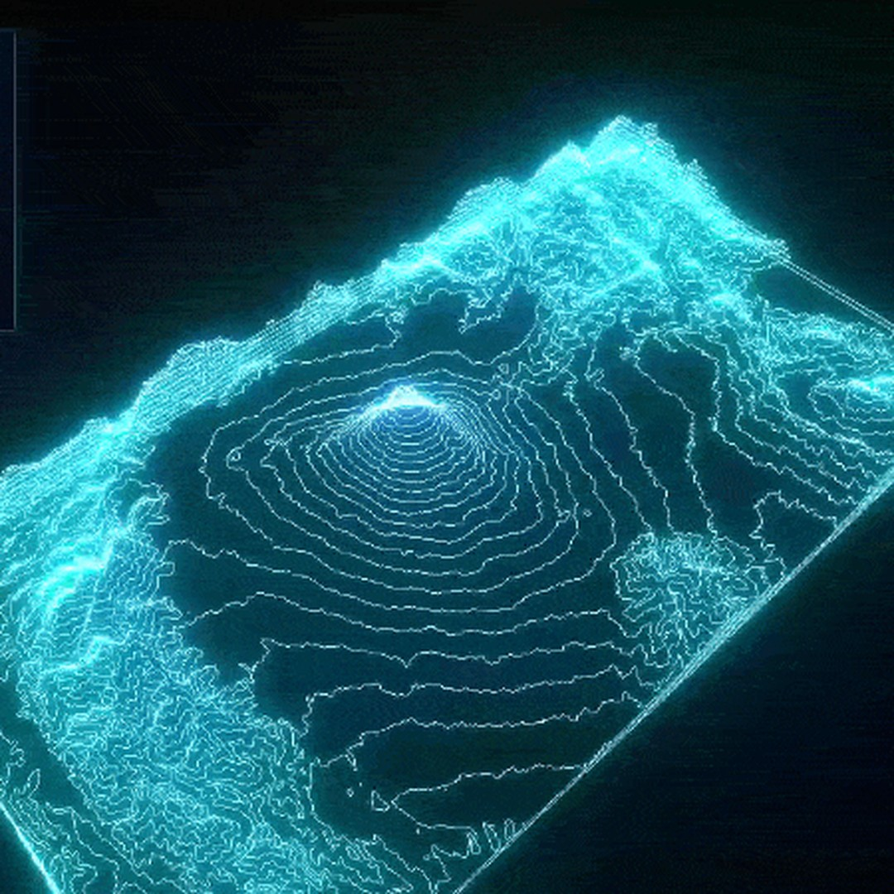
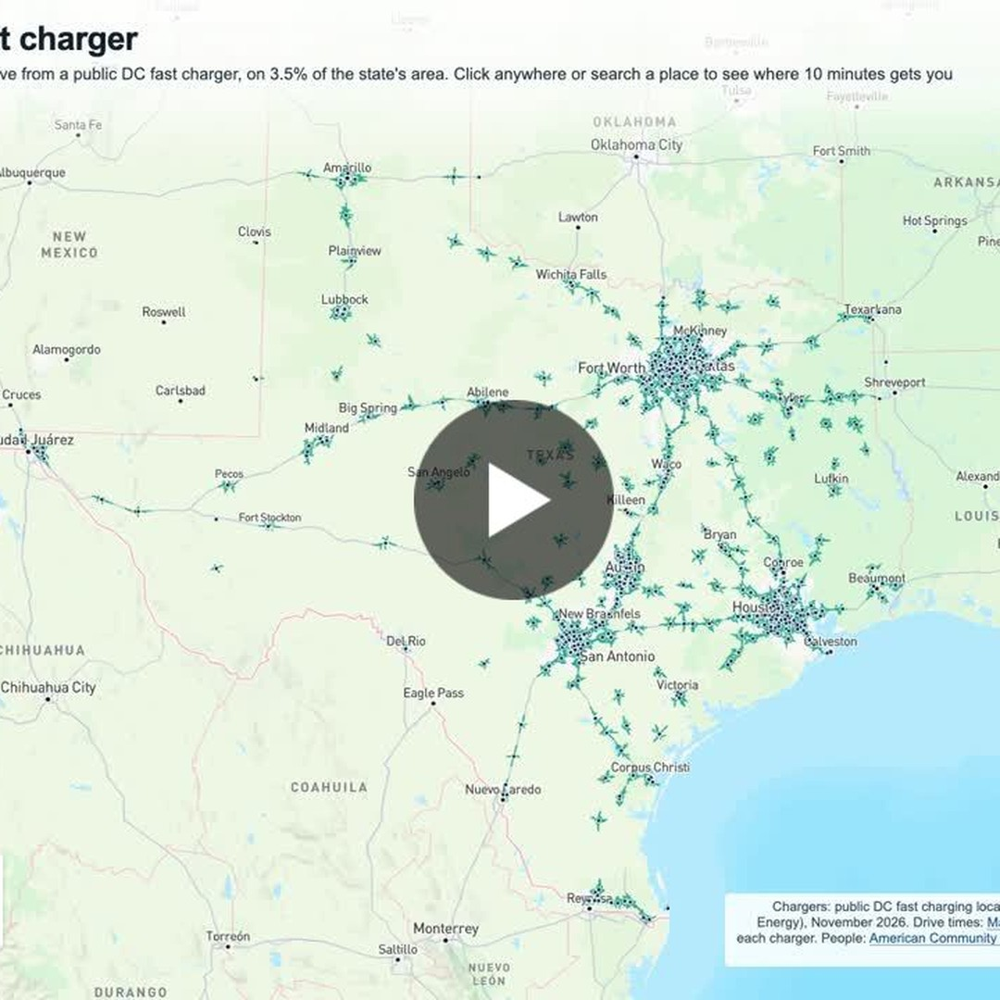

# Geoawesome reposts, 2026-11-08

2 post(s) ready. Each has a 1080×1080 image and its own text for Facebook, Instagram, YouTube Community and X. Nothing has been posted.

**To publish:** tick the box under a post. It is queued for the next free time slot and posted to Facebook and Instagram; a comment here confirms the time. Edit a text in this issue first if you want to change it (what is in the box is what gets posted). Untick before the slot to cancel. When it is live, a comment @mentions you with the YouTube Community text and the X text for Buffer.

---

## 1. Axis Maps Contours

<!-- post:2026-11-08-5-axis-maps-contours -->
- [ ] **Publish on Facebook + Instagram**



[Download square image](https://raw.githubusercontent.com/walczakagh/geoawesome-social-agent/main/drafts/images/2026-11-08-5-axis-maps-contours.jpg) · square crop, from 450px of source width (low resolution: upscaled, check sharpness)

**Source:** [Maps Mania](http://googlemapsmania.blogspot.com/2026/11/axis-maps-contours.html) · score 7.0/10 · Neon illuminated 3D contour map of Mount Fuji, rotating; striking visual from a favourite site.
**Rights:** Someone else's map: the credit line names them; ask them first if unsure. Licence on page: not stated.

**What it shows:** A 3D neon contour map of Mount Fuji made by Maps Mania for the 30DayMapChallenge theme '10 minute map'. The contour lines were exported as GeoJSON from Axis Maps Contours, a free browser-based tool that generates contours at regular elevation intervals for almost anywhere. ChatGPT then wrote three.js code that renders them as illuminated neon lines, with an animation rotating around the centre of the mountain. The author says the whole map took one minute.

**Check before posting:**
- Low-resolution source image (450px wide, upscaled): check sharpness before posting.
- Reuse policy is link_only and no image licence is stated: confirm reposting the image is acceptable.
- The post does not say whether the image is a still of the animated three.js map or a screenshot of Axis Maps Contours. Check which one it is.
- The elevation data behind Axis Maps Contours and the contour interval used are not stated.
- The page gives no individual credit. 'Map: Maps Mania' is used because the blog author made the map. The source suggested 'via Maps Mania'.
- Page text is truncated, so further details about the tool may be missing.
- Colours are described only as 'neon'. The specific colours and background are not stated.

**Facebook**

```text
The challenge was a 10 minute map. This neon Mount Fuji took one minute from start to finish.

Maps Mania exported Fuji's contour lines as GeoJSON from Axis Maps Contours, a free browser tool that builds contours at regular elevation intervals for almost anywhere. A single ChatGPT prompt then produced three.js code that lights the lines up and circles the summit. Each step took about 30 seconds, and the author admits vibe-coding might be cheating.

Read more: http://googlemapsmania.blogspot.com/2026/11/axis-maps-contours.html

Map: Maps Mania

#Geoawesome #Cartography #Elevation #Fuji
```

**Instagram**

```text
Mount Fuji in glowing contour lines, built in about 60 seconds.

The contours came from Axis Maps Contours and the code from one ChatGPT prompt, with the view slowly rotating around the mountain.

Find out more: http://googlemapsmania.blogspot.com/2026/11/axis-maps-contours.html

Map: Maps Mania

#Geoawesome #Contours #Fuji #Threejs
```

**YouTube Community**

```text
Thirty seconds for the data, thirty for the code.

For the 30DayMapChallenge theme '10 minute map', Maps Mania centred Axis Maps Contours on Mount Fuji and downloaded the contour lines as GeoJSON. ChatGPT turned that file into a standalone HTML page using three.js, rendering the contours as illuminated neon lines and animating a rotation around the mountain's centre. The post does not name the elevation source or the contour interval.

Learn more: http://googlemapsmania.blogspot.com/2026/11/axis-maps-contours.html

Map: Maps Mania

#Geoawesome #Topography #Threejs #Mapping
```

**X (via Buffer)**

```text
One GeoJSON export, one ChatGPT prompt, one minute: Mount Fuji as a rotating neon contour map.
http://googlemapsmania.blogspot.com/2026/11/axis-maps-contours.html
Map: Maps Mania
#Geoawesome #Cartography #Contours
```

**Alt text:** Mount Fuji drawn as glowing neon contour lines in a three-dimensional view.

---

## 2. # 30daymapchallenge | Kyle Walker - LinkedIn

<!-- post:2026-11-08-20-30daymapchallenge-kyle-walker-linkedin -->
- [ ] **Publish on Facebook + Instagram**



[Download square image](https://raw.githubusercontent.com/walczakagh/geoawesome-social-agent/main/drafts/images/2026-11-08-20-30daymapchallenge-kyle-walker-linkedin.jpg) · square crop, from 720px of source width

**Source:** [Google Alerts #5](https://www.linkedin.com/posts/walkerke_30daymapchallenge-activity-7524875774265319424-riyW) · score 5.0/10 · 10-minute drive coverage of Texas DC fast chargers; clear geo insight from Kyle Walker.
**Rights:** Someone else's map: the credit line names them; ask them first if unsure. Licence on page: not stated.

**What it shows:** Kyle Walker's Day 7 entry for the #30DayMapChallenge (prompt: 10 minute map): a map of Texas showing areas within a 10-minute drive of public DC fast chargers. He estimates that about 58% of Texans, around 17.4 million people, live inside that coverage. Basemap and isochrones come from Mapbox, and the original is interactive (click anywhere or search a city to see its 10-minute coverage).

**Check before posting:**
- Reuse policy is 'link_only' and no image licence is stated. Check with the editor or Kyle Walker before posting the image itself.
- No image credit on the page. Credit uses the map's maker, Kyle Walker.
- The source of the charger locations and the population data is not stated, and neither is the data date.
- 17.4 million is described as an estimate. The calculation method is not given.
- What the colours or shading mean is not stated in the page text.
- The URL of the interactive map is not in the page text. The lnkd.in link points to the month's collection of maps. Readers may need to go through the LinkedIn post to find the interactive version.
- The LinkedIn page is behind a sign-in wall for some readers.

**Facebook**

```text
An estimated 17.4 million Texans, about 58% of the state's population, live within a 10-minute drive of a public DC fast charger.

Kyle Walker made this map for Day 7 of the 30 Day Map Challenge, where the prompt was a 10 minute map. The basemap and drive-time isochrones come from Mapbox. In the interactive version you can click anywhere or search for your city to see its 10-minute coverage.

Find out more: https://www.linkedin.com/posts/walkerke_30daymapchallenge-activity-7524875774265319424-riyW

Map: Kyle Walker

#Geoawesome #Texas #Isochrones #Mapbox
```

**Instagram**

```text
Fast charging is ten minutes away for 58% of Texans.

Kyle Walker's 10-minute map traces drive-time coverage around public DC fast chargers across the state.

Read more: https://www.linkedin.com/posts/walkerke_30daymapchallenge-activity-7524875774265319424-riyW

Map: Kyle Walker

#Geoawesome #Texas #EV #Cartography
```

**YouTube Community**

```text
Where in Texas is a public DC fast charger less than 10 minutes away by car?

Kyle Walker answers with Mapbox isochrones, the polygons marking how far you can drive in 10 minutes, drawn around public DC fast chargers on a Mapbox basemap. His estimate is that roughly 58% of Texans (about 17.4 million) live inside them. The post does not say which charger or population data feed that figure. It is one of a month of maps on energy and infrastructure.

Full story: https://www.linkedin.com/posts/walkerke_30daymapchallenge-activity-7524875774265319424-riyW

Map: Kyle Walker

#Geoawesome #Isochrones #EV #Infrastructure
```

**X (via Buffer)**

```text
How many Texans can reach a public DC fast charger within a 10-minute drive? About 58%, an estimated 17.4 million.
https://www.linkedin.com/posts/walkerke_30daymapchallenge-activity-7524875774265319424-riyW
Map: Kyle Walker
#Geoawesome #Texas #EV #Isochrones
```

**Alt text:** Map of Texas showing the areas within a 10-minute drive of public DC fast chargers.

---

### Skipped after reading the page
- [Geoawesome on X: "A skull in Antarctic ice: Vega Island, snow-covered in March 2025 and ...](https://x.com/geoawesome_dgtl/status/2118943286010212487): This is Geoawesome's own X post found through Google Alerts; the page text is only X boilerplate, with no image credit, sensor, date or licence, so a caption would require guessing.
- [Iwo Jima, Volcano Islands, Japan, 8 November 2026 In the Sentinel-2 image of Iwo ... - Facebook](https://www.facebook.com/vulcaniya/posts/iwo-jima-volcano-islands-japan-8-november-2026in-the-sentinel-2-image-of-iwo-jim/122212755008442986/): No image or credit on the page, the reuse policy is link-only, and the text is cut off mid-sentence, so we have nothing we can post or describe without guessing.
- [Egypt's Intel Observer on X - @EGYOSINT](https://x.com/EGYOSINT/status/2119100953206964451): The page text is only X's login boilerplate, with no description, place, date or data source, and no image credit or licence (reuse policy is link_only), so the image cannot be captioned without guessing.
- [Search And Deploy: Helicopters, Aerial Drones Part Of Coos County Wild Fire Suppression Efforts](https://www.caledonianrecord.com/news/local/search-and-deploy-helicopters-aerial-drones-part-of-coos-county-wild-fire-suppression-efforts/article_6dd7c00a-cc2d-5470-9317-72920570c4f3.html): The image cannot be posted: the reuse policy is link-only, the page gives no map credit or licence, and the visual is a 630px local-news fire map that would need upscaling.
- [Tracking fires in Aiken, South Carolina | WFCA Fire Map - Western Fire Chiefs Association](https://wfca.com/fire-map/detection/263a3f473f264ac4): No image on the page and it is only an auto-generated VIIRS detection alert for one small fire, so there is no striking visual to post.
- [Tracking fires in Yuma, Arizona | WFCA Fire Map - Western Fire Chiefs Association](https://wfca.com/fire-map/detection/2ba99df3a4cc4d78): Auto-generated fire detection listing with no image on the page, no credit, no licence and only one line of text, so there is nothing to show or explain without guessing.
- [Mario Nawfal on X: " Satellite imagery reportedly shows burn marks at a Saudi ...](https://x.com/MarioNawfal/status/2119129002241647034): Unverified third-party X post with a truncated title, no image credit or licence, a link-only reuse policy and no page text to explain the image without guessing.
- [Pyramids Stand in a Line Along a Lost Nile, Seen From Space - YouTube](https://www.youtube.com/shorts/WXbH1SCzArU): The source is an unavailable YouTube Short with only a title, no image credit or licence, a link-only reuse policy and a low-resolution upscaled crop, so nothing could be described without guessing.
- [Free LiDAR Finder and Old Maps for England & Wales - ARCHI UK](https://www.archiuk.com/cgi-bin/build_lidar_map.pl?map_location=BL3+5JA%2C+BL35JA+in+Bolton%2C+Bolton%2C+Lancashire%2C+England&point_title=BL3+5JA%2C+BL35JA+in+Bolton%2C+Bolton%2C+Lancashire%2C+England&is_sub=ISSUB&pwd=PWDUSR&lidar_model_key=Lidar_Composite_Hillshade_LZ_DSM_1m&placename=BL3+5JA%2C+BL35JA+in+Bolton%2C+Bolton%2C+Lancashire%2C+England&point_lat=53.572830&point_long=-2.446283&postcode=POSTCODE&lidar_template=lidar_simple&archi_lidar_code=LCHDTM1&baselayer=esri_aerial): No image on the page (link-only alert for an auto-generated postcode view of a LiDAR finder tool), so there is no visual to post.
- [Factories Have Used Electric Heat for Decades. New Map Shows Where and Why.](https://www.ejarn.com/article/detail/96072): No image on the page, the text is cut off after one sentence, there is no image credit or licence, and the reuse policy is link only, so there is nothing to post square or describe without guessing.
- [Tracking fires in Bradley, Arkansas | WFCA Fire Map - Western Fire Chiefs Association](https://wfca.com/fire-map/detection/60f16105cc29410e): Auto-generated fire detection listing with no image on the page, a link-only reuse policy and no credit or licence, so there is nothing to post.
- [Mapbox on X](https://x.com/Mapbox/status/2119091756763664665): The page text is only X's generic login prompt: no description of the image, no credit, no licence, and the reuse policy is link_only, so any caption would be guesswork.
- [Explosions Heard on Iran's Qeshm Island and Southern Cities, State TV Reports - Haaretz](https://www.haaretz.com/middle-east-news/iran/2026-11-07/ty-article/.premium/explosions-heard-on-irans-qeshm-island-and-southern-cities-state-tv-reports/000001a1-b7a5-d1cd-aded-bfa79b250000): Breaking news report about explosions with an unclear cause, with no satellite image, map or geodata visual described, no image credit, a link-only reuse policy and a low-resolution image.
- [Satellite images show Ayodhya's Ram Mandir from space ahead of Diwali - Inshorts](https://inshorts.com/en/amp_news/satellite-images-show-ayodhya-s-ram-mandir-from-space-ahead-of-diwali-1794104595524): The source is a truncated Inshorts snippet with no image credit, no licence, a link-only reuse policy and no detail (date, imaging mode, resolution), so the image cannot be credited or described without guessing.
- [Misbar Tracks Israeli Army's Construction of a New Military Road in Southern Lebanon](https://www.misbar.com/en/editorial/2026/11/07/misbar-tracks-israeli-armys-construction-new-military-road-southern-lebanon): The source is link-only for reuse, has no image credit or licence, offers only a 450px image that would need upscaling, and does not say what the image shows (Sentinel-2 frame, video still or map).
- [Demolition site reconstructed as a point cloud , mesh and Gaussian splat - Reddit](https://www.reddit.com/r/3DScanning/comments/1xqjrlv/demolition_site_reconstructed_as_a_point_cloud/): No image was found on the page and no image credit or licence is given (reuse policy link_only), and the post reads as a demo of a commercial processing product rather than a geodata visual we can describe without guessing.
- [This map shows which U.S. counties are visited most frequently. It comes from Mob-Rule⁠, a ...](https://www.facebook.com/historycoolkids/posts/this-map-shows-which-us-counties-are-visited-most-frequentlyit-comes-from-mob-ru/1675046067629635/): No image was found on the page, no credit or licence is stated, and the source is a truncated Facebook repost (link-only reuse) of a Mob-Rule county map, so there is nothing to post square or credit without guessing.
- [This map shows which U.S. counties are visited most frequently. It comes from Mob-Rule⁠, a ...](https://www.instagram.com/p/DfcvZa3i3Ms/): No image was found on the page, there is no image credit, the reuse policy is link_only and the text is a truncated Google Alerts snippet, so we can't post or describe the map without guessing.

---

### Sources checked
- Google Alerts #1: 10 in feed, 10 new
- Google Alerts #2: 9 in feed, 9 new
- Google Alerts #3: 20 in feed, 20 new
- Google Alerts #4: 20 in feed, 20 new
- Google Alerts #5: 20 in feed, 19 new, 1 already found via another source
- Google Alerts #6: 10 in feed, 2 new, 5 already found via another source
- Google Alerts #7: 20 in feed, 20 new
- Google Alerts #8: 7 in feed, 0 new
- NASA Earth Observatory: 10 in feed, 0 new
- ESA Observing the Earth: failed: https://www.esa.int/rssfeed/Applications/Observing_the_Earth: HTTP 404
- EUMETSAT: 10 in feed, 0 new
- Copernicus Atmosphere Monitoring Service: 10 in feed, 0 new
- NASA JPL: 100 in feed, 1 new
- Planet Pulse: 50 in feed, 0 new
- Maps Mania: 25 in feed, 1 new
- Visual Capitalist (maps): 10 in feed, 0 new
- FlowingData: 10 in feed, 0 new
- Google Maps blog: 20 in feed, 0 new
- Google Research blog: 100 in feed, 0 new
- Overture Maps blog: 20 in feed, 0 new
- Bellingcat: 10 in feed, 0 new
- Reddit r/MapPorn: failed: https://www.reddit.com/r/MapPorn/top/.rss?t=day: HTTP 403
- Reddit r/dataisbeautiful: failed: https://www.reddit.com/r/dataisbeautiful/top/.rss?t=day: HTTP 429
