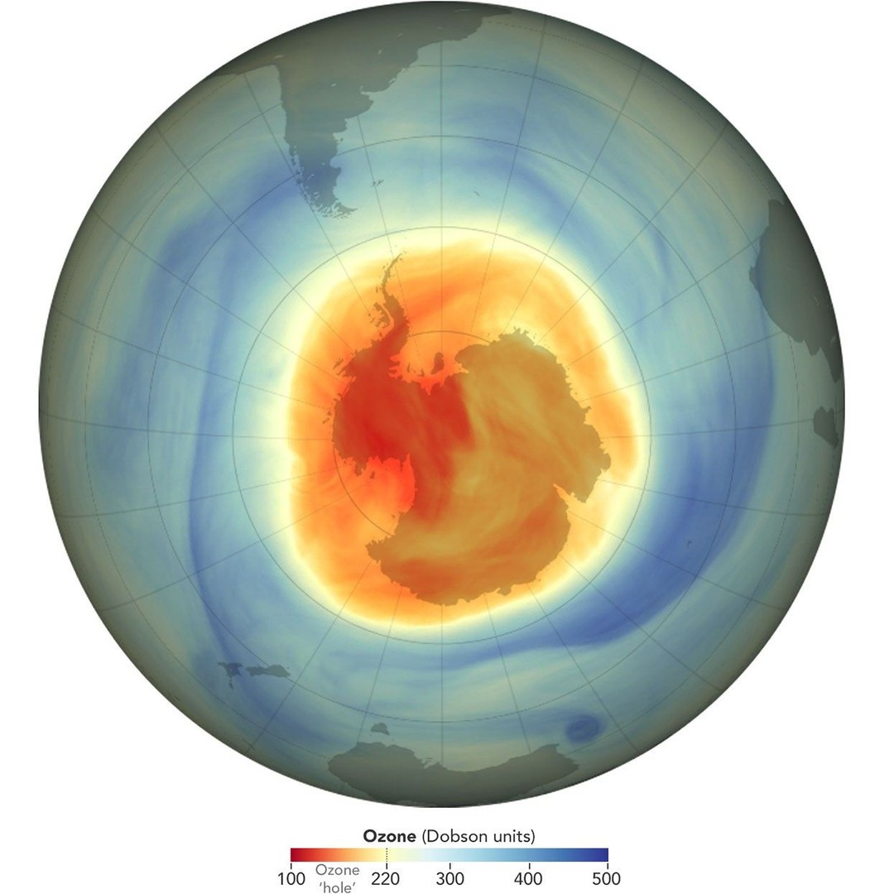
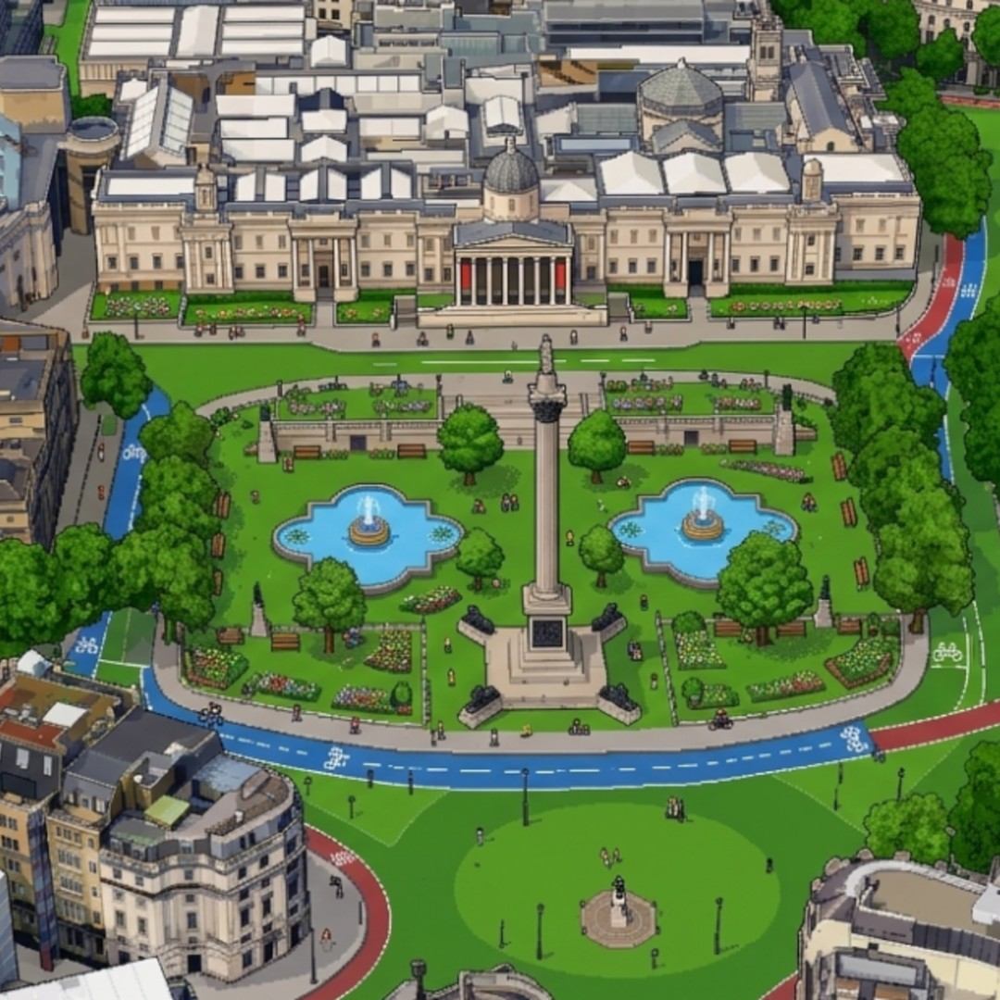

# Geoawesome reposts, 2026-11-09

2 post(s) ready. Each has a 1080×1080 image and its own text for Facebook, Instagram, YouTube Community and X. Nothing has been posted.

**To publish:** tick the box under a post. It is queued for the next free time slot and posted to Facebook and Instagram; a comment here confirms the time. Edit a text in this issue first if you want to change it (what is in the box is what gets posted). Untick before the slot to cancel. When it is live, a comment @mentions you with the YouTube Community text and the X text for Buffer.

---

## 1. Ozone Hole Reaches Its 2026 Maximum

<!-- post:2026-11-09-2-ozone-hole-reaches-its-2026-maximum -->
- [ ] **Publish on Facebook + Instagram**



[Download square image](https://raw.githubusercontent.com/walczakagh/geoawesome-social-agent/main/drafts/images/2026-11-09-2-ozone-hole-reaches-its-2026-maximum.jpg) · square crop, from 1245px of source width

**Source:** [NASA Earth Observatory](https://science.nasa.gov/earth/earth-observatory/ozone-hole-reaches-its-2026-maximum/) · score 8.0/10 · NASA Earth Observatory ozone hole map from satellite data; strong, familiar Earth-observation visual.
**Rights:** Publisher allows reuse with credit. Licence on page: NASA imagery, generally free to reuse with credit.

**What it shows:** A NASA Earth Observatory map of the Antarctic ozone hole on 18 September 2026, the day of its annual maximum area, made with NASA Ozone Watch data from OMPS on the NOAA-20 satellite. Red and yellow areas indicate the ozone hole: concentrations below the historical threshold of 220 Dobson Units. Measured by mean size from 7 September to 13 October, the 2026 hole was the seventh largest in 48 years of monitoring, but not as deep as other large holes, after an unusually strong polar vortex.

**Check before posting:**
- The page has a top map (18 September 2026) and a 1979 to 2026 series. The image note says only 'square crop, from 1245px of source width'. Confirm the crop is the 2026 top map and not a series panel.
- The red/yellow colour key is stated for the series visualisations. It is assumed to apply to the top map as well.
- The page gives no area figure (square kilometres) and no minimum Dobson Unit value for 2026, only the ranking and 'not as deep'.
- '48 years of monitoring' runs 1979 to 2026, but there is no data for 1995.
- The @NASAEarth handle is given in the source but was not used in the posts. Add it if wanted.

**Facebook**

```text
The 2026 Antarctic ozone hole was the seventh largest in 48 years of monitoring, yet not as deep as other big holes.

Shown here on 18 September, its day of maximum area, using OMPS data from NOAA-20; red and yellow mark ozone below 220 Dobson Units. An unusually strong polar vortex set up the conditions.

Read more: https://science.nasa.gov/earth/earth-observatory/ozone-hole-reaches-its-2026-maximum/

Image: NASA Earth Observatory images by Lauren Dauphin, using data from NASA Ozone Watch

#Ozone #Antarctica #Stratosphere #Geoawesome
```

**Instagram**

```text
Antarctica's 2026 ozone hole: seventh largest in 48 years.

Red and yellow mark where ozone dropped below 220 Dobson Units on 18 September, the hole's peak-area day.

Find out more: https://science.nasa.gov/earth/earth-observatory/ozone-hole-reaches-its-2026-maximum/

Image: NASA Earth Observatory images by Lauren Dauphin, using data from NASA Ozone Watch

#Ozone #Antarctica #NASA #Geoawesome
```

**YouTube Community**

```text
Big but not deep: that sums up the 2026 Antarctic ozone hole.

Ranked by mean size from 7 September to 13 October, it was the seventh largest in 48 years of monitoring. This year's data come from OMPS on NOAA-20, taking over from OMPS on Suomi NPP. The 'hole' is the area below 220 Dobson Units, and an unusually strong polar vortex kept it wide.

Full story: https://science.nasa.gov/earth/earth-observatory/ozone-hole-reaches-its-2026-maximum/

Image: NASA Earth Observatory images by Lauren Dauphin, using data from NASA Ozone Watch

#Ozone #OMPS #Stratosphere #Geoawesome
```

**X (via Buffer)**

```text
Seventh largest in 48 years of monitoring, but not among the deepest: the 2026 Antarctic ozone hole, set up by a strong polar vortex.
https://science.nasa.gov/earth/earth-observatory/ozone-hole-reaches-its-2026-maximum/
Image: NASA EO, Lauren Dauphin, NASA Ozone Watch
#Ozone #Antarctica #Geoawesome
```

**Alt text:** Polar map centred on Antarctica showing a large red and yellow area of low ozone over the continent on 18 September 2026.

---

## 2. Utopian London

<!-- post:2026-11-09-8-utopian-london -->
- [ ] **Publish on Facebook + Instagram**



[Download square image](https://raw.githubusercontent.com/walczakagh/geoawesome-social-agent/main/drafts/images/2026-11-09-8-utopian-london.jpg) · square crop, from 1034px of source width

**Source:** [Maps Mania](http://googlemapsmania.blogspot.com/2026/11/utopian-london.html) · score 7.0/10 · Pixel-art map of London reimagined as a utopia; clever, striking map with a hook.
**Rights:** Someone else's map: the credit line names them; ask them first if unsure. Licence on page: not stated.

**What it shows:** A single pixel-art map tile of Trafalgar Square in London, reimagined as a greener, more cycle-friendly place for the #30DayMapChallenge theme 'Utopia'. Maps Mania fed an aerial image of the square into Gemini and asked it to turn the scene into pixel art, grass over the roads, plant more trees and add dedicated cycle lanes. It is an AI-generated illustration, not survey data or a planning proposal.

**Check before posting:**
- The source and date of the original aerial image are not stated.
- The image is AI-generated (Gemini), so its geometry and details are the model's interpretation, not accurate mapping.
- The author's name is not given. The page gives no image credit, so the credit falls back to 'via Maps Mania'.
- No image licence is stated and the reuse policy is link_only. Check permission before posting the image itself.
- The page text is cut off mid-sentence, so the end of the description is missing.
- The tile area (about 0.15 square kilometres) and the 10,600-tile figure are the author's rough estimates.

**Facebook**

```text
Mapping all of Greater London this way would have needed roughly 10,600 tiles, so this Utopia map settles for one: Trafalgar Square.

Maps Mania fed an aerial image of the square into Gemini and asked it to turn the scene into pixel art, grass over the roads, plant more trees and add dedicated cycle lanes. It is an AI illustration made for the 30DayMapChallenge, not a planning proposal, but it shows what central London could look like without traffic.

Read more: http://googlemapsmania.blogspot.com/2026/11/utopian-london.html

Map: via Maps Mania

#Geoawesome #London #Cartography #Utopia
```

**Instagram**

```text
Trafalgar Square with the traffic gone, in pixel art.

Gemini turned an aerial image into pixel art, with grass where the roads were, more trees and new cycle lanes. It is a Utopia-themed entry for the 30DayMapChallenge.

Full story: http://googlemapsmania.blogspot.com/2026/11/utopian-london.html

Map: via Maps Mania

#Geoawesome #London #Cycling #Maps
```

**YouTube Community**

```text
One zoomed-in map tile covers roughly 0.15 square kilometres of London, and this Utopia map uses exactly one.

The method: an aerial image of Trafalgar Square went into Gemini with a prompt to render it as pixel art, replace the roads with grass, add trees and draw in dedicated cycle lanes. Doing the same for all of Greater London's approximately 1,591 square kilometres would take around 10,600 images. Because this is a generative edit, the layout is the model's interpretation rather than mapped data.

Learn more: http://googlemapsmania.blogspot.com/2026/11/utopian-london.html

Map: via Maps Mania

#Geoawesome #Gemini #Urbanism #Cartography
```

**X (via Buffer)**

```text
What if Trafalgar Square's roads were grass and cycle lanes? A pixel-art Utopia map made with Gemini from an aerial image.
http://googlemapsmania.blogspot.com/2026/11/utopian-london.html
Map: via Maps Mania
#Geoawesome #London #Utopia
```

**Alt text:** Pixel-art aerial view of Trafalgar Square in London, with green space in place of roads, extra trees and cycle lanes.

---

### Skipped after reading the page
- [Landsat Timelapse Shows Las Vegas Sprawling Across the Desert - YouTube](https://www.youtube.com/shorts/Ln9HlQQ1y5Q): Third-party YouTube Shorts reupload of NASA Goddard footage, with link-only reuse, no image credit or licence on the page, and a 405px source upscaled to 1080. Better to post from the original NASA SVS page (svs.gsfc.nasa.gov/10721).
- [Tracking the Sandman Fire in Idaho | WFCA Fire Map - Western Fire Chiefs Association](https://wfca.com/fire-map/idaho/sandman?name=SANDMAN): No image on the page, and the only text is an auto-generated tracker line (a 1-acre fire in Ada, Idaho) with no map, sensor, date or visual to describe.
- [Vega Island's skull-shaped glaciers are losing their "face", and scientists say a warmer ...](https://www.ecoportal.net/en/vega-island-skull-glaciers-melting/45072/): Reuse policy is link_only and the page gives no image credit or licence, so the image cannot be reposted, and it is unclear which Landsat 9 date the single cropped image shows.
- [Sentinel-2 satellite imagery shows a large, dark column of smoke rising near the location ... - X](https://x.com/sentdefender/status/2119451340376027394): There is no usable source text: the title is cut off before the location, there is no date, no image credit, no licence, and the claim comes from a third-party X account and cannot be checked.
- [Satellite images show torrent of rock and ice high in Nepalese mountain valley after Nepal ...](https://www.reutersconnect.com/item/satellite-images-show-torrent-of-rock-and-ice-high-in-nepalese-mountain-valley-after-nepal-china-disaster/dGFnOnJldXRlcnMuY29tLDIwMjY6bmV3c21sX1JDMkM2TkFIOUpGRw?lastViewed=dGFnOnJldXRlcnMuY29tLDIwMjY6bmV3c21sX1JDMkM2TkE2TlNaQQ&position=2): No image on the page, no image credit, link-only reuse policy and only a truncated snippet, so there is nothing to post square and no facts to caption.
- [A fascinating global heat map reveals where humanity takes the most photographs ... - Instagram](https://www.instagram.com/p/DffwVZXyjHP/): No image on the page and no maker, data source or credit: only a one-line Instagram teaser that cannot be explained or credited without guessing.
- [Tracking fires in Beltrami, Minnesota | WFCA Fire Map - Western Fire Chiefs Association](https://wfca.com/fire-map/detection/653864eb186c4746): No image on the page: this is an auto-generated fire detection listing (a 0.7-acre Landsat detection in Beltrami, Minnesota) with no visual to repost and no credit or licence.
- [IRGC Targets Three Oil Tankers in the Strait of Hormuz - Townhall](https://townhall.com/news/josephchalfant/2026/11/08/irgc-targets-three-oil-tankers-in-the-strait-of-hormuz-n2686101): No image credit, licence or caption: the page could be showing the Sentinel-2 scene, a still from the IRGC video or a stock photo, and the reuse policy is link-only, so there is nothing we can post or describe without guessing.
- [A satellite image shows fire and smoke rising from an oil depot in Feodosia](https://www.reutersconnect.com/item/a-satellite-image-shows-fire-and-smoke-rising-from-an-oil-depot-in-feodosia/dGFnOnJldXRlcnMuY29tLDIwMjQ6bmV3c21sX1JDMldHQUFEMzczQQ?lastViewed=dGFnOnJldXRlcnMuY29tLDIwMjQ6bmV3c21sX01SUFJDMldHQUFEMzczQQ&position=1): No image was found on the page, no credit or licence is stated, and Reuters Connect is a paid licensing marketplace (reuse policy link_only), so there is no visual we can repost.
- [Mapbox on X: "# 30DayMapChallenge Day 8 — Utopia What if Paris became a lush, green ...](https://x.com/Mapbox/status/2119466727528452339): The source gives only a truncated tweet title (Mapbox, #30DayMapChallenge Day 8 'Utopia', Paris as 'lush, green ...') and X login boilerplate, so the map can't be described without guessing, and the reuse policy is link_only with no image credit or licence.
- [Interactive 3D LiDAR Survey Demo - DH Geo Consultancy](https://dhgeoconsultancy.com/pages/lidar-3d): The image is a stylised in-browser simulation on a consultancy's sales page, not real survey data, and the source's link-only reuse policy and missing image credit rule out reposting it.
- [This map shows the estimated frequency of fires across the United States before 1850. The colors](https://www.facebook.com/groups/284561182238823/posts/1999015300793394/): No image on the page, no credit, and only a truncated sentence from a Facebook group post, so the map's maker, data and colour scale cannot be described without guessing.
- [Iran's Underground Military Buildup Revealed as Satellite Images Show Major Construction](https://www.youtube.com/shorts/mTr5vmfijYQ): Third-party YouTube Short with no image credit, licence, location, sensor or date, and an unverified military claim that cannot be captioned without guessing.
- [A satellite image shows a closer view of the water level of the Kapuas River in Sanggau Regency](https://www.reutersconnect.com/item/a-satellite-image-shows-a-closer-view-of-the-water-level-of-the-kapuas-river-in-sanggau-regency/dGFnOnJldXRlcnMuY29tLDIwMjY6bmV3c21sX1JDMjk0T0FaRk9DSA?lastViewed=dGFnOnJldXRlcnMuY29tLDIwMjY6bmV3c21sX1JDMjk0T0FGNzlJUg&position=2): No image is available (the page has no image, no credit and no licence, and the reuse policy is link-only), and the text is cut off before it gives the sensor or what the image shows.
- [These countries DON'T touch... but how close do they get? - YouTube](https://www.youtube.com/watch?v=fNn7bysM7Vc): No image found on the page, no image credit, link-only reuse policy, and the page text is a single attribution fragment, so the video's content could not be described without guessing.
- [Tracking the Hwy24sbc Fire in North Dakota | WFCA Fire Map](https://wfca.com/fire-map/north-dakota/hwy24sbc): No image on the page, no credit, link-only reuse policy, and the only fact is an auto-generated fire listing reporting 0 acres.
- [Tracking fires in Placer, California | WFCA Fire Map - Western Fire Chiefs Association](https://wfca.com/fire-map/detection/a779af2f27744a07): No image on the page and only an automated, single-line wildfire detection notice (0.4 acres, 4 merged observations) with link-only reuse, so there is no visual to post.
- [Isfahan judiciary chief says executions of protesters will continue | Iran International](https://www.iranintl.com/en/202610112116): Political news article about executions and sanctions on Iran, with no map, satellite image or geodata visual to repost.

---

### Sources checked
- Google Alerts #1: 16 in feed, 15 new
- Google Alerts #2: 12 in feed, 12 new
- Google Alerts #3: 20 in feed, 20 new
- Google Alerts #4: 20 in feed, 20 new
- Google Alerts #5: 20 in feed, 19 new, 1 already found via another source
- Google Alerts #6: 19 in feed, 6 new, 12 already found via another source
- Google Alerts #7: 17 in feed, 17 new
- Google Alerts #8: 3 in feed, 0 new
- NASA Earth Observatory: 10 in feed, 1 new
- ESA Observing the Earth: failed: https://www.esa.int/rssfeed/Applications/Observing_the_Earth: HTTP 404
- EUMETSAT: 10 in feed, 0 new
- Copernicus Atmosphere Monitoring Service: 10 in feed, 0 new
- NASA JPL: 100 in feed, 0 new
- Planet Pulse: 50 in feed, 0 new
- Maps Mania: 25 in feed, 1 new
- Visual Capitalist (maps): 10 in feed, 1 new
- FlowingData: 10 in feed, 0 new
- Google Maps blog: 20 in feed, 0 new
- Google Research blog: 100 in feed, 0 new
- Overture Maps blog: 20 in feed, 0 new
- Bellingcat: 10 in feed, 0 new
- Reddit r/MapPorn: failed: https://www.reddit.com/r/MapPorn/top/.rss?t=day: HTTP 403
- Reddit r/dataisbeautiful: failed: https://www.reddit.com/r/dataisbeautiful/top/.rss?t=day: HTTP 429
