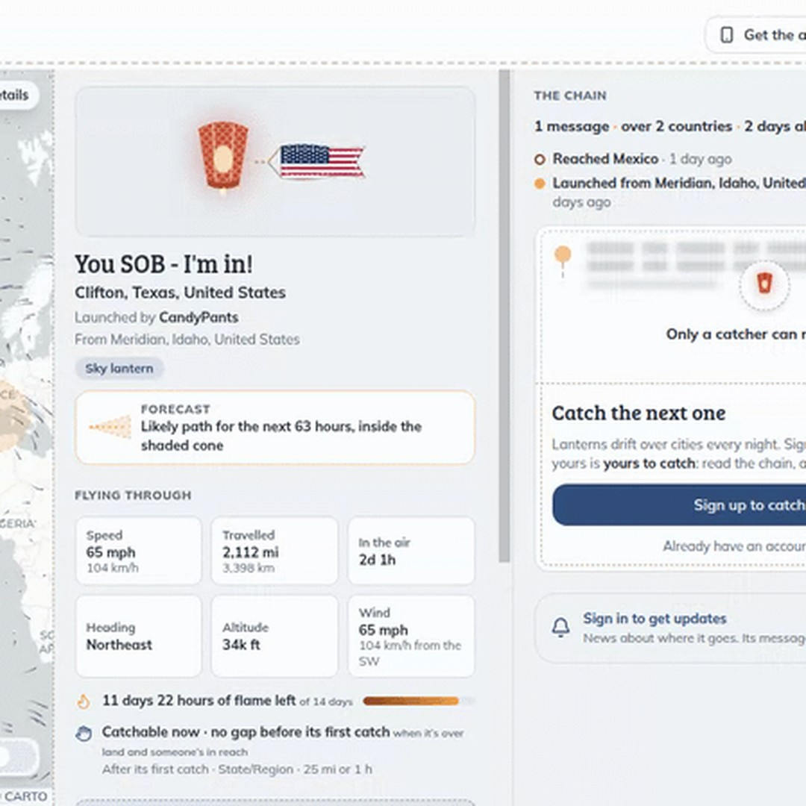
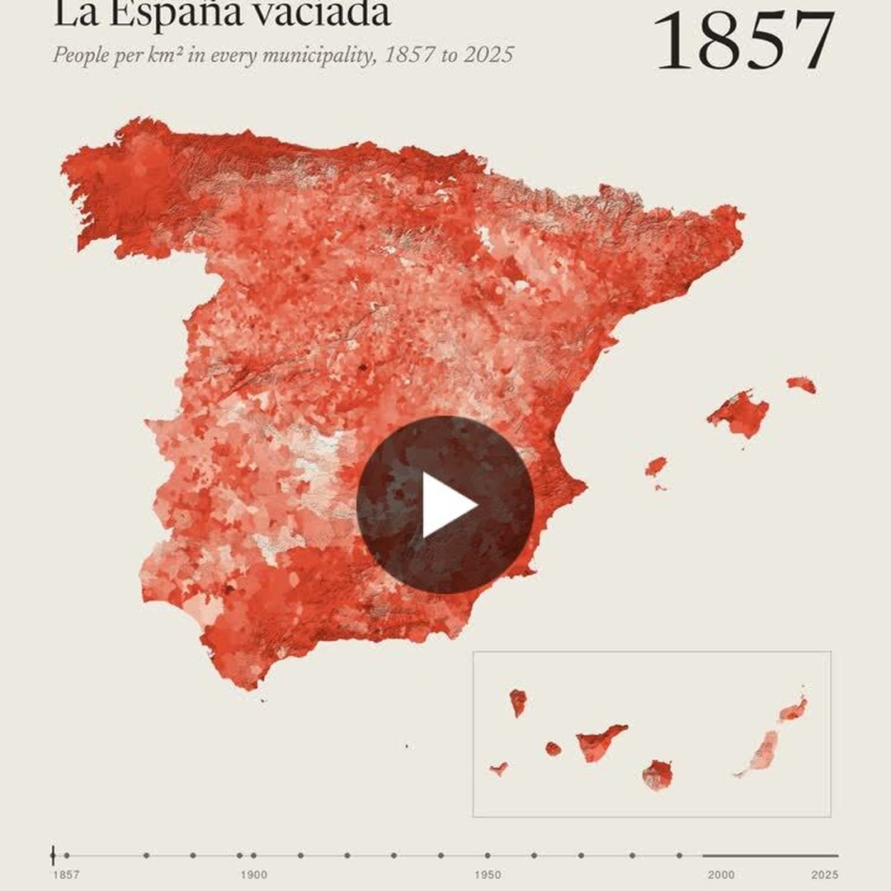

# Geoawesome reposts, 2026-11-10

2 post(s) ready. Each has a 1080×1080 image and its own text for Facebook, Instagram, YouTube Community and X. Nothing has been posted.

**To publish:** tick the box under a post. It is queued for the next free time slot and posted to Facebook and Instagram; a comment here confirms the time. Edit a text in this issue first if you want to change it (what is in the box is what gets posted). Untick before the slot to cancel. When it is live, a comment @mentions you with the YouTube Community text and the X text for Buffer.

---

## 1. Blowing in the Wind

<!-- post:2026-11-10-5-blowing-in-the-wind -->
- [ ] **Publish on Facebook + Instagram**



[Download square image](https://raw.githubusercontent.com/walczakagh/geoawesome-social-agent/main/drafts/images/2026-11-10-5-blowing-in-the-wind.jpg) · square crop, from 449px of source width (low resolution: upscaled, check sharpness)

**Source:** [Maps Mania](http://googlemapsmania.blogspot.com/2026/11/blowing-in-wind.html) · score 7.0/10 · Interactive map where you release a lantern that drifts on real wind data.
**Rights:** Someone else's map: the credit line names them; ask them first if unsure. Licence on page: not stated.

**What it shows:** Tell the Sky is an interactive map, featured on Maps Mania, that shows global wind patterns as animated streams flowing around the planet. Users write a message on a virtual lantern and release it. The lantern drifts with real-world wind currents until another user catches it, reads it, adds a message and releases it again.

**Check before posting:**
- The reuse policy is marked link_only and no image licence is stated, so confirm we may post a crop of the screenshot rather than just the link.
- The image is low resolution (449px of source width, upscaled to 1080), so check sharpness before posting.
- The page does not name the map's maker, only the map name 'Tell the Sky'. The credit uses that name plus Maps Mania.
- The wind data source (model or dataset), its resolution and how often it updates are not stated.
- It is not stated whether the wind field is live or near-real-time, only that it uses 'real-world wind currents'.
- The page text is cut off mid-sentence, so details of the lantern's journey may be missing.
- There is no direct link to the Tell the Sky site in the source material, only the Maps Mania post.
- Check what the cropped image actually shows (wind streams, lanterns, basemap) so the alt text matches.

**Facebook**

```text
A message in a bottle, except the ocean is the atmosphere and the currents are real-world winds.

Tell the Sky is an interactive map that animates global wind patterns as streams flowing around the planet, and those streams decide where your message goes. You write on a virtual lantern and release it. The prevailing winds carry it until another user catches it, reads it, adds their own message and sends it on. The page does not say which wind dataset drives it.

Read more: http://googlemapsmania.blogspot.com/2026/11/blowing-in-wind.html

Map: Tell the Sky via Maps Mania

#Geoawesome #Wind #Maps #Weather
```

**Instagram**

```text
Write a note on a glowing lantern and let the wind decide who reads it.

Tell the Sky animates global wind streams around the planet. Your lantern rides them until a stranger catches it and sends it on.

Find out more: http://googlemapsmania.blogspot.com/2026/11/blowing-in-wind.html

Map: Tell the Sky via Maps Mania

#Geoawesome #Wind #Atmosphere #Cartography
```

**YouTube Community**

```text
On this map the wind field is not decoration: it is the routing engine.

Tell the Sky shows global wind patterns as animated streams. A virtual lantern you launch is carried along by the prevailing winds, potentially across continents and oceans, until another user catches it, adds a message and releases it again. Maps Mania does not name the wind data source or its update frequency, so treat this as a playful visualisation, not a forecasting tool.

Learn more: http://googlemapsmania.blogspot.com/2026/11/blowing-in-wind.html

Map: Tell the Sky via Maps Mania

#Geoawesome #Wind #Weather #Interactive
```

**X (via Buffer)**

```text
Your message travels only as far as the prevailing winds take it. Tell the Sky routes virtual lanterns along real-world wind currents.
http://googlemapsmania.blogspot.com/2026/11/blowing-in-wind.html
Map: Tell the Sky via Maps Mania
#Geoawesome #Wind #Maps
```

**Alt text:** A world map covered in flowing animated lines that trace global wind patterns, from the Tell the Sky interactive map.

---

## 2. José Marín Fariña - LinkedIn

<!-- post:2026-11-10-12-jos-mar-n-fari-a-linkedin -->
- [ ] **Publish on Facebook + Instagram**



[Download square image](https://raw.githubusercontent.com/walczakagh/geoawesome-social-agent/main/drafts/images/2026-11-10-12-jos-mar-n-fari-a-linkedin.jpg) · square crop, from 720px of source width

**Source:** [Google Alerts #5](https://www.linkedin.com/posts/josemarinfarina_30daymapchallenge-30daymapchallenge-blender-activity-7525606051392430081-DlYt) · score 6.0/10 · Blender 3D render of Spain demography from GLO-30 terrain; visually striking.
**Rights:** Someone else's map: the credit line names them; ask them first if unsure. Licence on page: CC BY 4.0), with the boundaries eac.

**What it shows:** An animated 3D map of Spain by José Marín Fariña (Day 9 of the 30DayMapChallenge, theme Urban-Rural) showing population density per municipality census by census from 1857 to today. Colours run from pale (almost nobody) to dark red (the cities), using every census 1857 to 1991 from mapSpainHist by Pau Vall Prat (with historical municipal boundaries) and the INE yearly Padrón 1996 to 2025, with intermediate years interpolated. Terrain is Copernicus GLO-30 read at 60 m, rendered in Blender 5.2.

**Check before posting:**
- Reuse policy is link_only: confirm we may repost the image itself, or ask the author for permission.
- No image credit on the page. Credit uses the author's name as the map's maker.
- The IMAGE LICENCE field (CC BY 4.0) is a parsing error: that licence applies to the mapSpainHist population data, not to the rendered map.
- The source is an animation. The square is a still frame cropped from a 720px-wide source, so it is low resolution, and we do not know which census year the frame shows.
- The causes (1959 Stabilization Plan, farm mechanisation, emigration) are the author's own explanation, not part of the map.
- Years between censuses are interpolated, not observed.

**Facebook**

```text
In 1950 only 64 Spanish municipalities had fewer than 100 inhabitants. Today 1,406 do.

José Marín Fariña animated 'la España vaciada', the emptied Spain, census by census from 1857 to today, shading each municipality by people per km². Between 1960 and 1981 Móstoles, next to Madrid, grew from 2,578 to 150,259 people.

Full story: https://www.linkedin.com/posts/josemarinfarina_30daymapchallenge-30daymapchallenge-blender-activity-7525606051392430081-DlYt

Map: José Marín Fariña

#Spain #Demography #Census #Cartography #Geoawesome
```

**Instagram**

```text
Soria, Teruel and Cuenca now have 42 to 49% fewer people than at their peak.

Pale is almost nobody, dark red is the cities: Spain's municipalities by population density, census by census since 1857, rendered over 3D terrain in Blender.

Read more: https://www.linkedin.com/posts/josemarinfarina_30daymapchallenge-30daymapchallenge-blender-activity-7525606051392430081-DlYt

Map: José Marín Fariña

#Spain #Blender #Cartography #Geoawesome
```

**YouTube Community**

```text
Spain grew from 15.5 to 49 million people since 1857, yet its interior villages emptied.

Day 9 of the 30DayMapChallenge (Urban-Rural). Population comes from every census 1857 to 1991 (mapSpainHist by Pau Vall Prat, with each census's municipal boundaries) and INE's Padrón 1996 to 2025, with the years in between interpolated. Terrain: Copernicus GLO-30 read at 60 m, rendered in Blender 5.2.

Find out more: https://www.linkedin.com/posts/josemarinfarina_30daymapchallenge-30daymapchallenge-blender-activity-7525606051392430081-DlYt

Map: José Marín Fariña

#Copernicus #Census #Blender #Demography #Geoawesome
```

**X (via Buffer)**

```text
Móstoles went from 2,578 people in 1960 to 150,259 in 1981 as rural Spain emptied. Every census since 1857, mapped by municipality.
https://www.linkedin.com/posts/josemarinfarina_30daymapchallenge-30daymapchallenge-blender-activity-7525606051392430081-DlYt
Map: José Marín Fariña
#Spain #Demography #Blender #Geoawesome
```

**Alt text:** A 3D relief map of Spain with each municipality shaded from pale to dark red by population density, with the darkest areas around the cities.

---

### Skipped after reading the page
- [Dubai: 1986 → 2026 From Space - YouTube](https://www.youtube.com/watch?v=sKIrlol3gZw): No image or credit on the page, the reuse policy is link_only, and the fragmentary text does not support a caption without guessing.
- [Hormuz Shipping Crisis: Satellite Images Show Tanker Engulfed In Black Smoke - YouTube](https://www.youtube.com/watch?v=Vlk-wA2-EY8): No usable image or credit: this is a news channel's YouTube video (link-only reuse) with no satellite provider, date, location detail or verifiable source for the imagery.
- [Five strikes, 34 tanks hit—Ukraine keeps coming back to the same Russian oil hub](https://euromaidanpress.com/2026/11/09/five-strikes-34-tanks-hit-ukraine-keeps-coming-back-to-the-same-russian-oil-hub/): No image credit or licence on the page (reuse policy is link_only), and the sensor, provider and capture date of the satellite image are not given, so it cannot be credited or described without guessing.
- [Tracking the 327 Fire in Quebec | WFCA Fire Map - Western Fire Chiefs Association](https://wfca.com/fire-map/quebec/327?name=327&id=CA-2026_QC_327): No image on the page and only a single line of text (fire size), so there is no visual to repost and nothing to describe without guessing.
- [Tracking the Faulkner 223 Fire in Arkansas | WFCA Fire Map](https://wfca.com/fire-map/arkansas/faulkner_223?name=Faulkner+223): No image on the page and only one line of auto-generated text (a 1-acre fire), so there is no visual to post and nothing to explain without guessing.
- [US pauses border construction in Big Bend National Park after widespread criticism](https://lufkindailynews.com/news_reuters/national/file-photo-us-pauses-border-construction-in-big-bend-national-park-after-widespread-criticism/image_91ea1874-4ec7-5e61-a64f-816efb4fc80f.html): The source is flagged link_only, carries no licence, and the only image is a 420px Reuters wire crop of a Planet Labs handout that would be upscaled almost threefold for a 1080px square.
- [Show HN: Every satellite that passed over any place this week, and its photos](https://news.ycombinator.com/item?id=50428907): No image on the page (link-only Show HN thread), and the text is a fragment that does not say what the tool shows, so there is no visual to post and nothing to caption without guessing.
- [Nishinoshima volcano (Pacific Ocean, Japan): new eruption, strong fumarolic activity continues](https://www.volcanodiscovery.com/pt/nishino-shima/news/222688/Nishinoshima-volcano-Pacific-Ocean-Japan-new-eruption-strong-fumarolic-activity-continues.html): No image on the page, no image credit or licence, link-only reuse policy, and only a one-line text snippet: nothing to post without guessing.
- [The Largest Possible (Non-contiguous) Congressional District In Every Western State This ...](https://www.instagram.com/p/Dfiu0MtCNpo/): No image on the page, no credit, link-only reuse, and only a truncated snippet that cannot be described without guessing.
- [Tracking the Mcclung Ridge Fire in Virginia | WFCA Fire Map](https://wfca.com/fire-map/virginia/mcclung_ridge?name=McClung+Ridge): No image on the page and only one line of text (a 2-acre fire in Bath, Virginia), so there is no striking visual to post and no reuse rights (link_only).
- [Tracking the Clark 286 Fire in Arkansas | WFCA Fire Map - Western Fire Chiefs Association](https://wfca.com/fire-map/arkansas/clark_286): No image on the page and only one line of auto-generated text (a 1-acre fire), so there is no visual to post and nothing to explain without guessing.
- [Exploring the world's languages with Language Explorer](https://research.google/blog/exploring-the-worlds-languages-with-language-explorer/): Mainly a corporate and exhibition announcement: the page never describes the image, so it could not be captioned or alt-texted without guessing, and the reuse policy is link_only.
- [Tracking the Jungle Fire in Oregon | WFCA Fire Map](https://wfca.com/fire-map/oregon/jungle): No image on the page, no image credit and no stated licence (link-only reuse), and the text is a single line saying the Jungle fire in Union, Oregon is 5 acres, so there is no striking visual to post.
- [Iran distributes iodine near nuclear site ahead of possible U.S. strike — The Times](https://english.nv.ua/nation/iran-distributes-iodine-near-pickaxe-mountain-ahead-of-possible-u-s-strike-the-times-50657674.html): Geopolitical news report (iodine distribution near Pickaxe Mountain) with no described satellite image or map, no image credit, a link-only reuse policy and a 450px source image.
- [Saudi Arabia says key East-West oil pipeline targeted as Houthi attacks raise fears over ...](https://www.firstpost.com/world/saudi-arabia-says-key-east-west-oil-pipeline-targeted-as-houthi-attacks-raise-fears-over-energy-supplies-14058872.html): No image on the page, no credit or licence, and only a one-line news snippet about an attack, so there is nothing to post without guessing.
- [Josep Ferrer on X: "Europe's cities grow. Its countryside empties. # 30DayMapChallenge Day 9](https://x.com/iamjosepferrer/status/2119852788989735294): Only a tweet title is available (no data source, period, units or legend), the reuse policy is link_only and no image credit or licence is stated, so we cannot describe or repost the map without guessing.
- [Mapbox on X: "# 30DayMapChallenge Day 9 — Urban Rural 🏙️ Great maps bring both ...](https://x.com/Mapbox/status/2119818546020823333): The page text is only X login boilerplate and the title is cut off, so the map cannot be described without guessing. There is also no image credit and the reuse policy is link-only.

---

### Sources checked
- Google Alerts #1: 12 in feed, 12 new
- Google Alerts #2: 11 in feed, 10 new
- Google Alerts #3: 20 in feed, 19 new, 1 from excluded sites
- Google Alerts #4: 20 in feed, 19 new, 1 from excluded sites
- Google Alerts #5: 20 in feed, 20 new
- Google Alerts #6: 13 in feed, 6 new, 7 already found via another source
- Google Alerts #7: 20 in feed, 20 new
- Google Alerts #8: 3 in feed, 0 new
- NASA Earth Observatory: 10 in feed, 1 new
- ESA Observing the Earth: failed: https://www.esa.int/rssfeed/Applications/Observing_the_Earth: HTTP 404
- EUMETSAT: 10 in feed, 0 new
- Copernicus Atmosphere Monitoring Service: 10 in feed, 0 new
- NASA JPL: 100 in feed, 0 new
- Planet Pulse: 50 in feed, 0 new
- Maps Mania: 25 in feed, 1 new
- Visual Capitalist (maps): 10 in feed, 1 new
- FlowingData: 10 in feed, 2 new
- Google Maps blog: 20 in feed, 1 new
- Google Research blog: 100 in feed, 1 new
- Overture Maps blog: 20 in feed, 0 new
- Bellingcat: 10 in feed, 0 new
- Reddit r/MapPorn: failed: https://www.reddit.com/r/MapPorn/top/.rss?t=day: HTTP 403
- Reddit r/dataisbeautiful: failed: https://www.reddit.com/r/dataisbeautiful/top/.rss?t=day: HTTP 429
