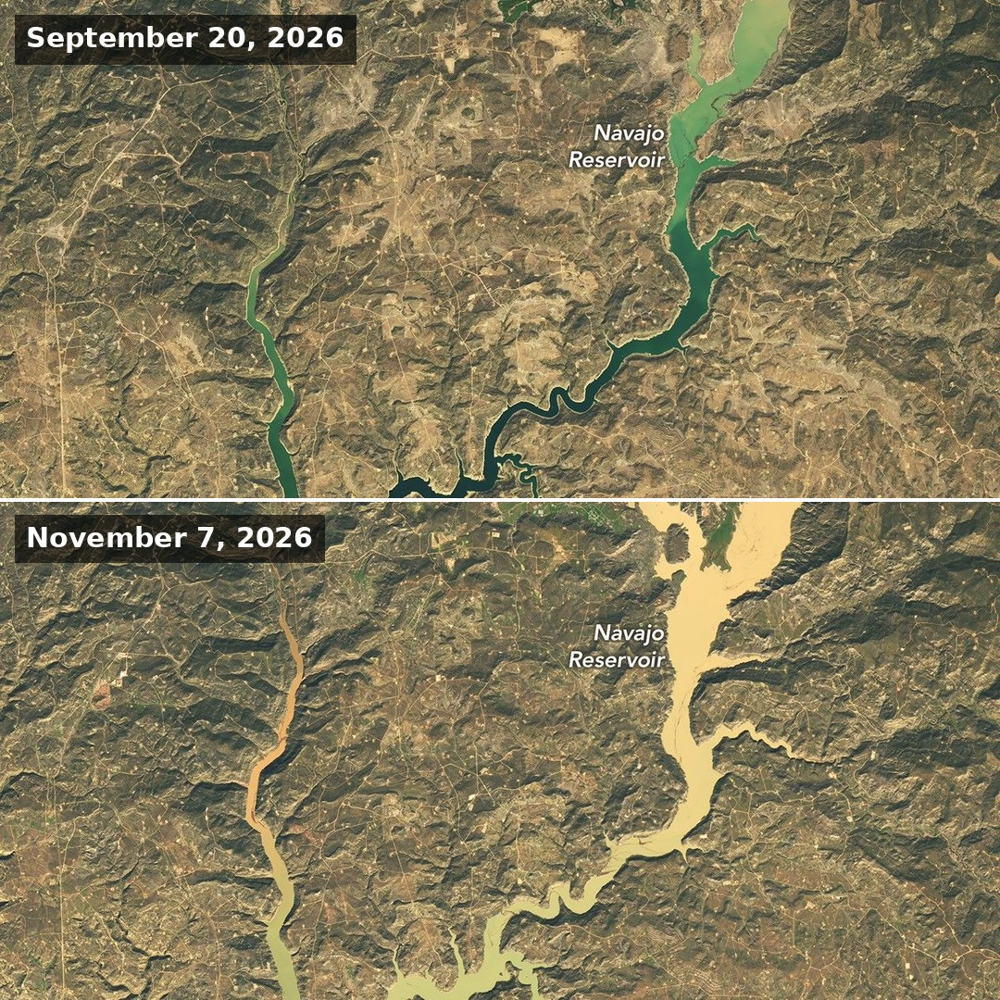
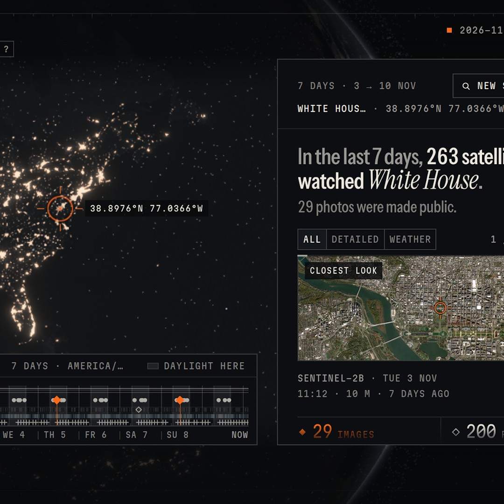
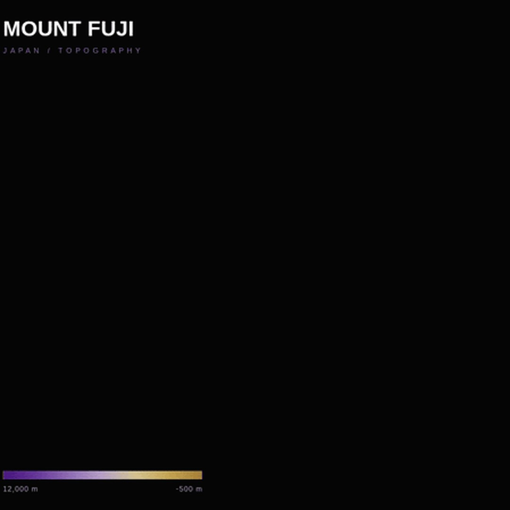
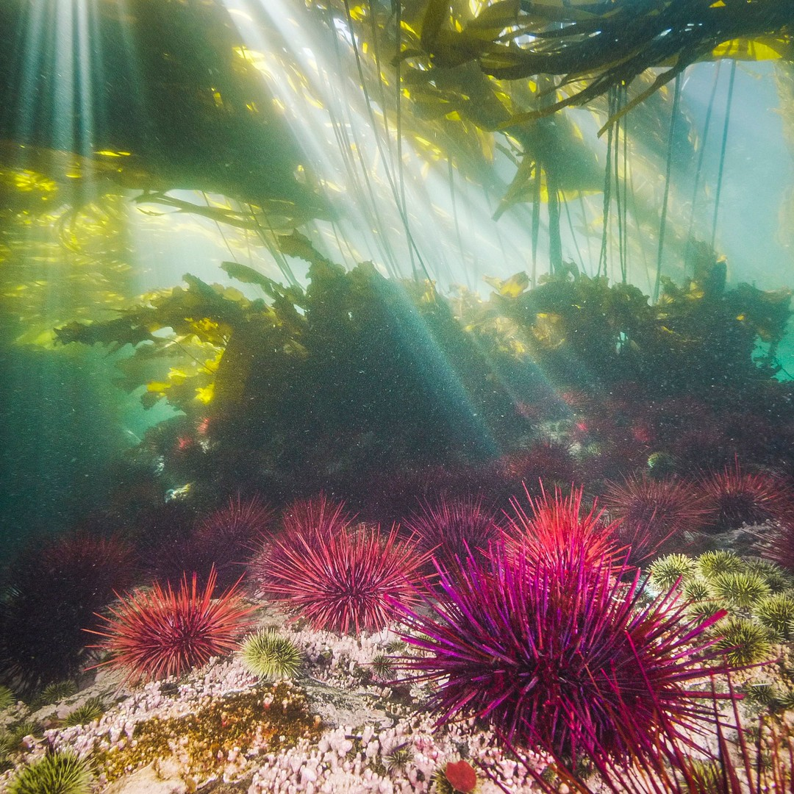

# Geoawesome reposts, 2026-11-11

4 post(s) ready. Each has a 1080×1080 image and its own text for Facebook, Instagram, YouTube Community and X. Nothing has been posted.

**To publish:** tick the box under a post. It is queued for the next free time slot and posted to Facebook and Instagram; a comment here confirms the time. Edit a text in this issue first if you want to change it (what is in the box is what gets posted). Untick before the slot to cancel. When it is live, a comment @mentions you with the YouTube Community text and the X text for Buffer.

---

## 1. Water Surges Into Navajo Reservoir

<!-- post:2026-11-11-4-water-surges-into-navajo-reservoir -->
- [ ] **Publish on Facebook + Instagram**



[Download square image](https://raw.githubusercontent.com/walczakagh/geoawesome-social-agent/main/drafts/images/2026-11-11-4-water-surges-into-navajo-reservoir.jpg) · before/after pair stacked, from 1264px of source width

**Source:** [NASA Earth Observatory](https://science.nasa.gov/earth/earth-observatory/water-surges-into-navajo-reservoir/) · score 8.0/10 · Satellite view of flooded Navajo Reservoir surge; strong Earth-observation scene from a favourite source.
**Rights:** Publisher allows reuse with credit. Licence on page: NASA imagery, generally free to reuse with credit.

**What it shows:** A before/after pair of Navajo Reservoir in northern New Mexico and southern Colorado, imaged by the OLI on Landsat 9. On the square, the top image is from 20 September 2026 and the bottom from 7 November 2026, after back-to-back extreme rain events hit the Four Corners region. In that time the lake rose by nearly 60 feet (18 metres), according to U.S. Army Corps of Engineers data, going from 60 percent to 108 percent of average capacity for the date.

**Check before posting:**
- The band combination and colour rendering are not stated (probably natural colour, but the source does not say), so colours are not described in the posts.
- The IMAGE CREDIT field is truncated ('from the U'). The full credit, 'NASA Earth Observatory images by Michala Garrison, using Landsat data from the U.S. Geological Survey', is taken from the page text. Check that it matches.
- The page describes the images as left/right. The square stacks them top (20 September) and bottom (7 November), so confirm the editor's layout matches.
- The 18-metre rise comes from U.S. Army Corps of Engineers gauge data, not from the imagery. The Bureau of Reclamation also reduced releases from Navajo Dam on 16 and 17 September, so the rise is not purely storm runoff.
- Rescue figures for Pagosa Springs are 'according to news reports' and are left out of the posts.
- No image resolution or scene extent is given.

**Facebook**

```text
Between 20 September and 7 November 2026, Navajo Reservoir rose by nearly 18 metres (60 feet), according to U.S. Army Corps of Engineers data.

Landsat 9 OLI views of New Mexico's second-largest reservoir before (top) and after (bottom) back-to-back storms in the Four Corners. It went from 60 to 108 percent of average capacity for the date, its highest level since August 2019.

Read more: https://science.nasa.gov/earth/earth-observatory/water-surges-into-navajo-reservoir/

Image: NASA Earth Observatory images by Michala Garrison, using Landsat data from the U.S. Geological Survey

#Landsat #Floods #Rainfall #Geoawesome
```

**Instagram**

```text
From 60 to 108 percent of average capacity: Navajo Reservoir after a very wet autumn.

Top: 20 September 2026. Bottom: 7 November 2026, the lake's highest level since August 2019 (Landsat 9).

Find out more: https://science.nasa.gov/earth/earth-observatory/water-surges-into-navajo-reservoir/

Image: NASA Earth Observatory images by Michala Garrison, using Landsat data from the U.S. Geological Survey

#Landsat9 #Drought #Reservoirs #Geoawesome
```

**YouTube Community**

```text
Storms in late October and early November 2026 lifted Navajo Reservoir by nearly 60 feet, per U.S. Army Corps of Engineers data.

The pair comes from the Operational Land Imager on Landsat 9: 20 September (top) and 7 November (bottom). Precipitation ran 2 to 4 times average across the Four Corners. The Bureau of Reclamation had also cut releases from Navajo Dam on 16 and 17 September.

Full story: https://science.nasa.gov/earth/earth-observatory/water-surges-into-navajo-reservoir/

Image: NASA Earth Observatory images by Michala Garrison, using Landsat data from the U.S. Geological Survey

#Landsat #Hydrology #Drought #Geoawesome
```

**X (via Buffer)**

```text
Navajo Reservoir held 60% of its average capacity on 20 Sept and 108% on 7 Nov 2026, after storms soaked the Four Corners. Landsat 9, top before, bottom after.
https://science.nasa.gov/earth/earth-observatory/water-surges-into-navajo-reservoir/
Image: NASA Earth Observatory, Landsat data from USGS
#Landsat #Floods #Reservoirs #Geoawesome
```

**Alt text:** Two stacked satellite images of Navajo Reservoir, the top from 20 September 2026 with the lake at a lower level and the bottom from 7 November 2026 with the lake noticeably higher after heavy rain.

---

## 2. Has a Satellite Been Watching You?

<!-- post:2026-11-11-5-has-a-satellite-been-watching-you -->
- [ ] **Publish on Facebook + Instagram**



[Download square image](https://raw.githubusercontent.com/walczakagh/geoawesome-social-agent/main/drafts/images/2026-11-11-5-has-a-satellite-been-watching-you.jpg) · square crop, from 1034px of source width

**Source:** [Maps Mania](http://googlemapsmania.blogspot.com/2026/11/has-satellite-been-watching-you.html) · score 8.0/10 · Interactive satellite-watching map showing which satellites photographed any location; playable and intriguing.
**Rights:** Someone else's map: the credit line names them; ask them first if unsure. Licence on page: not stated.

**What it shows:** Watched is an interactive map with a 3D globe. You enter any location and it reconstructs the satellites that passed within viewing range over the previous seven days, then searches public satellite imagery archives for photographs captured during those passes. Users can replay passes, follow trajectories and browse the images, and the globe also shows thousands of other tracked objects lit by the real position of the Sun.

**Check before posting:**
- The maker of Watched is not named and the Maps Mania post gives no direct URL for the tool, so the credit uses the tool's name plus the blog.
- No image credit or licence is stated, and the reuse policy is link_only. Check whether the screenshot can be reposted.
- The post does not say which public imagery archives are searched or which satellites and sensors are covered, so no missions are named.
- The source says the map 'attempts' to answer the question. The accuracy of matching passes to images is not described.
- The exact content of the cropped screenshot is not described. Check the alt text against the actual image.

**Facebook**

```text
Pick any spot on Earth and a new map will tell you which satellites flew over it in the past seven days, and which ones took a picture.

Watched replays a week of passes on a 3D globe, then searches public imagery archives for photographs captured on each pass. What it makes visible: an overpass is not an acquisition.

Read more: http://googlemapsmania.blogspot.com/2026/11/has-satellite-been-watching-you.html

Map: Watched via Maps Mania

#Geoawesome #Satellites #Imagery #Maps
```

**Instagram**

```text
Seven days, one location, every satellite that passed overhead.

Enter any place and Watched replays the passes on a 3D globe lit by the real position of the Sun, then searches public archives for photos taken along the way.

Find out more: http://googlemapsmania.blogspot.com/2026/11/has-satellite-been-watching-you.html

Map: Watched via Maps Mania

#Geoawesome #Satellites #Orbit #Globe
```

**YouTube Community**

```text
Not every satellite passing overhead is taking a picture of you. A new interactive map tries to show which ones did.

Watched reconstructs the past week of activity above any location, identifies satellites that came within viewing range and searches public imagery archives for photographs captured during those passes. On the 3D globe you can replay passes, follow trajectories and browse the matching images, alongside thousands of other tracked objects.

Learn more: http://googlemapsmania.blogspot.com/2026/11/has-satellite-been-watching-you.html

Map: Watched via Maps Mania

#Geoawesome #Satellites #Orbit #Tracking
```

**X (via Buffer)**

```text
Which satellites photographed your street this week? Watched checks the past seven days of passes against public imagery archives.
http://googlemapsmania.blogspot.com/2026/11/has-satellite-been-watching-you.html
Map: Watched via Maps Mania
#Geoawesome #Satellites #Space
```

**Alt text:** Screenshot of the Watched interactive map showing satellite passes around a 3D globe of the Earth.

---

## 3. Contoured Fuji

<!-- post:2026-11-11-11-contoured-fuji -->
- [ ] **Publish on Facebook + Instagram**



[Download square image](https://raw.githubusercontent.com/walczakagh/geoawesome-social-agent/main/drafts/images/2026-11-11-11-contoured-fuji.jpg) · square crop, from 449px of source width (low resolution: upscaled, check sharpness)

**Source:** [Maps Mania](http://googlemapsmania.blogspot.com/2026/11/contoured-fuji.html) · score 7.0/10 · Animated contour map of Mount Fuji; clever geo visual from a favourite site.
**Rights:** Someone else's map: the credit line names them; ask them first if unsure. Licence on page: not stated.

**What it shows:** An animated contour map of Mount Fuji built entirely through ChatGPT prompts and three.js for the 30DayMapChallenge 'Prompting Only' theme. It uses a contours GeoJSON downloaded from Axis Maps Contours. The highest contour appears first, then each lower one, on a colour ramp that is darkest at the top. Later prompts added a 3D effect, a rotation from a top-down to a side-on view and reduced vertical exaggeration. It was inspired by an animated contour map by Andy Woodruff.

**Check before posting:**
- Reuse policy is 'link_only' and no image licence is stated. Confirm that reposting the image is allowed before publishing.
- The source image is only 449px wide and has been upscaled. Check sharpness at 1080x1080.
- The page text is cut off before the link to the final map, so it is unclear whether the final version is an interactive page. The captions only describe the animation.
- The page gives no contour interval, elevation units or colour ramp values.
- The author is not named in the page text, so the credit is the blog, 'Maps Mania'.
- The challenge day number is not stated.

**Rule problems left after one fix attempt:**
- Facebook: #ChatGPT is not a single word

**Facebook**

```text
This animated Mount Fuji was built entirely through ChatGPT prompts, starting from a single contours GeoJSON.

Maps Mania made it for the 30DayMapChallenge 'Prompting Only' brief. Contours from Axis Maps Contours appear highest first, on a colour ramp that darkens towards the summit.

Read more: http://googlemapsmania.blogspot.com/2026/11/contoured-fuji.html

Map: Maps Mania

#Cartography #Fuji #AI #ChatGPT #Geoawesome
```

**Instagram**

```text
Mount Fuji, drawn from the summit down, one contour at a time.

An animated map produced entirely in a ChatGPT chat window, with the darkest colour at the peak.

Find out more: http://googlemapsmania.blogspot.com/2026/11/contoured-fuji.html

Map: Maps Mania

#Fuji #Contours #Japan #Geoawesome
```

**YouTube Community**

```text
The brief: make AI produce a map from start to finish in a chat window. The result: Mount Fuji in animated contours.

The input is a contours GeoJSON from Axis Maps Contours, rendered top-down in three.js, with the highest elevation drawn first and a colour ramp that is darkest at the top. Follow-up prompts added a 3D effect, a rotation from top-down to side-on and lower vertical exaggeration.

Learn more: http://googlemapsmania.blogspot.com/2026/11/contoured-fuji.html

Map: Maps Mania

#Threejs #Contours #Cartography #AI #Geoawesome
```

**X (via Buffer)**

```text
No hand-written code: ChatGPT and three.js turned a contours GeoJSON into this animated Mount Fuji, peak first.
http://googlemapsmania.blogspot.com/2026/11/contoured-fuji.html
Map: Maps Mania
#Mapping #Fuji #AI #Geoawesome
```

**Alt text:** A top-down contour map of Mount Fuji with concentric elevation lines coloured on a ramp that grows darker towards the summit.

---

## 4. Tracking the Ocean’s Great Forest: How Hakai Institute's Kelp Explorer Is Helping British Columbia Secure Its Coastal Heritage

<!-- post:2026-11-11-18-tracking-the-ocean-s-great-forest-how-ha -->
- [ ] **Publish on Facebook + Instagram**



[Download square image](https://raw.githubusercontent.com/walczakagh/geoawesome-social-agent/main/drafts/images/2026-11-11-18-tracking-the-ocean-s-great-forest-how-ha.jpg) · square crop, from 2160px of source width

**Source:** [Planet Pulse](https://www.planet.com/pulse/tracking-the-ocean-s-great-forest-how-hakai-institute-s-kelp-explorer-is-helping-british/) · score 6.0/10 · Kelp Explorer portal built on Planet imagery; map tool, but no image supplied.
**Rights:** Someone else's map: the credit line names them; ask them first if unsure. Licence on page: not stated.

**What it shows:** A photograph of a kelp forest in the Broughton Archipelago, British Columbia, by Grant Callegari of the Hakai Institute. It illustrates a Planet Pulse article on Hakai Institute's Kelp Explorer, a free online tool. The tool maps kelp forests along the BC coast using roughly 3 m PlanetScope imagery classified with machine learning, alongside a decades-long Landsat time series.

**Check before posting:**
- The image is a photograph, not satellite imagery. The page does not say whether it was taken from a drone, an aircraft or the surface.
- No capture date is given for the photo.
- The image licence is not stated on the page, and the reuse policy is link_only. Check the permission to repost the image before publishing.
- The PlanetScope-derived kelp visualisation mentioned in the article might be a more EO-relevant image, but its credit is not given in the source text.
- The page text is truncated, so details about Kelp Explorer's features (what users can click or compare) are not available.

**Facebook**

```text
As of 2020, no one had ever mapped kelp along the entire British Columbia coast.

This kelp forest in the Broughton Archipelago is the kind of habitat Hakai Institute's free Kelp Explorer now tracks, using about 3 m PlanetScope imagery to catch small shoreline beds that other sensors miss. A decades-long Landsat time series supplies the history.

Read more: https://www.planet.com/pulse/tracking-the-ocean-s-great-forest-how-hakai-institute-s-kelp-explorer-is-helping-british/

Image: Grant Callegari, Hakai Institute

#Kelp #Satellites #Landsat #Oceans #Geoawesome
```

**Instagram**

```text
Bull kelp is an annual, so a forest can shift from one year to the next.

This kelp forest in the Broughton Archipelago is part of a coast Hakai Institute now maps with PlanetScope imagery.

Find out more: https://www.planet.com/pulse/tracking-the-ocean-s-great-forest-how-hakai-institute-s-kelp-explorer-is-helping-british/

Image: Grant Callegari, Hakai Institute

#Kelp #Canada #Satellites #Geoawesome
```

**YouTube Community**

```text
At about 3 m resolution, PlanetScope catches small shoreline kelp beds that other satellite sensors miss.

Hakai Institute classifies that imagery with machine learning and pairs it with a decades-long Landsat time series, which flags outlier years and their possible links to marine heatwaves. Both feed the free Kelp Explorer tool. Pictured: a kelp forest in the Broughton Archipelago.

Learn more: https://www.planet.com/pulse/tracking-the-ocean-s-great-forest-how-hakai-institute-s-kelp-explorer-is-helping-british/

Image: Grant Callegari, Hakai Institute

#Kelp #Imagery #Landsat #Coasts #Geoawesome
```

**X (via Buffer)**

```text
Guardian Watchmen once logged kelp by boat along about 800 km of BC coastline in one summer. Hakai's Kelp Explorer now maps it with PlanetScope.
https://www.planet.com/pulse/tracking-the-ocean-s-great-forest-how-hakai-institute-s-kelp-explorer-is-helping-british/
Image: Grant Callegari, Hakai Institute
#Kelp #Mapping #Oceans #Geoawesome
```

**Alt text:** A kelp forest in the waters of the Broughton Archipelago, British Columbia.

---

### Skipped after reading the page
- [Satellite images show oil in waters off the coast of Oman on November 6 and the UAE](https://www.facebook.com/ArabNews/videos/satellite-images-show-oil-slicks-off-oman-and-uae-coasts/1184597400559759/): Link-only reuse policy with no image credit or licence, and only a fragment of text from an Arab News video, so the oil-slick image cannot be reposted or described without guessing.
- [Giant oil slick off Oman's coast is visible from space now - Around Prague](https://aroundprague.cz/en/news/world/giant-oil-slick-spreads-off-the-coast-of-oman-and-can-be-seen-from-space): No image on the page, no image credit and only a one-line snippet, so there is no visual to post and nothing to caption without guessing (sensor, date, size, cause).
- [Tankers continue to burn in the Middle East despite hopes for de-escalation - WNWN-FM](https://wincountry.com/2026/11/10/tankers-continue-to-burn-in-the-middle-east-despite-hopes-for-de-escalation/): This is a syndicated Reuters conflict news story. We cannot tell whether the page image is the Sentinel-2 scene or a news photo, it has no credit or licence, and it is only 450 px wide.
- [Satellite images show oil slicks off Oman and UAE coasts - YouTube](https://www.youtube.com/shorts/6qNOVFhAbcE): There is no image credit or licence, the source is link-only, the frame is a 405px YouTube Shorts grab, and one sentence of text gives no sensor, publisher or detail to caption it without guessing.
- [Satellite images show oil in waters off the coast of Oman on November 6 and the UAE](https://www.facebook.com/ArabNews/posts/satellite-images-show-oil-in-waters-off-the-coast-of-oman-on-november-6-and-the-/1573963421435333/): No image on the page, no image credit, link-only reuse policy, and the page text is a truncated snippet, so the visual cannot be described without guessing.
- [Tankers continue to burn in the Middle East despite hopes for de-escalation - Internazionale](https://www.internazionale.it/ultime-notizie-reuters/2026/11/10/tankers-continue-to-burn-in-the-middle-east-despite-hopes-for-de-escalation): Reuters conflict news text with an unidentified, uncredited, low-resolution (683px) image; the Sentinel-2 smoke image it mentions is not shown or credited, so we cannot caption it without guessing.
- [A combination of satellite images shows thermal activity before and after an attack on Didamar Island](https://www.reutersconnect.com/item/a-combination-of-satellite-images-shows-thermal-activity-before-and-after-an-attack-on-didamar-island/dGFnOnJldXRlcnMuY29tLDIwMjY6bmV3c21sX1JDMjdMT0FYWTJBOA): No image was found on the page, no credit or licence is stated, and the page text is a truncated fragment, so the post could not be written without guessing.
- [Post-Diwali Smog Trap: Satellite Pictures Capture North India Vanishing Under Grey Haze](https://special.ndtv.com/fighting-our-killer-air-a-citizens-charter-51/news-detail/post-diwali-smog-trap-satellite-pictures-capture-north-india-vanishing-under-grey-haze-12309246/1): No image on the page, no credit, no licence and a link-only reuse policy, so there is no visual to post; the text is a one-line news snippet.
- [Tracking the Rickett Hollow Fire in Kentucky | WFCA Fire Map](https://wfca.com/fire-map/kentucky/rickett_hollow?name=Rickett+Hollow): No image on the page and only a one-line status update (60 acres, 50% contained), so there is no visual to repost.
- [Ships remain ablaze, oil supplies under threat as war turns Hormuz into maritime war zone](https://www.geo.tv/latest/690586-tankers-oil-facilities-remain-under-attack-despite-bets-on-iran-war-de-escalation): This is a news article about attacks on shipping, not an Earth observation visual: the page has no image credit, the licence is not stated, the source is link-only, the image is a 400px upscale, and we cannot tell what it shows without guessing.
- [Satellite images show oil in waters off the coast of Oman on November 6 and the UAE](https://www.instagram.com/reel/Dfkd4GIDcXu/): No image or credit on the page, the source is a third-party Instagram reel under a link-only reuse policy, and the text is a fragment with conflicting dates and no sensor, location or extent details.
- [Tanker Navig8 Messi catches fire off Oman — Jerusalem Post - UA.NEWS](https://ua.news/en/dovkolo-svitu/bilia-omanu-zagorivsia-tanker-navig8-messi-jerusalem-post): The image is a reuse-restricted (link_only), uncredited, upscaled 600px picture from a news aggregator, and the page never says whether it is the Sentinel-2 image or a news photo.
- [US Army's Only Base Near Hormuz Destroyed, First Video Proof Of Iran's Massive Revenge Strike?](https://www.youtube.com/watch?v=Un6ec49idnw): No image or credit on the page, link-only reuse policy, and the source is a sensationalist YouTube video making an unverified military strike claim.
- [Tracking fires in Okanogan, Washington | WFCA Fire Map - Western Fire Chiefs Association](https://wfca.com/fire-map/detection/fe55111daff8445c): No image on the page, and the source is an auto-generated detection stub with too little information (no date, sensor detail or fire size) to caption without guessing.
- [Used Opus 5.5, Google 3D Tiles and MapLibre Navara (an extension that offers more ... - LinkedIn](https://www.linkedin.com/posts/evan-applegate_used-opus-55-google-3d-tiles-and-maplibre-activity-7525588435055640577-BPbP): The source's reuse policy is link_only and the page gives no image credit or licence, so we cannot repost the image; the visual is also an individual's AI-assisted 3D demo whose components we could not describe without guessing.
- [What's new in geospatial AI (November 2026) - Esri](https://www.esri.com/arcgis-blog/products/arcgis/geoai/whats-new-in-geospatial-ai-november-2026): Vendor product-update blog post (Esri AI features, MCP, embeddings) with no identifiable striking map or EO image, no image credit and link-only reuse policy.

---

### Sources checked
- Google Alerts #1: 18 in feed, 18 new
- Google Alerts #2: 20 in feed, 20 new
- Google Alerts #3: 20 in feed, 20 new
- Google Alerts #4: 20 in feed, 19 new, 1 from excluded sites
- Google Alerts #5: 20 in feed, 20 new
- Google Alerts #6: 20 in feed, 8 new, 12 already found via another source
- Google Alerts #7: 20 in feed, 20 new
- Google Alerts #8: 7 in feed, 0 new
- NASA Earth Observatory: 10 in feed, 1 new
- ESA Observing the Earth: failed: https://www.esa.int/rssfeed/Applications/Observing_the_Earth: HTTP 404
- EUMETSAT: 10 in feed, 2 new
- Copernicus Atmosphere Monitoring Service: 10 in feed, 0 new
- NASA JPL: 100 in feed, 1 new
- Planet Pulse: 50 in feed, 1 new
- Maps Mania: 25 in feed, 2 new
- Visual Capitalist (maps): 10 in feed, 1 new
- FlowingData: 10 in feed, 1 new
- Google Maps blog: 20 in feed, 0 new
- Google Research blog: 100 in feed, 0 new
- Overture Maps blog: 20 in feed, 0 new
- Bellingcat: 10 in feed, 0 new
- Reddit r/MapPorn: failed: https://www.reddit.com/r/MapPorn/top/.rss?t=day: HTTP 403
- Reddit r/dataisbeautiful: failed: https://www.reddit.com/r/dataisbeautiful/top/.rss?t=day: HTTP 429
