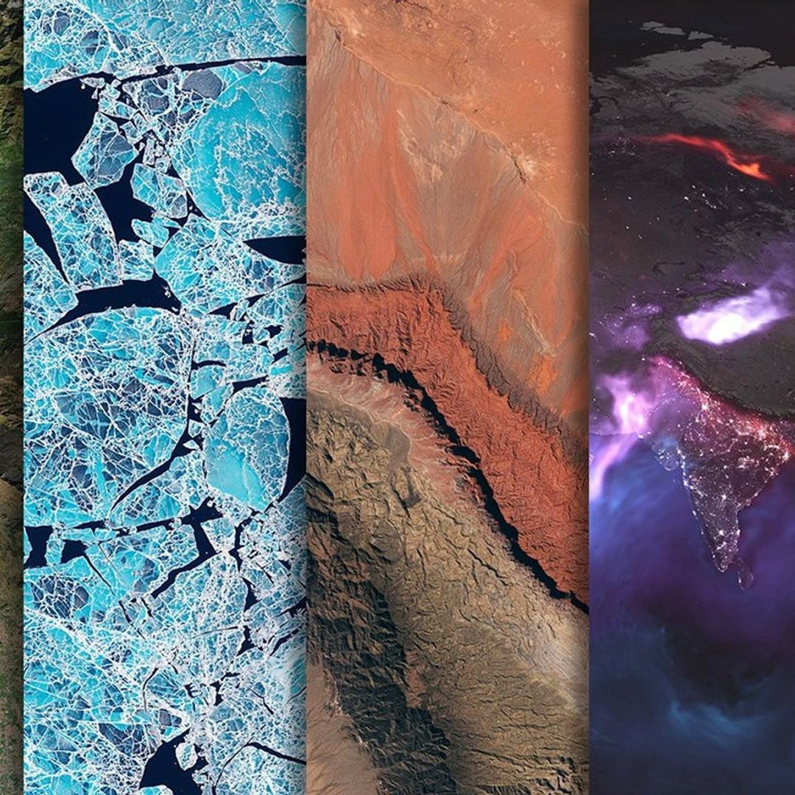
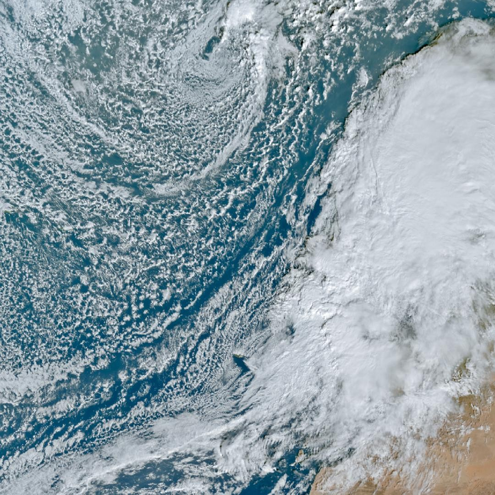
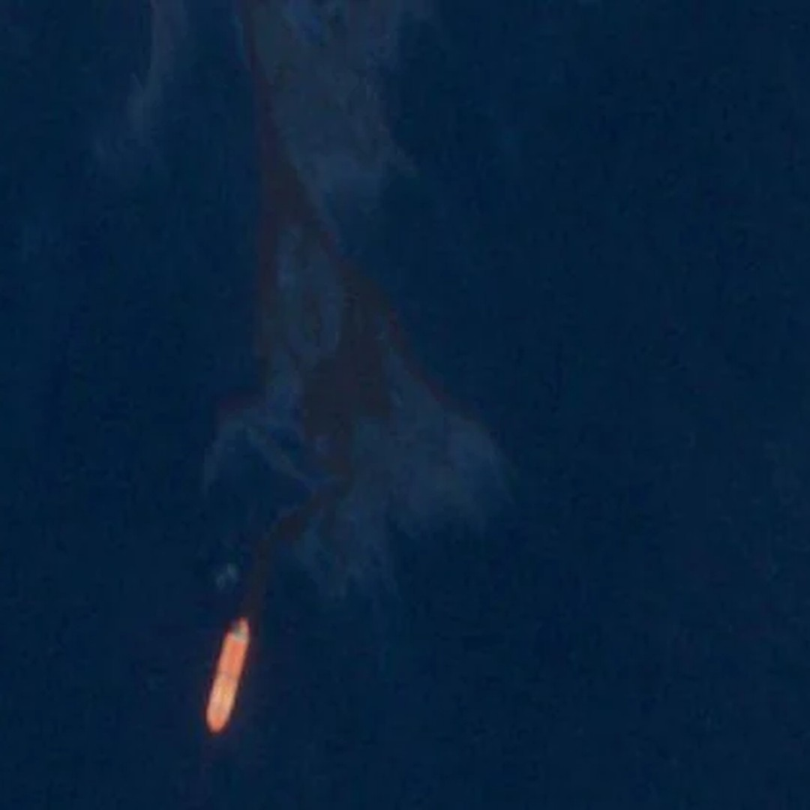
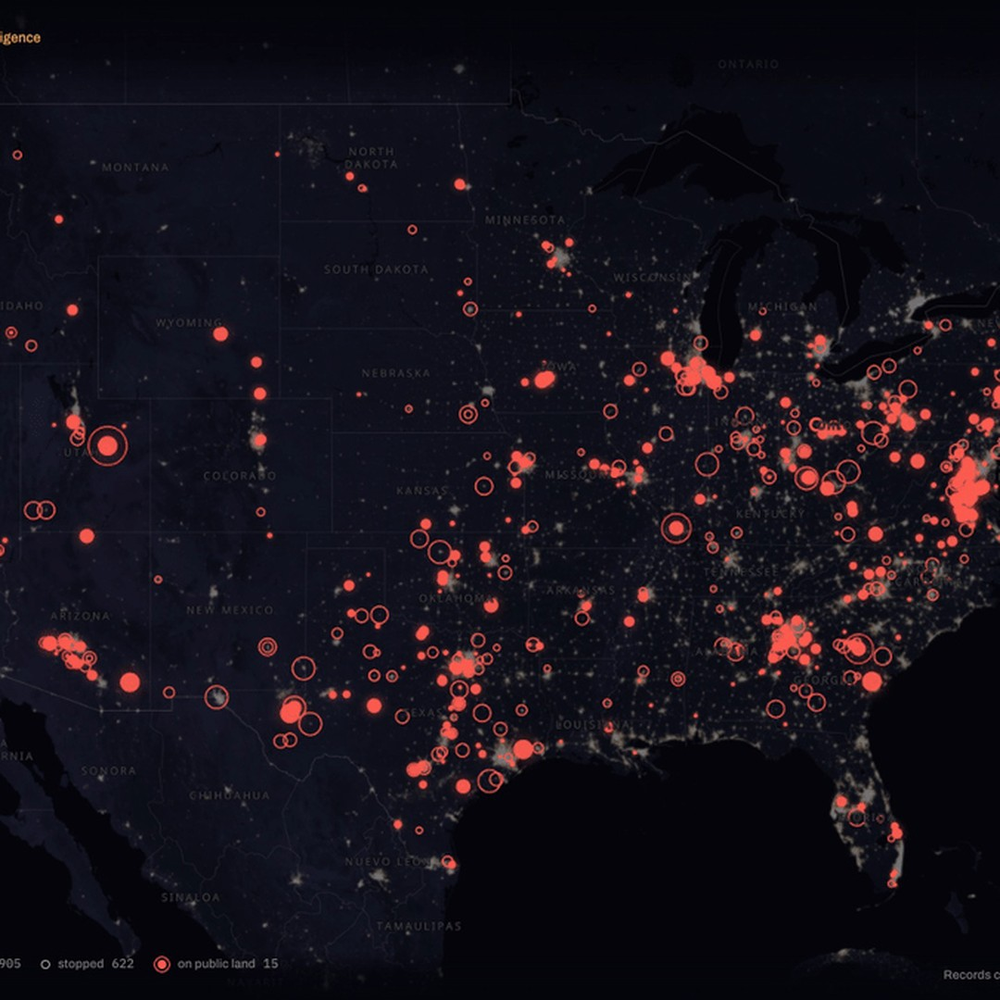
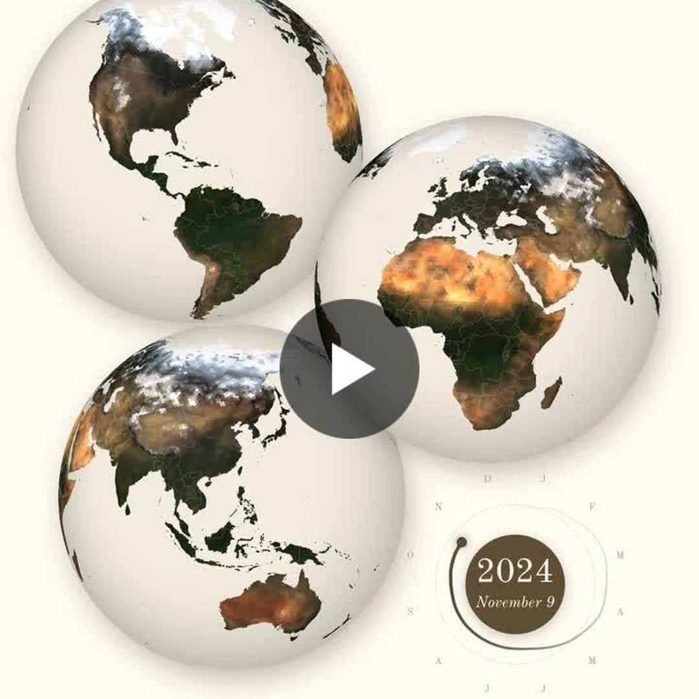
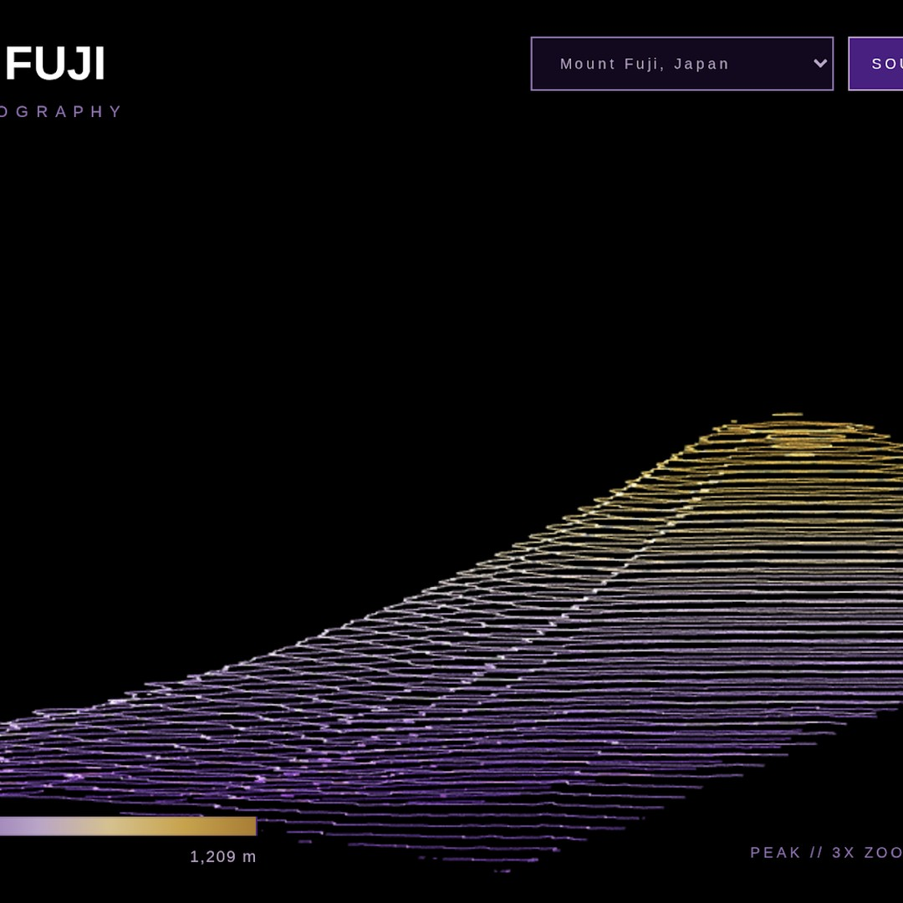
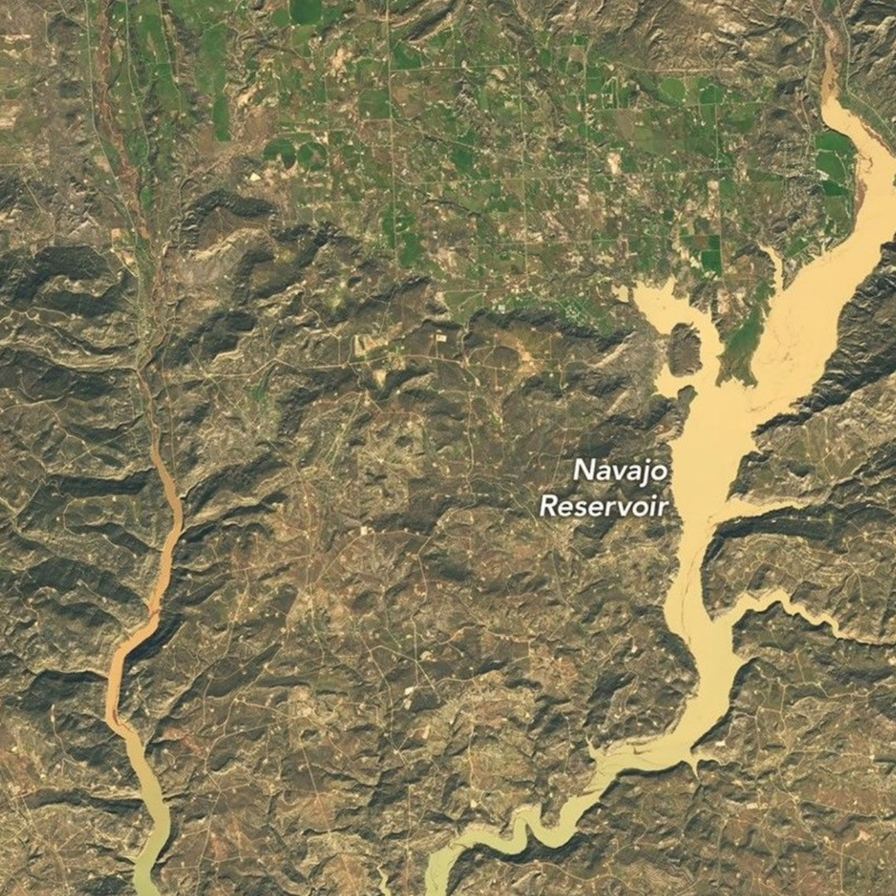

# Geoawesome reposts, 2026-11-12

8 post(s) ready. Each has a 1080×1080 image and its own text for Facebook, Instagram, YouTube Community and X. Nothing has been posted.

**To publish:** tick the box under a post. It is queued for the next free time slot and posted to Facebook and Instagram; a comment here confirms the time. Edit a text in this issue first if you want to change it (what is in the box is what gets posted). Untick before the slot to cancel. When it is live, a comment @mentions you with the YouTube Community text and the X text for Buffer.

---

## 1. Scotland’s Flow Country

<!-- post:2026-11-12-1-scotland-s-flow-country -->
- [ ] **Publish on Facebook + Instagram**



[Download square image](https://raw.githubusercontent.com/walczakagh/geoawesome-social-agent/main/drafts/images/2026-11-12-1-scotland-s-flow-country.jpg) · square crop, from 864px of source width

**Source:** [NASA Earth Observatory](https://science.nasa.gov/earth/earth-observatory/scotlands-flow-country/) · score 9.0/10 · Landsat satellite view of Scotland's blanket bogs; striking carbon-store landscape from NASA Earth Observatory.
**Rights:** Publisher allows reuse with credit. Licence on page: not stated.

**What it shows:** A Landsat 8 OLI image centred on the blanket bogs of the Flow Country in Scotland's Highlands, Europe's largest blanket bog and the first peatland of its type inscribed as a UNESCO World Heritage Site. Boggy areas appear dark brown with scattered lakes, darker green geometric shapes in the centre are conifer plantations, and the light green area on the right around Thurso is farmland. It was captured in spring, when the land surface is most waterlogged.

**Check before posting:**
- No exact acquisition date or year is given, only 'spring'.
- The band combination is not stated, so the posts do not call it natural colour.
- The image credit field was not found. The page text says 'NASA Earth Observatory images by Michala Garrison, using Landsat data from the U.S. Geological Survey'. The editor may want to extend the credit line if space allows.
- Image licence is not stated on the page. NASA imagery is generally reusable, but check before posting.
- The square crop is taken from 864px of the source width. Check that the Thurso farmland on the right side is still in frame, since the alt text mentions it.
- The 9,000 years and 8 metres figures are attributed to UNESCO, and the 600 gigatons figure is a scientists' estimate. The posts keep both hedges.

**Facebook**

```text
Europe's largest blanket bog sits in this Landsat 8 view of northern Scotland, a habitat that covers less than 0.1 percent of Earth's land.

The Flow Country's peat (dark brown, sprinkled with lakes) spans some 1,900 square kilometres of the Highlands. In places it has been building for more than 9,000 years, according to UNESCO. The darker green geometric patches in the centre are conifer plantations.

Full story: https://science.nasa.gov/earth/earth-observatory/scotlands-flow-country/

Image: NASA Earth Observatory

#Landsat #Peatlands #Scotland #Geoawesome
```

**Instagram**

```text
Every dark brown patch here is waterlogged peat, in places more than eight metres thick, according to UNESCO.

Scotland's Flow Country, seen by Landsat 8 in spring, when the bogs are at their wettest. Those neat green blocks are conifer plantations.

Learn more: https://science.nasa.gov/earth/earth-observatory/scotlands-flow-country/

Image: NASA Earth Observatory

#Peat #Scotland #Landsat #Geoawesome
```

**YouTube Community**

```text
Scientists estimate that the world's peatlands cover about 3 percent of the land but hold more than 600 gigatons of carbon, roughly twice as much as all forests combined.

This Landsat 8 OLI scene centres on Scotland's Flow Country, the first blanket bog of its type on the UNESCO World Heritage list. Bogs show dark brown with scattered lakes, and conifer plantations appear as darker green geometric blocks. The image was captured in spring, when the surface is wettest.

Read more: https://science.nasa.gov/earth/earth-observatory/scotlands-flow-country/

Image: NASA Earth Observatory

#Bogs #Carbon #Landsat #Geoawesome
```

**X (via Buffer)**

```text
More than 30 species of sphagnum moss grow in the Flow Country, the northern Scottish peatland seen here by Landsat 8.
https://science.nasa.gov/earth/earth-observatory/scotlands-flow-country/
Image: NASA Earth Observatory
#Landsat #Peat #Geoawesome
```

**Alt text:** Satellite view of the northern Scottish Highlands showing dark brown bogland dotted with lakes, darker green rectangular plantation blocks in the centre and lighter green farmland towards the right.

---

## 2. Image of the week: Storm Charles hits Spain and Portugal

<!-- post:2026-11-12-3-image-of-the-week-storm-charles-hits-spa -->
- [ ] **Publish on Facebook + Instagram**



[Download square image](https://raw.githubusercontent.com/walczakagh/geoawesome-social-agent/main/drafts/images/2026-11-12-3-image-of-the-week-storm-charles-hits-spa.jpg) · square crop, from 1080px of source width

**Source:** [EUMETSAT](http://www.eumetsat.int/image-week-storm-charles-hits-spain-and-portugal) · score 8.0/10 · Meteosat-12 full-disc view of Storm Charles over Iberia; vivid, timely Earth-from-space scene.
**Rights:** Someone else's map: the credit line names them; ask them first if unsure. Licence on page: not stated.

**What it shows:** A Meteosat-12 image of Storm Charles reaching Spain and Portugal, captured by the FCI instrument on 11 November 2026. Charles is the second Atlantic storm to reach Europe in a few days. It brought more than 200 mm of rain to Madeira and gusts of over 120 km/h to the Canary Islands, and red weather warnings are in place in both Spain and Portugal. The image was submitted by EUMETView user Antonio Vecoli.

**Check before posting:**
- The page does not state which FCI channel or RGB composite is shown, so the colours are not explained.
- No capture time is given beyond the date of 11 November 2026.
- No image credit was found on the page. EUMETSAT is used as the publisher, although the image was submitted by EUMETView user Antonio Vecoli. Consider crediting him too.
- The image licence is not stated and the reuse policy is link_only. Check whether a square crop may be posted.
- Alt text is based on the title and page text. Check it against the actual crop before posting.
- The rainfall and gust figures come from EUMETSAT's text, but the page does not name the stations or measurement source.

**Facebook**

```text
Charles is the second Atlantic storm to reach Europe in just a few days, and Meteosat-12 caught it arriving over Spain and Portugal.

This view comes from the FCI instrument on Meteosat-12 on 11 November 2026. Before reaching Iberia, the storm dropped more than 200 mm of rain on Madeira and brought gusts of over 120 km/h to the Canary Islands. Both countries now have red weather warnings in place.

Read more: http://www.eumetsat.int/image-week-storm-charles-hits-spain-and-portugal

Image: EUMETSAT

#Geoawesome #Meteosat #Storm #Spain #Portugal
```

**Instagram**

```text
More than 200 mm of rain on Madeira, then on to Iberia.

Storm Charles seen by Meteosat-12 as it reached Spain and Portugal on 11 November, with red warnings in both countries.

Find out more: http://www.eumetsat.int/image-week-storm-charles-hits-spain-and-portugal

Image: EUMETSAT

#Geoawesome #Meteosat #Weather #Iberia
```

**YouTube Community**

```text
Red weather warnings are in place in both Spain and Portugal as Storm Charles moves in from the Atlantic.

The FCI instrument aboard Meteosat-12, one of EUMETSAT's Meteosat Third Generation satellites, captured this scene on 11 November 2026. Charles is the second Atlantic storm to hit Europe in a few days, after more than 200 mm of rain on Madeira and gusts over 120 km/h on the Canary Islands. EUMETView user Antonio Vecoli submitted the image and text.

Learn more: http://www.eumetsat.int/image-week-storm-charles-hits-spain-and-portugal

Image: EUMETSAT

#Geoawesome #EUMETSAT #Meteosat #Storm #Portugal
```

**X (via Buffer)**

```text
Gusts over 120 km/h on the Canary Islands, now red warnings across Spain and Portugal: Storm Charles seen by Meteosat-12 on 11 Nov.
http://www.eumetsat.int/image-week-storm-charles-hits-spain-and-portugal
Image: EUMETSAT
#Geoawesome #Meteosat #Storm #Spain
```

**Alt text:** Satellite view of the cloud system of Storm Charles over the Atlantic as it reaches Spain and Portugal.

---

## 3. Satellite image shows an oil spill off the coast of UAE | Top News | lufkindailynews.com

<!-- post:2026-11-12-5-satellite-image-shows-an-oil-spill-off-t -->
- [ ] **Publish on Facebook + Instagram**



[Download square image](https://raw.githubusercontent.com/walczakagh/geoawesome-social-agent/main/drafts/images/2026-11-12-5-satellite-image-shows-an-oil-spill-off-t.jpg) · square crop, from 420px of source width (low resolution: upscaled, check sharpness)

**Source:** [Google Alerts #3](https://lufkindailynews.com/news_reuters/top_news/satellite-image-shows-an-oil-spill-off-the-coast-of-uae/image_49f88f7a-6fa3-58d3-96ac-dffd078b95c7.html) · score 7.0/10 · Sentinel-2 close-up of an oil spill off UAE; vivid satellite scene with a story.
**Rights:** Someone else's map: the credit line names them; ask them first if unsure. Licence on page: not stated.

**What it shows:** A close-up satellite image of an oil spill off the coast of the United Arab Emirates, dated 8 November 2026. The image is from Copernicus Sentinel-2, released by the European Union as a handout and distributed by Reuters. The source gives no exact location, spill extent, cause or band combination.

**Check before posting:**
- Source image is only 420px wide and upscaled to 1080px. Check sharpness. A full-resolution version from Copernicus Browser for 8 November 2026 may be better if the location can be pinned down.
- Reuse policy is link_only and no image licence is stated. The picture is a Reuters-distributed EU handout, so confirm rights before posting the image itself.
- The IMAGE CREDIT field was empty. The credit used comes verbatim from the photo caption on the page.
- Exact location off the UAE coast is not given (Gulf or Gulf of Oman side unknown).
- No size, extent or volume of the spill is given.
- The cause or source of the spill is not stated.
- Band combination and whether the image is true colour are not stated.
- The page is a syndicated local-newspaper copy of a Reuters photo with no accompanying story. Consider linking the Reuters original if one exists.

**Facebook**

```text
Copernicus Sentinel-2 caught this oil spill off the coast of the United Arab Emirates on 8 November 2026.

The close-up was released by the European Union and distributed by Reuters as a handout. The caption gives no exact location, extent or cause for the spill, so treat any figures circulating elsewhere with care until official estimates appear.

Read more: https://lufkindailynews.com/news_reuters/top_news/satellite-image-shows-an-oil-spill-off-the-coast-of-uae/image_49f88f7a-6fa3-58d3-96ac-dffd078b95c7.html

Image: EUROPEAN UNION/COPERNICUS SENTINEL-2/Handout via REUTERS

#Sentinel2 #Copernicus #Pollution #UAE #Geoawesome
```

**Instagram**

```text
Oil on the water off the UAE, seen from orbit on 8 November 2026.

A Sentinel-2 close-up of the spill. Its location, size and cause have not been published with the image.

Find out more: https://lufkindailynews.com/news_reuters/top_news/satellite-image-shows-an-oil-spill-off-the-coast-of-uae/image_49f88f7a-6fa3-58d3-96ac-dffd078b95c7.html

Image: EUROPEAN UNION/COPERNICUS SENTINEL-2/Handout via REUTERS

#Sentinel2 #Oil #Sea #Geoawesome
```

**YouTube Community**

```text
Three days after acquisition, a European Union handout put this view of a spill off the Emirati coast into the news cycle.

The Sentinel-2 scene is dated 8 November 2026 and shows the spill in close-up. The handout caption does not state the band combination, the area affected or what caused the release, so for now this is a first look rather than a measurement.

Learn more: https://lufkindailynews.com/news_reuters/top_news/satellite-image-shows-an-oil-spill-off-the-coast-of-uae/image_49f88f7a-6fa3-58d3-96ac-dffd078b95c7.html

Image: EUROPEAN UNION/COPERNICUS SENTINEL-2/Handout via REUTERS

#Copernicus #Oil #Gulf #Satellite #Geoawesome
```

**X (via Buffer)**

```text
The EU has released a Sentinel-2 close-up of an oil spill off the UAE coast, dated 8 November 2026. No extent or cause given yet.
https://lufkindailynews.com/news_reuters/top_news/satellite-image-shows-an-oil-spill-off-the-coast-of-uae/image_49f88f7a-6fa3-58d3-96ac-dffd078b95c7.html
Image: EU/Copernicus Sentinel-2/Handout via Reuters
#Sentinel2 #Pollution #UAE #Geoawesome
```

**Alt text:** Close-up satellite image of an oil spill on the sea off the coast of the United Arab Emirates.

---

## 4. This Map Shows Proposed AI Data Centers Near National Parks

<!-- post:2026-11-12-7-this-map-shows-proposed-ai-data-centers -->
- [ ] **Publish on Facebook + Instagram**



[Download square image](https://raw.githubusercontent.com/walczakagh/geoawesome-social-agent/main/drafts/images/2026-11-12-7-this-map-shows-proposed-ai-data-centers.jpg) · square crop, from 676px of source width (low resolution: upscaled, check sharpness)

**Source:** [Google Alerts #5](https://www.outsideonline.com/outdoor-adventure/environment/ai-data-centers-national-parks-map/) · score 7.0/10 · Interactive map of AI data center proposals near public lands; strong geo story.
**Rights:** Someone else's map: the credit line names them; ask them first if unsure. Licence on page: not stated.

**What it shows:** A map by More Than Just Parks, an independent public lands publication, that tracks AI and other data centres across the United States, including proposed sites near national parks and other protected land. The tool currently lists 2,086 data centres, 741 of them in the proposal phase, and 77 of those are within ten miles of protected land. Users enter a zip code to see the nearest facility, its suggested effect on utility costs and the groups supporting it. No data date, base map or symbol key is given beyond 'as of this writing' in an article published 11 November 2026.

**Check before posting:**
- Reuse policy is marked link_only and no image licence is stated. Confirm we may repost the image at all before publishing.
- The only credit on the page is 'Photo: Courtesy of More Than Just Parks'. The page does not confirm whether the image is a map screenshot or a photo, so check what the image actually shows before using the 'Map:' credit and the alt text.
- The source image is only 676px wide and was upscaled to 1080. Check sharpness.
- More Than Just Parks is an advocacy outlet that states it opposes data centres on public lands. The data methodology and sources behind the counts are not described.
- Two sets of proximity figures appear: 14/38/131 proposed sites within 10/25/50 miles of a national park, and 77 proposals within ten miles of 'protected land' (a broader category). Do not mix them up.
- The counts change as the map auto-populates. The figures are 'as of this writing', not dated.
- The Horseshoe Bend proposal has not been formally adopted (per the City of Page). The five-mile distance to Grand Canyon NP is according to Pattiz's map.
- 'Roughly half are in the American West' has an unclear referent in the source, so it was left out.

**Facebook**

```text
At least 14 proposed data centre projects sit within ten miles of a US national park boundary, according to a map by More Than Just Parks.

The tool lists 2,086 data centres, 741 still at proposal stage, with 38 planned sites within 25 miles of a national park and 131 within 50. Enter a zip code and it returns the nearest facility, its likely effect on utility costs and who backs it. Note that its makers openly oppose data centres on public lands.

Read more: https://www.outsideonline.com/outdoor-adventure/environment/ai-data-centers-national-parks-map/

Map: More Than Just Parks via Outside

#Geoawesome #Maps #AI #Infrastructure
```

**Instagram**

```text
About five miles: that is the gap between a proposed $10 billion data centre near Horseshoe Bend and Grand Canyon National Park, by this map's reckoning.

More Than Just Parks tracks 741 proposed US data centres, 77 of them within ten miles of protected land.

Find out more: https://www.outsideonline.com/outdoor-adventure/environment/ai-data-centers-national-parks-map/

Map: More Than Just Parks via Outside

#Geoawesome #Maps #Arizona #AI
```

**YouTube Community**

```text
Of 741 proposed US data centres on one tracker, 77 lie within ten miles of protected land such as national parks, wildlife refuges and wilderness areas.

The More Than Just Parks map auto-populates as new information appears and lists 2,086 facilities in total. At its core it is a proximity analysis, with counts of proposed sites at 10, 25 and 50 miles from park boundaries (14, 38 and 131). In Virginia, 12 of 97 proposals fall within 25 miles of Shenandoah National Park.

Learn more: https://www.outsideonline.com/outdoor-adventure/environment/ai-data-centers-national-parks-map/

Map: More Than Just Parks via Outside

#Geoawesome #GIS #Infrastructure #Parks
```

**X (via Buffer)**

```text
Type a US zip code into this map and it returns the nearest data centre, built or proposed. 131 proposals sit within 50 miles of a national park.
https://www.outsideonline.com/outdoor-adventure/environment/ai-data-centers-national-parks-map/
Map: More Than Just Parks via Outside
#Geoawesome #Maps #GIS #AI
```

**Alt text:** A map by More Than Just Parks marking data centre locations across the United States in relation to national parks and other protected land.

---

## 5. # 30daymapchallenge | Karim Douieb - LinkedIn

<!-- post:2026-11-12-9-30daymapchallenge-karim-douieb-linkedin -->
- [ ] **Publish on Facebook + Instagram**



[Download square image](https://raw.githubusercontent.com/walczakagh/geoawesome-social-agent/main/drafts/images/2026-11-12-9-30daymapchallenge-karim-douieb-linkedin.jpg) · square crop, from 720px of source width

**Source:** [Google Alerts #5](https://www.linkedin.com/posts/karim-douieb_30daymapchallenge-activity-7526251328248135681-9pq0) · score 7.0/10 · NASA MODIS average land colour animation from space; Earth-from-orbit visual.
**Rights:** Someone else's map: the credit line names them; ask them first if unsure. Licence on page: not stated.

**What it shows:** "Earth's Breath" by Karim Douieb, his Day 11 entry (theme: Sound) for the 30 Day Map Challenge. It shows the average colour of the land as seen from space by NASA MODIS, sampled every 8 days over two years. The original is meant to be watched with sound on.

**Check before posting:**
- No image credit or licence is given on the page, and the reuse policy is link_only. Confirm permission with Karim Douieb before posting the image itself.
- The post does not say which two years are covered.
- The MODIS product and platform (Terra or Aqua) are not named, and neither is how the 'average colour' was calculated.
- The post does not explain how the sound was made or whether it is driven by the data. The captions avoid calling it sonification.
- The geographic extent is not stated. Check whether it is global or regional.
- The original appears to be an animation with sound, so a still square crop loses both. Check that the chosen frame reads well on its own.
- The alt text was written without seeing the image. Check it against the actual frame.

**Facebook**

```text
Two years of land colour, sampled by NASA MODIS every 8 days and paired with sound.

Karim Douieb's "Earth's Breath" is his entry for Day 11 of the 30 Day Map Challenge, where the theme was Sound. It maps the average colour of the land as seen from space, and he recommends playing it with the volume on. The post does not say which MODIS product or which two years were used.

Full story: https://www.linkedin.com/posts/karim-douieb_30daymapchallenge-activity-7526251328248135681-9pq0

Map: Karim Douieb

#Geoawesome #MODIS #Mapping #Dataviz
```

**Instagram**

```text
The land, breathing in colour every 8 days.

"Earth's Breath" by Karim Douieb shows the average colour of the land seen by NASA MODIS over two years. Watch the original with sound on.

Learn more: https://www.linkedin.com/posts/karim-douieb_30daymapchallenge-activity-7526251328248135681-9pq0

Map: Karim Douieb

#Geoawesome #NASA #Dataviz #Maps
```

**YouTube Community**

```text
An 8-day cadence held for two full years: that is the rhythm behind Karim Douieb's "Earth's Breath".

The map shows the average colour of the land as seen from space by NASA's MODIS. He made it for Day 11 of the 30 Day Map Challenge, whose theme was Sound, so the original plays with audio. The post does not name the MODIS product, the years covered or how the sound was made.

Find out more: https://www.linkedin.com/posts/karim-douieb_30daymapchallenge-activity-7526251328248135681-9pq0

Map: Karim Douieb

#Geoawesome #MODIS #NASA #Cartography
```

**X (via Buffer)**

```text
Earth's Breath: the average colour of the land from NASA MODIS, every 8 days for two years. Sound on.
https://www.linkedin.com/posts/karim-douieb_30daymapchallenge-activity-7526251328248135681-9pq0
Map: Karim Douieb
#Geoawesome #MODIS #Maps
```

**Alt text:** A map showing the land coloured by its average colour as seen from space by NASA's MODIS sensor.

---

## 6. The Hills are Alive with the Sound of Music

<!-- post:2026-11-12-10-the-hills-are-alive-with-the-sound-of-mu -->
- [ ] **Publish on Facebook + Instagram**



[Download square image](https://raw.githubusercontent.com/walczakagh/geoawesome-social-agent/main/drafts/images/2026-11-12-10-the-hills-are-alive-with-the-sound-of-mu.jpg) · square crop, from 1034px of source width

**Source:** [Maps Mania](http://googlemapsmania.blogspot.com/2026/11/the-hills-are-alive-with-sound-of-music.html) · score 7.0/10 · Interactive terrain-to-music map from Maps Mania; playful, novel way of showing landscapes.
**Rights:** Someone else's map: the credit line names them; ask them first if unsure. Licence on page: not stated.

**What it shows:** A screenshot of The Sound of Music, an experimental interactive map by Maps Mania. It draws contour lines from Mapterhorn elevation data and plays a note as each contour is drawn. Elevation sets pitch, contour length and complexity set duration and intensity, position sets stereo placement, and the terrain's geometry sets scale, chord progression and tempo.

**Check before posting:**
- Reuse policy is link_only and no image licence is stated. Check whether the screenshot may be reposted before using it.
- The source does not say which location the screenshot shows.
- The source does not say what the colours on the map mean.
- No resolution is given for the Mapterhorn elevation data.
- No image credit appears on the page. The credit uses the map's site plus the blog.

**Facebook**

```text
Higher ground, higher notes: this map turns contour lines into a musical score.

An experimental map that draws contours from Mapterhorn elevation data and plays them as music. Contour length and complexity set note duration and intensity, while the terrain's geometry picks the scale, chord progression and tempo. Add a lat,lng to the URL to hear anywhere on Earth.

Read more: http://googlemapsmania.blogspot.com/2026/11/the-hills-are-alive-with-sound-of-music.html

Map: mapsmania.github.io via Maps Mania

#Cartography #Sonification #Terrain #Elevation #Geoawesome
```

**Instagram**

```text
What does a mountain range sound like next to a gentle plain?

Watch the contours draw themselves while each one plays a note, pitched by elevation.

Find out more: http://googlemapsmania.blogspot.com/2026/11/the-hills-are-alive-with-sound-of-music.html

Map: mapsmania.github.io via Maps Mania

#Contours #Maps #Sonification #Geoawesome
```

**YouTube Community**

```text
Every contour on this map is a note, and the whole landscape is the score.

Mapterhorn elevation sets the pitch. Contour length and complexity control duration and intensity, and position across the landscape places each note in the stereo field. The terrain's geometry also chooses the scale, chord progression and tempo, giving every location its own musical fingerprint.

Learn more: http://googlemapsmania.blogspot.com/2026/11/the-hills-are-alive-with-sound-of-music.html

Map: mapsmania.github.io via Maps Mania

#Elevation #Contours #Terrain #Cartography #Geoawesome
```

**X (via Buffer)**

```text
Can a map make a rugged mountain range sound different from a gentle hill? This one tries, turning contours into melody.
http://googlemapsmania.blogspot.com/2026/11/the-hills-are-alive-with-sound-of-music.html
Map: mapsmania.github.io via Maps Mania
#Contours #Sonification #Cartography #Geoawesome
```

**Alt text:** A map of terrain drawn as contour lines, from an interactive map that turns elevation into music.

---

## 7. #30daymapchallenge #3dmaps # maplibre #threejs | Alexa Cristina - LinkedIn

<!-- post:2026-11-12-12-30daymapchallenge-3dmaps-maplibre-three -->
- [ ] **Publish on Facebook + Instagram**


[Download square image](https://raw.githubusercontent.com/walczakagh/geoawesome-social-agent/main/drafts/images/2026-11-12-12-30daymapchallenge-3dmaps-maplibre-three.jpg) · square crop, from 720px of source width

**Source:** [Google Alerts #2](https://www.linkedin.com/posts/alexa-a-cristina_30daymapchallenge-3dmaps-maplibre-activity-7526307335988723712-k1NY) · score 6.0/10 · 3D city map of Cluj-Napoca from a 30-day map challenge; a clever sound-based visualisation.
**Rights:** Someone else's map: the credit line names them; ask them first if unsure. Licence on page: not stated.

**What it shows:** A 3D map of estimated sound levels across Cluj-Napoca, built by Alexa Cristina in MapLibre and Three.js for Day 11 of the #30DayMapChallenge. Each OpenStreetMap street and railway gets a typical level for its road class (lower in 30 km/h zones). Sound falls 3 dB per doubling of distance on a 25 m grid, streets add up as energy, and a 'sea of sound' haze rises 24 m for each dB above 50: its colour and height are the estimate, its moving shapes are decorative. The estimate is compared with the city's official noise map (noise action plan 2026, strategic map 2021, itself a model); they agree on 39% of residential streets, and on 50.2% only the official map calls them quiet.

**Check before posting:**
- Reuse policy is link_only and no image licence is stated: get permission from Alexa Cristina before posting the image.
- No image credit on the page; credited to the author of the post.
- The page does not say which part of the city the shared image shows (Piața Unirii, Gheorgheni or the Grigorescu comparison).
- The colour scale and the dB thresholds for 'loud' and 'quiet' are not defined in the text.
- All noise values are estimated, not measured: no traffic counts and no screening by buildings.
- The 03:00 to 06:30 change is an illustrative profile, not data.
- The figure of about 32,700 people above 60 dB at night is quoted from the action plan (2021 data), not recalculated. It is left out of the posts.
- The source image is only 720px wide, so the 1080 square may look soft.

**Facebook**

```text
Only 83.1 of 722.1 km mapped in Cluj-Napoca come out quiet in this 3D sound estimate.

Alexa Cristina built it in MapLibre and Three.js for the 30DayMapChallenge, giving each OpenStreetMap street a typical level for its class. Set beside the city's official noise map (also a model), the two agree on only 39% of residential streets.

Full story: https://www.linkedin.com/posts/alexa-a-cristina_30daymapchallenge-3dmaps-maplibre-activity-7526307335988723712-k1NY

Map: Alexa Cristina

#Geoawesome #Cartography #Cluj #Maps
```

**Instagram**

```text
Cluj-Napoca, drawn as a sea of sound.

Every estimated decibel above 50 lifts the haze 24 m. Piața Unirii, where three main roads meet, roars, while Gheorgheni goes lower.

Find out more: https://www.linkedin.com/posts/alexa-a-cristina_30daymapchallenge-3dmaps-maplibre-activity-7526307335988723712-k1NY

Map: Alexa Cristina

#Geoawesome #Noise #Soundscape #Cluj
```

**YouTube Community**

```text
On 50.2% of Cluj-Napoca's residential streets, only the official noise map calls them quiet.

The alternative is an OpenStreetMap estimate: typical levels per road class (lower in 30 km/h zones), a 3 dB drop per doubling of distance on a 25 m grid, and streets summed as energy. With no traffic counts or building screening, it compares categories, not decibels.

Learn more: https://www.linkedin.com/posts/alexa-a-cristina_30daymapchallenge-3dmaps-maplibre-activity-7526307335988723712-k1NY

Map: Alexa Cristina

#Geoawesome #Acoustics #Cartography #Noise
```

**X (via Buffer)**

```text
Cluj-Napoca's streets as a 3D sea of sound: 48 km loud and 83.1 km quiet, all estimated from OpenStreetMap road classes.
https://www.linkedin.com/posts/alexa-a-cristina_30daymapchallenge-3dmaps-maplibre-activity-7526307335988723712-k1NY
Map: Alexa Cristina
#Geoawesome #Noise #Cartography
```

**Alt text:** A 3D map of Cluj-Napoca with a coloured haze of estimated street noise rising above the streets and buildings, higher where the city is louder.

---

## 8. Water Levels at New Mexico's Navajo Reservoir Surge to Seven-Year High - Newsweek

<!-- post:2026-11-12-16-water-levels-at-new-mexico-s-navajo-rese -->
- [ ] **Publish on Facebook + Instagram**



[Download square image](https://raw.githubusercontent.com/walczakagh/geoawesome-social-agent/main/drafts/images/2026-11-12-16-water-levels-at-new-mexico-s-navajo-rese.jpg) · square crop, from 800px of source width

**Source:** [Google Alerts #3](https://www.newsweek.com/water-levels-at-new-mexicos-navajo-reservoir-surge-to-seven-year-high-12700849) · score 6.0/10 · Newly released satellite images of a reservoir swelling to a seven-year high.
**Rights:** Someone else's map: the credit line names them; ask them first if unsure. Licence on page: not stated.

**What it shows:** NASA published a pair of Landsat 9 images of Navajo Reservoir, which straddles the border of northwestern New Mexico and southwestern Colorado, taken on 20 September and 7 November. After back-to-back extreme rain events in the Four Corners region, the water level rose 60 feet. The reservoir went from 60 percent to 108 percent of average capacity for the date, its highest level since August 2019. The page does not say how the images were processed or what the colours represent.

**Check before posting:**
- No image credit is given on the page. The credit 'NASA, Landsat 9, via Newsweek' is inferred from the article text, which says NASA published the images and Landsat 9 captured them. Check the original NASA release for the exact credit line.
- The reuse policy is link_only and no licence is stated. Consider using the original NASA image instead of the Newsweek copy.
- The IMAGE NOTE says 'square crop, from 800px of source width', not a before/after stacked pair. The square may show only one of the two dates, or a cropped side-by-side. Check which date is visible before posting. The captions refer to the pair, so they may need adjusting if only one date shows.
- The band combination, colour rendering and resolution of the images are not stated.
- The 60-foot rise is given in feet only. No metric figure is provided by the source.
- The rainfall figures for Durango and Farmington and the winter outlook come from an AccuWeather meteorologist quoted by Newsweek, not from NASA. They are left out of most captions.

**Facebook**

```text
Navajo Reservoir rose about 60 feet in seven weeks, reaching its highest level since August 2019.

NASA's Landsat 9 images from 20 September and 7 November show New Mexico's second-largest reservoir going from 60% to 108% of average capacity for the date. Back-to-back extreme rain events hit the Four Corners, which saw two to four times average precipitation from early September to early November.

Read more: https://www.newsweek.com/water-levels-at-new-mexicos-navajo-reservoir-surge-to-seven-year-high-12700849

Image: NASA, Landsat 9, via Newsweek

#Landsat #Reservoirs #Hydrology #Geoawesome
```

**Instagram**

```text
From 60% to 108% of average capacity, between one Landsat pass and another.

Navajo Reservoir, on the New Mexico/Colorado border, swelled after back-to-back extreme rain in the Four Corners. It is now at its highest level since August 2019.

Find out more: https://www.newsweek.com/water-levels-at-new-mexicos-navajo-reservoir-surge-to-seven-year-high-12700849

Image: NASA, Landsat 9, via Newsweek

#Landsat9 #Reservoirs #Water #Geoawesome
```

**YouTube Community**

```text
The Four Corners got two to four times its average precipitation from early September to early November, and one reservoir shows it clearly.

NASA compared Landsat 9 scenes of Navajo Reservoir from 20 September and 7 November. Over that period the water level rose 60 feet, taking the reservoir from 60% to 108% of average capacity for the date. The source does not give the band combination or processing details.

Learn more: https://www.newsweek.com/water-levels-at-new-mexicos-navajo-reservoir-surge-to-seven-year-high-12700849

Image: NASA, Landsat 9, via Newsweek

#Landsat #Rainfall #Hydrology #Geoawesome
```

**X (via Buffer)**

```text
Navajo Reservoir seen by Landsat 9: up 60 feet between 20 September and 7 November, its highest level since August 2019.

https://www.newsweek.com/water-levels-at-new-mexicos-navajo-reservoir-surge-to-seven-year-high-12700849

Image: NASA, Landsat 9, via Newsweek

#Landsat #Reservoirs #Geoawesome
```

**Alt text:** Satellite view of Navajo Reservoir, a narrow, branching lake winding through dry, brown terrain.

---

### Skipped after reading the page
- [NASA Landsat Shows an Iraqi Lake Losing Its Water and Turning Red - YouTube](https://www.youtube.com/shorts/fypLrJ9HSMM): Reuse policy is link_only with no image credit or licence, the 405px frame is from an unidentified YouTube Short, and the lake, end date and red colour cannot be explained without guessing.
- [Oil slicks seen from space : the devastating impact of boat strikes on fragile Gulf ecosystems](https://www.theguardian.com/world/2026/nov/12/oil-slicks-seen-from-space-the-devastating-impact-of-boat-strikes-on-fragile-gulf-ecosystems): The page gives no image credit or licence, the reuse policy is link_only, and the source does not say which satellite image the 630px crop shows, so we cannot credit or explain it without guessing.
- [A new interactive map reveals dozens of massive AI data center proposals closing in on ...](https://www.facebook.com/outsidemagazine/posts/a-new-interactive-map-reveals-dozens-of-massive-ai-data-center-proposals-closing/1501640768496410/): No image on the page, no credit or licence, and only a truncated teaser from a Facebook post (link-only reuse); the map's maker, data and coverage cannot be described without guessing.
- [Geoawesome on X: " 30DayMapChallenge , Day 2 'Lines': the Mount Hood recreation areas ...](https://x.com/geoawesome_dgtl/status/2120581836044661091/photo/1): This is Geoawesome's own X post, the page text is only the X login wall, there is no image credit, and the map can't be described beyond a truncated title without guessing.
- [Tracking the Bridge Creek Fire in Oregon | WFCA Fire Map](https://wfca.com/fire-map/oregon/bridge_creek?name=Bridge+Creek): No image on the page, no credit or licence, and only one line of text (fire size), so there is no visual to repost and nothing to describe without guessing.
- [Tankers burn in the Middle East despite hopes for de-escalation | National/World](https://www.centraloregondaily.com/news/nation-world/tankers-burn-in-the-middle-east-despite-hopes-for-de-escalation/article_01a97f61-950c-578f-b4a5-ea695160c7c6.html): The page does not say what the image shows or who made it (no credit, no licence, link-only reuse), it is only 420px wide, and this is a conflict news story rather than an Earth observation visual.
- [jembob on X: "Today's Sentinel-2 images from Ust-Luga show still two fires remaining ...](https://x.com/jembobineuse/status/2120535834864582702): The source gives too little to caption without guessing: a truncated X post title, no image credit, no licence, link-only reuse, and an unverified third-party claim about fires.
- [Watch this Landsat 3D Visualizations & Asset Library (SVS14858 closely #shorts - YouTube](https://www.youtube.com/shorts/1r9mGRBsWAU): The video is about reading contracts and only reuses NASA's Landsat 9 3D asset footage as background, with no credit, no licence and a low-resolution 405px frame.
- [New Sentinel-2 satellite imagery shows the U.S. Army's Logistics Support Area in Yanbu,… / X](https://x.com/EGYOSINT/status/2120680177365667928/video/1): There is nothing to verify: the title is truncated, the page text is only X's login prompt, no image credit or licence is given, the reuse policy is link_only, and the claim (a U.S. Army logistics site in Yanbu) comes from an unverified third-party OSINT account.
- [Some Wisconsin monarchs have made it to Mexico months after being tagged - WPR](https://www.wpr.org/news/wisconsin-monarchs-mexico-after-being-tagged): The page gives no description, credit or licence for its image (reuse policy is link_only), and the article text describes no map or satellite visual, so the image could not be captioned without guessing.
- [Somalia Weekly Weather Forecast - Valid From 11 - 17 Nov 2026 - ReliefWeb](https://reliefweb.int/report/somalia/somalia-weekly-weather-forecast-valid-11-17-nov-2026): No image on the page and only a truncated text snippet (link-only alert), so there is no visual to post and the flood map details cannot be described without guessing.
- [Tracking the Clark 289 Fire in Arkansas | WFCA Fire Map - Western Fire Chiefs Association](https://wfca.com/fire-map/arkansas/clark_289?name=Clark+289): No image on the page, reuse is link-only, and the only fact is a single line (fire size 100 acres), so there is no visual to post and nothing to caption without guessing.

---

### Sources checked
- Google Alerts #1: 13 in feed, 13 new
- Google Alerts #2: 5 in feed, 5 new
- Google Alerts #3: 20 in feed, 20 new
- Google Alerts #4: 20 in feed, 20 new
- Google Alerts #5: 20 in feed, 19 new, 1 already found via another source
- Google Alerts #6: 10 in feed, 4 new, 4 already found via another source
- Google Alerts #7: 20 in feed, 20 new
- Google Alerts #8: 7 in feed, 0 new
- NASA Earth Observatory: 10 in feed, 1 new
- ESA Observing the Earth: failed: https://www.esa.int/rssfeed/Applications/Observing_the_Earth: HTTP 404
- EUMETSAT: 10 in feed, 2 new
- Copernicus Atmosphere Monitoring Service: 10 in feed, 0 new
- NASA JPL: 100 in feed, 0 new
- Planet Pulse: 50 in feed, 0 new
- Maps Mania: 25 in feed, 1 new
- Visual Capitalist (maps): 10 in feed, 2 new
- FlowingData: 10 in feed, 2 new
- Google Maps blog: 20 in feed, 0 new
- Google Research blog: 100 in feed, 1 new
- Overture Maps blog: 20 in feed, 0 new
- Bellingcat: 10 in feed, 0 new
- Reddit r/MapPorn: failed: https://www.reddit.com/r/MapPorn/top/.rss?t=day: HTTP 403
- Reddit r/dataisbeautiful: failed: https://www.reddit.com/r/dataisbeautiful/top/.rss?t=day: HTTP 429
