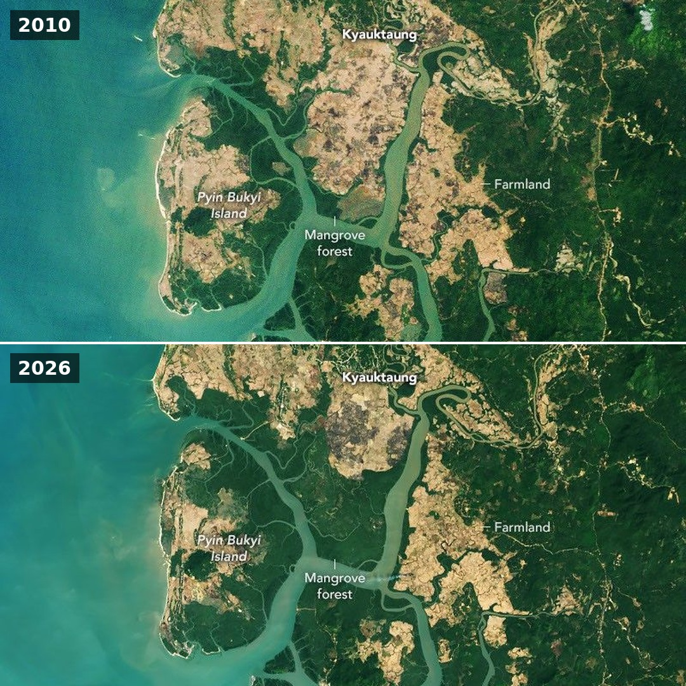

# Geoawesome reposts, 2026-11-13

1 post(s) ready. Each has a 1080×1080 image and its own text for Facebook, Instagram, YouTube Community and X. Nothing has been posted.

**To publish:** tick the box under a post. It is queued for the next free time slot and posted to Facebook and Instagram; a comment here confirms the time. Edit a text in this issue first if you want to change it (what is in the box is what gets posted). Untick before the slot to cancel. When it is live, a comment @mentions you with the YouTube Community text and the X text for Buffer.

---

## 1. A Global Rebound for Mangroves

<!-- post:2026-11-13-1-a-global-rebound-for-mangroves -->
- [ ] **Publish on Facebook + Instagram**



[Download square image](https://raw.githubusercontent.com/walczakagh/geoawesome-social-agent/main/drafts/images/2026-11-13-1-a-global-rebound-for-mangroves.jpg) · before/after pair stacked, from 800px of source width

**Source:** [NASA Earth Observatory](https://science.nasa.gov/earth/earth-observatory/a-global-rebound-for-mangroves/) · score 8.0/10 · Landsat imagery of mangrove recovery; vivid satellite scene, strong editor history from NASA EO.
**Rights:** Publisher allows reuse with credit. Licence on page: NASA imagery, generally free to reuse with credit.

**What it shows:** A stacked pair of Landsat images of Palaw Township in Burma's Myeik District: top 2010, bottom 2026. They show mangroves regenerating in degraded areas and spreading into new ground, much of it in abandoned rice fields (brown) south of the village of Kyauktaung. The images illustrate a global study in Science, based on Landsat imagery from 1984 to 2023. It found nearly 3,000 km² of mangrove loss between 1984 and 2010, then a gain of nearly 2,000 km² after 2010.

**Check before posting:**
- The source does not say which Landsat satellites or sensors were used, or the exact acquisition dates; only the years 2010 and 2026 are given.
- The band combination is not stated. The only colour explained is brown, for abandoned rice fields.
- The bottom image (2026) falls after the study period (1984 to 2023). It illustrates the trend and is not part of the study data.
- The image credit field in the source was cut off at 'from the U'. The full credit here is taken from the page text: 'NASA Earth Observatory images by Michala Garrison, using Landsat data from the U.S. Geological Survey'.
- The causes of the turnaround in Burma (post-tsunami awareness and restoration, legal protections, sedimentation) are the study authors' attribution.

**Facebook**

```text
The world lost nearly 3,000 km² of mangroves between 1984 and 2010, then gained back nearly 2,000 km² after.

A global Landsat study in Science (1984 to 2023) found the turnaround. Here, Palaw Township in Burma's Myeik District, top 2010, bottom 2026: mangroves are moving into abandoned rice fields (brown) south of Kyauktaung.

Read more: https://science.nasa.gov/earth/earth-observatory/a-global-rebound-for-mangroves/

Image: NASA Earth Observatory images by Michala Garrison, using Landsat data from the U.S. Geological Survey

#Mangroves #Landsat #Myanmar #Geoawesome
```

**Instagram**

```text
Abandoned rice fields in Burma are turning back into mangrove forest.

Top: 2010, bottom: 2026, Palaw Township, Myeik District. The brown patches are old paddies south of Kyauktaung.

Find out more: https://science.nasa.gov/earth/earth-observatory/a-global-rebound-for-mangroves/

Image: NASA Earth Observatory images by Michala Garrison, using Landsat data from the U.S. Geological Survey

#Mangroves #Coasts #Burma #Geoawesome
```

**YouTube Community**

```text
About two-thirds of the mangrove gain since 2010 came from trees colonising new ground, a third from regrowth.

The study in Science tracked mangrove extent and canopy density in Landsat imagery from 1984 to 2023. This pair shows Palaw Township, Burma (top 2010, bottom 2026), where both regrowth and spread into new areas have happened.

Learn more: https://science.nasa.gov/earth/earth-observatory/a-global-rebound-for-mangroves/

Image: NASA Earth Observatory images by Michala Garrison, using Landsat data from the U.S. Geological Survey

#Landsat #Forests #Mangroves #Geoawesome
```

**X (via Buffer)**

```text
Burma lost 28.6% of its mangroves between the 1980s and 2010. Since then its mangrove area has grown about 10%.
https://science.nasa.gov/earth/earth-observatory/a-global-rebound-for-mangroves/
Image: NASA Earth Observatory, Landsat/USGS
#Mangroves #Landsat #Burma #Geoawesome
```

**Alt text:** Two stacked satellite images of a coastal area in Burma, the top from 2010 and the bottom from 2026, showing forest cover spreading into brown patches of former rice fields.

---

### Skipped after reading the page
- [UAE's Ras Al Khaimah, Sharjah reopen several beaches after tanker oil spill](https://www.internazionale.it/ultime-notizie-reuters/2026/11/12/uae-s-ras-al-khaimah-sharjah-reopen-several-beaches-after-tanker-oil-spill): Reuters text-only news report with no described map or satellite image and no image credit; the 683px page image is unidentified and reuse is link_only, so we cannot say what it shows without guessing.
- [Downtown Toronto as an airborne lidar survey measured it. This is the 1 m surface model of ...](https://www.facebook.com/milanjanosovscience/posts/downtown-toronto-as-an-airborne-lidar-survey-measured-itthis-is-the-1-m-surface-/976918338825888/): No image was found on the page, the reuse policy is link_only, there is no image credit or licence, and the page text is truncated, so there is nothing to repost square without guessing.
- [Tracking the Whitesbridge Fire in California | WFCA Fire Map](https://wfca.com/fire-map/california/whitesbridge?name=Whitesbridge): No image on the page, no image credit, link-only reuse policy, and the only content is one line of incident status (97 acres, 96% contained), not a striking visual.
- [Flow Country satellite image shows blanket bog carbon storage - Facebook](https://www.facebook.com/TheFlowCountry/posts/-the-flow-country-is-nasa-national-aeronautics-and-space-administrations-image-o/1461431542779667/): No image was found on the page, there is no image credit or licence, the reuse policy is link_only, and the only text is a one-line AI summary, so the caption would rest on guesses.
- [Oil slicks seen from space : the devastating impact of boat strikes on fragile Gulf ecosystems](https://www.reddit.com/r/Environmentalism/comments/1xupnao/oil_slicks_seen_from_space_the_devastating_impact/): No image on the page, no credit or licence, and only a Reddit title with no sensor, date, location or source data, so the post could not be written without guessing.
- [Grant Tosterud - X](https://x.com/granttosterudwx/status/2120918991103570070/photo/1): No usable source material: the page text is only X's login boilerplate, with no description of the image, no data, date or sensor, and no image credit, so any caption would be guesswork.
- [Sentinel-2 Super-Resolution Demo Datasets - GammaEarth](https://www.gamma.earth/demo-datasets/): Vendor product and sign-up page: the cropped image cannot be identified (no place, date or scene named), no image credit or licence is given, and the reuse policy is link only.
- [False Color Sentinel-2 Imagery of Catalonia, Spain - November 2025 - Soar Atlas](https://soaratlas.com/maps/false-color-sentinel-2-imagery-of-catalonia-spain-november-2025-142090): The source names no band combination, so the colours cannot be explained without guessing; there is also no image credit, no licence, a link-only reuse policy and a low-resolution (630px) source image.
- [The same globe, two nights: lights as seen from space , in 1992 and 2024. | Alvin Foo](https://www.linkedin.com/posts/alvinfsc_the-same-globe-two-nights-lights-as-seen-activity-7526765810275487745-_Rle): LinkedIn repost with no image credit, licence or data source and a link-only reuse policy, so the image cannot be credited or explained without guessing.
- [What Does an Open-Pit Mine Look Like as a 3D Point Cloud ? 🗺️ DJI Matrice 400 Drone - YouTube](https://www.youtube.com/shorts/IujGLvjhyz0): This is a YouTube Short demoing a drone/LiDAR product. The reuse policy is link-only, it has no creator or image credit, the mine's location and date are not given, and the only image is a 405px upscaled frame.
- [Tracking fires in Clay, Arkansas | WFCA Fire Map - Western Fire Chiefs Association](https://wfca.com/fire-map/detection/5b4866bd50144112): There is no image on the page and the content is a single auto-generated fire detection entry (9.3 acres in Clay, Arkansas), so there is no striking visual to post.
- [Tracking the Macks Curve Fire in Pennsylvania | WFCA Fire Map](https://wfca.com/fire-map/pennsylvania/macks_curve?name=Mack%27s+Curve): No image on the page and only a garbled text fragment (which names a different fire, Foot Creek), so there is no visual to post and nothing about the Macks Curve Fire that can be stated without guessing.
- [Tracking the Red Hill Fire in Mississippi | WFCA Fire Map](https://wfca.com/fire-map/mississippi/red_hill?name=Red+Hill): No image on the page and only a one-line fire size update (519 acres, Perry, Mississippi), so there is no visual to post and too little to explain without guessing.
- [Oil slicks seen from space : the devastating impact of boat strikes on fragile Gulf ecosystems](https://www.thebeiruter.com/article/oil-slicks-seen-from-space-the-devastating-impact-of-boat-strikes-on-fragile-gulf-ecosystems/3074): The page gives no credit, licence, sensor or date for the image we would crop, the reuse policy is link_only, and the source image is only 500px wide, so we cannot post or caption it without guessing.
- [Wildfire burn area labeling for insurance - IKT Spīdolas](https://spidolas.com/data/burn-areas/): Vendor sales page for a labelling service: the image is an unexplained product example with no credit, licence, sensor or date, so it cannot be captioned without guessing.

---

### Sources checked
- Google Alerts #1: 20 in feed, 20 new
- Google Alerts #2: 20 in feed, 20 new
- Google Alerts #3: 20 in feed, 19 new, 1 from excluded sites
- Google Alerts #4: 20 in feed, 20 new
- Google Alerts #5: 20 in feed, 19 new, 1 already found via another source
- Google Alerts #6: 20 in feed, 10 new, 10 already found via another source
- Google Alerts #7: 20 in feed, 19 new, 1 already found via another source
- Google Alerts #8: 4 in feed, 0 new
- NASA Earth Observatory: 10 in feed, 1 new
- ESA Observing the Earth: failed: https://www.esa.int/rssfeed/Applications/Observing_the_Earth: HTTP 404
- EUMETSAT: 10 in feed, 0 new
- Copernicus Atmosphere Monitoring Service: 10 in feed, 0 new
- NASA JPL: 100 in feed, 0 new
- Planet Pulse: 50 in feed, 0 new
- Maps Mania: 25 in feed, 1 new
- Visual Capitalist (maps): 10 in feed, 3 new
- FlowingData: 10 in feed, 2 new
- Google Maps blog: 20 in feed, 0 new
- Google Research blog: 100 in feed, 0 new
- Overture Maps blog: 20 in feed, 0 new
- Bellingcat: 10 in feed, 0 new
- Reddit r/MapPorn: failed: https://www.reddit.com/r/MapPorn/top/.rss?t=day: HTTP 403
- Reddit r/dataisbeautiful: failed: https://www.reddit.com/r/dataisbeautiful/top/.rss?t=day: HTTP 429
