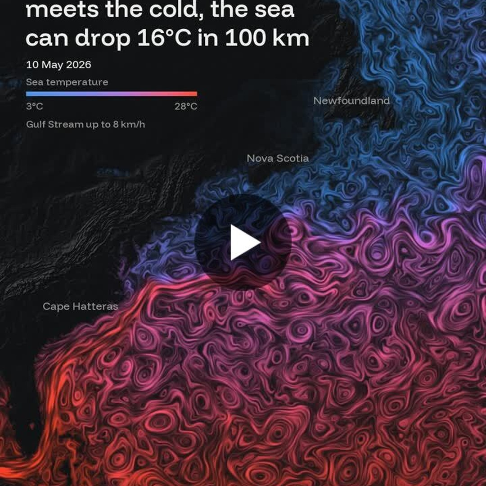

# Geoawesome reposts, 2026-11-14

1 post(s) ready. Each has a 1080×1080 image and its own text for Facebook, Instagram, YouTube Community and X. Nothing has been posted.

**To publish:** tick the box under a post. It is queued for the next free time slot and posted to Facebook and Instagram; a comment here confirms the time. Edit a text in this issue first if you want to change it (what is in the box is what gets posted). Untick before the slot to cancel. When it is live, a comment @mentions you with the YouTube Community text and the X text for Buffer.

---

## 1. # 30daymapchallenge | Amir Zelman - LinkedIn

<!-- post:2026-11-14-11-30daymapchallenge-amir-zelman-linkedin -->
- [ ] **Publish on Facebook + Instagram**



[Download square image](https://raw.githubusercontent.com/walczakagh/geoawesome-social-agent/main/drafts/images/2026-11-14-11-30daymapchallenge-amir-zelman-linkedin.jpg) · square crop, from 720px of source width

**Source:** [Google Alerts #5](https://www.linkedin.com/posts/amir-zelman_30daymapchallenge-activity-7527060693687304192-MYD-) · score 6.0/10 · Gulf Stream six-month North Atlantic map from 30DayMapChallenge; oceanographic visual with a hook.
**Rights:** Someone else's map: the credit line names them; ask them first if unsure. Licence on page: not stated.

**What it shows:** Amir Zelman's map for Day 13 (Interactions) of the 30DayMapChallenge shows six months of North Atlantic currents and sea temperature, from May to the week of posting. The warm Gulf Stream runs up the coast at up to 8 km/h and meets cold water flowing down from Labrador, where the sea can drop 16°C in 100 km. The data comes from Copernicus Marine and NOAA, served through Geodesic by SeerAI.

**Check before posting:**
- Reuse policy is link_only and no image licence is stated. Check whether reposting the image is allowed or ask Amir Zelman for permission.
- No image credit was found on the page. The credit used here is the post author plus the data providers named in the post.
- The post does not explain the colour scale or whether the visual is an animation or a still.
- Exact dates are not given. 'May to this week' implies roughly May to mid-November 2026.
- The figures of 8 km/h and 16°C in 100 km are the author's own statements, with no specific source cited.
- Which coast is meant is not stated explicitly, so the posts do not name it.
- A commenter's question about AMOC changes is not addressed in the post and is left out.

**Facebook**

```text
Where the Gulf Stream meets cold water from Labrador, the sea can drop 16°C in just 100 km.

Amir Zelman's map for Day 13 (Interactions) of the 30DayMapChallenge covers six months, from May to this week. The warm current moves up the coast at up to 8 km/h before colliding with the flow coming south.

Read more: https://www.linkedin.com/posts/amir-zelman_30daymapchallenge-activity-7527060693687304192-MYD-

Map: Amir Zelman, data: Copernicus Marine and NOAA

#Geoawesome #Oceanography #Cartography #Copernicus
```

**Instagram**

```text
The Gulf Stream crashing into cold Labrador water, mapped from May to this week.

Amir Zelman's 30DayMapChallenge entry, built on currents and sea temperature from Copernicus Marine and NOAA.

Find out more: https://www.linkedin.com/posts/amir-zelman_30daymapchallenge-activity-7527060693687304192-MYD-

Map: Amir Zelman, data: Copernicus Marine and NOAA

#Geoawesome #Oceans #Cartography #Maps
```

**YouTube Community**

```text
Six months of North Atlantic currents in one map, from May to this week.

For Day 13 (Interactions) of the 30DayMapChallenge, Amir Zelman combined current and sea temperature data from Copernicus Marine and NOAA, served through Geodesic by SeerAI. The focus is the front where the warm Gulf Stream meets cold Labrador water. The post puts the temperature drop there at up to 16°C over 100 km.

Learn more: https://www.linkedin.com/posts/amir-zelman_30daymapchallenge-activity-7527060693687304192-MYD-

Map: Amir Zelman, data: Copernicus Marine and NOAA

#Geoawesome #Oceanography #NOAA #Copernicus
```

**X (via Buffer)**

```text
Warm water heading north at up to 8 km/h, straight into the cold flow from Labrador. Six months of the North Atlantic, May to now.
https://www.linkedin.com/posts/amir-zelman_30daymapchallenge-activity-7527060693687304192-MYD-
Map: Amir Zelman, data: Copernicus Marine, NOAA
#Geoawesome #Oceans #Cartography
```

**Alt text:** Map of the North Atlantic showing ocean currents and sea temperature, with the warm Gulf Stream meeting colder water flowing down from Labrador.

---

### Skipped after reading the page
- [The Barnes Ice Cap, located on Baffin Island in the Canadian Arctic, is the last remaining fragment ...](https://www.facebook.com/CopernicusEU/posts/%EF%B8%8F-the-barnes-ice-cap-located-on-baffin-island-in-the-canadian-arctic-is-the-last/1588129033356069/): No image was found on the page, there is no image credit or licence, the reuse policy is link_only, and the source text is only a truncated fragment of a Copernicus Facebook post.
- [Las Vegas grew, Lake Mead shrank: real satellite pictures, 1984 to 2025 #Shorts - YouTube](https://www.youtube.com/shorts/usltHpAT8EI): Reuse policy is link_only, no creator or image credit can be found, and the only image is a low-resolution (405px, upscaled) frame from a vertical YouTube Short, so there is no image we can properly post or credit.
- [See airline traffic during the nationwide ground stop](https://www.cbsnews.com/projects/2026/nationwide-groundstop-timelapse/): No image was found on the page, the reuse policy is link_only and the page text is truncated, so there is no visual to post and too little sourced detail to caption it without guessing.
- [Atmospheric River Season for the Pacific Northwest | NASA Earthdata](https://www.earthdata.nasa.gov/news/worldview-image-archive/atmospheric-river-season-pacific-northwest): No image was extracted from the page, there is no image credit or licence, and the source's reuse policy is link_only, so there is nothing we can post as a square.
- [Tracking the 641 Fire in Quebec | WFCA Fire Map](https://wfca.com/fire-map/quebec/641?name=641&id=CA-2026_QC_641): No image on the page, no credit or licence, and only one line of text (fire size), so there is no visual to repost and nothing to describe without guessing.
- [Satellite images show an old Russian garrison coming back to life and new radar ... - Facebook](https://www.facebook.com/united24.media/posts/satellite-images-show-an-old-russian-garrison-coming-back-to-life-and-new-radar-/1115190834615550/): No image or image credit was found on the page, and the one-line text gives no location detail, sensor, date or source, so it cannot be posted without guessing.
- [LiDAR Point-Cloud Viewer - cocreative](https://cocreative.it/templates/lidar-stream): No image on the page, no image credit or licence, link-only reuse policy, and the page is a vendor template demo rather than a published map or image.
- [This map shows airline traffic during the FAA's nationwide ground stop on Nov. 13 ... - Instagram](https://www.instagram.com/reel/DftNjJJRV5j/): There is no image to post: the page has no image, the credit is unknown, the description is truncated and the reuse policy is link-only.
- [Mapbox on X: "# 30DayMapChallenge Day 13 — Interactions 🏎️ Ready, set, race! Earth Racer](https://x.com/Mapbox/status/2121293766153662909): The source gives only a tweet title ('Earth Racer', a #30DayMapChallenge Day 13 interactions entry) with no page text, image credit or licence, and the reuse policy is link_only, so we cannot describe or repost the visual without guessing.
- [Tracking the Lac 370863 Fire in California | WFCA Fire Map](https://wfca.com/fire-map/california/lac_370863): No image on the page, no credit or licence, and the page text is a garbled fire-tracker stub (an unclear 'Anderson 993115 ac' figure for incident lac_370863), so it cannot be described without guessing.
- [Tracking fires in Jefferson, Washington | WFCA Fire Map - Western Fire Chiefs Association](https://wfca.com/fire-map/detection/29eccb8349674853): Auto-generated fire detection page with no image, no date for the detection, no credit and a one-line description, so there is nothing to show and too little to caption without guessing.
- [Tracking fires in Nueces, Texas | WFCA Fire Map - Western Fire Chiefs Association](https://wfca.com/fire-map/detection/2b1791710c8c412b): Auto-generated fire detection listing with no image on the page and a link-only reuse policy, so there is no visual to post.
- [Tracking the Logan 240 Fire in Arkansas | WFCA Fire Map](https://wfca.com/fire-map/arkansas/logan_240): No image on the page, and the source is a one-line automated fire-tracker entry (a 1-acre fire) with nothing striking to show or explain.
- [Tracking fires in Coffee, Tennessee | WFCA Fire Map - Western Fire Chiefs Association](https://wfca.com/fire-map/detection/826aca5c3f0c40db): Auto-generated fire detection listing with no image on the page: one small (0.9 acre) Landsat detection, link-only reuse and no credit, so there is no striking visual to post.
- [A glowing Hawaii, as seen from space - Modern Ghana](https://www.modernghana.com/videonews/cnn/1/753572): The page has only a title: nothing on the image's sensor, date, location detail or what is glowing, no image credit, a 50px source image, and a CNN video relayed by an aggregator.
- [A glowing Hawaii, as seen from space - YouTube](https://www.youtube.com/watch?v=EOms6kHB1Z8): No image or credit on the page, and the text is only a title fragment pointing to a CNN YouTube video, so a caption would be guesswork.
- [Projects – archiscans.com](https://archiscans.com/en/projects/): Company portfolio page for a point cloud and IFC viewer: no named project, place, date or data to describe, no image credit or licence, link-only reuse policy and a low-resolution image.
- [Matrice 400 + Zenmuse L3: Open-Pit Mine 3D Point Cloud From Flight Plan | DJI Enterprise](https://www.facebook.com/DJIEnterpriseOfficial/videos/what-does-an-open-pit-mine-look-like-as-a-3d-point-clouda-dji-matrice-400-drone-/4589813534624014/): Vendor promo video (DJI Matrice 400 + Zenmuse L3) on a link-only, uncredited source; the page text is unrelated certification copy, so mine, date and specs cannot be stated without guessing.

---

### Sources checked
- Google Alerts #1: 20 in feed, 20 new
- Google Alerts #2: 20 in feed, 20 new
- Google Alerts #3: 20 in feed, 20 new
- Google Alerts #4: 20 in feed, 20 new
- Google Alerts #5: 20 in feed, 19 new, 1 already found via another source
- Google Alerts #6: 20 in feed, 17 new, 3 already found via another source
- Google Alerts #7: 20 in feed, 20 new
- Google Alerts #8: 3 in feed, 0 new
- NASA Earth Observatory: 10 in feed, 0 new
- ESA Observing the Earth: failed: https://www.esa.int/rssfeed/Applications/Observing_the_Earth: HTTP 404
- EUMETSAT: 10 in feed, 0 new
- Copernicus Atmosphere Monitoring Service: 10 in feed, 0 new
- NASA JPL: 100 in feed, 0 new
- Planet Pulse: 50 in feed, 0 new
- Maps Mania: 25 in feed, 1 new
- Visual Capitalist (maps): 10 in feed, 0 new
- FlowingData: 10 in feed, 1 new
- Google Maps blog: 20 in feed, 0 new
- Google Research blog: 100 in feed, 1 new
- Overture Maps blog: 20 in feed, 0 new
- Bellingcat: 10 in feed, 0 new
- Reddit r/MapPorn: failed: https://www.reddit.com/r/MapPorn/top/.rss?t=day: HTTP 403
- Reddit r/dataisbeautiful: failed: https://www.reddit.com/r/dataisbeautiful/top/.rss?t=day: HTTP 429
