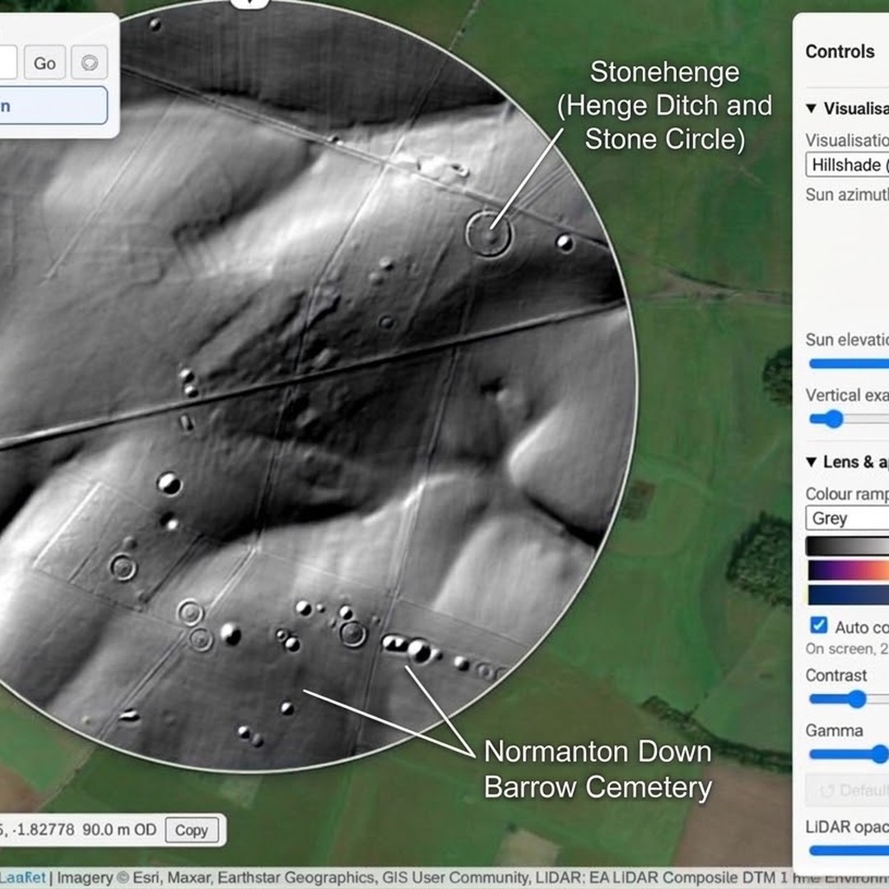
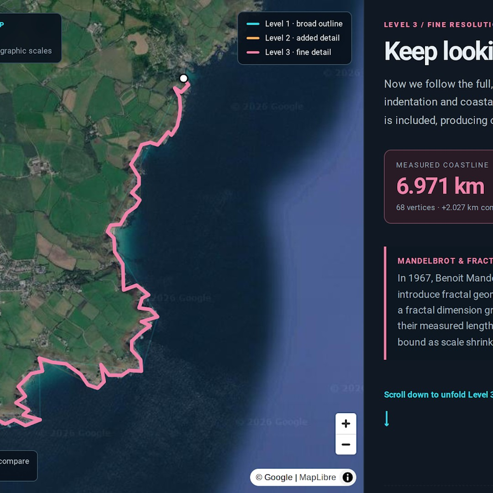

# Geoawesome reposts, 2026-11-15

2 post(s) ready. Each has a 1080×1080 image and its own text for Facebook, Instagram, YouTube Community and X. Nothing has been posted.

**To publish:** tick the box under a post. It is queued for the next free time slot and posted to Facebook and Instagram; a comment here confirms the time. Edit a text in this issue first if you want to change it (what is in the box is what gets posted). Untick before the slot to cancel. When it is live, a comment @mentions you with the YouTube Community text and the X text for Buffer.

---

## 1. Explore Britain's Hidden Archaeology

<!-- post:2026-11-15-2-explore-britain-s-hidden-archaeology -->
- [ ] **Publish on Facebook + Instagram**



[Download square image](https://raw.githubusercontent.com/walczakagh/geoawesome-social-agent/main/drafts/images/2026-11-15-2-explore-britain-s-hidden-archaeology.jpg) · square crop, from 816px of source width

**Source:** [Maps Mania](http://googlemapsmania.blogspot.com/2026/11/explore-britains-hidden-archaeology.html) · score 8.0/10 · LiDAR view of Stonehenge and barrow cemeteries; interactive archaeology map with striking detail.
**Rights:** Someone else's map: the credit line names them; ask them first if unsure. Licence on page: not stated.

**What it shows:** A LiDAR elevation view of Stonehenge from the interactive map LiDAR Lens - Great Britain, featured on Maps Mania. It shows the Normanton Down Barrow Cemetery (dozens of Bronze Age burial mounds) and the Avenue, the prehistoric parallel banks and ditches that once formed a formal approach to the monument. The map lets users switch between hillshade, slope, local relief and sky-view factor inside a circular lens.

**Check before posting:**
- Reuse policy is link_only and no image licence is stated: confirm we may post the image itself before publishing.
- The maker of LiDAR Lens - Great Britain is not named. The credit uses the tool name plus Maps Mania.
- The source of the LiDAR data and its resolution are not given beyond 'high-resolution'.
- The visualisation technique in the featured image (hillshade, slope, local relief or sky-view factor) is not stated.
- No survey or capture date is given.

**Facebook**

```text
Dozens of Bronze Age burial mounds from the Normanton Down Barrow Cemetery stand out around Stonehenge in this LiDAR view.

It also picks out the Avenue, the parallel banks and ditches of the old formal approach. In LiDAR Lens - Great Britain, a circular lens switches between hillshade, slope, local relief and sky-view factor.

Read more: http://googlemapsmania.blogspot.com/2026/11/explore-britains-hidden-archaeology.html

Map: LiDAR Lens - Great Britain via Maps Mania

#Lidar #Archaeology #Stonehenge #Geoawesome
```

**Instagram**

```text
Look past the stones: Bronze Age barrows are scattered across the ground all around them.

High-resolution LiDAR elevation data brings out mounds and earthworks that ordinary aerial photos tend to miss.

Find out more: http://googlemapsmania.blogspot.com/2026/11/explore-britains-hidden-archaeology.html

Map: LiDAR Lens - Great Britain via Maps Mania

#Lidar #Stonehenge #Prehistory #Geoawesome
```

**YouTube Community**

```text
Hillshade, slope, local relief and sky-view factor: four ways to read the same ground, all behind one circular lens.

LiDAR Lens - Great Britain runs these over high-resolution LiDAR elevation data. Around Stonehenge they reveal the Avenue's banks and ditches and the Normanton Down barrows. Try the other techniques at Avebury, Silbury Hill, Maiden Castle or Uffington.

Learn more: http://googlemapsmania.blogspot.com/2026/11/explore-britains-hidden-archaeology.html

Map: LiDAR Lens - Great Britain via Maps Mania

#Lidar #Archaeology #Elevation #Geoawesome
```

**X (via Buffer)**

```text
Bronze Age barrows, the Avenue and Stonehenge itself, all pulled out of LiDAR elevation data.
http://googlemapsmania.blogspot.com/2026/11/explore-britains-hidden-archaeology.html
Map: LiDAR Lens via Maps Mania
#Lidar #Archaeology #Heritage #Geoawesome
```

**Alt text:** LiDAR terrain view of Stonehenge and its surroundings, with many small burial mounds scattered across the landscape and the long parallel banks of the Avenue leading towards the monument.

---

## 2. The Never-Ending Coastline

<!-- post:2026-11-15-5-the-never-ending-coastline -->
- [ ] **Publish on Facebook + Instagram**



[Download square image](https://raw.githubusercontent.com/walczakagh/geoawesome-social-agent/main/drafts/images/2026-11-15-5-the-never-ending-coastline.jpg) · square crop, from 870px of source width

**Source:** [Maps Mania](http://googlemapsmania.blogspot.com/2026/11/the-never-ending-coastline.html) · score 7.0/10 · Interactive coastline-paradox map with a clever cartographic hook from Borges.
**Rights:** Someone else's map: the credit line names them; ask them first if unsure. Licence on page: not stated.

**What it shows:** The Never-Ending Coastline is an interactive map made by the Maps Mania author for the 30DayMapChallenge 'Borgesian Map' prompt, inspired by Borges' story On Exactitude in Science. It shows three versions of the same stretch of coastline. The first smooths over small bays, inlets and headlands, and each later version adds detail. As the reader scrolls, the map zooms in, the resolution increases and the measured coastline grows longer, illustrating the coastline paradox.

**Check before posting:**
- Reuse policy is 'link_only' and no image licence is stated. Check whether posting a crop of the map image is allowed before publishing.
- The page does not name the coastline that is mapped.
- No measured lengths are given for the three levels, so no numbers are used.
- The data source for the coastline polylines is not stated.
- The page text is cut off mid-sentence ('the polyline can be gradually'), so some features of the map may be missing.
- There is no image credit on the page. The map is the blog author's own work, so it is credited to Maps Mania. The author is not named in the source.
- The exact content of the square crop (which zoom level or view) is not described.

**Facebook**

```text
How long is a coastline? On this map, the answer changes every time you scroll.

The Never-Ending Coastline is Maps Mania's entry for the 30DayMapChallenge 'Borgesian Map' prompt, a nod to Borges' story of a map as large as the empire it shows. It traces the same stretch of shore at three levels of detail. With each step the map zooms in, the line picks up more bays, inlets and headlands, and the measured length grows.

Read more: http://googlemapsmania.blogspot.com/2026/11/the-never-ending-coastline.html

Map: Maps Mania

#Cartography #Coastline #Mapping #Geoawesome
```

**Instagram**

```text
Three tracings of one shore, and each is longer than the last.

Scroll through this interactive map and the coastline paradox plays out on screen: more zoom, more twists, a longer measured line.

Find out more: http://googlemapsmania.blogspot.com/2026/11/the-never-ending-coastline.html

Map: Maps Mania

#Maps #Coastline #Borges #Geoawesome
```

**YouTube Community**

```text
The coastline paradox at three resolutions: one shore, three polylines, three different lengths.

The coarsest level smooths over small bays, inlets and headlands. Each scroll step zooms in and swaps in a more detailed version of the line, so the measured coastline keeps growing. Maps Mania built it for the 30DayMapChallenge 'Borgesian Map' prompt, after Borges' On Exactitude in Science. The post does not name the coastline or give the lengths.

Learn more: http://googlemapsmania.blogspot.com/2026/11/the-never-ending-coastline.html

Map: Maps Mania

#Cartography #GIS #Borges #Geoawesome
```

**X (via Buffer)**

```text
Measure a coastline at three levels of detail and you get three answers. A scroll-through take on the coastline paradox.
http://googlemapsmania.blogspot.com/2026/11/the-never-ending-coastline.html
Map: Maps Mania
#Cartography #Coastline #Maps #Geoawesome
```

**Alt text:** A map of a stretch of coastline traced with a line, from the interactive map The Never-Ending Coastline.

---

### Skipped after reading the page
- [Copernicus EU on X: "🏝️ A remote paradise in the Pacific! 🛰️ #CopernicusEU Sentinel-2 ...](https://x.com/CopernicusEU/status/2121675424526676333): The source gives only a truncated tweet title (a Pacific location seen by Sentinel-2) with no place name, date, credit or description, so the image cannot be explained without guessing, and the reuse policy is link_only.
- [Wim Zwijnenburg on X: "While planning hikes and tracking snowfall, found a beautiful ...](https://x.com/wammezz/status/2121677048615760015): The source gives only a truncated tweet title and X boilerplate, with no description of the image, data, place or date, so the visual could not be explained without guessing.
- [Tracking the Swamp Creek Fire in Montana | WFCA Fire Map](https://wfca.com/fire-map/montana/swamp_creek): No image on the page and almost no usable facts: the text names 'Spring Creek' (17 acres, started 20 Aug) while the title says Swamp Creek, and the page warns the incident may no longer be active.
- [Iran claimed it DESTROYED a major American early-warning radar in Bahrain. But fresh sate… / X](https://x.com/MarioNawfal/status/2121634397178966095/video/1): The page gives only a truncated headline about an unverified military claim from an aggregator account on X: no imagery provider, sensor, date or image credit, and the reuse policy is link_only.
- [Two Atlantic storms in one week, seen from space . Storm Bruna spun up west of Portugal ...](https://www.facebook.com/weathershot/videos/two-atlantic-storms-in-one-week-seen-from-space-storm-bruna-spun-up-west-of-port/1675188527456378/): Third-party Facebook video with a link-only reuse policy, no image credit or licence, and truncated text that names no sensor or source imagery, so we cannot post the image or caption it without guessing.
- [Researchers cover 38,000km looking for signs of H5 bird flu | ABC NEWS - YouTube](https://www.youtube.com/watch?v=hL8K7kLufJY): No image or map on the page: it is a news video about an aerial bird flu survey, with no visual we can repost or describe without guessing.
- [ArcGIS StoryMaps on X: "Starry Night with maps! 🗺️ For the # 30DayMapChallenge , Greg ...](https://x.com/ArcGISStoryMaps/status/2121730651531493514): The source is only a truncated X post title and login boilerplate: no description of the map, its data or its full author, no image credit, and a link-only reuse policy, so any caption would be a guess.
- [Ordnance Survey on X: "What if a map was the same size as the place it represents? 🗺️ For ...](https://x.com/OrdnanceSurvey/status/2121675840714871096): There is nothing to caption: the tweet text is cut off, the page text is only X boilerplate, there is no image credit or licence, and the source is link-only, so the visual cannot be described or reposted without guessing.
- [Bike Map XL Not quite a true Borgesian map, but it's the closest I've gotten! My Bike ... - Instagram](https://www.instagram.com/p/DfuyS7pMRC2/): No image was found on the page and there is no image credit or licence. The source text is only a fragment of an Instagram caption, so we have nothing to post and could not credit the maker.
- [Tracking fires in Ravalli, Montana | WFCA Fire Map - Western Fire Chiefs Association](https://wfca.com/fire-map/detection/7c319c831e824c46): No image on the page (link-only alert) and only an auto-generated detection stub, so there is no visual to post and nothing to say without guessing.
- [Geoawesome - X](https://x.com/geoawesome_dgtl/status/2121639544512741654/photo/1): The page text is only X's generic sign-in prompt: no description of the image, no credit, no licence. It also appears to be Geoawesome's own post, so it cannot be captioned without guessing.
- [Tracking fires in Grant, Oregon | WFCA Fire Map - Western Fire Chiefs Association](https://wfca.com/fire-map/detection/755ed53208814c07): No image on the page (link-only alert): this is an automated VIIRS fire-detection entry on WFCA's map with no visual to repost and no credit or licence.
- [Tracking fires in McHenry, Illinois | WFCA Fire Map - Western Fire Chiefs Association](https://wfca.com/fire-map/detection/fe71b1ba92434f61): Auto-generated fire-detection listing with no image on the page (link-only reuse) and a single tiny event (0.4 acres), so there is no striking visual to post.
- [Satellite imagery tool — Sentinel-2 , Landsat since 1984, radar, aerial | GodsView](https://godsviewai.com/world/satellite): Promotional product page for a commercial imagery tool, with no specific image, place, date or credit; the visual could not be described without guessing.
- [14 de novembro de 2026 - YouTube](https://www.youtube.com/watch?v=2ptE5ZsW8Fs): No image or map on the page, only a Google Alerts snippet for a third-party YouTube video (Cosmos Brutal, 'The SUPER El Niño Seen From Space'), so there is nothing to post or describe without guessing.
- [# 30DayMapChallenge | Michelle Thomas - LinkedIn](https://www.linkedin.com/posts/michelle-s-thomas_30daymapchallenge-activity-7527061965995708418-nYrV): Promotional LinkedIn pointer to an Esri #30DayMapChallenge roundup: it names no specific map, place, data or date, and there is no image credit or licence (reuse policy link_only), so it cannot be captioned without guessing.
- [This map shows that 50% of Canadians live south of the red line - Facebook](https://www.facebook.com/adoriandeck/posts/this-map-shows-that-50-of-canadians-live-south-of-the-red-line/1516144873670138/): No image or credit was found: this is a reshare on a personal Facebook page of an unattributed map, with no data source and a link-only reuse policy.
- [# 30daymapchallenge | Laurence Oakes-Ash - LinkedIn](https://www.linkedin.com/posts/laurence-oakes-ash-4aa0b721_30daymapchallenge-activity-7526928307456688129-O9K8): Vendor promotion for an AI dashboard product (Cadence). The image is a product screenshot or video still with no described map content, and no image credit is given.

---

### Sources checked
- Google Alerts #1: 20 in feed, 19 new, 1 from excluded sites
- Google Alerts #2: 20 in feed, 20 new
- Google Alerts #3: 20 in feed, 20 new
- Google Alerts #4: 20 in feed, 20 new
- Google Alerts #5: 20 in feed, 20 new
- Google Alerts #6: 20 in feed, 12 new, 7 already found via another source
- Google Alerts #7: 20 in feed, 20 new
- Google Alerts #8: 5 in feed, 0 new
- NASA Earth Observatory: 10 in feed, 0 new
- ESA Observing the Earth: failed: https://www.esa.int/rssfeed/Applications/Observing_the_Earth: HTTP 404
- EUMETSAT: 10 in feed, 0 new
- Copernicus Atmosphere Monitoring Service: 10 in feed, 0 new
- NASA JPL: 100 in feed, 0 new
- Planet Pulse: 50 in feed, 0 new
- Maps Mania: 25 in feed, 2 new
- Visual Capitalist (maps): 10 in feed, 1 new
- FlowingData: 10 in feed, 0 new
- Google Maps blog: 20 in feed, 0 new
- Google Research blog: 100 in feed, 0 new
- Overture Maps blog: 20 in feed, 0 new
- Bellingcat: 10 in feed, 0 new
- Reddit r/MapPorn: failed: https://www.reddit.com/r/MapPorn/top/.rss?t=day: HTTP 403
- Reddit r/dataisbeautiful: failed: https://www.reddit.com/r/dataisbeautiful/top/.rss?t=day: HTTP 429
