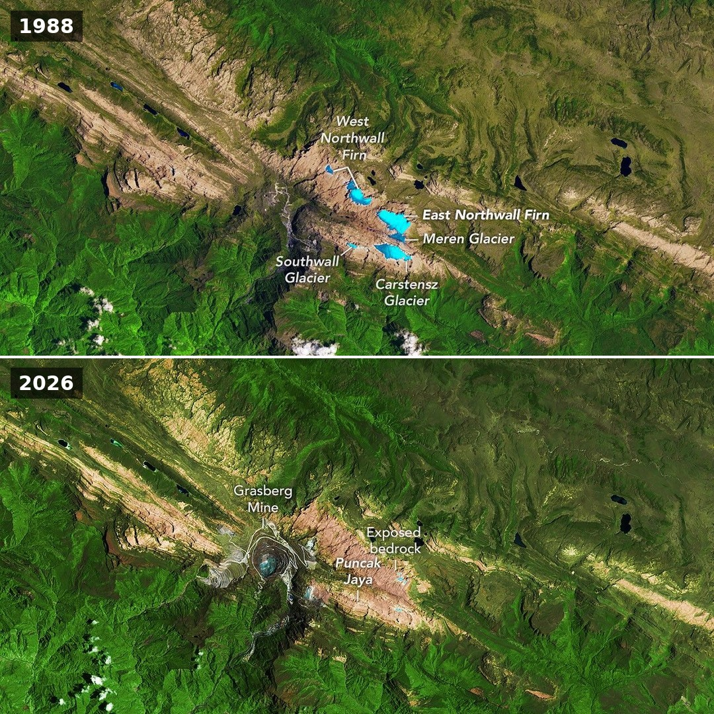
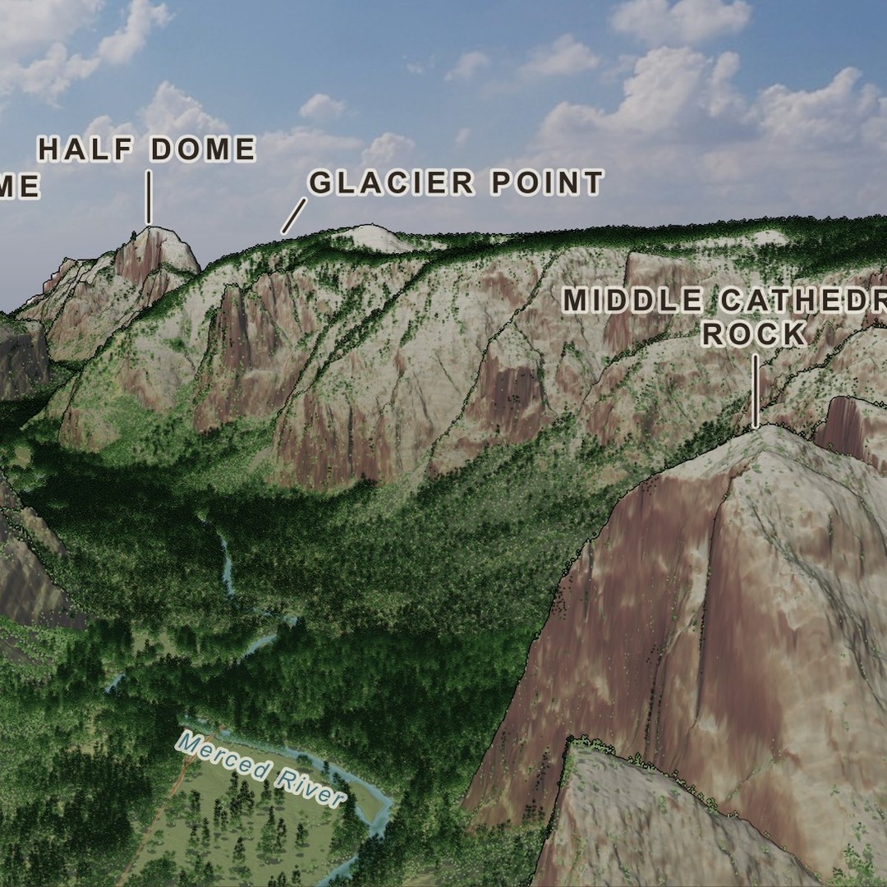
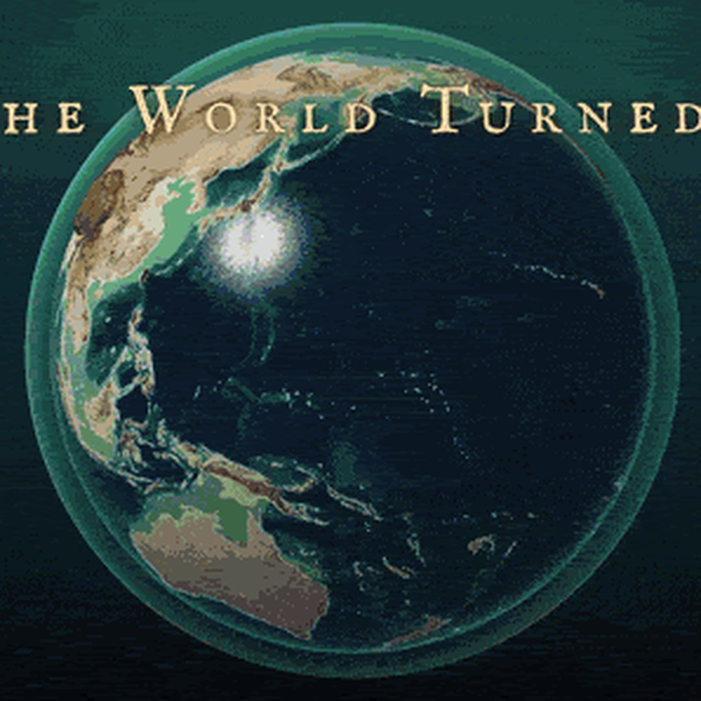
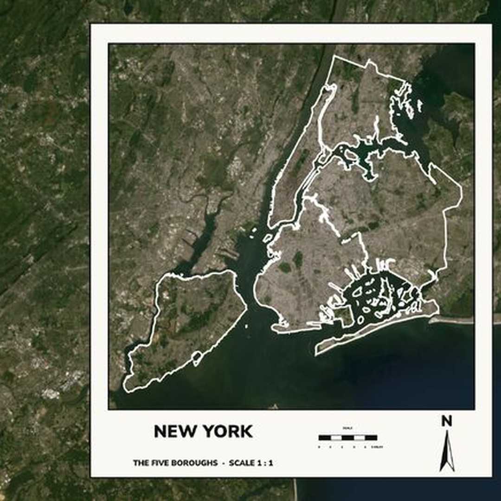

# Geoawesome reposts, 2026-11-16

4 post(s) ready. Each has a 1080×1080 image and its own text for Facebook, Instagram, YouTube Community and X. Nothing has been posted.

**To publish:** tick the box under a post. It is queued for the next free time slot and posted to Facebook and Instagram; a comment here confirms the time. Edit a text in this issue first if you want to change it (what is in the box is what gets posted). Untick before the slot to cancel. When it is live, a comment @mentions you with the YouTube Community text and the X text for Buffer.

---

## 1. The Last Ice on Puncak Jaya

<!-- post:2026-11-16-3-the-last-ice-on-puncak-jaya -->
- [ ] **Publish on Facebook + Instagram**



[Download square image](https://raw.githubusercontent.com/walczakagh/geoawesome-social-agent/main/drafts/images/2026-11-16-3-the-last-ice-on-puncak-jaya.jpg) · before/after pair stacked, from 1280px of source width

**Source:** [NASA Earth Observatory](https://science.nasa.gov/earth/earth-observatory/the-last-ice-on-puncak-jaya/) · score 8.0/10 · Landsat image of Puncak Jaya's shrinking ice; strong before-after glacier loss story from orbit.
**Rights:** Publisher allows reuse with credit. Licence on page: NASA imagery, generally free to reuse with credit.

**What it shows:** A false-colour Landsat pair of the ice near the summit of Puncak Jaya in Indonesia's Sudirman Range on New Guinea. The top image is from 1988 (Landsat 5 TM) and the bottom from 2026 (Landsat 9 OLI). Ice appears light blue, exposed bedrock brown, clouds white and vegetation green. Glacier area fell from about 4.31 km² in 1988 to about 0.09 km² by September 2025 (roughly 2 percent), and the remaining patches no longer flow like glaciers.

**Check before posting:**
- The verbatim credit field is truncated ('from the U'). The full credit in the page text reads 'using Landsat data from the U.S. Geological Survey', and that version is used in the posts.
- The page describes the pair as left/right. The square stacks them as top (1988) and bottom (2026).
- Exact acquisition dates within 1988 and 2026 are not given, and neither is the band combination used for the false colour.
- The latest area figure (0.09 km²) is for September 2025, not the 2026 image date. No 2026 estimate exists yet: an aerial survey is planned for December.
- Area and thickness figures are attributed to Donaldi Permana (BMKG).
- The 'around 2030' disappearance date comes from unnamed 'recent satellite studies'. BMKG suggests it could be sooner because of the 'current' El Niño (current as of November 2026).

**Facebook**

```text
Puncak Jaya's ice shrank from about 4.31 km² in 1988 to roughly 0.09 km² by September 2025.

In this Landsat false-colour pair (top 1988, bottom 2026), ice shows light blue and bare bedrock brown. What remains is too thin and fragmented to flow, so it no longer works as a glacier.

Read more: https://science.nasa.gov/earth/earth-observatory/the-last-ice-on-puncak-jaya/

Image: NASA Earth Observatory images by Lauren Dauphin, using Landsat data from the U.S. Geological Survey

#Landsat #Glaciers #Indonesia #Tropics #Geoawesome
```

**Instagram**

```text
One of the last tropical ice fields is down to about 2 percent of its 1988 area.

Light blue is ice, brown is bare rock: Puncak Jaya, Indonesia, in 1988 (top) and 2026 (bottom).

Find out more: https://science.nasa.gov/earth/earth-observatory/the-last-ice-on-puncak-jaya/

Image: NASA Earth Observatory images by Lauren Dauphin, using Landsat data from the U.S. Geological Survey

#Glaciers #Cryosphere #Landsat #Geoawesome
```

**YouTube Community**

```text
At Puncak Jaya's main monitoring site, the ice went from 32 m thick in 2010 to gone by November 2024.

The pair combines Landsat 5 TM (top, 1988) and Landsat 9 OLI (bottom, 2026) in false colour: ice light blue, bedrock brown, clouds white, vegetation green. Recent satellite studies suggest the main ice areas could disappear around 2030.

Learn more: https://science.nasa.gov/earth/earth-observatory/the-last-ice-on-puncak-jaya/

Image: NASA Earth Observatory images by Lauren Dauphin, using Landsat data from the U.S. Geological Survey

#Landsat #Glaciers #Climate #Indonesia #Geoawesome
```

**X (via Buffer)**

```text
The ice near Puncak Jaya's summit is down to about 2% of its 1988 extent and no longer flows like a glacier. Landsat, 1988 vs 2026.
https://science.nasa.gov/earth/earth-observatory/the-last-ice-on-puncak-jaya/
Image: NASA Earth Observatory, Landsat/USGS
#Landsat #Glaciers #Tropics #Geoawesome
```

**Alt text:** Two stacked false-colour satellite images of the Puncak Jaya summit area: the top one, from 1988, shows broad light-blue ice, and the bottom one, from 2026, shows only small scattered ice patches among brown bedrock.

---

## 2. Yosemite Valley LiDAR Map - Stephen Conklin

<!-- post:2026-11-16-7-yosemite-valley-lidar-map-stephen-conkli -->
- [ ] **Publish on Facebook + Instagram**



[Download square image](https://raw.githubusercontent.com/walczakagh/geoawesome-social-agent/main/drafts/images/2026-11-16-7-yosemite-valley-lidar-map-stephen-conkli.jpg) · square crop, from 1069px of source width

**Source:** [Google Alerts #4](https://conklingeospatial.com/projects/yosemite-valley-lidar/) · score 7.0/10 · 243-million-point lidar survey turned into detail map and 3D view; strong terrain visual.
**Rights:** Someone else's map: the credit line names them; ask them first if unsure. Licence on page: not stated.

**What it shows:** A cartographic sheet by Stephen Conklin built from an airborne LiDAR survey of Yosemite Valley flown by NCALM and distributed by OpenTopography (about 243 million laser returns, classified as ground and unclassified). The sheet combines a 3D view up the valley, a detail map of the valley floor, an overview of the full survey and an exploded stack of the eight processing steps around Yosemite Village, rendered in Blender from layers exported out of QGIS (UTM Zone 11N, EPSG:26911). In the 3D views, trees are drawn from the LiDAR points themselves rather than from symbols; roads, trails and buildings come from OpenStreetMap.

**Check before posting:**
- No image credit or licence on the page, and the reuse policy is link_only: confirm permission from Stephen Conklin before posting the image.
- The page has several views (3D valley view, valley floor detail, exploded stack, low 3D view). It is not clear which one the 1069px-wide square crop shows, so check the alt text against the actual crop.
- Survey date, point density and DEM resolution are not stated.
- The page does not say how the trees were extracted from points classified only as ground and unclassified.

**Facebook**

```text
About 243 million laser returns sit behind this map of Yosemite Valley.

Stephen Conklin built one sheet from an NCALM airborne LiDAR survey: a 3D view up the valley, a detail map of the valley floor and an exploded stack showing all eight processing steps. In the 3D views, each tree is drawn from the points, not a symbol.

Read more: https://conklingeospatial.com/projects/yosemite-valley-lidar/

Map: Stephen Conklin, LiDAR: NCALM via OpenTopography

#Lidar #Yosemite #Cartography #Terrain #Geoawesome
```

**Instagram**

```text
No tree symbols here: the forest on this Yosemite map comes straight from laser returns.

An airborne survey of the valley, rendered as 3D and 2D views on a single sheet.

Find out more: https://conklingeospatial.com/projects/yosemite-valley-lidar/

Map: Stephen Conklin, LiDAR: NCALM via OpenTopography

#Lidar #Yosemite #Trees #Geoawesome
```

**YouTube Community**

```text
Eight processing steps, from raw point cloud to finished map, stacked in one exploded view.

Stephen Conklin worked from an NCALM survey of Yosemite Valley with roughly 243 million returns, classified only as ground and unclassified. Layers were exported from QGIS in UTM Zone 11N (EPSG:26911), rendered in Blender and topped with OpenStreetMap roads, trails and buildings.

Learn more: https://conklingeospatial.com/projects/yosemite-valley-lidar/

Map: Stephen Conklin, LiDAR: NCALM via OpenTopography

#Lidar #QGIS #Blender #Cartography #Geoawesome
```

**X (via Buffer)**

```text
Yosemite Valley as one LiDAR map sheet: 3D view, valley floor detail and the full processing stack, all from a single NCALM survey.
https://conklingeospatial.com/projects/yosemite-valley-lidar/
Map: Stephen Conklin; data NCALM/OpenTopography
#Lidar #Yosemite #QGIS #Geoawesome
```

**Alt text:** A LiDAR-derived map of Yosemite Valley in California, showing the valley floor and surrounding terrain with trees rendered from individual laser points.

---

## 3. An Inverted Earth You Can Explore

<!-- post:2026-11-16-8-an-inverted-earth-you-can-explore -->
- [ ] **Publish on Facebook + Instagram**



[Download square image](https://raw.githubusercontent.com/walczakagh/geoawesome-social-agent/main/drafts/images/2026-11-16-8-an-inverted-earth-you-can-explore.jpg) · square crop, from 298px of source width (low resolution: upscaled, check sharpness)

**Source:** [Maps Mania](http://googlemapsmania.blogspot.com/2026/11/an-inverted-earth-you-can-explore.html) · score 7.0/10 · Explorable inverted Earth map with a submarine viewpoint; a clever, playful geo visual.
**Rights:** Someone else's map: the credit line names them; ask them first if unsure. Licence on page: not stated.

**What it shows:** Atlantis (also called Atlantis: The World Turned Over) is an interactive browser map by Tripgeo, made for the Inverted theme of the #30DayMapChallenge and featured on Maps Mania. It swaps Earth's land and oceans: the oceans have drained onto the continents, the former seabed stands as huge mountain ranges and every city is submerged. Users pilot a submarine called the Nereid through drowned city streets and flooded continental interiors, and can use sonar to sound the depths of the inverted world's ocean trenches.

**Check before posting:**
- The source image is only 298px wide and has been upscaled for the square. Check sharpness before posting, or take a fresh screenshot from Tripgeo's map.
- The write-up does not describe the source image, so the alt text is kept general. Check it against the actual image.
- No image credit or licence is stated on the page, and the reuse policy is link_only. The credit 'Map: Tripgeo via Maps Mania' is based on the page naming Tripgeo as the maker.
- The source does not say which elevation or bathymetry data the map uses, or how the inversion was calculated.
- The page text is cut off mid-sentence (the Paris example), so any further details are missing.
- Tripgeo's own URL for the map is not given. The post links to the Maps Mania article.
- 'First I've encountered' that lets you navigate by submarine is the Maps Mania author's view, not a verified first.

**Facebook**

```text
Swap Earth's land and oceans, and every city on the planet ends up underwater.

Tripgeo's Atlantis, made for the Inverted theme of the 30DayMapChallenge, turns the former seabed into enormous mountain ranges. You pilot a submarine, the Nereid, through drowned streets and newly flooded continental interiors, right in the browser.

Full story: http://googlemapsmania.blogspot.com/2026/11/an-inverted-earth-you-can-explore.html

Map: Tripgeo via Maps Mania

#Geoawesome #Cartography #Maps #Seabed
```

**Instagram**

```text
The oceans have drained onto the continents, and the cities went under.

In Tripgeo's Atlantis you steer a browser submarine along the drowned streets of familiar places such as Paris.

Learn more: http://googlemapsmania.blogspot.com/2026/11/an-inverted-earth-you-can-explore.html

Map: Tripgeo via Maps Mania

#Geoawesome #Maps #Oceans #Submarine
```

**YouTube Community**

```text
This inverted Earth comes with a submarine that has working sonar.

Atlantis: The World Turned Over, by Tripgeo for the 30DayMapChallenge Inverted theme, swaps land and sea. The old seabed stands exposed as mountain ranges while the continents fill with water. The Nereid is fully navigable in the browser, and its sonar sounds the depths of the inverted world's ocean trenches.

Read more: http://googlemapsmania.blogspot.com/2026/11/an-inverted-earth-you-can-explore.html

Map: Tripgeo via Maps Mania

#Geoawesome #Topography #Cartography #Oceans
```

**X (via Buffer)**

```text
Every city on Earth lies underwater in Tripgeo's Atlantis, an inverted planet you navigate by submarine in your browser.
http://googlemapsmania.blogspot.com/2026/11/an-inverted-earth-you-can-explore.html
Map: Tripgeo via Maps Mania
#Geoawesome #Maps #Cartography
```

**Alt text:** A view from Tripgeo's Atlantis web map, an inverted Earth where land and oceans have swapped places.

---

## 4. # 30daymapchallenge | Chris Whong - LinkedIn

<!-- post:2026-11-16-16-30daymapchallenge-chris-whong-linkedin -->
- [ ] **Publish on Facebook + Instagram**



[Download square image](https://raw.githubusercontent.com/walczakagh/geoawesome-social-agent/main/drafts/images/2026-11-16-16-30daymapchallenge-chris-whong-linkedin.jpg) · square crop, from 437px of source width (low resolution: upscaled, check sharpness)

**Source:** [Google Alerts #5](https://www.linkedin.com/posts/chris-whong-798b587_30daymapchallenge-activity-7527459355500339200-VVj3) · score 6.0/10 · Borgesian map of New York as a map; clever concept for 30DayMapChallenge.
**Rights:** Someone else's map: the credit line names them; ask them first if unsure. Licence on page: not stated.

**What it shows:** Chris Whong's Day 14 entry for the 30DayMapChallenge (theme: Borgesian Map). It shows New York as if the city were itself a map, with the furniture of a GIS 101 map built at full size so it can be seen from the air. Made with Squidmaps. No data source, date of imagery or colour scheme is described.

**Check before posting:**
- Source reuse policy is link_only and no image licence is stated. Check whether Chris Whong allows the image to be reposted before using it, or post as a link only.
- No image credit on the page. The credit used is the post's author (Chris Whong) via LinkedIn.
- Source image is only 437px wide and was upscaled for the square. Check sharpness before posting.
- The post does not say which map elements (scale bar, north arrow, legend, etc.) appear, so the captions describe them only as 'GIS 101 map furniture'.
- Not stated whether the base view is satellite or aerial imagery, a 3D render or something else, or which data Squidmaps used.
- Hashtag #30DayMapChallenge left out because the brief allows single-word hashtags only. The challenge is named in the text instead.

**Facebook**

```text
Borges imagined a map as large as the empire it described. Chris Whong flipped the idea and turned New York into its own map.

His entry for Day 14 of the 30DayMapChallenge, themed 'Borgesian Map', gives the city the furniture of a GIS 101 map, built at full size so it reads from the air. It was made with Squidmaps.

Full story: https://www.linkedin.com/posts/chris-whong-798b587_30daymapchallenge-activity-7527459355500339200-VVj3

Map: Chris Whong via LinkedIn

#Cartography #Borges #NYC #Geoawesome
```

**Instagram**

```text
What if New York were its own map?

Chris Whong dressed the city in textbook GIS map elements at full size, readable from above. Day 14 of the 30DayMapChallenge.

Read more: https://www.linkedin.com/posts/chris-whong-798b587_30daymapchallenge-activity-7527459355500339200-VVj3

Map: Chris Whong via LinkedIn

#Maps #NYC #Cartography #Geoawesome
```

**YouTube Community**

```text
The 30DayMapChallenge theme for Day 14 was 'Borgesian Map', and Chris Whong answered it by running the original story backwards.

In Borges's On Exactitude in Science, cartographers produce a map the size of the empire. Here the territory becomes the map: New York carries the standard elements of an introductory GIS layout, scaled up to full size so they can be seen from the air. The piece was built with Squidmaps.

Learn more: https://www.linkedin.com/posts/chris-whong-798b587_30daymapchallenge-activity-7527459355500339200-VVj3

Map: Chris Whong via LinkedIn

#GIS #Borges #Cartography #Geoawesome
```

**X (via Buffer)**

```text
Borges in reverse: New York wearing GIS 101 map furniture at full size, visible from the air.
https://www.linkedin.com/posts/chris-whong-798b587_30daymapchallenge-activity-7527459355500339200-VVj3
Map: Chris Whong via LinkedIn
#Cartography #NYC #Borges #Geoawesome
```

**Alt text:** An overhead view of New York with oversized elements of a basic GIS map placed on the city, as though the city itself were a map.

---

### Skipped after reading the page
- [Shanghai Expands in Landsat Images, 1984-2025 - YouTube](https://www.youtube.com/shorts/LlbQ3rPboGs?vl=es): Reuse policy is link_only, the page names no image credit or uploader to attribute, and the only frame available is 405px wide and would need upscaling. Repost if the original creator and a full-resolution image can be found.
- [Copernicus EU on X: " Born from fire! 🛰️ #CopernicusEU Sentinel-2 captures Surtsey, the ...](https://x.com/CopernicusEU/status/2121963872772907050): The source is only a truncated X post title (the page text is a login wall), with no image credit, date or detail, and the reuse policy is link_only, so the image cannot be checked, credited or reposted.
- [Satellite images showing the aftermath of the attack on the Russian port of Ust-Luga have ...](https://unn.ua/en/news/satellite-images-showing-the-aftermath-of-the-attack-on-the-russian-port-of-ust-luga-have-appeared-online): There is no image credit or licence, the reuse policy is link_only, and the satellite provider, sensor and acquisition date are not given, so the image cannot be posted or explained without guessing.
- [Downtown Montreal and Mont Royal as an airborne lidar survey measured them. This is the ...](https://www.facebook.com/milanjanosovscience/videos/downtown-montreal-and-mont-royal-as-an-airborne-lidar-survey-measured-themthis-i/3750740401731181/): The reuse policy is link_only, and the page gives no image credit or licence, so the frame cannot be reposted as a square image. Ask the creator for permission first.
- [Tracking fires in Henry, Alabama | WFCA Fire Map - Western Fire Chiefs Association](https://wfca.com/fire-map/detection/d4bf875da3874d05): No image on the page and the reuse policy is link-only; this is an auto-generated satellite detection stub with no visual to repost.
- [Tracking fires in Grayson, Texas | WFCA Fire Map - Western Fire Chiefs Association](https://wfca.com/fire-map/detection/22affd8fd59b4115): No image on the page: this is an auto-generated fire-detection listing (0.4 acres from 2 merged Landsat observations in Grayson, Texas) with nothing striking to post.
- [Tracking the Range 43 Range 45 Fire in Mississippi | WFCA Fire Map](https://wfca.com/fire-map/mississippi/range_43__range_45?name=Range+43+%26+Range+45): No image on the page and only one line of auto-generated tracker text (a fire listed at 0 acres), so there is no visual to post.
- [Satellite images showing the aftermath of the attack on the Russian port of Ust-Luga have ... - УНН](https://unn.ua/en/amp/satellite-images-showing-the-aftermath-of-the-attack-on-the-russian-port-of-ust-luga-have-appeared-online): No image on the page and no image credit, so there is no visual to repost; the satellite images are second-hand (UNN citing Radio Free Europe/Radio Liberty) with no provider, sensor or acquisition date given.
- [Satellite images show a large fire at an Aramco pumping station, reportedly caused by a ...](https://x.com/biteme_suckas/status/2122041485302677693/video/1): Unverified video from an anonymous X account with no image credit, licence, sensor, date or location detail, a truncated and hedged cause, and a link-only reuse policy.
- [A decade of progress seen from space Since 2012, electricity access in India has ... - Instagram](https://www.instagram.com/p/DfxTCe1iSHe/): No image was found on the page, there is no image credit or licence, the reuse policy is link_only, and the truncated text gives no sensor, date or map details to describe.
- [Seen from space — plastic may be changing the color of the Pacific Ocean - Free Press](https://www.slobodenpecat.mk/en/se-gleda-od-vselenata-plastikata-mozhebi-ja-menuva-bojata-na-tihiot-okean/): No image on the page and only a truncated text snippet, so there is nothing to post and no sourced facts to caption.
- [Tracking fires in San Joaquin, California | WFCA Fire Map - Western Fire Chiefs Association](https://wfca.com/fire-map/detection/09f84cc1d9564a3d): No image on the page and only an auto-generated detection stub (0.7 acres, 12 merged observations), with no visual to post square and no licence.
- [Tracking fires in Tuolumne, California | WFCA Fire Map - Western Fire Chiefs Association](https://wfca.com/fire-map/detection/dfcd4bb93c58449b): No image on the page, and the source is an auto-generated fire-detection listing with no date, size, sensor detail or credit to build a post from.
- [Tracking fires in Coffee, Georgia | WFCA Fire Map - Western Fire Chiefs Association](https://wfca.com/fire-map/detection/a49edfbeb57245d0): No image on the page (link-only reuse) and the content is an auto-generated detection entry for a single 0.9-acre Landsat fire detection in Coffee, Georgia, with no striking visual to share.

---

### Sources checked
- Google Alerts #1: 9 in feed, 9 new
- Google Alerts #2: 20 in feed, 20 new
- Google Alerts #3: 20 in feed, 18 new, 2 already found via another source
- Google Alerts #4: 20 in feed, 20 new
- Google Alerts #5: 20 in feed, 19 new, 1 already found via another source
- Google Alerts #6: 20 in feed, 5 new, 15 already found via another source
- Google Alerts #7: 20 in feed, 20 new
- Google Alerts #8: 2 in feed, 0 new
- NASA Earth Observatory: 10 in feed, 1 new
- ESA Observing the Earth: failed: https://www.esa.int/rssfeed/Applications/Observing_the_Earth: HTTP 404
- EUMETSAT: 10 in feed, 0 new
- Copernicus Atmosphere Monitoring Service: 10 in feed, 0 new
- NASA JPL: 100 in feed, 0 new
- Planet Pulse: 50 in feed, 0 new
- Maps Mania: 25 in feed, 1 new
- Visual Capitalist (maps): 10 in feed, 2 new
- FlowingData: 10 in feed, 0 new
- Google Maps blog: 20 in feed, 0 new
- Google Research blog: 100 in feed, 0 new
- Overture Maps blog: 20 in feed, 0 new
- Bellingcat: 10 in feed, 0 new
- Reddit r/MapPorn: failed: https://www.reddit.com/r/MapPorn/top/.rss?t=day: HTTP 403
- Reddit r/dataisbeautiful: failed: https://www.reddit.com/r/dataisbeautiful/top/.rss?t=day: HTTP 429
