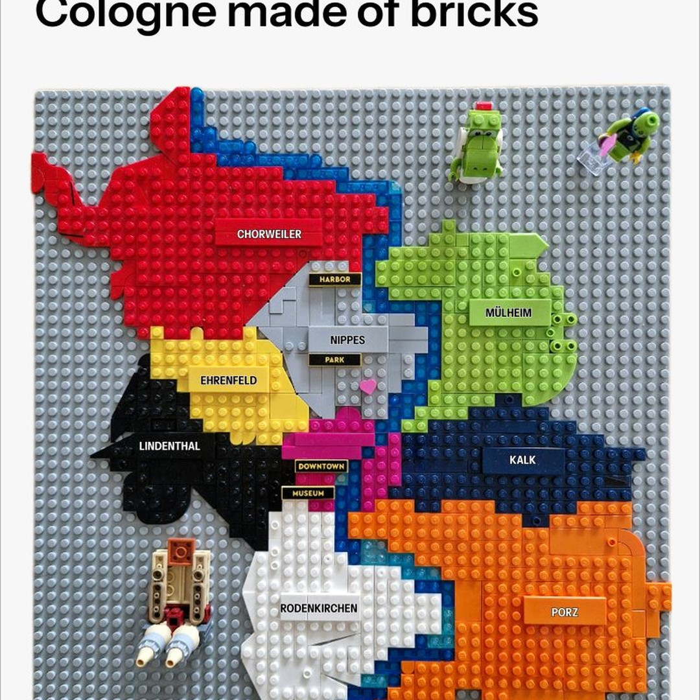

# Geoawesome reposts, 2026-11-17

1 post(s) ready. Each has a 1080×1080 image and its own text for Facebook, Instagram, YouTube Community and X. Nothing has been posted.

**To publish:** tick the box under a post. It is queued for the next free time slot and posted to Facebook and Instagram; a comment here confirms the time. Edit a text in this issue first if you want to change it (what is in the box is what gets posted). Untick before the slot to cancel. When it is live, a comment @mentions you with the YouTube Community text and the X text for Buffer.

---

## 1. Ansgar Wolsing - 30daymapchallenge - LinkedIn

<!-- post:2026-11-17-17-ansgar-wolsing-30daymapchallenge-linkedi -->
- [ ] **Publish on Facebook + Instagram**



[Download square image](https://raw.githubusercontent.com/walczakagh/geoawesome-social-agent/main/drafts/images/2026-11-17-17-ansgar-wolsing-30daymapchallenge-linkedi.jpg) · square crop, from 800px of source width

**Source:** [Google Alerts #5](https://www.linkedin.com/posts/ansgar-wolsing_30daymapchallenge-activity-7528133498466103296-RmFF) · score 6.0/10 · Cologne boroughs mapped in LEGO for 30DayMapChallenge; a clever, visual map concept.
**Rights:** Someone else's map: the credit line names them; ask them first if unsure. Licence on page: not stated.

**What it shows:** A map of Cologne's boroughs built from LEGO, posted on LinkedIn by Ansgar Wolsing as his entry for Day 16 of the #30DayMapChallenge, whose theme was 'Collaborative map'. He describes mapping as 'a family business' and tags Julia Zimmermann. A comment signed by Wolsing adds that 'Yoshi and the alien are also involved'. The source gives no build method, scale or boundary data.

**Check before posting:**
- The reuse policy is link_only, and no image licence is stated. Get permission from Ansgar Wolsing before posting the image itself.
- The page names no image credit. The credit uses the post author (Ansgar Wolsing) and LinkedIn as publisher.
- Julia Zimmermann's exact role is not stated. She is tagged with a heart after 'Mapping is a family business', so co-builder is implied but not confirmed.
- 'Yoshi and the alien' are not explained. They are probably toy figures in the photo, but this is unverified. Check the image.
- The source gives no information on how the borough boundaries were derived, the scale or the number of bricks.
- The image content has not been seen. Confirm that the crop shows the full LEGO map.

**Facebook**

```text
Mapping is a family business, writes Ansgar Wolsing, and his Day 16 entry for the 30DayMapChallenge backs that up.

The theme was 'collaborative map', so Cologne's boroughs were built in LEGO, with Julia Zimmermann tagged in the post. Wolsing adds that Yoshi and an alien were also involved. It is a good reminder that a borough map can be a physical object as well as a GIS layer.

Read more: https://www.linkedin.com/posts/ansgar-wolsing_30daymapchallenge-activity-7528133498466103296-RmFF

Map: Ansgar Wolsing via LinkedIn

#Geoawesome #Mapping #LEGO #Cologne
```

**Instagram**

```text
Cologne, borough by borough, in LEGO bricks.

Ansgar Wolsing's take on Day 16 (collaborative map) of the 30DayMapChallenge is a family effort with Julia Zimmermann, plus cameos from Yoshi and an alien.

Find out more: https://www.linkedin.com/posts/ansgar-wolsing_30daymapchallenge-activity-7528133498466103296-RmFF

Map: Ansgar Wolsing via LinkedIn

#Geoawesome #Maps #LEGO #Köln
```

**YouTube Community**

```text
The 'collaborative map' prompt, answered with a box of LEGO.

Ansgar Wolsing posted this model of Cologne's boroughs for Day 16 of the 30DayMapChallenge and calls mapping a family business, tagging Julia Zimmermann. The post gives no scale or build details, so read it as a playful take on the prompt rather than a data product. Yoshi and an alien reportedly helped too.

Learn more: https://www.linkedin.com/posts/ansgar-wolsing_30daymapchallenge-activity-7528133498466103296-RmFF

Map: Ansgar Wolsing via LinkedIn

#Geoawesome #Cartography #LEGO #Cologne
```

**X (via Buffer)**

```text
Cologne's boroughs, rebuilt in LEGO for Day 16 (collaborative map) of the 30DayMapChallenge. A family project, says Ansgar Wolsing.
https://www.linkedin.com/posts/ansgar-wolsing_30daymapchallenge-activity-7528133498466103296-RmFF
Map: Ansgar Wolsing via LinkedIn
#Geoawesome #LEGO #Maps #Cologne
```

**Alt text:** A map of Cologne's boroughs built from LEGO bricks.

---

### Skipped after reading the page
- [Mumbai from space, 1988 to 2025: real satellite pictures #Shorts - YouTube](https://www.youtube.com/shorts/XqqaFKc0FXI): The image cannot be credited (no creator or licence on the page, reuse policy is link_only), it is a 405px frame from a YouTube Short, and the page text is too fragmentary to caption without guessing.
- [Map or Simulation? - Turning Maps into Games](http://googlemapsmania.blogspot.com/2026/11/map-or-simulation-turning-maps-into.html): We can't tell which of the three projects the 337px image shows, so we can't credit its maker or describe it without guessing, and the upscaled crop is likely too soft for a 1080 square.
- [Tracking fires in San Joaquin, California | WFCA Fire Map - Western Fire Chiefs Association](https://wfca.com/fire-map/detection/8a4374cf2aff44ac): Auto-generated detection page for a 0.2-acre Landsat hotspot with no image on the page, so there is no visual to repost.
- [Satellite image shows 2 oil depots burning in Azov, Rostov oblast, after strike, Ukrainian ...](https://warhistory.org/maps/ukraine/2026-11-16/satellite-image-shows-2-oil-depots-burning-in-azov-rostov-oblast-after-strike-ukrainian-channel-reports): The image has no credit, no licence and no sensor or date, and the burning-depot claim comes only from a Ukrainian Telegram channel; we could not caption or credit it without guessing.
- [NASA photos of Michigan, Great Lakes from space since 2020. See link below ... - Facebook](https://www.facebook.com/detroitfreepress/posts/nasa-photos-of-michigan-great-lakes-from-space-since-2020-see-link-below-%EF%B8%8F-provi/1618794653626014/): No image on the page, no image credit and no sensor or date: only a truncated Facebook teaser from a newspaper about NASA photos, which cannot be described without guessing.
- [A light aircraft scanning Scotland's Cairngorms with lasers counted more than 6 million trees ...](https://www.ecoticias.com/en/a-light-aircraft-scanning-scotlands-cairngorms-with-lasers-counted-more-than-6-million-trees-and-the-young-ones-are-moving-into-land-left-treeless-for-centuries-because-of-what-happened-to-the-deer/54183/): The page does not describe or credit its image, and the reuse policy is link-only, so the visual cannot be identified or posted without guessing.
- [Tracking the Clarks Fire in California | WFCA Fire Map - Western Fire Chiefs Association](https://wfca.com/fire-map/california/clarks): No image on the page and almost no usable text: a generic WFCA incident-map listing for a fire marked 'no longer active', with no visual to repost and no credit.
- [Imperator Cat on X: " 3D terrain map made by me (there could be mistakes tho). Zoom in on ...](https://x.com/CatImperator/status/2122329700110328051): Cannot be explained without guessing: the truncated tweet names no place, data source or method, there is no image credit, and the reuse policy is link only, so the image should not be reposted.
- [Ctruh Launches Verse Engine and Streams an Entire 10.3-Billion-Triangle City Into a Web ...](https://www.ptinews.com/press-release/ctruh-launches-verse-engine-and-streams-an-entire-10-3-billion-triangle-city-into-a-web-browser-from-a-single-link/4264684): Press release with no image on the page (link-only reuse) and only a truncated benchmark claim, so there is no visual to post.
- [Tracking fires in Shelby, Alabama | WFCA Fire Map - Western Fire Chiefs Association](https://wfca.com/fire-map/detection/88166cffdc8b44a2): Auto-generated fire detection page with no image on the page (link-only source), so there is no visual to post.
- [Two Tankers Hit Near Strait of Hormuz, One Disabled - The Maritime Executive](https://maritime-executive.com/article/two-tankers-hit-near-strait-of-hormuz-one-disabled): Conflict news item, not a visual story: the page does not identify its image or give a credit, the reuse policy is link_only, the image is 512px wide and upscaled, and the Sentinel-2 claim is unverified and contradictory.
- [Deck.gl Scatterplot with Colliding Labels - SDG Example](https://do-me.github.io/deckgl-label-collision/sdg/): No image on the page, and the visual is a t-SNE scatterplot of text embeddings of the 169 SDG targets, not a map or Earth observation image.
- [From 400 miles above Earth, AI tracks invasive leafy spurge | University of Minnesota](https://twin-cities.umn.edu/news-events/400-miles-above-earth-ai-tracks-invasive-leafy-spurge): University press release with no description of the image, so it cannot be captioned or alt-texted without guessing, and the only crop is 600px wide and upscaled.
- [Russia's Crimean Bridge Looks Worse From Space— Satellite Image Shows Apparent ...](https://ground.news/article/crimean-bridge-on-satellite-image-analysts-saw-a-deformed-arch-and-a-damaged-painting): The page is a news aggregator round-up of strikes on the Crimean Bridge with no information about the satellite image (no provider, sensor, acquisition date or description of the damage), no image credit and a link-only reuse policy, so the image cannot be explained or credited without guessing.
- [Tracking the Von Hollen Fire in South Carolina | WFCA Fire Map](https://wfca.com/fire-map/south-carolina/von_hollen?name=Von+Hollen): No image on the page and no credit or licence, only a one-line status update (88 acres, 100% contained) on a link-only alert source.
- [Tracking fires in Butte, California | WFCA Fire Map - Western Fire Chiefs Association](https://wfca.com/fire-map/detection/1e0187153362414e): Auto-generated fire detection listing (0.4 acres, Landsat) with no image on the page and a link-only reuse policy, so there is no visual to share.
- [Gaussian splatting in QGIS : r/GaussianSplatting - Reddit](https://www.reddit.com/r/GaussianSplatting/comments/1xxs5ob/gaussian_splatting_in_qgis/): No image was found on the page and the source is a truncated Reddit text snippet, so there is no visual to post and nothing to describe without guessing.
- [Tracking the Canyon Rd Pioneer Rd Fire in California | WFCA Fire Map](https://wfca.com/fire-map/california/canyon_rd_pioneer_rd): No image on the page, the incident is listed as no longer active, and the page text is too thin to caption without guessing.

---

### Sources checked
- Google Alerts #1: 15 in feed, 15 new
- Google Alerts #2: 20 in feed, 20 new
- Google Alerts #3: 20 in feed, 19 new, 1 already found via another source
- Google Alerts #4: 20 in feed, 19 new, 1 from excluded sites
- Google Alerts #5: 20 in feed, 20 new
- Google Alerts #6: 20 in feed, 7 new, 13 already found via another source
- Google Alerts #7: 20 in feed, 20 new
- Google Alerts #8: 2 in feed, 0 new
- NASA Earth Observatory: 10 in feed, 3 new
- ESA Observing the Earth: failed: https://www.esa.int/rssfeed/Applications/Observing_the_Earth: HTTP 404
- EUMETSAT: 10 in feed, 0 new
- Copernicus Atmosphere Monitoring Service: 10 in feed, 0 new
- NASA JPL: 100 in feed, 1 new
- Planet Pulse: 50 in feed, 0 new
- Maps Mania: 25 in feed, 1 new
- Visual Capitalist (maps): 10 in feed, 0 new
- FlowingData: 10 in feed, 1 new
- Google Maps blog: 20 in feed, 3 new
- Google Research blog: 100 in feed, 0 new
- Overture Maps blog: 20 in feed, 0 new
- Bellingcat: 10 in feed, 0 new
- Reddit r/MapPorn: failed: https://www.reddit.com/r/MapPorn/top/.rss?t=day: HTTP 403
- Reddit r/dataisbeautiful: failed: https://www.reddit.com/r/dataisbeautiful/top/.rss?t=day: HTTP 429
