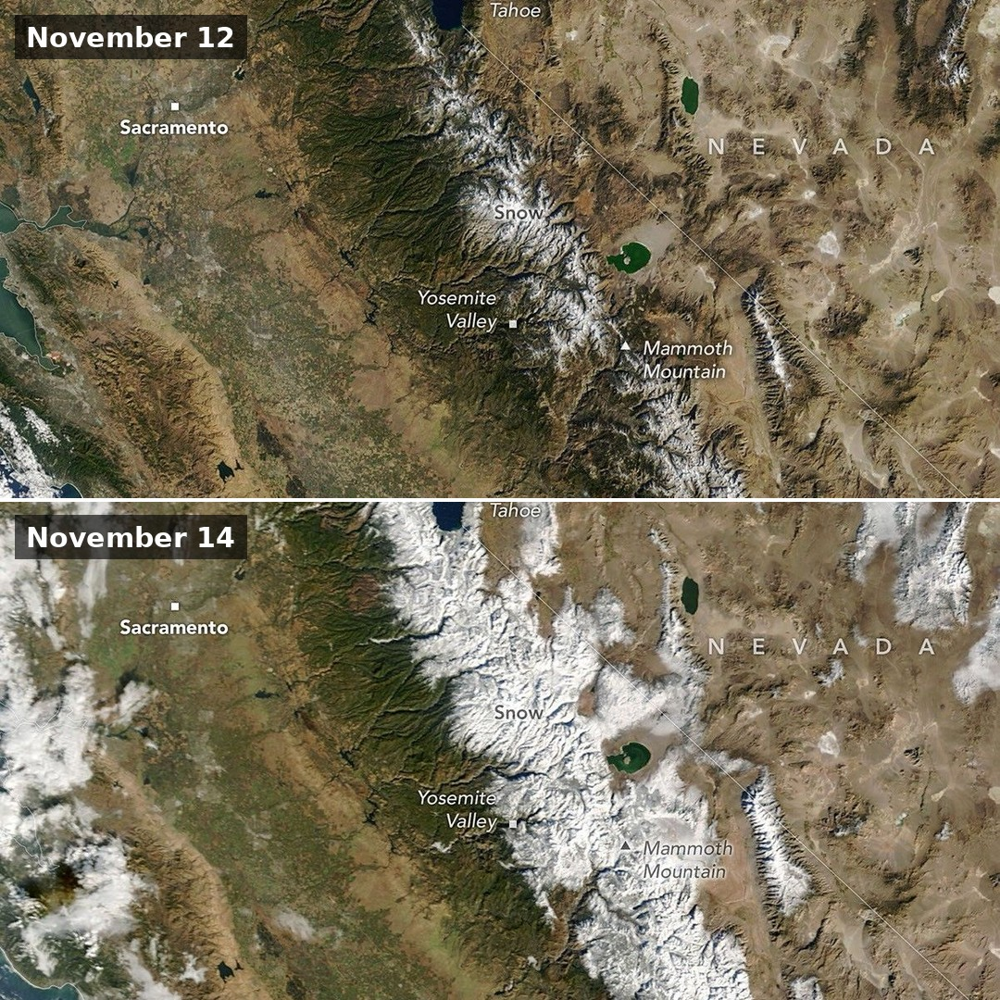
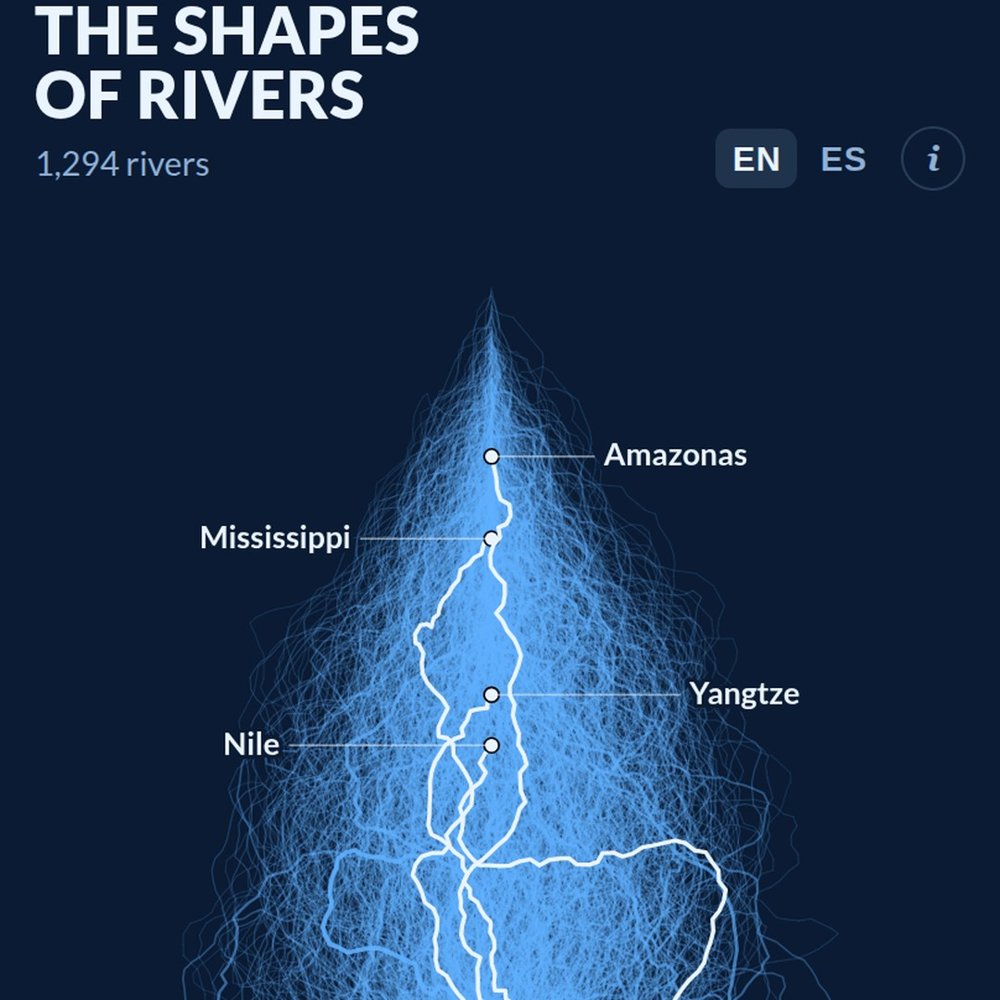
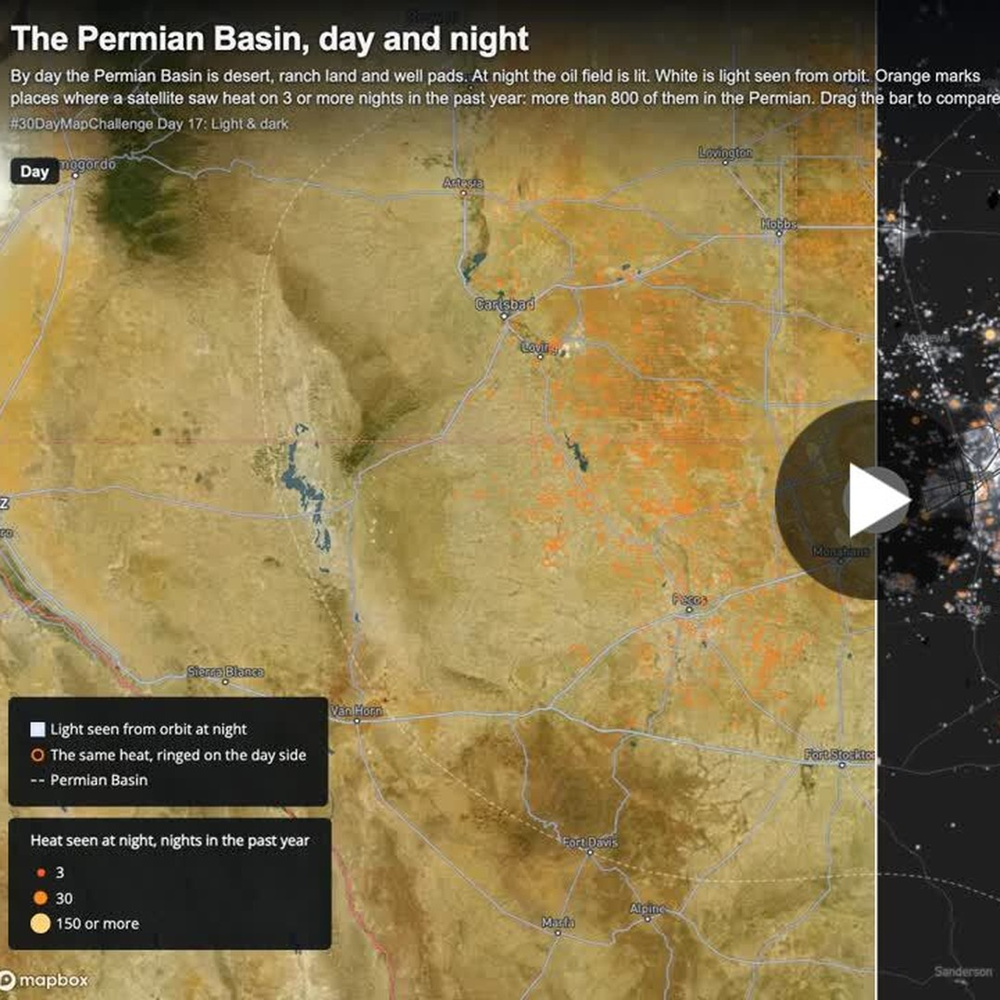
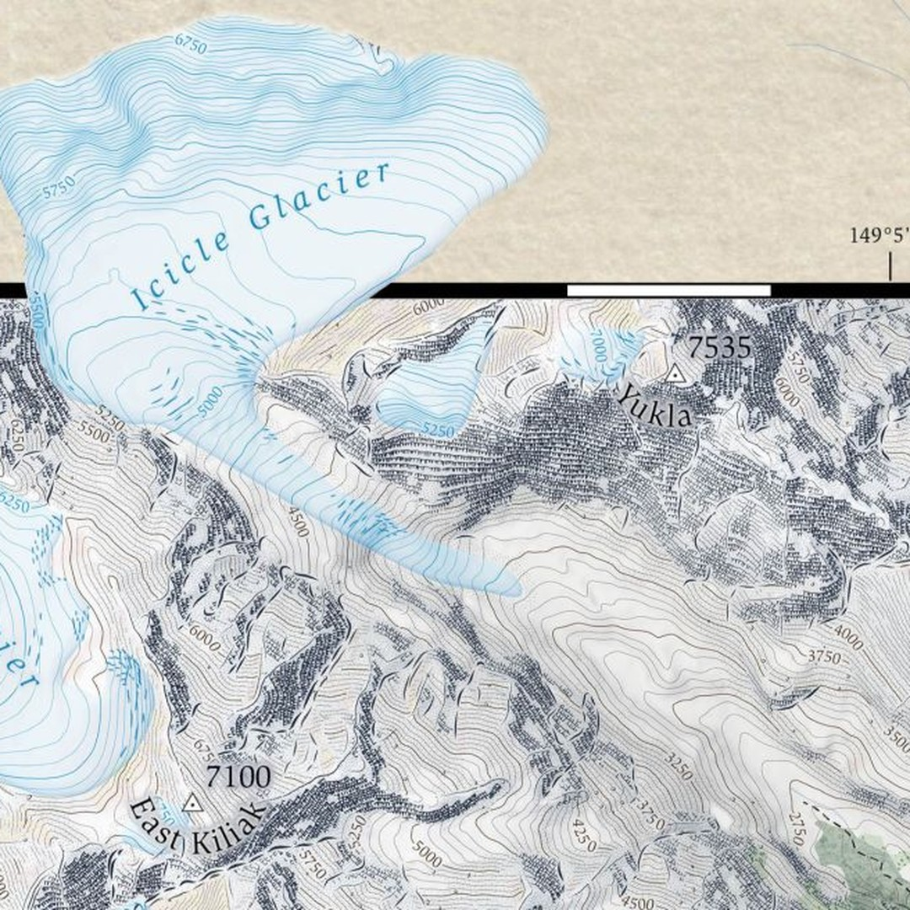

# Geoawesome reposts, 2026-11-18

4 post(s) ready. Each has a 1080×1080 image and its own text for Facebook, Instagram, YouTube Community and X. Nothing has been posted.

**To publish:** tick the box under a post. It is queued for the next free time slot and posted to Facebook and Instagram; a comment here confirms the time. Edit a text in this issue first if you want to change it (what is in the box is what gets posted). Untick before the slot to cancel. When it is live, a comment @mentions you with the YouTube Community text and the X text for Buffer.

---

## 1. Sierra Snow Season Spins Up

<!-- post:2026-11-18-4-sierra-snow-season-spins-up -->
- [ ] **Publish on Facebook + Instagram**



[Download square image](https://raw.githubusercontent.com/walczakagh/geoawesome-social-agent/main/drafts/images/2026-11-18-4-sierra-snow-season-spins-up.jpg) · before/after pair stacked, from 1202px of source width

**Source:** [NASA Earth Observatory](https://science.nasa.gov/earth/earth-observatory/sierra-snow-season-spins-up/) · score 8.0/10 · NASA Earth Observatory satellite scene of Sierra snowstorm; vivid Earth imagery, strong editor history.
**Rights:** Publisher allows reuse with credit. Licence on page: NASA imagery, generally free to reuse with credit.

**What it shows:** A before/after pair of California's Sierra Nevada from MODIS on NASA's Terra satellite. In the stacked square, the top image is 12 November 2026, when the mountains were mostly bare with snow only at the highest elevations. The bottom image is the morning of 14 November 2026, after a storm on 13 November left fresh snow, imaged during a lull between weather systems.

**Check before posting:**
- The source does not state the band combination or whether the images are natural colour, so the captions do not describe the colour rendering.
- Image resolution is not given.
- The page text describes the pair as left (12 November) and right (14 November). The square is stacked top/bottom, so the captions use top/bottom; check that the stacking matches the labels.
- Snowfall figures come from third parties: Donner Pass from the Central Sierra Snow Laboratory, and Mammoth Mountain from the resort's own report.
- The roughly 120 cm figure above 2,400 m is a National Weather Service forecast for 18 to 20 November ('possible'), not an observed amount. It may be outdated by the time of posting.

**Facebook**

```text
One storm on 13 November turned the Sierra Nevada white in two days.

Top: 12 November, mostly bare mountains with snow only on the highest ground. Bottom: 14 November, fresh snow seen by MODIS on NASA's Terra during a lull between storms. The Central Sierra Snow Laboratory recorded nearly 30 cm at Donner Pass.

Read more: https://science.nasa.gov/earth/earth-observatory/sierra-snow-season-spins-up/

Image: NASA Earth Observatory images by Michala Garrison, using MODIS data from NASA EOSDIS LANCE and GIBS/Worldview

#Geoawesome #MODIS #Snow #Weather
```

**Instagram**

```text
Mostly bare on 12 November, white two days later.

Top: California's Sierra Nevada before the storm. Bottom: fresh snow on 14 November, imaged by Terra MODIS.

Learn more: https://science.nasa.gov/earth/earth-observatory/sierra-snow-season-spins-up/

Image: NASA Earth Observatory images by Michala Garrison, using MODIS data from NASA EOSDIS LANCE and GIBS/Worldview

#Geoawesome #Snow #California #NASA
```

**YouTube Community**

```text
The National Weather Service warned that around 120 cm of snow was possible above 2,400 m in the Sierra Nevada from 18 to 20 November.

Before that, MODIS on NASA's Terra saw mostly bare mountains on 12 November (top) and fresh snow on the morning of 14 November (bottom), during a lull between storms. Mammoth Mountain reported 23 to 33 cm of new snow.

Full story: https://science.nasa.gov/earth/earth-observatory/sierra-snow-season-spins-up/

Image: NASA Earth Observatory images by Michala Garrison, using MODIS data from NASA EOSDIS LANCE and GIBS/Worldview

#Geoawesome #Terra #Winter #Mountains
```

**X (via Buffer)**

```text
Interstate 80 closed in both directions after nearly 30 cm of snow at Donner Pass on 13 November. Terra MODIS: 12 Nov (top) vs 14 Nov (bottom).
https://science.nasa.gov/earth/earth-observatory/sierra-snow-season-spins-up/
Image: NASA Earth Observatory, MODIS
#Geoawesome #MODIS #Snow #California
```

**Alt text:** Two satellite views of California's Sierra Nevada stacked vertically: the top shows mostly snow-free mountains with snow only on the highest peaks, and the bottom shows the range widely covered in fresh white snow.

---

## 2. The Interactive Shapes of Rivers

<!-- post:2026-11-18-5-the-interactive-shapes-of-rivers -->
- [ ] **Publish on Facebook + Instagram**



[Download square image](https://raw.githubusercontent.com/walczakagh/geoawesome-social-agent/main/drafts/images/2026-11-18-5-the-interactive-shapes-of-rivers.jpg) · square crop, from 808px of source width

**Source:** [Maps Mania](http://googlemapsmania.blogspot.com/2026/11/the-interactive-shapes-of-rivers.html) · score 8.0/10 · Interactive river-shapes map of 1,294 rivers, rearrangeable across views; highly playable geo visual.
**Rights:** Someone else's map: the credit line names them; ask them first if unsure. Licence on page: not stated.

**What it shows:** An interactive version of Dr. Dominic Royé's 'Shapes of Rivers' visualisation, showing 1,294 of the world's longest rivers. Users can switch between a 'Drop' view, a Radial compass burst and a geographic Map view without coastlines, equalise river lengths to compare sinuosity, group rivers by continent and highlight individual rivers. In the Map view, blank areas over the Sahara, the Arabian Peninsula, the Gobi interior and the Australian Outback mark the great hydrological deserts.

**Check before posting:**
- The maker of the interactive version is not named. It is unclear whether it is by Dominic Royé or someone else, so the credit is left as 'via Maps Mania'.
- The river data source and date are not stated.
- No image credit or licence is given on the page, and the reuse policy is link_only. Check rights before posting the image.
- It is not stated which view (Drop, Radial or Map) appears in the cropped image, or what colours are used. The alt text is kept generic.
- The selection criteria for the 1,294 'longest rivers' are not given.

**Facebook**

```text
Draw 1,294 of the world's longest rivers without a single coastline and the continents still take shape.

This interactive take on Dr. Dominic Royé's Shapes of Rivers lets you switch between his 'Drop' layout, a Radial burst and a geographic Map view. In the Map view, the empty patches over the Sahara, the Arabian Peninsula, the Gobi interior and the Australian Outback show where the planet's great hydrological deserts sit.

Full story: http://googlemapsmania.blogspot.com/2026/11/the-interactive-shapes-of-rivers.html

Map: via Maps Mania

#Rivers #Hydrology #Cartography #Geoawesome
```

**Instagram**

```text
The Sahara, the Gobi and the Outback show up here as gaps, with no long rivers to draw.

All 1,294 rivers can be rearranged on the fly, and you can equalise their lengths to see how much each one meanders.

Learn more: http://googlemapsmania.blogspot.com/2026/11/the-interactive-shapes-of-rivers.html

Map: via Maps Mania

#Rivers #Maps #Visualisation #Geoawesome
```

**YouTube Community**

```text
Set 1,294 rivers to the same length and their sinuosity becomes something you can compare side by side.

The interactive Shapes of Rivers builds on Dr. Dominic Royé's widely shared 'Drop' view. You can reorder every river into Drop, Radial or Map layouts, group them by continent and highlight a single river to trace its exact geometry. The Map view has no coastlines, so landmasses are outlined only by inland waterways.

Find out more: http://googlemapsmania.blogspot.com/2026/11/the-interactive-shapes-of-rivers.html

Map: via Maps Mania

#Hydrology #Rivers #Geography #Geoawesome
```

**X (via Buffer)**

```text
No coastlines, only rivers: 1,294 of them, which you can rearrange into Drop, Radial or Map views.
http://googlemapsmania.blogspot.com/2026/11/the-interactive-shapes-of-rivers.html
Map: via Maps Mania
#Rivers #Hydrology #Cartography #Geoawesome
```

**Alt text:** A data visualisation of hundreds of the world's longest rivers, each drawn as a separate line shape.

---

## 3. # 30daymapchallenge | Kyle Walker - LinkedIn

<!-- post:2026-11-18-17-30daymapchallenge-kyle-walker-linkedin -->
- [ ] **Publish on Facebook + Instagram**



[Download square image](https://raw.githubusercontent.com/walczakagh/geoawesome-social-agent/main/drafts/images/2026-11-18-17-30daymapchallenge-kyle-walker-linkedin.jpg) · square crop, from 720px of source width

**Source:** [Google Alerts #5](https://www.linkedin.com/posts/walkerke_30daymapchallenge-activity-7528518136841752578-Gg38) · score 6.0/10 · 30DayMapChallenge night-light map with VIIRS fire data; a live map link.
**Rights:** Someone else's map: the credit line names them; ask them first if unsure. Licence on page: not stated.

**What it shows:** A map by Kyle Walker of the Permian Basin oil field for Day 17 (Light & dark) of the #30DayMapChallenge. It marks 836 places that NASA VIIRS active fire detections recorded as night-time heat on 3 or more nights over the past year, alongside NASA Black Marble night-light imagery. The live map has a slider for comparing the field by day and by night.

**Check before posting:**
- No image credit or licence is stated on the page, and the reuse policy is link_only. Confirm with Kyle Walker that the image can be reposted.
- Source image is only 720px wide, so the 1080x1080 square is upscaled. Check sharpness before posting.
- It is unclear which view the cropped square shows (day imagery, Black Marble night lights or heat detections). Check the image matches the alt text.
- The source of the daytime imagery behind the slider is not stated.
- 'This past year' has no exact date range. The post was published 17 November 2026.
- The 836 sites are only partly identified: the author says some are 'likely' gas flares, while others are gas plants and other industry. There is no breakdown.
- The live map is behind a shortened lnkd.in link. The posts link to the LinkedIn post instead.

**Facebook**

```text
836 places in the Permian Basin showed up as night-time heat on 3 or more nights over the past year.

Kyle Walker mapped NASA VIIRS active fire detections across the oil field and paired them with NASA Black Marble night lights. Some of the hotspots are likely gas flares, but VIIRS also picks up gas plants and other industry. A slider compares the field by day and by night.

Read more: https://www.linkedin.com/posts/walkerke_30daymapchallenge-activity-7528518136841752578-Gg38

Map: Kyle Walker

#Geoawesome #VIIRS #Permian #Flaring
```

**Instagram**

```text
An oil field mapped by the heat it gives off after dark.

NASA VIIRS flagged 836 spots in the Permian Basin as night-time heat on three or more nights in a year. Some are likely gas flares.

Learn more: https://www.linkedin.com/posts/walkerke_30daymapchallenge-activity-7528518136841752578-Gg38

Map: Kyle Walker

#Geoawesome #Permian #Oil #NASA
```

**YouTube Community**

```text
Not every hotspot over an oil field at night is a flare.

For Day 17 (Light & dark) of the 30 Day Map Challenge, Kyle Walker plotted Permian Basin sites caught by NASA VIIRS active fire detections on at least three nights in the past year. The sensor registers gas plants and other industry as well as likely flares. Night lights come from NASA Black Marble, and a slider switches between day and night.

Find out more: https://www.linkedin.com/posts/walkerke_30daymapchallenge-activity-7528518136841752578-Gg38

Map: Kyle Walker

#Geoawesome #VIIRS #Cartography #Oil
```

**X (via Buffer)**

```text
Heat on three or more nights in a year: NASA VIIRS flagged 836 such sites in the Permian Basin. Some likely gas flares, others gas plants and industry.
https://www.linkedin.com/posts/walkerke_30daymapchallenge-activity-7528518136841752578-Gg38
Map: Kyle Walker
#Geoawesome #VIIRS #Permian #Flaring
```

**Alt text:** Map of the Permian Basin oil field showing locations where a satellite detected night-time heat.

---

## 4. # 30daymapchallenge #arcgis #cartogaphy #swisstyle #terrain #chugach | Shira Ellenson - LinkedIn

<!-- post:2026-11-18-18-30daymapchallenge-arcgis-cartogaphy-swi -->
- [ ] **Publish on Facebook + Instagram**



[Download square image](https://raw.githubusercontent.com/walczakagh/geoawesome-social-agent/main/drafts/images/2026-11-18-18-30daymapchallenge-arcgis-cartogaphy-swi.jpg) · square crop, from 656px of source width (low resolution: upscaled, check sharpness)

**Source:** [Google Alerts #5](https://www.linkedin.com/posts/shira-ellenson_30daymapchallenge-arcgis-cartogaphy-activity-7528492458830368768-e7xu) · score 6.0/10 · Swiss-style hachure terrain map of Chugach peaks; a striking cartographic look.
**Rights:** Someone else's map: the credit line names them; ask them first if unsure. Licence on page: not stated.

**What it shows:** A work-in-progress terrain map by Shira Ellenson for Day 17 (Light & Dark) of the 30DayMapChallenge, showing mountains in the Chugach area of Alaska drawn with Swiss-style rock hachures. Slope and aspect control the direction, width and spacing of each stroke: on sunlit faces strokes are spaced apart and taper toward the ridge, while shaded slopes get denser strokes that taper toward the base. Edge detection was used to find ridges and gullies, with scree, atmospheric perspective and a hidden easter egg added.

**Check before posting:**
- Reuse policy is link_only and no image licence is stated: get permission from Shira Ellenson before posting the image itself.
- No image credit on the page. The credit used is the map's author, taken from the LinkedIn post.
- Low-resolution source (656px wide, upscaled): check that the fine hachure strokes are still sharp at 1080x1080.
- The elevation data source and resolution are not stated.
- The exact extent is not given, only #chugach and 'Alaska'. Do not name specific peaks.
- The software is only implied by the #arcgis hashtag and a linked ArcGIS Pro tutorial, so it is not named in the posts.
- The map is described as a work in progress (sneak peek), not a finished product.
- The alt text is based on the author's description. Check it against the actual image.

**Facebook**

```text
Every stroke on this mountain map is set by the light: Swiss-style rock hachures, applied to the Chugach in Alaska.

In Shira Ellenson's 30DayMapChallenge entry (Day 17: Light & Dark), strokes spread out and taper toward the ridge on sunlit faces, then crowd together and taper toward the base on shaded slopes. Edge detection finds ridges and gullies, and scree and atmospheric perspective finish the look. It is still a work in progress.

Find out more: https://www.linkedin.com/posts/shira-ellenson_30daymapchallenge-arcgis-cartogaphy-activity-7528492458830368768-e7xu

Map: Shira Ellenson

#Cartography #Terrain #Chugach #Geoawesome
```

**Instagram**

```text
Swiss rock drawing, moved to Alaska.

Hachures thin out on sunlit faces and pack tight in shadow, tracing the light across the Chugach. A 30DayMapChallenge sneak peek.

Learn more: https://www.linkedin.com/posts/shira-ellenson_30daymapchallenge-arcgis-cartogaphy-activity-7528492458830368768-e7xu

Map: Shira Ellenson

#Hachures #Alaska #Cartography #Geoawesome
```

**YouTube Community**

```text
Behind the engraved look: slope and aspect set the direction, width and spacing of every hachure stroke.

Shira Ellenson then used edge detection to pick out ridges and gullies in the Chugach terrain and added scree and atmospheric perspective. Her references include Roman Geisthövel's dissertation on automatic Swiss-style rock depiction, the Swiss National Map and Bradford Washburn's 1960 Denali map.

Read more: https://www.linkedin.com/posts/shira-ellenson_30daymapchallenge-arcgis-cartogaphy-activity-7528492458830368768-e7xu

Map: Shira Ellenson

#Relief #Terrain #Cartography #Geoawesome
```

**X (via Buffer)**

```text
Swiss-style rock hachures for Alaska's Chugach: sparse strokes on sunlit faces, dense ones in shadow. A 30DayMapChallenge work in progress.
https://www.linkedin.com/posts/shira-ellenson_30daymapchallenge-arcgis-cartogaphy-activity-7528492458830368768-e7xu
Map: Shira Ellenson
#Cartography #Hachures #Alaska #Geoawesome
```

**Alt text:** A mountain terrain map drawn in fine hachure strokes that are dense on shaded slopes and widely spaced on sunlit faces, giving the peaks a shaded, engraved look.

---

### Skipped after reading the page
- [Ukraine Strikes Crimean Bridge Again—This Time an Entire Road Section Falls Into the Sea](https://united24media.com/war-in-ukraine/ukraine-strikes-crimean-bridge-again-this-time-an-entire-road-section-falls-into-the-sea-24432): War news with no Earth observation or map visual: the image has no credit or licence, the footage is unverified third-party material, and the article contains no satellite, sensor or geodata content to explain.
- [Shanghai from space: Pudong was farmland in 1987, city by 2023 #shorts - YouTube](https://www.youtube.com/shorts/g9OtJPzAyh8): Link-only reuse policy, no image credit or licence, and a low-resolution (405px, upscaled) YouTube Shorts thumbnail, so we cannot properly repost or credit the image.
- [Tracking fires in Vernon, Wisconsin | WFCA Fire Map - Western Fire Chiefs Association](https://wfca.com/fire-map/detection/1f738cefe4644261): No image on the page: this is an auto-generated satellite fire detection listing (one VIIRS detection, about 97 acres, Vernon, Wisconsin) with no map visual to repost and a link-only reuse policy.
- [Tracking fires in Hawaii, Hawaii | WFCA Fire Map - Western Fire Chiefs Association](https://wfca.com/fire-map/detection/399223e0b50943f5): No image on the page and the source is only an automated one-line VIIRS detection notice (link-only reuse), so there is no visual to post and no context beyond a bare acreage figure.
- [Ctruh launches Verse Engine and streams an entire 10.3-billion-triangle city Into a web ...](https://www.aninews.in/news/business/ctruh-launches-verse-engine-and-streams-an-entire-103-billion-triangle-city-into-a-web-browser-from-a-single-link20261117185542/): This is a company press release (product launch, US expansion and fundraising) with self-reported benchmarks, no identified image or image credit, and a link-only reuse policy, so there is no clear striking visual to repost.
- [Tracking the Shady Hollow Fire in Arkansas | WFCA Fire Map](https://wfca.com/fire-map/arkansas/shady_hollow?name=Shady+Hollow): No image on the page and only a one-line incident status (100 acres, 0% contained), so there is no visual to repost and nothing to describe without guessing.
- [precision farming, made simple - Aigri](https://aigri.co/en/): Commercial landing page for an invitation-only farming app, with no identifiable map or satellite image to credit, no image credit or licence, and a link_only reuse policy.
- [Zelenskyy Reveals What Missiles and Drones Struck the Crimean Bridge—and How the ...](https://united24media.com/war-in-ukraine/zelenskyy-reveals-what-missiles-and-drones-struck-the-crimean-bridge-and-how-the-attack-unfolded-24442): War news article about weapons used in the Crimean Bridge strike, with no satellite image, map or geodata visual described, no image credit or licence, and a low-resolution link-only image.
- [Ukraine Uses Its Own Missile Guidance System to Strike the $4 Billion Crimean Bridge ...](https://united24media.com/war-in-ukraine/ukraine-uses-its-own-missile-guidance-system-to-strike-the-4-billion-crimean-bridge-without-starlink-or-starshield-24469): War news report with no Earth observation image or map: the source names no image, sensor or credit, the picture is a low-resolution crop under a link-only reuse policy, and the main claims come from an unnamed officer via The Times.
- [Pixels & Parcels - Managing New Mexico's Water with Landsat - YouTube](https://www.youtube.com/watch?v=xjvDN2mTvEc): No image was found on the page, and the source is a YouTube video with only a truncated teaser line, so there is no visual to post and no facts to caption without guessing.
- [Ukraine strikes Crimean bridge for second day as Russia pounds Kyiv bridges | Top News](https://lufkindailynews.com/news_reuters/top_news/ukraine-strikes-crimean-bridge-for-second-day-as-russia-pounds-kyiv-bridges/article_45e2ed7e-8e5c-58f4-adcb-285cb6ee2b44.html): This is a Reuters wire news story about wartime strikes on the Crimean and Kyiv bridges, with no satellite image or map, and the image itself is unidentified, uncredited, unlicensed and only 420px wide.
- [This map shows the 8 sections of the newly opened King Charles III England Coast Path. At ...](https://www.facebook.com/photo.php?fbid=1532445315664740&set=a.416664743909475&type=3): No image was found on the page, there is no image credit or licence, the reuse policy is link_only, and the text is cut off, so the map cannot be shown, credited or described without guessing.
- [This interactive map reveals Nova Scotia's shipwrecks - Your Quad Counties](https://yourquadcounties.ca/this-interactive-map-reveals-nova-scotias-shipwrecks/): The page is a two-line radio host blurb that names no map maker, data source or number of wrecks, gives no image credit, and is marked link_only, so the visual can't be described or credited without guessing.
- [Ctruh launches Verse Engine and streams an entire 10.3-billion-triangle city Into a web ...](https://www.bignewsnetwork.com/news/279438816/ctruh-launches-verse-engine-and-streams-an-entire-103-billion-triangle-city-into-a-web-browser-from-a-single-link): Company press release (product launch, US expansion, funding round) with no identifiable map or Earth observation visual; the image is an unknown 420px newswire picture with an all-rights-reserved credit.
- [Historic Bristol, TN/VA: 1888 Sanborn Map Reveals Main Street Businesses - Facebook](https://www.facebook.com/photo.php?fbid=122212789155106562&set=gm.1603643261807831&type=3): No image was found on the page, there is no credit or licence, the reuse policy is link-only, and the page text is just a repeated title, so there is nothing to post or describe without guessing.

---

### Sources checked
- Google Alerts #1: 15 in feed, 15 new
- Google Alerts #2: 20 in feed, 18 new
- Google Alerts #3: 20 in feed, 19 new, 1 from excluded sites
- Google Alerts #4: 20 in feed, 20 new
- Google Alerts #5: 20 in feed, 20 new
- Google Alerts #6: 20 in feed, 7 new, 13 already found via another source
- Google Alerts #7: 20 in feed, 20 new
- Google Alerts #8: 9 in feed, 0 new
- NASA Earth Observatory: 10 in feed, 1 new
- ESA Observing the Earth: failed: https://www.esa.int/rssfeed/Applications/Observing_the_Earth: HTTP 404
- EUMETSAT: 10 in feed, 0 new
- Copernicus Atmosphere Monitoring Service: 10 in feed, 0 new
- NASA JPL: 100 in feed, 0 new
- Planet Pulse: 50 in feed, 0 new
- Maps Mania: 25 in feed, 1 new
- Visual Capitalist (maps): 10 in feed, 2 new
- FlowingData: 10 in feed, 2 new
- Google Maps blog: 20 in feed, 0 new
- Google Research blog: 100 in feed, 0 new
- Overture Maps blog: 20 in feed, 0 new
- Bellingcat: 10 in feed, 0 new
- Reddit r/MapPorn: failed: https://www.reddit.com/r/MapPorn/top/.rss?t=day: HTTP 404
- Reddit r/dataisbeautiful: failed: https://www.reddit.com/r/dataisbeautiful/top/.rss?t=day: HTTP 429
