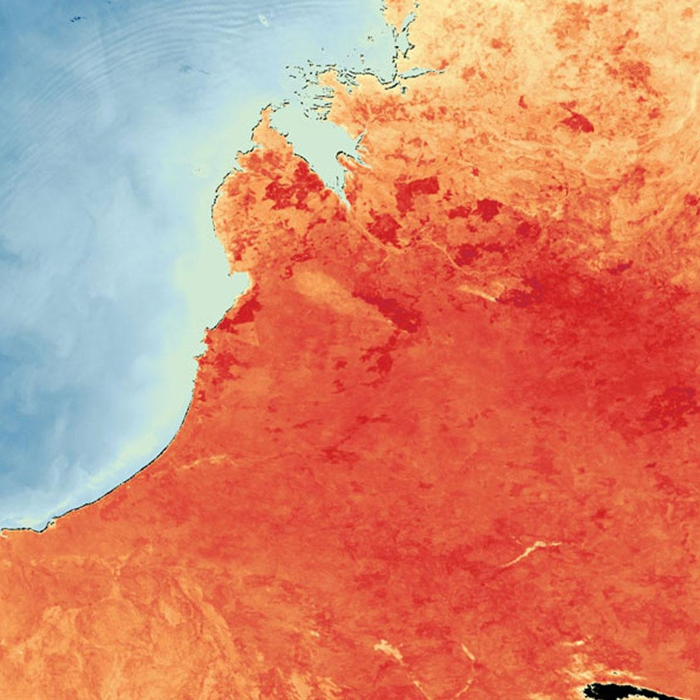
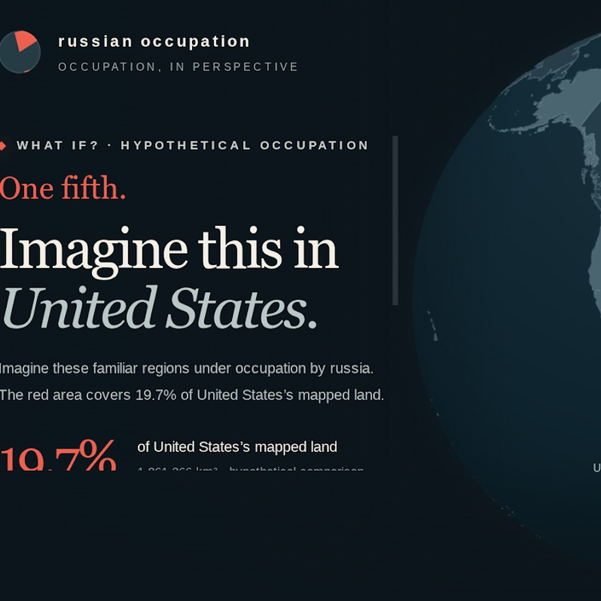
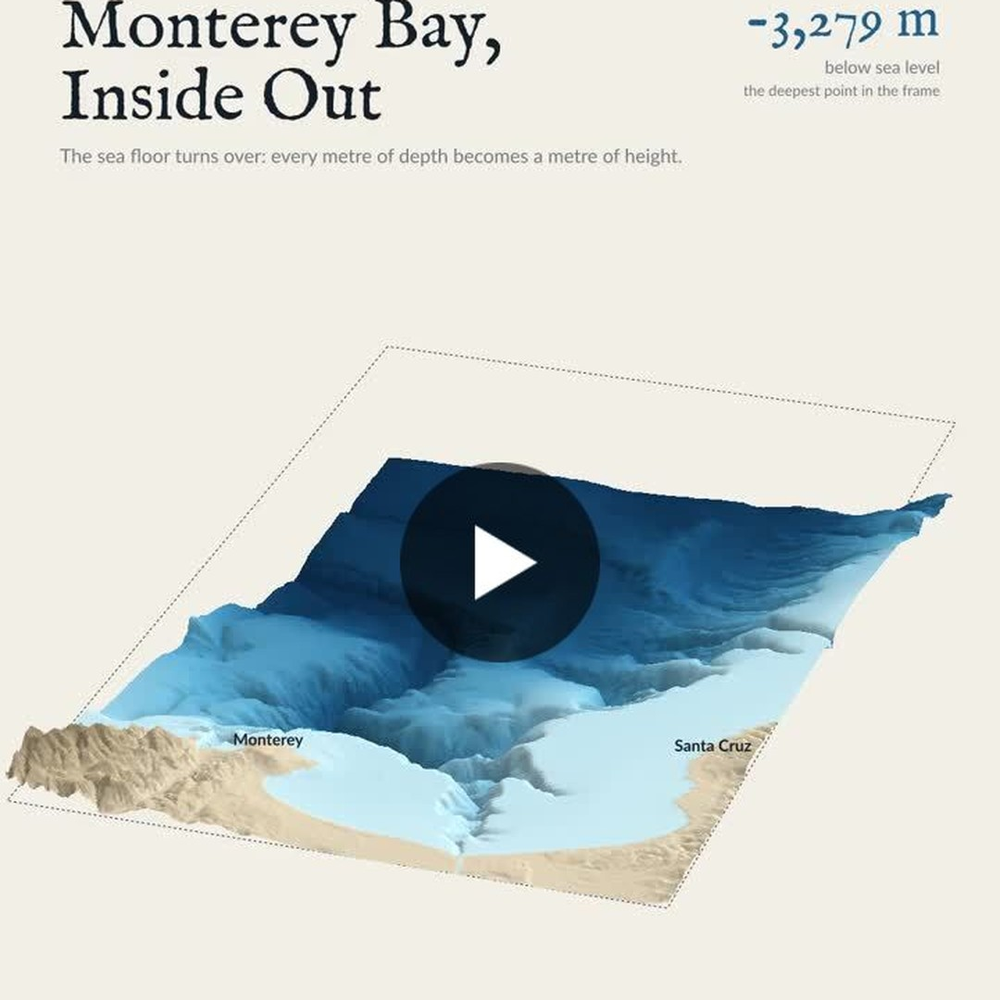
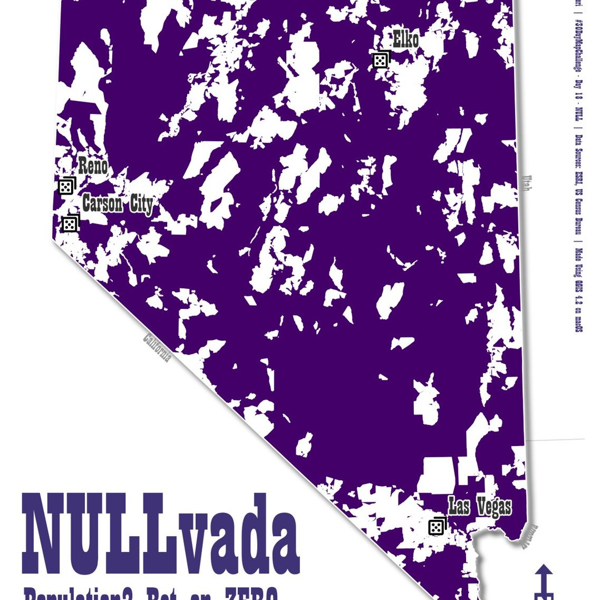
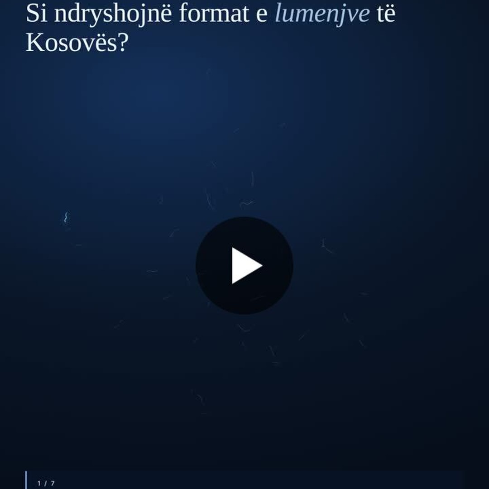

# Geoawesome reposts, 2026-11-19

5 post(s) ready. Each has a 1080×1080 image and its own text for Facebook, Instagram, YouTube Community and X. Nothing has been posted.

**To publish:** tick the box under a post. It is queued for the next free time slot and posted to Facebook and Instagram; a comment here confirms the time. Edit a text in this issue first if you want to change it (what is in the box is what gets posted). Untick before the slot to cancel. When it is live, a comment @mentions you with the YouTube Community text and the X text for Buffer.

---

## 1. Copernicus Sentinel-3C’s first thermal images

<!-- post:2026-11-19-2-copernicus-sentinel-3c-s-first-thermal-i -->
- [ ] **Publish on Facebook + Instagram**



[Download square image](https://raw.githubusercontent.com/walczakagh/geoawesome-social-agent/main/drafts/images/2026-11-19-2-copernicus-sentinel-3c-s-first-thermal-i.jpg) · square crop, from 1080px of source width

**Source:** [EUMETSAT](http://www.eumetsat.int/copernicus-sentinel-3cs-first-thermal-images) · score 8.0/10 · New Sentinel-3C thermal images of seas, ice and Indonesian fires; first-images Earth observation story.
**Rights:** Someone else's map: the credit line names them; ask them first if unsure. Licence on page: not stated.

**What it shows:** A preliminary image of the coast of north-west Australia (Pilbara to Kimberley, including King Sound) captured on 4 November 2026 at 01:34 UTC by the SLSTR instrument on Copernicus Sentinel-3C, shown in a shortwave infrared view and a thermal infrared view. In the thermal view the warm, shallow North West Shelf glows almost white along the coast, the open Indian Ocean is a few degrees colder, and swirls and 'horsehead' shapes mark where the West Australian Current mixes with the South Equatorial Current. North-west of King Sound, arc-shaped ripples a few kilometres apart are internal gravity waves, which EUMETSAT says may be in the ocean.

**Check before posting:**
- The source shows the Australia scene in two views (shortwave and thermal infrared). Check which part ends up in the 1080px square crop. The captions focus on the thermal view and must match what is visible.
- No colour scale or temperature range is given. Only 'almost white = warm shelf water' and 'a few degrees colder' offshore are stated.
- These are preliminary images from commissioning. No final product specification is implied.
- EUMETSAT hedges the internal gravity waves as 'may be in the ocean'. The captions keep that hedge.
- There is no image credit on the page, so the fallback credit 'EUMETSAT' is used. The image licence is not stated and the reuse policy is link_only, so confirm reuse permission before posting the image itself.
- The '+/- a few tenths of a degree' precision is a quote from the EUMETSAT mission manager, not an independent figure.
- The crop may not include King Sound or the Kimberley, so the place references may not all be visible.
- The handle @eumetsat comes from the source. Verify that it is correct on each platform before tagging.

**Facebook**

```text
Sentinel-3C's first thermal infrared images are in, and the lead one turns the sea off north-west Australia into a map of colliding currents.

In this preliminary SLSTR view from 4 November 2026, the warm, shallow North West Shelf glows almost white along the coast while the open Indian Ocean sits a few degrees colder. Swirls and 'horsehead' shapes mark where colder water carried north by the West Australian Current mixes with the warmer South Equatorial Current.

Read more: http://www.eumetsat.int/copernicus-sentinel-3cs-first-thermal-images

Image: EUMETSAT

#Sentinel3 #Copernicus #Oceanography #Australia #Geoawesome
```

**Instagram**

```text
Heat, not light: off north-west Australia, the warm coastal shelf glows almost white in Sentinel-3C's first thermal infrared view.

Further out, eddies trace cooler current water mixing with warmer flow. Preliminary image, 4 November 2026.

Find out more: http://www.eumetsat.int/copernicus-sentinel-3cs-first-thermal-images

Image: EUMETSAT

#Sentinel3 #Thermal #Ocean #Copernicus #Geoawesome
```

**YouTube Community**

```text
Arc-shaped ripples a few kilometres apart north-west of King Sound are internal gravity waves, which EUMETSAT says may be in the ocean, picked up by Sentinel-3C's thermal channels.

The preliminary SLSTR image (4 November 2026, 01:34 UTC) pairs a shortwave infrared view of reflected sunlight with a thermal infrared view of emitted heat. In the thermal view the North West Shelf glows almost white, while the open Indian Ocean is a few degrees colder.

Learn more: http://www.eumetsat.int/copernicus-sentinel-3cs-first-thermal-images

Image: EUMETSAT

#Sentinel3 #SLSTR #Infrared #Copernicus #Geoawesome
```

**X (via Buffer)**

```text
Seven weeks after launch, @eumetsat's Sentinel-3C picks out eddies off north-west Australia in thermal infrared, where warm shelf water meets a colder Indian Ocean.
http://www.eumetsat.int/copernicus-sentinel-3cs-first-thermal-images
Image: EUMETSAT
#Sentinel3 #Copernicus #Ocean #Geoawesome
```

**Alt text:** Satellite infrared image of the north-west Australian coast, with warm water glowing pale along the shoreline and swirling eddies in the cooler ocean further out.

---

## 2. Should the USA Give Texas to Russia?

<!-- post:2026-11-19-6-should-the-usa-give-texas-to-russia -->
- [ ] **Publish on Facebook + Instagram**



[Download square image](https://raw.githubusercontent.com/walczakagh/geoawesome-social-agent/main/drafts/images/2026-11-19-6-should-the-usa-give-texas-to-russia.jpg) · square crop, from 798px of source width

**Source:** [Maps Mania](http://googlemapsmania.blogspot.com/2026/11/should-usa-give-texas-to-russia.html) · score 7.0/10 · Interactive map making territorial occupation tangible; Maps Mania favourite with a clear hook.
**Rights:** Someone else's map: the credit line names them; ask them first if unsure. Licence on page: not stated.

**What it shows:** A screenshot of the interactive map 'Russian Occupation – What if it were your country?', made by Nini and Levan, a Georgian couple who witnessed the 2008 war in Georgia. The user chooses a country and the map highlights in red an area equivalent to approximately 20% of its territory, a hypothetical illustration of the scale of Russian occupation. It was featured on Maps Mania on 18 November 2026.

**Check before posting:**
- The page does not say which country the cropped screenshot shows, so the alt text and captions stay generic. The editor should check the image and name the country if it is clear.
- The page does not say how the red area's shape or position is chosen. It only says the area is equivalent to approximately 20% of the territory.
- The page does not give a direct link to the original tool, only its name, and no image credit or licence is stated. The source's reuse policy is link_only, so confirm that posting the image is allowed.
- The blog's political framing (that the Trump administration is floating a Donbas-for-NATO deal) is the blog author's claim, has no source, and is left out of the captions. The provocative headline is also not reused.
- The page implies the occupied share of Ukraine is about a fifth but does not give a source for that figure.

**Facebook**

```text
Pick your country, and a map shades roughly a fifth of it in red.

"Russian Occupation – What if it were your country?" is an interactive map by Nini and Levan, a Georgian couple who lived through the 2008 war in Georgia. It highlights an area equivalent to about 20% of the territory of whichever country you choose, so the scale of occupation becomes your own cities and landscapes instead of an unfamiliar map of eastern Ukraine or the Caucasus.

Full story: http://googlemapsmania.blogspot.com/2026/11/should-usa-give-texas-to-russia.html

Map: Nini and Levan via Maps Mania

#Geoawesome #Maps #Cartography #Ukraine
```

**Instagram**

```text
About 20% of your own country, coloured red.

Choose a country on this interactive map by Nini and Levan, a Georgian couple who witnessed the 2008 war, and it marks out an area that size across places you already know.

Find out more: http://googlemapsmania.blogspot.com/2026/11/should-usa-give-texas-to-russia.html

Map: Nini and Levan via Maps Mania

#Geoawesome #Maps #Georgia #Ukraine
```

**YouTube Community**

```text
Area comparisons land hardest on ground the viewer already knows.

That is the method behind "Russian Occupation – What if it were your country?": select a country and the map overlays a red area equivalent to approximately 20% of its territory. The creators, Georgian couple Nini and Levan, call it a hypothetical illustration. The page does not explain how the shape is placed, so read it as a statement of area, not a modelled front line.

Learn more: http://googlemapsmania.blogspot.com/2026/11/should-usa-give-texas-to-russia.html

Map: Nini and Levan via Maps Mania

#Geoawesome #Cartography #Interactive #Scale
```

**X (via Buffer)**

```text
What would losing a fifth of your own country look like? This interactive map shades about 20% of whichever country you pick in red.
http://googlemapsmania.blogspot.com/2026/11/should-usa-give-texas-to-russia.html
Map: Nini and Levan via Maps Mania
#Geoawesome #Maps #Cartography
```

**Alt text:** A map of a country with an area covering roughly a fifth of its territory highlighted in red.

---

## 3. # 30daymapchallenge #teammusa #urbanplanning #arcgis #insideout #bathymetry #oceans ...

<!-- post:2026-11-19-14-30daymapchallenge-teammusa-urbanplannin -->
- [ ] **Publish on Facebook + Instagram**



[Download square image](https://raw.githubusercontent.com/walczakagh/geoawesome-social-agent/main/drafts/images/2026-11-19-14-30daymapchallenge-teammusa-urbanplannin.jpg) · square crop, from 720px of source width

**Source:** [Google Alerts #5](https://www.linkedin.com/posts/gautamikasat_30daymapchallenge-teammusa-urbanplanning-activity-7528560577321869312-CAxr) · score 6.0/10 · Seafloor under Monterey Bay as a mountain range; striking inside-out 3D-style map idea.
**Rights:** Someone else's map: the credit line names them; ask them first if unsure. Licence on page: not stated.

**What it shows:** A 30DayMapChallenge Day 15 ('Inside out') map of Monterey Bay in which the seafloor is turned over, so every metre of depth becomes a metre of height, while the land stays unchanged. Data is NOAA NCEI's Coastal Relief Model, with height exaggerated 5x, made in Python. The bay's deepest point is 3,279 m below the surface; flipped, the author says it would stand almost three times taller than the highest hill on the surrounding coast.

**Check before posting:**
- Reuse policy is link_only and no image licence is stated. Get the creator's permission before posting the image.
- No image credit on the page. The creator is identified only by the LinkedIn URL slug 'gautamikasat'; confirm their full name and preferred credit.
- The colour scheme and any legend are not described, so the colours are not explained in the posts.
- The version and resolution of the Coastal Relief Model are not stated.
- The post's hashtags include #ArcGIS, but the text says the map was made in Python. The workflow is unclear.
- The highest coastal hill used for the 'almost three times taller' comparison is not named or measured in the source.
- The 5x vertical exaggeration means the relief in the image is not to true scale.
- The image was cropped from a 720px-wide source, so check the sharpness at 1080x1080.

**Facebook**

```text
Flip Monterey Bay's seafloor and its deepest point, 3,279 m down, becomes a peak almost three times taller than the coast's highest hill.

This Day 15 'Inside out' entry for the 30DayMapChallenge turns every metre of depth into a metre of height and leaves the land where it is. Made in Python from NOAA NCEI's Coastal Relief Model, with 5x vertical exaggeration.

Full story: https://www.linkedin.com/posts/gautamikasat_30daymapchallenge-teammusa-urbanplanning-activity-7528560577321869312-CAxr

Map: gautamikasat via LinkedIn

#Geoawesome #Bathymetry #Oceans #Cartography
```

**Instagram**

```text
Monterey Bay, turned inside out.

Seafloor depth becomes height, so the bay's 3,279 m deep point turns into a summit while the land stays untouched (5x vertical exaggeration).

Learn more: https://www.linkedin.com/posts/gautamikasat_30daymapchallenge-teammusa-urbanplanning-activity-7528560577321869312-CAxr

Map: gautamikasat via LinkedIn

#Geoawesome #Bathymetry #Oceans #Maps
```

**YouTube Community**

```text
This map treats Monterey Bay's seafloor as terrain to climb rather than water to sound.

The bathymetry comes from NOAA NCEI's Coastal Relief Model and is inverted so depth reads as elevation, with onshore topography left unchanged. It was built in Python with 5x vertical exaggeration. Inverted, the 3,279 m deep point would rise almost three times higher than the tallest hill on the nearby coast.

Find out more: https://www.linkedin.com/posts/gautamikasat_30daymapchallenge-teammusa-urbanplanning-activity-7528560577321869312-CAxr

Map: gautamikasat via LinkedIn

#Geoawesome #Bathymetry #NOAA #Python
```

**X (via Buffer)**

```text
What if Monterey Bay's seafloor were a mountain range? Flipped, its 3,279 m deep point would tower over every hill on the coast.
https://www.linkedin.com/posts/gautamikasat_30daymapchallenge-teammusa-urbanplanning-activity-7528560577321869312-CAxr
Map: gautamikasat via LinkedIn
#Geoawesome #Bathymetry #Cartography
```

**Alt text:** A 3D relief map of Monterey Bay in which the seafloor has been inverted into raised, mountain-like terrain beside the unchanged coastline.

---

## 4. Sandon Lettieri - 30daymapchallenge - LinkedIn

<!-- post:2026-11-19-15-sandon-lettieri-30daymapchallenge-linked -->
- [ ] **Publish on Facebook + Instagram**



[Download square image](https://raw.githubusercontent.com/walczakagh/geoawesome-social-agent/main/drafts/images/2026-11-19-15-sandon-lettieri-30daymapchallenge-linked.jpg) · square crop, from 1138px of source width

**Source:** [Google Alerts #5](https://www.linkedin.com/posts/sandon-lettieri-896b3816_30daymapchallenge-activity-7528683792195260416-GQBz) · score 6.0/10 · Clever 30DayMapChallenge map of zero-population Census blocks in Nevada; witty geo insight.
**Rights:** Someone else's map: the credit line names them; ask them first if unsure. Licence on page: not stated.

**What it shows:** A map of Nevada by Sandon Lettieri, made for Day 18 (theme: NULL) of the 30 Day Map Challenge and titled 'NULLvada'. It highlights the US Census blocks in Nevada with zero population, with cities added for reference. The author contrasts Las Vegas with the areas outside its sprawl.

**Check before posting:**
- Reuse policy is link_only and the image licence is not stated. Get permission from Sandon Lettieri before posting the image itself.
- The page gives no image credit. The credit line is taken from the post author named in the title.
- The Census year or vintage (for example 2020 decennial blocks) is not stated.
- The colour scheme and legend are not described, so the posts do not say what the colours mean.
- The page gives no count or share of zero-population blocks or area. Check the image before adding any figure.
- The source text says 'Las Vega'. The posts assume Las Vegas.

**Facebook**

```text
Nevada plus a NULL population equals 'NULLvada', Sandon Lettieri's entry for Day 18 of the 30 Day Map Challenge.

The map highlights every US Census block in Nevada with zero population, with cities added only for reference. The result turns an empty value into the subject of the map: the sprawl of Las Vegas on one side, the blocks where nobody is counted on the other.

Full story: https://www.linkedin.com/posts/sandon-lettieri-896b3816_30daymapchallenge-activity-7528683792195260416-GQBz

Map: Sandon Lettieri via LinkedIn

#Nevada #Census #Cartography #Geoawesome
```

**Instagram**

```text
Where nobody lives, mapped: welcome to NULLvada.

Census blocks with a population of zero, highlighted across Nevada, with cities marked so you can find your bearings.

Find out more: https://www.linkedin.com/posts/sandon-lettieri-896b3816_30daymapchallenge-activity-7528683792195260416-GQBz

Map: Sandon Lettieri via LinkedIn

#Nevada #Maps #Population #Geoawesome
```

**YouTube Community**

```text
Day 18 of the 30 Day Map Challenge had the theme NULL, so Sandon Lettieri mapped a NULL population.

The map selects the US Census blocks in Nevada where the recorded population is zero and highlights them. City labels sit on top for reference. Census blocks are the smallest unit of census geography, which makes the gap between the Las Vegas sprawl and the unpopulated blocks around it easy to read.

Learn more: https://www.linkedin.com/posts/sandon-lettieri-896b3816_30daymapchallenge-activity-7528683792195260416-GQBz

Map: Sandon Lettieri via LinkedIn

#Census #Demographics #Cartography #Geoawesome
```

**X (via Buffer)**

```text
Nevada + zero population = NULLvada. Census blocks where nobody is counted, mapped for the NULL day of the 30 Day Map Challenge.
https://www.linkedin.com/posts/sandon-lettieri-896b3816_30daymapchallenge-activity-7528683792195260416-GQBz
Map: Sandon Lettieri via LinkedIn
#Nevada #Census #Maps #Geoawesome
```

**Alt text:** Map of Nevada highlighting the census blocks with zero population, with city names marked for reference.

---

## 5. # 30daymapchallenge #kosovo #hydrography #rivers #gis #cartography #datavisualization - LinkedIn

<!-- post:2026-11-19-16-30daymapchallenge-kosovo-hydrography-ri -->
- [ ] **Publish on Facebook + Instagram**



[Download square image](https://raw.githubusercontent.com/walczakagh/geoawesome-social-agent/main/drafts/images/2026-11-19-16-30daymapchallenge-kosovo-hydrography-ri.jpg) · square crop, from 720px of source width

**Source:** [Google Alerts #5](https://www.linkedin.com/posts/rizah-murseli-6358a416_30daymapchallenge-kosovo-hydrography-activity-7528560578840358913-be1B) · score 6.0/10 · Hydrography map of Kosovo's rivers from HydroRIVERS; a clean, attractive cartographic piece.
**Rights:** Someone else's map: the credit line names them; ask them first if unsure. Licence on page: not stated.

**What it shows:** A Hydrographic Atlas of Kosovo by Rizah Murseli, made for the #30DayMapChallenge, showing the country's river networks and how their tributaries connect. It is built from the HydroRIVERS dataset and is inspired by Dominic Royé's 'The Shapes of Rivers' visualisation. It was published as an animated visualisation plus an interactive map.

**Check before posting:**
- No image credit or licence on the page; the reuse policy is link_only, so check with Rizah Murseli before posting the image itself.
- The data source of the map is stated (HydroRIVERS), but there is no data date, river size threshold or explanation of colours or line widths.
- The interactive map sits behind a lnkd.in short link (https://lnkd.in/dXhnt5Hj) that has not been checked. The posts link to the LinkedIn post instead.
- The source is an animation, so the square is presumably a single frame or still. Confirm it reads clearly as a map.
- The square was cropped from only 720px of source width, so the 1080x1080 output may look soft. Check thin river lines for blur.
- Credit uses 'Created by Rizah Murseli' from the post text, since no formal image credit line was found.

**Facebook**

```text
Kosovo's river network, traced tributary by tributary from a single global dataset.

Rizah Murseli built this Hydrographic Atlas of Kosovo from HydroRIVERS data for the 30DayMapChallenge, following Dominic Royé's 'The Shapes of Rivers'. It comes as an animation and an interactive map showing how tributaries join up across the landscape.

Full story: https://www.linkedin.com/posts/rizah-murseli-6358a416_30daymapchallenge-kosovo-hydrography-activity-7528560578840358913-be1B

Map: Rizah Murseli

#Kosovo #Hydrography #Rivers #Geoawesome
```

**Instagram**

```text
The shapes of Kosovo's rivers, one tributary at a time.

A Hydrographic Atlas of Kosovo drawn from HydroRIVERS, inspired by Dominic Royé's 'The Shapes of Rivers'.

Learn more: https://www.linkedin.com/posts/rizah-murseli-6358a416_30daymapchallenge-kosovo-hydrography-activity-7528560578840358913-be1B

Map: Rizah Murseli

#Kosovo #Rivers #Cartography #Geoawesome
```

**YouTube Community**

```text
One question drives this map: how do Kosovo's tributaries connect across the landscape?

The Hydrographic Atlas of Kosovo uses the HydroRIVERS dataset to draw the country's river networks in the style of Dominic Royé's 'The Shapes of Rivers'. Rizah Murseli made it for the 30DayMapChallenge as both an animation and an interactive map.

Read more: https://www.linkedin.com/posts/rizah-murseli-6358a416_30daymapchallenge-kosovo-hydrography-activity-7528560578840358913-be1B

Map: Rizah Murseli

#Hydrography #Kosovo #Maps #Geoawesome
```

**X (via Buffer)**

```text
How do Kosovo's tributaries link up? A Hydrographic Atlas built from HydroRIVERS, animated and interactive.
https://www.linkedin.com/posts/rizah-murseli-6358a416_30daymapchallenge-kosovo-hydrography-activity-7528560578840358913-be1B
Map: Rizah Murseli
#Kosovo #Rivers #Cartography #Geoawesome
```

**Alt text:** Map of Kosovo showing its rivers and tributaries as a branching network of lines across the country.

---

### Skipped after reading the page
- [Third attack in a week suspends traffic over Crimean Bridge, Russian official says](https://sg.news.yahoo.com/third-attack-week-suspends-traffic-233640993.html): Wire news report on a military attack with no satellite image or map described, no image credit, link-only reuse and a 100px source image, so there is no striking Earth observation visual to repost.
- [Misbar Tracks Damage to Oil Tanker Dominica Prosperity After Attack off Ras Al Khaimah](https://www.misbar.com/en/editorial/2026/11/18/misbar-tracks-damage-oil-tanker-dominica-prosperity-after-attack-ras-al-khaimah): The source allows link only, gives no image credit or licence, does not say which of several satellite images the 450px picture is, and the upscale will be soft.
- [Tracking the Mirey Branch Fire in North Carolina | WFCA Fire Map](https://wfca.com/fire-map/north-carolina/mirey_branch?name=MIREY+BRANCH): No image on the page, link-only reuse policy, and the only content is one line saying the Mirey Branch fire in Jones, North Carolina is 9 acres.
- [Tracking the Marion Brush Creek Fire in Tennessee | WFCA Fire Map](https://wfca.com/fire-map/tennessee/marion_-_brush_creek?name=Marion+-+Brush+Creek): No image on the page (link-only alert) and only one line of text, so there is no visual to post.
- [IAEA says North Korea is expanding uranium-enrichment plant at Yongbyon - AsiaOne.com](https://www.asiaone.com/asia/iaea-says-north-korea-expanding-uranium-enrichment-plant-yongbyon): News report with no identifiable visual: the page gives no image credit, licence, caption or description, so we cannot say what the picture shows without guessing (reuse policy is link_only and the image is only 630px wide).
- [Ukrainian forces once more hit Russia's Crimean Bridge, days after devastating strike](https://kyivindependent.com/ukrainian-forces-once-more-hit-russias-crimean-bridge-days-after-devastating-strike/): Developing war news story with no satellite image or map described, and the article image has no stated credit or licence.
- [Misbar Detects Construction Developments Around Israel's Dimona Nuclear Reactor](https://www.misbar.com/en/editorial/2026/11/18/misbar-detects-construction-developments-around-israel%E2%80%99s-dimona-nuclear-reactor): No image credit or licence on the page, the reuse policy is link_only, the image is only 450px wide (upscaled), and the source gives no sensor, date or image provider, so the visual cannot be credited or explained without guessing.
- [Mangrove forests were "drowning" for decades, but satellite images now show a quiet and ...](https://www.ecoportal.net/en/mangrove-forests-recovery-satellite/46525/): The page does not say what the lead image shows (sensor, date, place) or who made it, and the reuse policy is link_only, so we cannot caption or credit it without guessing.
- [Marvel's New Asgard Is a Real Norwegian Town - YouTube](https://www.youtube.com/watch?v=lvVyRAC4Zf0): No image on the page, no image credit, link-only reuse policy, and the page text is too thin to say which town is shown without guessing.
- [Josep Ferrer on X: "On the shortest day, the sun rises 51 minutes later in Madrid than in ...](https://x.com/iamjosepferrer/status/2122789605187682686): Cannot be described without guessing: the title is cut off, the page text is only X login boilerplate, there is no image credit or licence, and the reuse policy is link_only.
- [A National Digital Twin Brings Infrastructure Education to Pupils across Scotland with CesiumJS](https://cesium.com/blog/2026/11/18/national-digital-twin-supports-infrastructure-edu/): Vendor blog post about an education programme, and the cropped image cannot be identified or credited without guessing.
- [Ukraine blew up Putin's bridge using relay drones to bypass Starlink limits - Ars Technica](https://arstechnica.com/gadgets/2026/11/ukraine-blew-up-putins-bridge-using-relay-drones-to-bypass-starlink-limits/): War news article with an AFP/Ukrainian Security Service photo of unknown content, not Earth observation or a map, link-only reuse and no stated licence.
- [Somalia Weekly Weather Forecast - Valid From 18 - 24 Nov 2026 - ReliefWeb](https://reliefweb.int/report/somalia/somalia-weekly-weather-forecast-valid-18-24-nov-2026): Routine weekly forecast report with link-only reuse, no image credit or licence, and no description of the image, so it cannot be posted or explained without guessing.
- [Posts by tag 'basemap' | Numbers and Places - Interactive Maps, Data Visualization, and Storytelling](https://numbersandplaces.com/tag/basemap): A tag index listing four basemap styles, with no single identifiable image, no image credit and no licence, so the visual cannot be described without guessing.

---

### Sources checked
- Google Alerts #1: 20 in feed, 20 new
- Google Alerts #2: 14 in feed, 13 new
- Google Alerts #3: 20 in feed, 20 new
- Google Alerts #4: 20 in feed, 20 new
- Google Alerts #5: 20 in feed, 20 new
- Google Alerts #6: 20 in feed, 11 new, 8 already found via another source
- Google Alerts #7: 20 in feed, 19 new, 1 already found via another source
- Google Alerts #8: 2 in feed, 0 new
- NASA Earth Observatory: 10 in feed, 1 new
- ESA Observing the Earth: failed: https://www.esa.int/rssfeed/Applications/Observing_the_Earth: HTTP 404
- EUMETSAT: 10 in feed, 1 new
- Copernicus Atmosphere Monitoring Service: 10 in feed, 0 new
- NASA JPL: 100 in feed, 0 new
- Planet Pulse: 50 in feed, 0 new
- Maps Mania: 25 in feed, 1 new
- Visual Capitalist (maps): 10 in feed, 3 new
- FlowingData: 10 in feed, 2 new
- Google Maps blog: 20 in feed, 0 new
- Google Research blog: 100 in feed, 0 new
- Overture Maps blog: 20 in feed, 1 new
- Bellingcat: 10 in feed, 0 new
- Reddit r/MapPorn: failed: https://www.reddit.com/r/MapPorn/top/.rss?t=day: HTTP 404
- Reddit r/dataisbeautiful: failed: https://www.reddit.com/r/dataisbeautiful/top/.rss?t=day: HTTP 429
