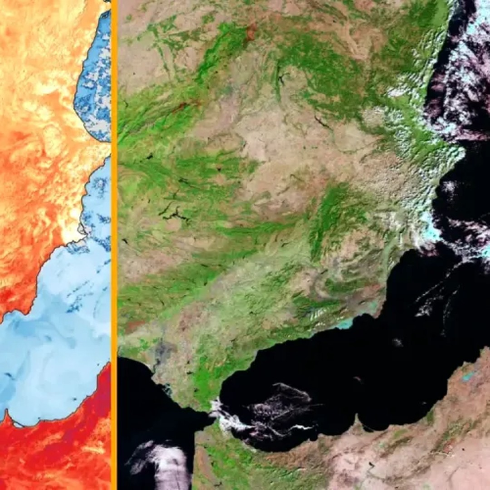

# Geoawesome reposts, 2026-11-20

1 post(s) ready. Each has a 1080×1080 image and its own text for Facebook, Instagram, YouTube Community and X. Nothing has been posted.

**To publish:** tick the box under a post. It is queued for the next free time slot and posted to Facebook and Instagram; a comment here confirms the time. Edit a text in this issue first if you want to change it (what is in the box is what gets posted). Untick before the slot to cancel. When it is live, a comment @mentions you with the YouTube Community text and the X text for Buffer.

---

## 1. Sentinel-3C satellite images show heat contrast between Morocco and Spain - Bladi.net

<!-- post:2026-11-20-6-sentinel-3c-satellite-images-show-heat-c -->
- [ ] **Publish on Facebook + Instagram**



[Download square image](https://raw.githubusercontent.com/walczakagh/geoawesome-social-agent/main/drafts/images/2026-11-20-6-sentinel-3c-satellite-images-show-heat-c.jpg) · square crop, from 500px of source width (low resolution: upscaled, check sharpness)

**Source:** [Google Alerts #3](https://en.bladi.net/sentinel-3c-satellite-images-show-heat-contrast,125082.html) · score 7.0/10 · New Sentinel-3C thermal imagery of Morocco and Spain; first Earth-observation images from a new satellite.
**Rights:** Someone else's map: the credit line names them; ask them first if unsure. Licence on page: not stated.

**What it shows:** The first thermal images from Sentinel-3C, captured on 2 November and published on 18 November, covering Morocco, Algeria, the Iberian Peninsula and part of France. The thermal map shows brightness temperatures calculated from infrared radiation at the top of the atmosphere (not air temperatures). According to ESA, parts of Morocco exceed 30 °C, compared with around 25 to 30 °C in Andalusia and southern Portugal. A second false-colour image shows dense vegetation in bright green, which generally matches the coolest surfaces on the thermal map. The satellite was launched on 15 September 2026 and is still in commissioning.

**Check before posting:**
- No image credit on the page. The images are likely ESA originals, since the article cites ESA, but this is not stated. Find the original ESA release and replace 'Image: Bladi.net' with the official credit before posting.
- Licence not stated and the reuse policy is link_only. Confirm that reposting the image is allowed, ideally from the ESA original.
- It is unclear whether the square crop is the thermal map or the false-colour image. Check before posting and adjust the alt text if it is the false-colour view.
- The page gives no colour scale or legend for the thermal map, so the captions do not say which colour means which temperature.
- The square was upscaled from a 500px source and may be soft. Use a higher-resolution original from ESA if possible.
- The page does not name the radiometer or give a spatial resolution, so neither is in the captions.
- The 30 °C and 25 to 30 °C figures are attributed to ESA via Bladi.net. They have not been checked against ESA directly.

**Facebook**

```text
Sentinel-3C's first thermal images put parts of Morocco above 30 °C on 2 November.

According to ESA, Andalusia and southern Portugal sat at around 25 to 30 °C on the same map. These are brightness temperatures, calculated from infrared radiation at the top of the atmosphere, so they differ from what a weather station would record. The satellite is still in commissioning.

Read more: https://en.bladi.net/sentinel-3c-satellite-images-show-heat-contrast,125082.html

Image: Bladi.net

#Sentinel3 #ESA #Morocco #Thermal #Geoawesome
```

**Instagram**

```text
Early November, and parts of Morocco still read above 30 °C from orbit.

This is a first thermal look from Sentinel-3C across Morocco, Algeria, Iberia and part of France, taken while the satellite is still in commissioning.

Find out more: https://en.bladi.net/sentinel-3c-satellite-images-show-heat-contrast,125082.html

Image: Bladi.net

#Sentinel3 #Morocco #Spain #Satellite #Geoawesome
```

**YouTube Community**

```text
Launched on 15 September 2026, Sentinel-3C is already returning thermal data.

Its radiometer observes land and sea in nine spectral bands, plus two channels for tracking fires. The 2 November images show top-of-atmosphere brightness temperatures. A false-colour companion image shows dense vegetation in bright green, lining up with the coolest surfaces.

Learn more: https://en.bladi.net/sentinel-3c-satellite-images-show-heat-contrast,125082.html

Image: Bladi.net

#Sentinel3 #ESA #Thermal #Iberia #Geoawesome
```

**X (via Buffer)**

```text
Still in commissioning, Sentinel-3C already separates Morocco (above 30 °C in places) from Andalusia (around 25 to 30 °C) in brightness temperature, 2 Nov.
https://en.bladi.net/sentinel-3c-satellite-images-show-heat-contrast,125082.html
Image: Bladi.net
#Sentinel3 #ESA #Thermal #Geoawesome
```

**Alt text:** Satellite thermal map of Morocco, Algeria, the Iberian Peninsula and part of France, with land and the surrounding Atlantic and Mediterranean waters shaded by surface brightness temperature.

---

### Skipped after reading the page
- [Iran weighs resuming oil exports in defiance of US naval blockade – IRGC outlet](https://www.iranintl.com/en/202611199805): Political news article about Iranian oil exports and IRIB leadership, with no Earth observation image, map or geodata visual to repost.
- [UNITED24 Media on X: " Satellite images show damage across the Crimean Bridge after ...](https://x.com/United24media/status/2123541847570014309): No usable source: the page text is only X boilerplate, the title is cut off, there is no image credit or licence, reuse is link-only, and the war-damage claim cannot be described without guessing.
- [A combination picture of satellite images show smoke rising from a vessel at sea and an oil ...](https://www.reutersconnect.com/item/a-combination-picture-of-satellite-images-show-smoke-rising-from-a-vessel-at-sea-and-an-oil-spill-reaching-closer-to-the-shore-off-the-coast-of-uae/dGFnOnJldXRlcnMuY29tLDIwMjY6bmV3c21sX1JDMjRST0FWR1FXMQ): No image on the page, no credit and a link-only Reuters Connect licence, so there is nothing we can repost; the page text is also truncated.
- [Satellite images show a collapsed span of the Crimean Bridge after Ukraine's third strike in a week](https://meduza.io/en/news/2026/11/19/satellite-images-show-a-collapsed-span-of-the-crimean-bridge-after-ukraine-s-third-strike-in-a-week): The image cannot be credited or verified, and its reuse is not cleared: it was published by unnamed Ukrainian OSINT channels with no satellite provider, sensor or licence stated, the source's reuse policy is link_only, and the only available copy is a low-resolution 675px crop.
- [8 Rivers Disappearing Right Now ( Seen From Space ) - YouTube](https://www.youtube.com/watch?v=ZxhdTSLUTOM): No image on the page, no image credit or licence, link-only reuse policy, and only a fragmentary YouTube snippet with no sensor, date, place or numbers to caption from.
- [Tracking the Lafayette Road Fire in Kentucky | WFCA Fire Map](https://wfca.com/fire-map/kentucky/lafayette_road): No image on the page, no image credit or licence, link-only reuse policy, and the only data is an auto-generated tracker entry (0 acres, 0% contained) with nothing visual to post.
- [Satellite images show collapsed roadway section of Crimean Bridge after Ukraine's ... - Reflect.ee](https://en.reflect.ee/article/satellite-images-show-collapsed-roadway-section-of-crimean-bridge-after-ukraines-7a5b25): No usable image or credit: the page has no image, no stated licence, reuse is link-only, and the text is a truncated alert that gives no sensor, date or image provider.
- [Downtown Orlando, Florida in 3D | A LiDAR Survey Re-Envisioning of the Urban Core](https://www.youtube.com/watch?v=AUmzudtzi-s): No image on the page and almost no source text (title, hashtags, channel name), so there is nothing to post and the visual could not be described without guessing.
- [The Bay Area saw huge amounts of rain yesterday. This map shows exactly where it ... - Facebook](https://www.facebook.com/SFChronicle/posts/the-bay-area-saw-huge-amounts-of-rain-yesterday-this-map-shows-exactly-where-it-/1830733955764673/): No image on the page, no credit or licence, link-only reuse, and the text gives no data source, date range or rainfall figures to caption.
- [Tracking fires in Polk, Oregon | WFCA Fire Map - Western Fire Chiefs Association](https://wfca.com/fire-map/detection/c4638bf6bc184f2b): Auto-generated fire detection alert page with no image and only one line of text ("observed by SOF from 4 merged observations"), so there is no striking visual and nothing to explain without guessing.
- [Tracking the Seidel Fire in Wisconsin | WFCA Fire Map - Western Fire Chiefs Association](https://wfca.com/fire-map/wisconsin/seidel): No image on the page, and the only content is an auto-generated tracker line reporting the Seidel fire in Florence, Wisconsin at 0 acres, so there is no visual or story to post.
- [Tracking the Pageless Fire in Wisconsin | WFCA Fire Map - Western Fire Chiefs Association](https://wfca.com/fire-map/wisconsin/pageless): No image on the page, a single auto-generated line reporting a 0-acre fire, no visual or detail to describe without guessing.
- [Sediment-Hosted Copper Deposits: Geology and Examples - Farmonaut](https://farmonaut.com/mining/sediment-hosted-copper-deposits): No image was found on the page and no credit or licence is given; the only text is a truncated Google Alerts snippet from a commercial explainer, so there is nothing to post without guessing.
- [maplibre -gl-pie-charts/demos/us-education/index.html at master - GitHub](https://github.com/zwang-geog/maplibre-gl-pie-charts/blob/master/demos/us-education/index.html): This is a GitHub code file for a MapLibre pie-chart plugin demo. The page gives no data source, date, categories or colour meaning for the US education map, so it cannot be described without guessing; there is also no image credit, the reuse policy is link only, and the image is low resolution.
- [Tracking the Leavette Fire in Kentucky | WFCA Fire Map](https://wfca.com/fire-map/kentucky/leavette): No image on the page, link-only reuse policy, and the text is a one-line status update (2-acre fire, 75% contained) with no map or visual to share.
- [Satellite pic shows destruction of Putin's prized £3bn Crimea bridge after three strikes by ... - The Sun](https://www.the-sun.com/news/17325508/putin-crimea-bridge-blitzed-tyrant/): Reuse policy is link_only with no image credit or licence on the page, and the only source is a partisan tabloid war report that gives no date, sensor or resolution for the satellite image.

---

### Sources checked
- Google Alerts #1: 14 in feed, 14 new
- Google Alerts #2: 20 in feed, 20 new
- Google Alerts #3: 20 in feed, 20 new
- Google Alerts #4: 20 in feed, 20 new
- Google Alerts #5: 20 in feed, 20 new
- Google Alerts #6: 20 in feed, 5 new, 14 already found via another source
- Google Alerts #7: 17 in feed, 17 new
- Google Alerts #8: 3 in feed, 0 new
- NASA Earth Observatory: 10 in feed, 1 new
- ESA Observing the Earth: failed: https://www.esa.int/rssfeed/Applications/Observing_the_Earth: HTTP 404
- EUMETSAT: 10 in feed, 0 new
- Copernicus Atmosphere Monitoring Service: 10 in feed, 0 new
- NASA JPL: 100 in feed, 1 new
- Planet Pulse: 50 in feed, 0 new
- Maps Mania: 25 in feed, 0 new, 1 already found via another source
- Visual Capitalist (maps): 10 in feed, 2 new
- FlowingData: 10 in feed, 3 new
- Google Maps blog: 20 in feed, 0 new
- Google Research blog: 100 in feed, 1 new
- Overture Maps blog: 20 in feed, 0 new
- Bellingcat: 10 in feed, 0 new
- Reddit r/MapPorn: failed: https://www.reddit.com/r/MapPorn/top/.rss?t=day: HTTP 404
- Reddit r/dataisbeautiful: failed: https://www.reddit.com/r/dataisbeautiful/top/.rss?t=day: HTTP 429
