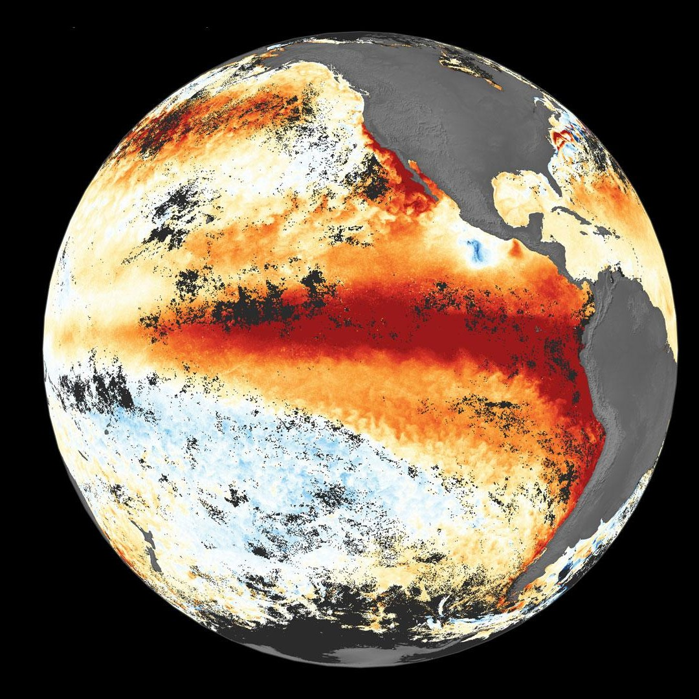
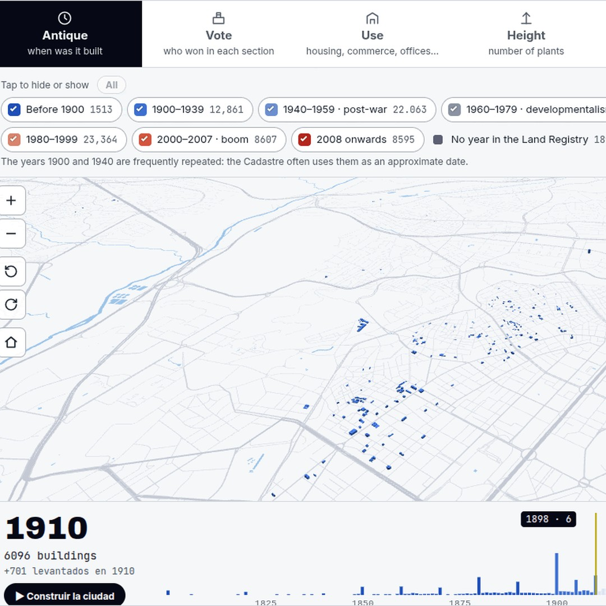
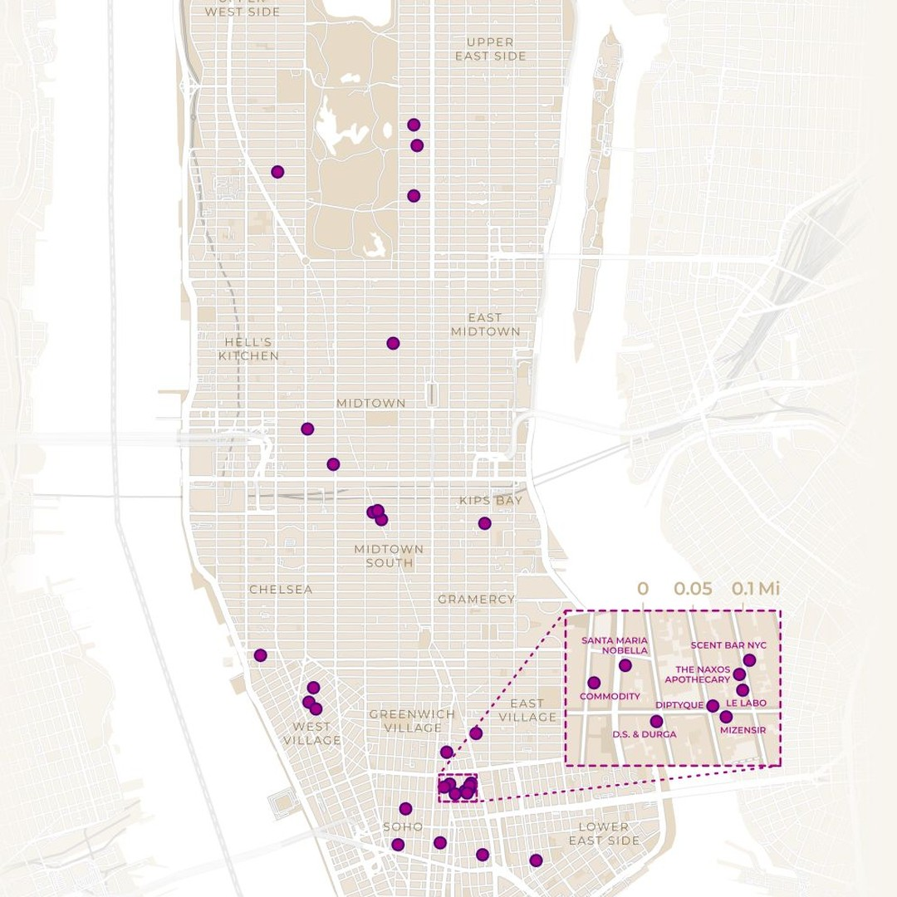

# Geoawesome reposts, 2026-11-20

3 post(s) ready. Each has a 1080×1080 image and its own text for Facebook, Instagram and X. Nothing has been posted.

**To publish:** tick the box under a post. It is queued for the next free time slot and posted to Facebook and Instagram; a comment here confirms the time. Edit a text in this issue first if you want to change it (what is in the box is what gets posted). Untick before the slot to cancel. When it is live, a comment @mentions you with the X text for Buffer.

---

## 1. Image of the week: El Nino as seen from Sentinel-3

<!-- post:2026-11-20-1-image-of-the-week-el-nino-as-seen-from-s -->
- [ ] **Publish on Facebook + Instagram**



[Download square image](https://raw.githubusercontent.com/walczakagh/geoawesome-social-agent/main/drafts/images/2026-11-20-1-image-of-the-week-el-nino-as-seen-from-s.jpg) · square crop, from 1080px of source width

**Source:** [EUMETSAT](http://www.eumetsat.int/image-week-el-nino-seen-sentinel-3) · score 8.0/10 · Sentinel-3 El Niño sea-temperature image with agency credit; climate and strong visual.
**Rights:** Someone else's map: the credit line names them; ask them first if unsure. Licence on page: not stated.

**What it shows:** A weekly anomaly map of nighttime sea surface temperature for 26 October to 1 November 2026, compared with the 1991–2020 average for the same week. Red areas were warmer than normal and blue areas cooler. A red band runs along the equator from the central Pacific to South America, up to 4°C above normal and strongest off Ecuador and Peru. EUMETSAT made it from SLSTR data on Copernicus Sentinel-3A and -B.

**Check before posting:**
- The reuse policy is 'link_only' and the page states no image licence. Confirm we may post the image itself before publishing.
- The page gives no image credit, so 'EUMETSAT' is used as instructed. Check whether EUMETSAT wants a Copernicus or ESA credit as well.
- The page describes what a very strong El Niño can do but does not say whether this event is classified as strong. The posts make no such claim.
- No spatial resolution or colour scale values are given beyond 'up to 4°C warmer'.
- The square crop is taken from 1080px of the source width. Check that it still shows the full equatorial band to the South American coast and any colour legend.
- Sentinel-3C, launched 15 September, did not contribute to this image. The page credits only Sentinel-3A and -B.

**Facebook**

```text
Off Ecuador and Peru, the Pacific ran up to 4°C warmer than normal in the last week of October 2026.

This map compares nighttime sea surface temperatures from 26 October to 1 November with the 1991–2020 average for the same week: red is warmer, blue cooler. The warm band stretches along the equator from the central Pacific and has replaced the cold water that usually rises to the surface off South America. Data come from the SLSTR radiometers on Copernicus Sentinel-3A and -B.

Read more: http://www.eumetsat.int/image-week-el-nino-seen-sentinel-3

Image: EUMETSAT

#Climate #Sentinel3 #Copernicus #Oceans #Geoawesome
```

**Instagram**

```text
A red stripe across the equatorial Pacific marks El Niño, with the strongest warmth off Ecuador and Peru.

Night-time sea temperatures from Sentinel-3 SLSTR, 26 October to 1 November 2026, set against the 1991–2020 norm. Red runs hot, blue runs cool.

Find out more: http://www.eumetsat.int/image-week-el-nino-seen-sentinel-3

Image: EUMETSAT

#Climate #Sentinel3 #Pacific #Geoawesome
```

**X (via Buffer)**

```text
El Niño from orbit: equatorial Pacific waters up to 4°C above the 1991–2020 norm, 26 Oct to 1 Nov 2026, from Sentinel-3 SLSTR night-time data.
http://www.eumetsat.int/image-week-el-nino-seen-sentinel-3
Image: EUMETSAT
#Pacific #Sentinel3 #Copernicus #Geoawesome
```

**Alt text:** Map of the Pacific Ocean shaded red and blue, with a band of red along the equator stretching from the central Pacific to the coast of South America.

---

## 2. Madrid's Architectural Time Machine

<!-- post:2026-11-20-2-madrid-s-architectural-time-machine -->
- [ ] **Publish on Facebook + Instagram**



[Download square image](https://raw.githubusercontent.com/walczakagh/geoawesome-social-agent/main/drafts/images/2026-11-20-2-madrid-s-architectural-time-machine.jpg) · square crop, from 768px of source width

**Source:** [Maps Mania](http://googlemapsmania.blogspot.com/2026/11/madrids-architectural-time-machine.html) · score 8.0/10 · Animated building-age map of Madrid; interactive-style cartography from a favourite site.
**Rights:** Someone else's map: the credit line names them; ask them first if unsure. Licence on page: not stated.

**What it shows:** An interactive, animated building-age map of Madrid made by Carreteras y hospitales and featured on Maps Mania. When you press play, buildings appear colour-coded by construction year, tracing the city's expansion from the historic centre through 20th-century growth to recent developments. It shows only the surviving building stock, not demolished buildings.

**Check before posting:**
- The data source for the construction years is not stated (for example cadastre or another dataset).
- The colour scale and the date range the animation covers are not given; check the map legend before posting.
- Maps Mania places this map in a trend of 3D animated building-age maps but does not explicitly say the Madrid map is 3D, so the posts do not call it 3D.
- No image credit or licence appears on the page, and the reuse policy is link_only. Confirm that posting a crop of the screenshot is acceptable.
- The square is cropped from only 768px of source width, so check that it stays sharp at 1080x1080.

**Facebook**

```text
Madrid's building stock now plays back as an animation, with each building appearing in the year it was built.

Carreteras y hospitales has made a building-age map of the Spanish capital: press play and colour-coded buildings fill in from the historic centre through 20th-century growth to recent developments. One caveat: maps like this show only surviving buildings, so anything demolished and replaced leaves no trace.

Read more: http://googlemapsmania.blogspot.com/2026/11/madrids-architectural-time-machine.html

Map: Carreteras y hospitales via Maps Mania

#Madrid #Cartography #Buildings #Geoawesome
```

**Instagram**

```text
Press play and watch Madrid build itself, one construction year at a time.

Colour-coded buildings spread out from the old centre towards the latest developments. Only buildings still standing today are included.

Find out more: http://googlemapsmania.blogspot.com/2026/11/madrids-architectural-time-machine.html

Map: Carreteras y hospitales via Maps Mania

#Maps #Urban #Madrid #Geoawesome
```

**X (via Buffer)**

```text
Madrid's growth, replayed through the age of the buildings that survive today. Anything already demolished is missing from the story.

http://googlemapsmania.blogspot.com/2026/11/madrids-architectural-time-machine.html

Map: Carreteras y hospitales via Maps Mania

#Madrid #Cartography #Geoawesome
```

**Alt text:** A map of Madrid with its buildings coloured according to the year they were constructed.

---

## 3. Karen Wang - 30daymapchallenge - LinkedIn

<!-- post:2026-11-20-20-karen-wang-30daymapchallenge-linkedin -->
- [ ] **Publish on Facebook + Instagram**



[Download square image](https://raw.githubusercontent.com/walczakagh/geoawesome-social-agent/main/drafts/images/2026-11-20-20-karen-wang-30daymapchallenge-linkedin.jpg) · square crop, from 993px of source width

**Source:** [Google Alerts #5](https://www.linkedin.com/posts/karenyw_30daymapchallenge-activity-7529204955082076161-PNqZ) · score 5.0/10 · 30DayMapChallenge Manhattan perfume store map; a clear map subject, though image missing.
**Rights:** Someone else's map: the credit line names them; ask them first if unsure. Licence on page: not stated.

**What it shows:** Karen Wang's map for Day 19 (theme: Smell) of the 30DayMapChallenge shows the distribution of perfume stores across Manhattan. The data comes from OpenStreetMap. The page does not describe the symbology, colours, store count or the date of the data extract.

**Check before posting:**
- Reuse policy is link_only and no image licence is stated. Get permission from Karen Wang before posting her map as an image.
- The page gives no image credit. 'Map: Karen Wang via LinkedIn' is based on the post author (title and URL), so confirm it.
- The source does not say how stores are symbolised (points, density, hexbins) or what any colours mean, so the alt text stays general.
- The source gives no number of stores and no date for the OpenStreetMap extract.
- The map is only as complete as OpenStreetMap shop tagging in Manhattan. The captions mention this as a limitation, not as a sourced fact.
- The page text includes a profile tagline ('Líder de Área GIS...') that seems to belong to another LinkedIn user, not the map author. It is ignored here.

**Facebook**

```text
Karen Wang turned the "Smell" theme of Day 19 of the 30DayMapChallenge into a map of perfume stores across Manhattan.

The store locations come from OpenStreetMap, so the pattern is only as complete as the shop tags mappers have added there. Wang grew up in New Jersey and enjoyed shopping trips into Manhattan, which explains the choice of place for a theme that is hard to map literally.

Full story: https://www.linkedin.com/posts/karenyw_30daymapchallenge-activity-7529204955082076161-PNqZ

Map: Karen Wang via LinkedIn

#Manhattan #OSM #Cartography #Maps #Geoawesome
```

**Instagram**

```text
Day 19 of the 30DayMapChallenge was "Smell", so Karen Wang mapped where Manhattan's perfume stores are.

OpenStreetMap shop data turns a sense you cannot see into a pattern on the island.

Learn more: https://www.linkedin.com/posts/karenyw_30daymapchallenge-activity-7529204955082076161-PNqZ

Map: Karen Wang via LinkedIn

#NYC #Perfume #OSM #Geoawesome
```

**X (via Buffer)**

```text
Mapping a smell: perfume stores across Manhattan from OpenStreetMap data, Karen Wang's Day 19 entry for the 30DayMapChallenge.
https://www.linkedin.com/posts/karenyw_30daymapchallenge-activity-7529204955082076161-PNqZ
Map: Karen Wang via LinkedIn
#Maps #Manhattan #OSM #Geoawesome
```

**Alt text:** A map of Manhattan showing where perfume stores are located across the island.

---

### Skipped after reading the page
- [USGS Water Resources on X: "Tracking the way water shapes our world using Landsat ...](https://x.com/USGS_Water/status/2123453810903306530): The source gives no description of the image (only a truncated tweet title and X boilerplate text), so a caption would require guessing.
- [Iwo-jima Volcano (Volcano Islands, Japan): Morphology Change Since 2023](https://www.volcanodiscovery.com/iwo-jima/news/424383/Iwo-jima-volcano-Volcano-Islands-Japan-morphology-change-since-2023.html): No image was found on the page, no image credit or licence is given, the reuse policy is link-only, and the page text is only a fragment, so the post could not be written without guessing.
- [New tool for flood runoff prediction, driven by Sentinel-2 and tested in Ethiopia](https://climate.esa.int/de/neuigkeiten-und-veranstaltungen/new-tool-for-flood-runoff-prediction-driven-by-sentinel-2-and-tested-in-ethiopia/): Research news about a flood-runoff GIS toolbox with no described visual: the page never says what the image shows, gives no image credit or licence, and reuse policy is link_only.
- [New Satellite Images Show Damage To Crimean Bridge After Ukrainian Attacks - Reddit](https://www.reddit.com/r/UkraineWarVideoReport/comments/1y0zjln/new_satellite_images_show_damage_to_crimean/): No image or credit could be found, reuse is link-only, and the page snippet gives no sensor, date or provider for an unverified war-damage claim.
- [How the war in Iran turned the Gulf into a climate catastrophe - YouTube](https://www.youtube.com/watch?v=rK5zy_dn9UQ): No image was found on the page, there is no image credit, and the only text is a YouTube description fragment linking to a Guardian article, so there is no sourced visual to repost.
- [The Crimean Bridge After Three Strikes: Satellite Images Show New Damage](https://charter97.org/en/news/2026/11/20/706225/): We have no rights to the image: the source is link-only, gives no image credit or licence, and the satellite provider is unnamed.
- [New satellite images show the Kerch Bridge after a structural collapse. Satellite ... - Facebook](https://www.facebook.com/zmist.news/photos/-new-satellite-images-show-the-kerch-bridge-after-a-structural-collapsesatellite/1169186982284570/): No image on the page and no credit: the source is a truncated, unverified third-party Facebook post about a contested wartime claim, with no sensor, date or provider.
- [Tracking fires in Tulsa, Oklahoma | WFCA Fire Map - Western Fire Chiefs Association](https://wfca.com/fire-map/detection/566d3b5a750541f8): Auto-generated fire detection listing with no image on the page (and link-only reuse), so there is no visual to post.
- [What can satellites see when they look at Europe's forests? - Phys.org](https://phys.org/news/2026-11-satellites-europe-forests.html): The only image is an Unsplash stock photo (Kevin Stadnyk), not a satellite image or map; the article summarises four studies without showing any of their maps.
- [Crimea Bridge Strikes: Ukraine's Push to Cripple Russian Logistics - Modern Diplomacy](https://moderndiplomacy.eu/2026/11/20/crimea-bridge-strikes-ukraines-push-to-cripple-russian-logistics/): News analysis of strikes on the Crimea bridge with no described map or satellite image, no image credit, and a low-resolution unknown visual we could not explain without guessing.
- [Before the naval drones rescued downed airmen in the Strait of Hormuz, the US Army put ...](https://africa.businessinsider.com/military-and-defense/before-the-naval-drones-rescued-downed-airmen-in-the-strait-of-hormuz-the-us-army-put/vm4zc6r): Defence news about Saronic Corsair naval drones with no Earth observation image or map, no image credit and a low-resolution image.
- [How the war in Iran turned the Gulf into a climate catastrophe – video explainer](https://www.theguardian.com/world/video/2026/nov/20/how-the-war-in-iran-turned-the-gulf-into-a-climate-catastrophe-video-explainer): Guardian video explainer with link-only reuse, no image credit or licence, a 630px source and no stated sensor, date or location for the visual, so it cannot be posted or captioned without guessing.
- [Satellite imagery used to find new greenhouse builds](https://www.floraldaily.com/article/9894643/satellite-imagery-used-to-find-new-greenhouse-builds/): The page text never describes the image, there is no credit or licence, the source is link-only and only 630px wide, so we would have to guess what the square shows.
- [New satellite images show massive construction projects in Nagorno-Karabakh, even ... - Facebook](https://www.facebook.com/rferl/posts/new-satellite-images-show-massive-construction-projects-in-nagorno-karabakh-even/1595544332611366/): No image on the page, no image credit, a link-only reuse policy and only a truncated one-line teaser from a Facebook post, so there is nothing to show and no way to describe the imagery without guessing.
- [Geoawesome - X](https://x.com/geoawesome_dgtl/status/2123679989618880905/photo/1): The page is Geoawesome's own X post, and the source text is only X's login boilerplate, so it gives no description, credit or licence and the image cannot be explained without guessing.
- [GIS & REMOTE SENSING APPLICATIONS IN DEFORESTATION MONITORING 🛰️ Protecting ...](https://www.facebook.com/thai.aerospaceindustries/posts/-gis-remote-sensing-applications-in-deforestation-monitoring-%EF%B8%8Fprotecting-our-for/1860985222320253/): No image on the page and no concrete facts: the source is a generic social media explainer about GIS and deforestation monitoring, with no place, sensor, date or credit.
- [Cyclone Akvan to weaken by tonight: Rain to continue over Odisha, West Bengal](https://www.indiatoday.in/amp/science/story/cyclone-akvan-weakens-after-odisha-landfall-imd-rain-storm-disaster-3043155-2026-11-20): News text about Cyclone Akvan's landfall with no identifiable visual: the page names no image credit, licence or description, the image is only 388px wide, and the source is link-only.

---

### Sources checked
- Google Alerts #1: 13 in feed, 6 new
- Google Alerts #2: 20 in feed, 0 new
- Google Alerts #3: 20 in feed, 20 new
- Google Alerts #4: 20 in feed, 19 new
- Google Alerts #5: 20 in feed, 18 new
- Google Alerts #6: 18 in feed, 4 new
- Google Alerts #7: 20 in feed, 11 new
- Google Alerts #8: 3 in feed, 0 new
- NASA Earth Observatory: 10 in feed, 0 new
- ESA Observing the Earth: failed: https://www.esa.int/rssfeed/Applications/Observing_the_Earth: HTTP 404
- EUMETSAT: 10 in feed, 1 new
- Copernicus Atmosphere Monitoring Service: 10 in feed, 0 new
- NASA JPL: 100 in feed, 0 new
- Planet Pulse: 50 in feed, 0 new
- Maps Mania: 25 in feed, 1 new
- Visual Capitalist (maps): 10 in feed, 1 new
- FlowingData: 10 in feed, 1 new
- Google Maps blog: 20 in feed, 0 new
- Google Research blog: 100 in feed, 0 new
- Overture Maps blog: 20 in feed, 0 new
- Bellingcat: 10 in feed, 0 new
- Reddit r/MapPorn: failed: https://www.reddit.com/r/MapPorn/top/.rss?t=day: HTTP 404
- Reddit r/dataisbeautiful: failed: https://www.reddit.com/r/dataisbeautiful/top/.rss?t=day: HTTP 429
