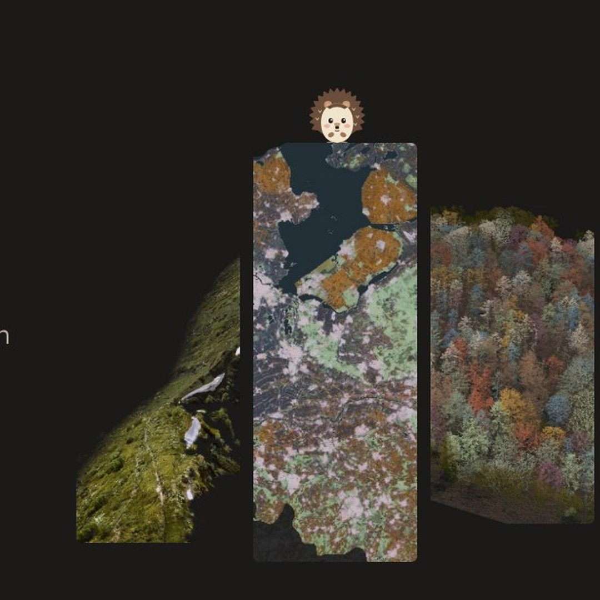

# Geoawesome reposts, 2026-11-21

1 post(s) ready. Each has a 1080×1080 image and its own text for Facebook, Instagram and X. Nothing has been posted.

**To publish:** tick the box under a post. It is queued for the next free time slot and posted to Facebook and Instagram; a comment here confirms the time. Edit a text in this issue first if you want to change it (what is in the box is what gets posted). Untick before the slot to cancel. When it is live, a comment @mentions you with the X text for Buffer.

---

## 1. Amsterdam as a 3D city model from AHN4 lidar - Ivana Pallister

<!-- post:2026-11-21-3-amsterdam-as-a-3d-city-model-from-ahn4-l -->
- [ ] **Publish on Facebook + Instagram**



[Download square image](https://raw.githubusercontent.com/walczakagh/geoawesome-social-agent/main/drafts/images/2026-11-21-3-amsterdam-as-a-3d-city-model-from-ahn4-l.jpg) · square crop, from 630px of source width (low resolution: upscaled, check sharpness)

**Source:** [Google Alerts #7](https://ivanapallister.com/projects/city/) · score 7.0/10 · Amsterdam 3D block model from AHN4 lidar, buildings, canals and trees; a striking city visual.
**Rights:** Someone else's map: the credit line names them; ask them first if unsure. Licence on page: not stated.

**What it shows:** A 3D model of Amsterdam that Ivana Pallister built with her own scripts from the AHN4 airborne laser scan. AHN4 is CC0 data from Rijkswaterstaat and Het Waterschapshuis, obtained via GeoTiles.nl, with about 35 points per square metre in this part of the city. Building points are grouped into parts that share a roof height and given straight walls, and trees are merged into one smooth canopy. Colours: buildings are stone-coloured and lighter as they get taller, trees are olive, canals are dark slate, and areas outside the scan fade into the page.

**Check before posting:**
- Reuse policy is link_only and the page states no licence for the rendering (only the AHN4 data is CC0). Get permission from Ivana Pallister before posting the image.
- The source image is only 630px wide and was upscaled to 1080. Check sharpness before posting.
- The page states no image credit. The credit uses the author named in the page title, who says the model and rendering are her own scripts. The publisher field ('Google Alerts #7') is not the real publisher.
- The page states no AHN4 acquisition date.
- The page describes a flight (an animation) starting at the Rijksmuseum. It is unclear which frame the square shows or whether the Rijksmuseum is visible in it.
- The figure of about 35 points per square metre applies to 'this part of Amsterdam', not necessarily the whole country.
- No social handle for the author is known, so she is named in plain text.

**Facebook**

```text
About 35 laser points per square metre went into this 3D model of Amsterdam, built from the AHN4 lidar scan.

Ivana Pallister grouped building points by shared roof height, gave each part straight walls and merged trees into one smooth canopy. Detail is lost, but the canal city suddenly reads: buildings get lighter as they rise, trees are olive and canals dark slate.

Read more: https://ivanapallister.com/projects/city/

Image: Ivana Pallister (AHN4 data: Rijkswaterstaat, Het Waterschapshuis, via GeoTiles.nl)

#Geoawesome #Lidar #Amsterdam #3D #GIS
```

**Instagram**

```text
Raw, a lidar point cloud of Amsterdam looks like snow, so Ivana Pallister rebuilt it as blocks, walls and canopy.

Stone-coloured buildings grow lighter with height. Her flythrough starts at the Rijksmuseum, whose two towers survive as stepped spires, then heads north-east over the canals. Beyond the scanned area, everything fades into the page.

Find out more: https://ivanapallister.com/projects/city/

Image: Ivana Pallister (AHN4 data: Rijkswaterstaat, Het Waterschapshuis, via GeoTiles.nl)

#Geoawesome #Lidar #Netherlands #3D #Cartography
```

**X (via Buffer)**

```text
One olive canopy for the trees, straight walls for every roof height: Amsterdam rebuilt from the AHN4 laser scan.

https://ivanapallister.com/projects/city/
Image: Ivana Pallister, AHN4 via GeoTiles.nl
#Geoawesome #Lidar #Amsterdam
```

**Alt text:** A 3D rendering of part of Amsterdam with stone-coloured block buildings, olive tree canopies and dark slate canals, fading to a plain background at the edges.

---

### Skipped after reading the page
- [Lake Milh Shrinks in Landsat Images, 1988-2025 - YouTube](https://www.youtube.com/shorts/q0rYysunhSI): Link-only YouTube Short with no image credit or licence, a 405px frame that would need upscaling, and truncated text; repost from the original NASA source instead if one exists.
- [Hurricane Michael's Category 5 landfall in 2018, seen from space - YouTube](https://www.youtube.com/shorts/FORBzagi0vs): There is no image credit and no licence, the reuse policy is link-only, and the source is an unattributed YouTube Short with a truncated description, a low-resolution frame and no sensor or uploader named.
- [Tracking the Anderson Johnny Smith Lane Fire in Tennessee | WFCA Fire Map](https://wfca.com/fire-map/tennessee/anderson_johnny_smith_lane): No image on the page and only an auto-generated fire tracker entry (1 acre, 0% contained) with nothing visual to show.
- [Tracking the Morgan Nashville Highway Fire in Tennessee | WFCA Fire Map](https://wfca.com/fire-map/tennessee/morgan_nashville_highway?name=Morgan+-+Nashville+Highway): No image on the page and the text is a one-line fire status (55 acres, 97% contained), so there is no visual to repost.

---

### Sources checked
- Google Alerts #1: 19 in feed, 11 new
- Google Alerts #2: 14 in feed, 9 new
- Google Alerts #3: 20 in feed, 16 new
- Google Alerts #4: 20 in feed, 10 new
- Google Alerts #5: 20 in feed, 14 new
- Google Alerts #6: 17 in feed, 3 new, 7 already found via another source
- Google Alerts #7: 20 in feed, 8 new, 1 already found via another source
- Google Alerts #8: 2 in feed, 0 new
- NASA Earth Observatory: 10 in feed, 1 new
- ESA Observing the Earth: failed: https://www.esa.int/rssfeed/Applications/Observing_the_Earth: HTTP 404
- EUMETSAT: 10 in feed, 0 new
- Copernicus Atmosphere Monitoring Service: 10 in feed, 0 new
- NASA JPL: 100 in feed, 0 new
- Planet Pulse: 50 in feed, 0 new
- Maps Mania: 25 in feed, 0 new
- Visual Capitalist (maps): 10 in feed, 1 new
- FlowingData: 10 in feed, 1 new
- Google Maps blog: 20 in feed, 0 new
- Google Research blog: 100 in feed, 1 new
- Overture Maps blog: 20 in feed, 0 new
- Bellingcat: 10 in feed, 0 new
- Reddit r/MapPorn: failed: https://www.reddit.com/r/MapPorn/top/.rss?t=day: HTTP 404
- Reddit r/dataisbeautiful: failed: https://www.reddit.com/r/dataisbeautiful/top/.rss?t=day: HTTP 429
