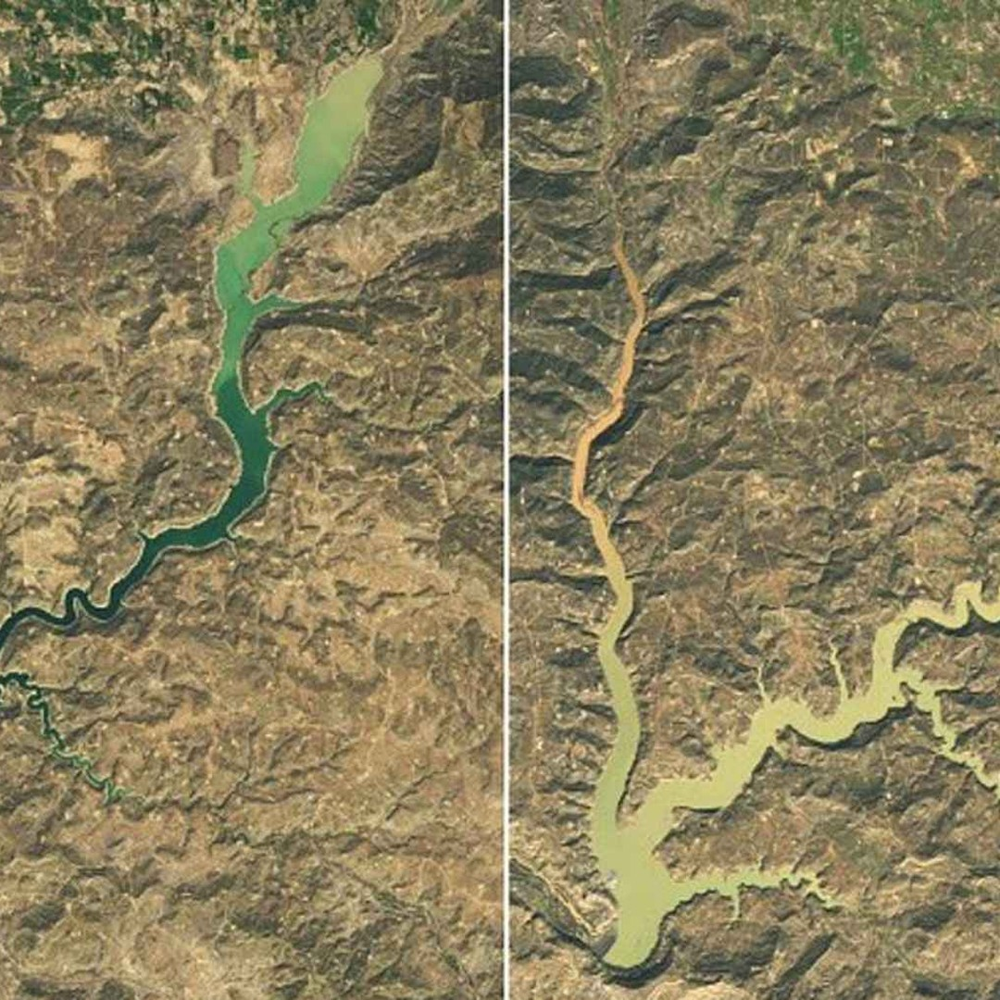
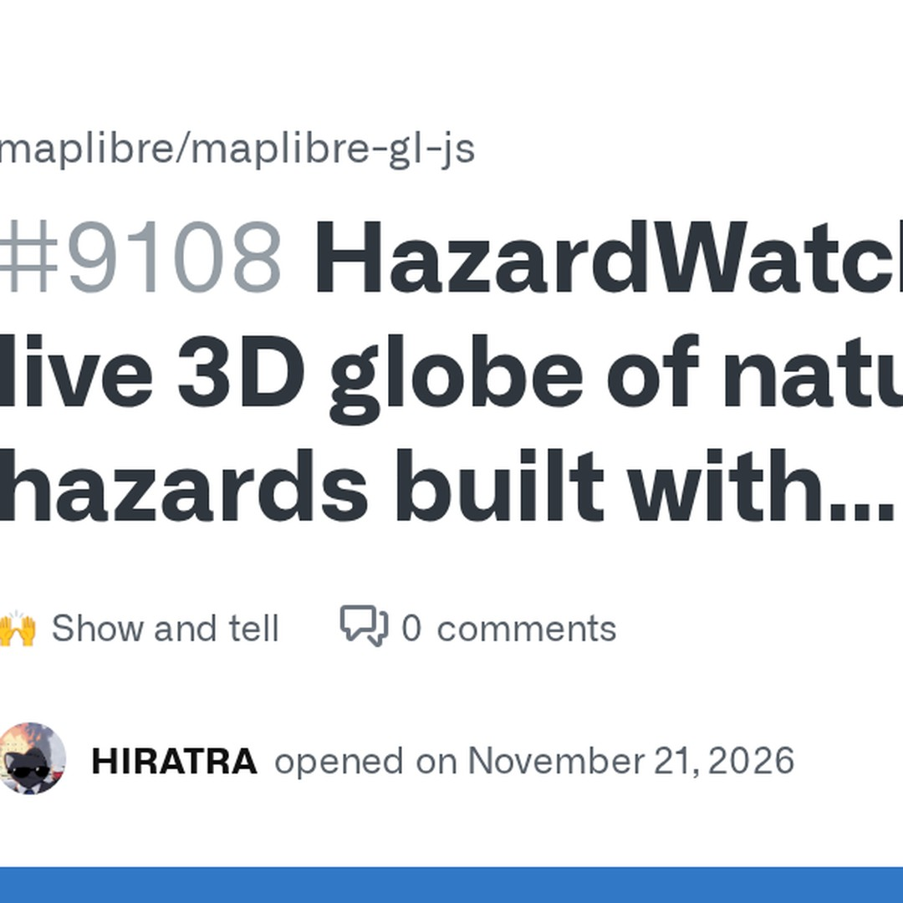
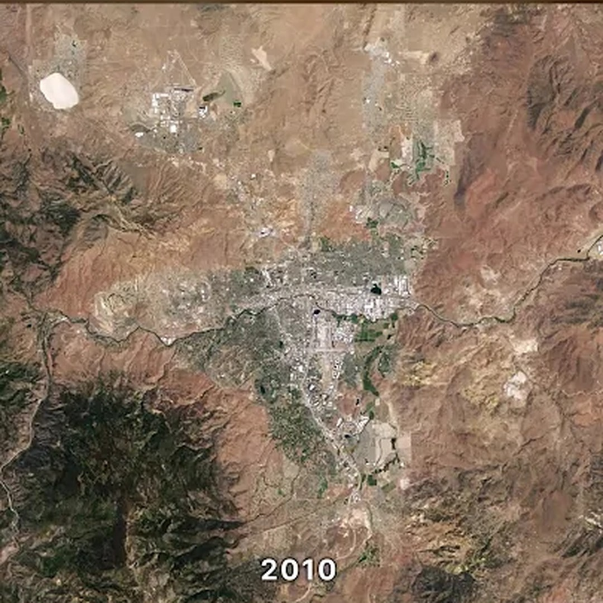
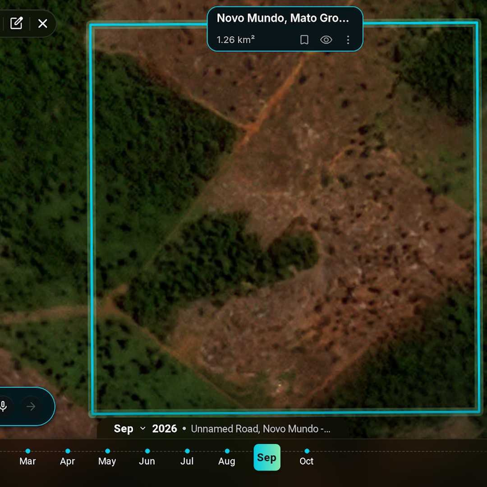

# Geoawesome reposts, 2026-11-22

4 post(s) ready. Each has a 1080×1080 image and its own text for Facebook, Instagram and X. Nothing has been posted.

**To publish:** tick the box under a post. It is queued for the next free time slot and posted to Facebook and Instagram; a comment here confirms the time. Edit a text in this issue first if you want to change it (what is in the box is what gets posted). Untick before the slot to cancel. When it is live, a comment @mentions you with the X text for Buffer.

---

## 1. A drought-starved reservoir in the Southwest "drank" 60 feet of water in weeks and then ...

<!-- post:2026-11-22-1-a-drought-starved-reservoir-in-the-south -->
- [ ] **Publish on Facebook + Instagram**



[Download square image](https://raw.githubusercontent.com/walczakagh/geoawesome-social-agent/main/drafts/images/2026-11-22-1-a-drought-starved-reservoir-in-the-south.jpg) · square crop, from 1013px of source width

**Source:** [Google Alerts #3](https://www.ecoportal.net/en/navajo-reservoir-drought-flood/46213/) · score 8.0/10 · Landsat 9 before-and-after images of Navajo Reservoir expanding after drought; disaster change story.
**Rights:** Someone else's map: the credit line names them; ask them first if unsure. Licence on page: not stated.

**What it shows:** Landsat 9 imagery of Navajo Reservoir in the Four Corners region (northern New Mexico and southern Colorado), taken on 20 September and 7 November. According to the article, the reservoir's surface area expanded as the level rose nearly 60 feet (18 m), from 60 percent of average capacity for the date to 108 percent, the highest since August 2019. The page text does not say how the image is styled or what the colours represent.

**Check before posting:**
- No image credit on the page ('NOT FOUND'). The credit line uses the page publisher, ecoportal.net. This looks like a secondary write-up, so the original imagery owner (possibly NASA or USGS, not stated) should be checked and the credit fixed before posting.
- The editor's square is a single crop from a 1013px source. It is not confirmed that it shows the Landsat 9 pair (20 Sept and 7 Nov), only one date, or something else. Check the image before posting; the alt text is generic for that reason.
- Image licence not stated and the reuse policy is link_only, so check that reposting the image is allowed.
- Band combination, resolution and what the colours mean are not given.
- The article is a secondary summary. The Landsat dates and the 60 to 108 percent figures are as reported there, not verified against the original imagery.
- The Bureau of Reclamation cut releases from Navajo Dam on 16 and 17 September, which set a lower baseline. The posts mention this only briefly or leave it out.

**Facebook**

```text
Navajo Reservoir gained nearly 60 feet (18 metres) in under two months.

Landsat 9 images from 20 September and 7 November show the reservoir's surface area expanding across the Four Corners. It went from 60 percent of its average capacity for the date to 108 percent, the highest level since August 2019, after storms delivered 2 to 4 times the seasonal average precipitation. Long-term drought still persists in parts of the Southwest.

Read more: https://www.ecoportal.net/en/navajo-reservoir-drought-flood/46213/
Image: ecoportal.net

#Landsat #Drought #Reservoir #Hydrology #Geoawesome
```

**Instagram**

```text
60 percent of average capacity on 20 September, 108 percent on 7 November: Navajo Reservoir as seen by Landsat 9.

The lake rose nearly 60 feet (18 metres), its highest level since August 2019. The surge followed storms with 2 to 4 times the seasonal average precipitation across the Four Corners, and the same rain flooded Pagosa Springs, Colorado. A full reservoir does not end long-term drought, which persists in parts of the Southwest.

Find out more: https://www.ecoportal.net/en/navajo-reservoir-drought-flood/46213/
Image: ecoportal.net

#Landsat #Water #Satellite #Floods #Geoawesome
```

**X (via Buffer)**

```text
A drought-hit reservoir gained nearly 60 feet in under two months. Landsat 9 shows Navajo Reservoir going from 60 to 108 percent of average capacity (20 Sept to 7 Nov).
https://www.ecoportal.net/en/navajo-reservoir-drought-flood/46213/
Image: ecoportal.net
#Landsat #Drought #Geoawesome
```

**Alt text:** Satellite image of Navajo Reservoir in the Four Corners region of the southwestern United States, captured by Landsat 9.

---

## 2. HazardWatch: a live 3D globe of natural hazards built with MapLibre GL JS #9108 - GitHub

<!-- post:2026-11-22-2-hazardwatch-a-live-3d-globe-of-natural-h -->
- [ ] **Publish on Facebook + Instagram**



[Download square image](https://raw.githubusercontent.com/walczakagh/geoawesome-social-agent/main/drafts/images/2026-11-22-2-hazardwatch-a-live-3d-globe-of-natural-h.jpg) · square crop, from 600px of source width (low resolution: upscaled, check sharpness)

**Source:** [Google Alerts #2](https://github.com/maplibre/maplibre-gl-js/discussions/9108) · score 7.0/10 · Live 3D globe of natural hazards: NASA FIRMS fire heatmap and GIBS imagery, interactive.
**Rights:** Someone else's map: the credit line names them; ask them first if unsure. Licence on page: not stated.

**What it shows:** A screenshot of HazardWatch, an open source live 3D globe of natural hazards built on MapLibre GL JS. It draws on USGS, NASA FIRMS and GDACS data and runs on free tiers with no API key. The source gives no dates, symbol legend or description of the image itself.

**Check before posting:**
- The image was not seen by the writer and the page does not describe it: check that the 600px crop shows the globe itself, and check its sharpness (upscaled from low resolution).
- No image credit on the page and no author name in the text: credit is set to the project name via the GitHub discussion, so check the poster's username and add it if you want.
- Image licence not stated and the reuse policy is link_only: confirm with the author before using the screenshot.
- The page does not say which hazard type comes from which feed (USGS, NASA FIRMS, GDACS), nor what the colours or symbols mean.
- No live URL for HazardWatch itself is given, only the GitHub discussion link.
- Not stated how often the data refreshes, beyond the author's phrase 'happening right now'.

**Facebook**

```text
A live 3D globe of natural hazards that runs on free tiers and needs no API key.

HazardWatch is an open source map built on MapLibre GL JS, showing hazards happening right now. It combines data from USGS, NASA FIRMS and GDACS. Its maker shared it in the MapLibre GL JS discussions on GitHub and is asking for feedback.

Read more: https://github.com/maplibre/maplibre-gl-js/discussions/9108

Map: HazardWatch via MapLibre GL JS on GitHub

#Geoawesome #Hazards #Globe #Geodata #Mapping
```

**Instagram**

```text
Three hazard data sources, USGS, NASA FIRMS and GDACS, come together on one 3D globe.

HazardWatch maps natural hazards happening right now and is built on MapLibre GL JS as an open source project. It runs on free tiers with no API key, so it is easy to study.

Find out more: https://github.com/maplibre/maplibre-gl-js/discussions/9108

Map: HazardWatch via MapLibre GL JS on GitHub

#Geoawesome #Maps #Hazards #Globe
```

**X (via Buffer)**

```text
HazardWatch puts live natural hazards on an open source 3D globe built with MapLibre GL JS. Data from USGS, NASA FIRMS and GDACS.
https://github.com/maplibre/maplibre-gl-js/discussions/9108
Map: HazardWatch via GitHub
#Geoawesome #Hazards #Geodata
```

**Alt text:** Screenshot of HazardWatch, a 3D globe map showing natural hazards happening around the world.

---

## 3. Reno Expands in Landsat Images, 1985-2025 - YouTube

<!-- post:2026-11-22-6-reno-expands-in-landsat-images-1985-2025 -->
- [ ] **Publish on Facebook + Instagram**



[Download square image](https://raw.githubusercontent.com/walczakagh/geoawesome-social-agent/main/drafts/images/2026-11-22-6-reno-expands-in-landsat-images-1985-2025.jpg) · square crop, from 405px of source width (low resolution: upscaled, check sharpness)

**Source:** [Google Alerts #3](https://www.youtube.com/shorts/ZNmnXQTTPyE) · score 7.0/10 · Reno urban expansion in Landsat time series 1985-2025; before/after change story.
**Rights:** Someone else's map: the credit line names them; ask them first if unsure. Licence on page: not stated.

**What it shows:** A time series of natural-colour Landsat images of Reno, Nevada, from 1985 to 2025, showing the city's urban footprint spreading across its valley. The source is a YouTube Short and the page text, which is truncated, describes it as NASA's time series. No resolution, sensor detail, growth figures or colour key are given, but natural colour means no false-colour legend is needed.

**Check before posting:**
- No image credit found on the page. 'NASA' is taken from the page text ('NASA's time series'); check the YouTube channel that published the Short before posting.
- Licence not stated, and the source is link_only: confirm the still can be reused.
- The image is upscaled from 405px, so check sharpness before posting.
- Which year or frame the square shows is unknown (it is a still from a video), and the alt text is generic for that reason.
- Page text is cut off after 'urban footprint', so no figures on growth are available.
- The Landsat missions or sensors used are not stated.

**Facebook**

```text
Forty years of Landsat imagery show Reno pushing out across its Nevada valley.

The sequence runs from 1985 to 2025 in natural colour, so the city's urban footprint reads the way it would look from orbit, with no false-colour key to decode. It is a NASA time series shared as a short video, and the source gives no figures for how much the footprint grew.

Read more: https://www.youtube.com/shorts/ZNmnXQTTPyE

Image: NASA, Landsat (via YouTube)

#Landsat #Reno #Nevada #Urbanisation #Geoawesome
```

**Instagram**

```text
Reno, Nevada, seen by Landsat in 1985 and again in 2025.

In natural colour the change needs no legend: the city's urban footprint spreads across the valley. A NASA time series, shared as a short video, with no growth figures given in the source.

Find out more: https://www.youtube.com/shorts/ZNmnXQTTPyE

Image: NASA, Landsat (via YouTube)

#Landsat #Nevada #Satellite #NASA #Geoawesome
```

**X (via Buffer)**

```text
Reno spreads across its Nevada valley in Landsat natural-colour images from 1985 to 2025. A NASA time series.
https://www.youtube.com/shorts/ZNmnXQTTPyE
Image: NASA, Landsat
#Landsat #Reno #Urbanisation #Geoawesome
```

**Alt text:** Natural-colour Landsat satellite view of the city of Reno and the surrounding valley in Nevada, taken from a time series of urban growth.

---

## 4. Search the Planet with AI

<!-- post:2026-11-22-8-search-the-planet-with-ai -->
- [ ] **Publish on Facebook + Instagram**



[Download square image](https://raw.githubusercontent.com/walczakagh/geoawesome-social-agent/main/drafts/images/2026-11-22-8-search-the-planet-with-ai.jpg) · square crop, from 849px of source width

**Source:** [Maps Mania](http://googlemapsmania.blogspot.com/2026/11/search-planet-with-ai.html) · score 7.0/10 · Satellite image of Amazon deforestation from a new Planet search tool; Maps Mania is a favourite source.
**Rights:** Someone else's map: the credit line names them; ask them first if unsure. Licence on page: not stated.

**What it shows:** A satellite image of an area of recent deforestation in the Amazon, found by the Maps Mania author using Planet AI, Planet's new natural-language search over a global index of satellite imagery. The page does not give the date, exact location, sensor or what the colours mean.

**Check before posting:**
- No date, coordinates, sensor or resolution given for the image
- Not stated that the image itself is Planet imagery, only that the tool is from Planet
- Image credit not found on the page, using 'via Maps Mania'; licence not stated and reuse policy is link_only
- Page text is truncated, so details of how the index is built are not used
- Search query used to find this scene is not stated
- Source image is only 849px wide, so the square will be upscaled

**Facebook**

```text
A plain-language search was enough to surface this patch of recent Amazon deforestation.

It was found with Planet AI, a new tool that matches a natural-language description against a global index of satellite imagery, no coordinates needed. Visual search like this appeared about a decade ago with Terrapattern and Descartes Labs' GeoVisual Search, both now defunct. No date or sensor is given for this scene.

Read more: http://googlemapsmania.blogspot.com/2026/11/search-planet-with-ai.html

Image: via Maps Mania

#Geoawesome #Amazon #Deforestation #Satellite #Planet
```

**Instagram**

```text
Describe what you are looking for, and a global satellite index returns the places that match.

This clearing of recent Amazon deforestation came up in Planet AI, Planet's new natural-language search tool. No coordinates, no scanning scenes by hand. Earlier attempts, Terrapattern and Descartes Labs' GeoVisual Search, are both now gone.

Find out more: http://googlemapsmania.blogspot.com/2026/11/search-planet-with-ai.html

Image: via Maps Mania

#Geoawesome #Amazon #Forests #Satellite #Mapping
```

**X (via Buffer)**

```text
Planet AI finds places on Earth from a plain-language description, like this recent Amazon deforestation. No coordinates needed.
http://googlemapsmania.blogspot.com/2026/11/search-planet-with-ai.html
Image: via Maps Mania
#Geoawesome #Amazon #Satellite
```

**Alt text:** Satellite image of an area of recent deforestation in the Amazon.

---

### Skipped after reading the page
- [Was New York Really Under 2,000 Feet of Ice? - YouTube](https://www.youtube.com/watch?v=xSD3_9-K9pQ): No image found on the page and it is a YouTube video link with only a one-line text snippet; there is no visual to share and the content cannot be explained without guessing.
- [The Hurricane's Eye Exploded Upward... Seen From Space #shorts - YouTube](https://www.youtube.com/shorts/HT__vJ4hg7w): The only source is the title of a YouTube Short whose page says the content is unavailable. It names no hurricane, sensor, date or creator, and the image is a low-resolution crop with no credit or licence (link_only policy).
- [Typhoon Halong Seen From SPACE NOAA Satellite Tracked the Remnants Into Alaska - YouTube](https://www.youtube.com/shorts/Zy-qCsF1o0w): The only source is a YouTube Short whose page reads 'Video unavailable'. There is no image credit, no named satellite or sensor, no date, and the crop is upscaled from 405px, so a caption could not be written without guessing.
- [This map shows what your street looked like in 1940 Every dot is a building, and every ... - Facebook](https://www.facebook.com/61595237521306/videos/this-map-shows-what-your-street-looked-like-in-1940-every-dot-is-a-building-and-/1890310005477140/): Facebook video repost with truncated text: no map maker, credit or named city, so it cannot be credited or properly explained without guessing.

---

### Sources checked
- Google Alerts #1: 20 in feed, 20 new
- Google Alerts #2: 12 in feed, 12 new
- Google Alerts #3: 20 in feed, 20 new
- Google Alerts #4: 20 in feed, 20 new
- Google Alerts #5: 20 in feed, 20 new
- Google Alerts #6: 20 in feed, 14 new, 6 already found via another source
- Google Alerts #7: 16 in feed, 16 new
- Google Alerts #8: 1 in feed, 0 new
- NASA Earth Observatory: 10 in feed, 0 new
- ESA Observing the Earth: failed: https://www.esa.int/rssfeed/Applications/Observing_the_Earth: HTTP 404
- EUMETSAT: 10 in feed, 0 new
- Copernicus Atmosphere Monitoring Service: 10 in feed, 0 new
- NASA JPL: 100 in feed, 0 new
- Planet Pulse: 50 in feed, 0 new
- Maps Mania: 25 in feed, 1 new
- Visual Capitalist (maps): 10 in feed, 0 new
- FlowingData: 10 in feed, 0 new
- Google Maps blog: 20 in feed, 0 new
- Google Research blog: 100 in feed, 0 new
- Overture Maps blog: 20 in feed, 0 new
- Bellingcat: 10 in feed, 0 new
- Reddit r/MapPorn: failed: https://www.reddit.com/r/MapPorn/top/.rss?t=day: HTTP 404
- Reddit r/dataisbeautiful: failed: https://www.reddit.com/r/dataisbeautiful/top/.rss?t=day: HTTP 429
