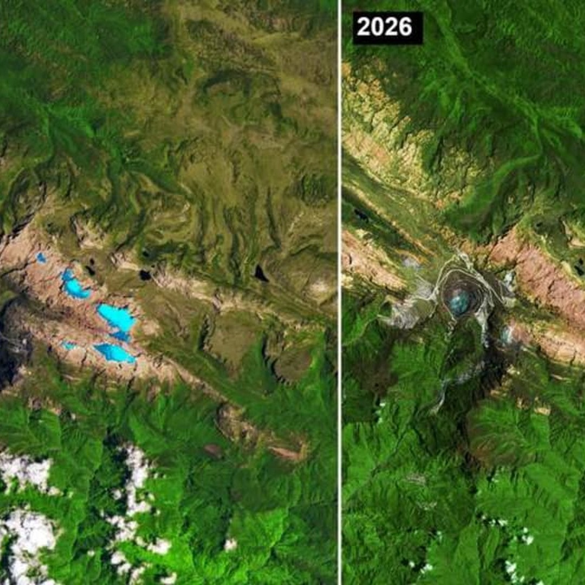
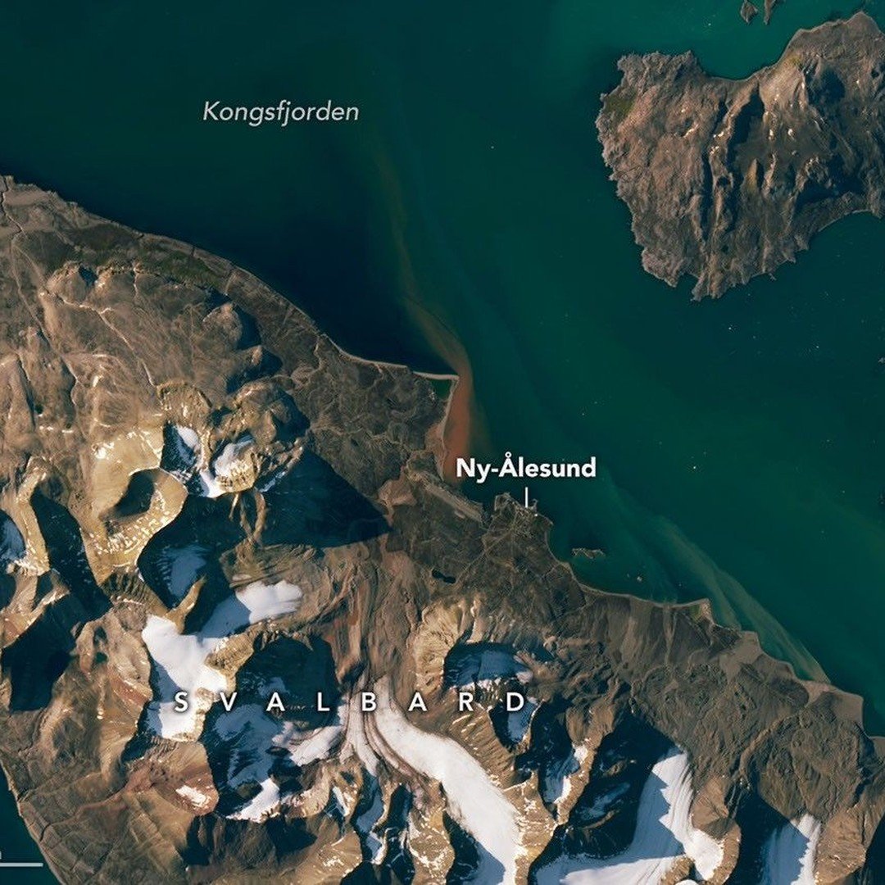

# Geoawesome reposts, 2026-11-23

2 post(s) ready. Each has a 1080×1080 image and its own text for Facebook, Instagram and X. Nothing has been posted.

**To publish:** tick the box under a post. It is queued for the next free time slot and posted to Facebook and Instagram; a comment here confirms the time. Edit a text in this issue first if you want to change it (what is in the box is what gets posted). Untick before the slot to cancel. When it is live, a comment @mentions you with the X text for Buffer.

---

## 1. In 1988, ice covered 1.66 square miles near the summit of Indonesia's Puncak Jaya, and ...

<!-- post:2026-11-23-1-in-1988-ice-covered-1-66-square-miles-ne -->
- [ ] **Publish on Facebook + Instagram**



[Download square image](https://raw.githubusercontent.com/walczakagh/geoawesome-social-agent/main/drafts/images/2026-11-23-1-in-1988-ice-covered-1-66-square-miles-ne.jpg) · square crop, from 720px of source width

**Source:** [Google Alerts #3](https://www.aol.com/articles/1988-ice-covered-1-66-221657000.html) · score 8.0/10 · NASA Earth Observatory Landsat before/after of Puncak Jaya glacier loss; climate plus credited imagery.
**Rights:** Someone else's map: the credit line names them; ask them first if unsure. Licence on page: not stated.

**What it shows:** A NASA Earth Observatory false-colour comparison of the Puncak Jaya range on New Guinea: Landsat 5 on 3 November 1988 and Landsat 9 on 19 October 2026. Ice is light blue, bare rock brown, clouds white and plants green. Glacier area near the summit fell from 4.31 km² in 1988 to about 0.09 km² by September 2025 (about 2 percent), per BMKG climate scientist Donaldi Permana.

**Check before posting:**
- IMAGE NOTE says only 'square crop': check whether the square shows one scene or both dates. The captions describe NASA's comparison, not necessarily what the crop contains.
- Image licence is not stated and the reuse policy is link_only: confirm the image can be reposted with credit before publishing.
- The page is an AOL repost of NASA Earth Observatory content (via Earth.com). Consider linking the original NASA page if available.
- The 2025 area figure comes from Permana and is based on satellite and aerial data. An aerial survey is planned for December to measure 2026.
- The 'main ice areas gone around 2030' projection comes from a study in The Cryosphere; BMKG estimates a sooner loss. Neither is used in the captions.
- Band combination for the false-colour images is not given in the source.

**Facebook**

```text
About 2 percent of Puncak Jaya's 1988 glacier ice is left, and it no longer moves.

NASA Earth Observatory compared Landsat 5 (3 November 1988) with Landsat 9 (19 October 2026) in false colour: ice is light blue, rock brown. Glacier area near the summit fell from 4.31 km² to about 0.09 km² by September 2025, per BMKG's Donaldi Permana.

Learn more: https://www.aol.com/articles/1988-ice-covered-1-66-221657000.html
Image: NASA Earth Observatory / Lauren Dauphin, using Landsat data from the U.S. Geological Survey.
#Geoawesome #Landsat #Glaciers #Indonesia #Cryosphere
```

**Instagram**

```text
In 1988, light blue ice capped several of the highest ridges of Puncak Jaya. In NASA's 2026 false-colour Landsat view, only a few small blue fragments remain among newly bared brown rock.

What is left of the ice would fit on about a dozen soccer fields, and the patches are too thin and broken up to flow.

Find out more: https://www.aol.com/articles/1988-ice-covered-1-66-221657000.html
Image: NASA Earth Observatory / Lauren Dauphin, using Landsat data from the U.S. Geological Survey.
#Geoawesome #Landsat #Glaciers #Indonesia #NASA
```

**X (via Buffer)**

```text
Puncak Jaya's ice shrank from 4.31 km² (1988) to about 0.09 km² (Sept 2025). NASA sets Landsat 5 against Landsat 9.
https://www.aol.com/articles/1988-ice-covered-1-66-221657000.html
Image: NASA Earth Observatory / Lauren Dauphin, Landsat/USGS
#Geoawesome #Landsat #Glaciers
```

**Alt text:** False-colour Landsat satellite imagery of the Puncak Jaya mountains in Indonesian New Guinea, where light blue marks ice, brown bare rock, green plants and white clouds.

---

## 2. Laser Focus at the Top of the World

<!-- post:2026-11-23-6-laser-focus-at-the-top-of-the-world -->
- [ ] **Publish on Facebook + Instagram**



[Download square image](https://raw.githubusercontent.com/walczakagh/geoawesome-social-agent/main/drafts/images/2026-11-23-6-laser-focus-at-the-top-of-the-world.jpg) · square crop, from 853px of source width

**Source:** [NASA Earth Observatory](https://science.nasa.gov/earth/earth-observatory/laser-focus-at-the-top-of-the-world/) · score 7.0/10 · NASA Earth Observatory image of Svalbard geodetic station; Earth-angle imagery with clear NASA credit.
**Rights:** Publisher allows reuse with credit. Licence on page: NASA imagery, generally free to reuse with credit.

**What it shows:** A Landsat 9 OLI image, acquired in July 2026, of the remote Arctic location of the Ny-Ålesund Geodetic Observatory in Svalbard, Norway. The observatory, operated by the Norwegian Mapping Authority, got NASA's first next-generation satellite laser ranging (SLR) system, which officially debuted on 12 October. It is the northernmost SLR facility on Earth. The source does not say what the colours represent.

**Check before posting:**
- Band combination and colour treatment are not stated, so the captions do not describe the colours.
- The exact acquisition day is not given, only July 2026.
- The image credit field in the source was cut off after 'from the U'. It was completed from the page text ('U.S. Geological Survey'), so check it against the page before posting.
- The square crop was made from only 853px of source width, so it may look soft at 1080x1080.
- The page text does not say where the station sits within the image. Check the crop actually shows the site.
- The performance claims (thousands of pulses per second, single-photon detection, tracking almost every orbit) are NASA's own and come from the project manager's statements.

**Facebook**

```text
The northernmost satellite laser ranging station on Earth went live in Svalbard on 12 October.

Landsat 9 (OLI) shows the remote Ny-Ålesund site in July 2026. NASA's new system fires pulses thousands of times per second, up from tens, and from this latitude polar-orbiting satellites like ICESat-2 can be tracked almost every orbit.

Read more: https://science.nasa.gov/earth/earth-observatory/laser-focus-at-the-top-of-the-world/

Image: NASA Earth Observatory images by Lauren Dauphin, using Landsat data from the U.S. Geological Survey

#Geoawesome #Landsat #Svalbard #Geodesy #Arctic
```

**Instagram**

```text
Ny-Ålesund sits so far north that polar-orbiting satellites like ICESat-2 can be tracked almost every orbit.

This Landsat 9 OLI scene from July 2026 shows the Svalbard site of NASA's first next-generation laser ranging system, in operation since 12 October. Its sensors detect single photons, so less light needs to bounce back from a satellite.

Find out more: https://science.nasa.gov/earth/earth-observatory/laser-focus-at-the-top-of-the-world/

Image: NASA Earth Observatory images by Lauren Dauphin, using Landsat data from the U.S. Geological Survey

#Geoawesome #Svalbard #Arctic #Satellites #Norway
```

**X (via Buffer)**

```text
NASA's first next-generation laser ranging system is now running in Svalbard, the northernmost SLR facility on Earth. Landsat 9, July 2026.
https://science.nasa.gov/earth/earth-observatory/laser-focus-at-the-top-of-the-world/
Image: NASA Earth Observatory, Lauren Dauphin, Landsat data from USGS
#Geoawesome #Svalbard #Geodesy #Landsat
```

**Alt text:** Landsat 9 satellite image of the Ny-Ålesund area of Svalbard, Norway, in the Arctic, acquired in July 2026.

---

### Skipped after reading the page
- [Earth.com on X: " Landsat images show the ice near the summit of Puncak Jaya in Indonesia ...](https://x.com/EarthDotCom/status/2124671802714574895): The source is a truncated X post with no dates, no description of what the Landsat images show and no image credit, and its reuse policy is link_only, so a caption would need guesswork.
- [Geoawesome on X: "Navajo Reservoir held 60% of its average capacity on 20 Sept and 108 ...](https://x.com/geoawesome_dgtl/status/2124559042366345588/photo/1): The source is Geoawesome's own earlier X post, not someone else's image. The title is truncated ('...and 108 ...'), the page text is only X boilerplate, no credit or licence is given, and the reuse policy is link_only. Nothing about the visual could be explained without guessing.
- [Satellite images suggest Russian corvette was hit in suspected drone attack in Benghazi](https://www.libyanexpress.com/satellite-images-suggest-russian-corvette-was-hit-in-suspected-drone-attack-in-benghazi/): Source is link_only with no image credit or licence on the page, the image is a 450px upscale, and the content is an unverified conflict claim (damage to the vessel and the attacker are both unconfirmed).
- [Russian missile corvette “Merkuriy” went to the bottom, sank](https://nashaniva.com/amp/en/409870): No image was found on the page, the source is a link-only alert with no usable visual, and the satellite imagery it mentions is not available to post.
- [Tracking the Little Ridge Fire in Virginia | WFCA Fire Map](https://wfca.com/fire-map/virginia/little_ridge): No image was found on the page, and the only text is a one-line acreage figure (350 acres) with no sensor, date, perimeter data or map description to build a caption on.
- [Tracking the Mud Lick Fire in Kentucky | WFCA Fire Map - Western Fire Chiefs Association](https://wfca.com/fire-map/kentucky/mud_lick?name=Mud+Lick): No image was found on the page, the only content is a one-line status notice (120 acres, 90% contained) and the source is link-only, so there is no striking visual to repost.

---

### Sources checked
- Google Alerts #1: 15 in feed, 12 new
- Google Alerts #2: 15 in feed, 11 new
- Google Alerts #3: 20 in feed, 20 new
- Google Alerts #4: 19 in feed, 15 new
- Google Alerts #5: 20 in feed, 20 new
- Google Alerts #6: 20 in feed, 2 new, 8 already found via another source
- Google Alerts #7: 20 in feed, 16 new
- Google Alerts #8: 1 in feed, 0 new
- NASA Earth Observatory: 10 in feed, 1 new
- ESA Observing the Earth: failed: https://www.esa.int/rssfeed/Applications/Observing_the_Earth: HTTP 404
- EUMETSAT: 10 in feed, 0 new
- Copernicus Atmosphere Monitoring Service: 10 in feed, 0 new
- NASA JPL: 100 in feed, 0 new
- Planet Pulse: 50 in feed, 0 new
- Maps Mania: 25 in feed, 0 new
- Visual Capitalist (maps): 10 in feed, 2 new
- FlowingData: 10 in feed, 0 new
- Google Maps blog: 20 in feed, 0 new
- Google Research blog: 100 in feed, 0 new
- Overture Maps blog: 20 in feed, 0 new
- Bellingcat: 10 in feed, 0 new
- Reddit r/MapPorn: failed: https://www.reddit.com/r/MapPorn/top/.rss?t=day: HTTP 404
- Reddit r/dataisbeautiful: failed: https://www.reddit.com/r/dataisbeautiful/top/.rss?t=day: HTTP 429
