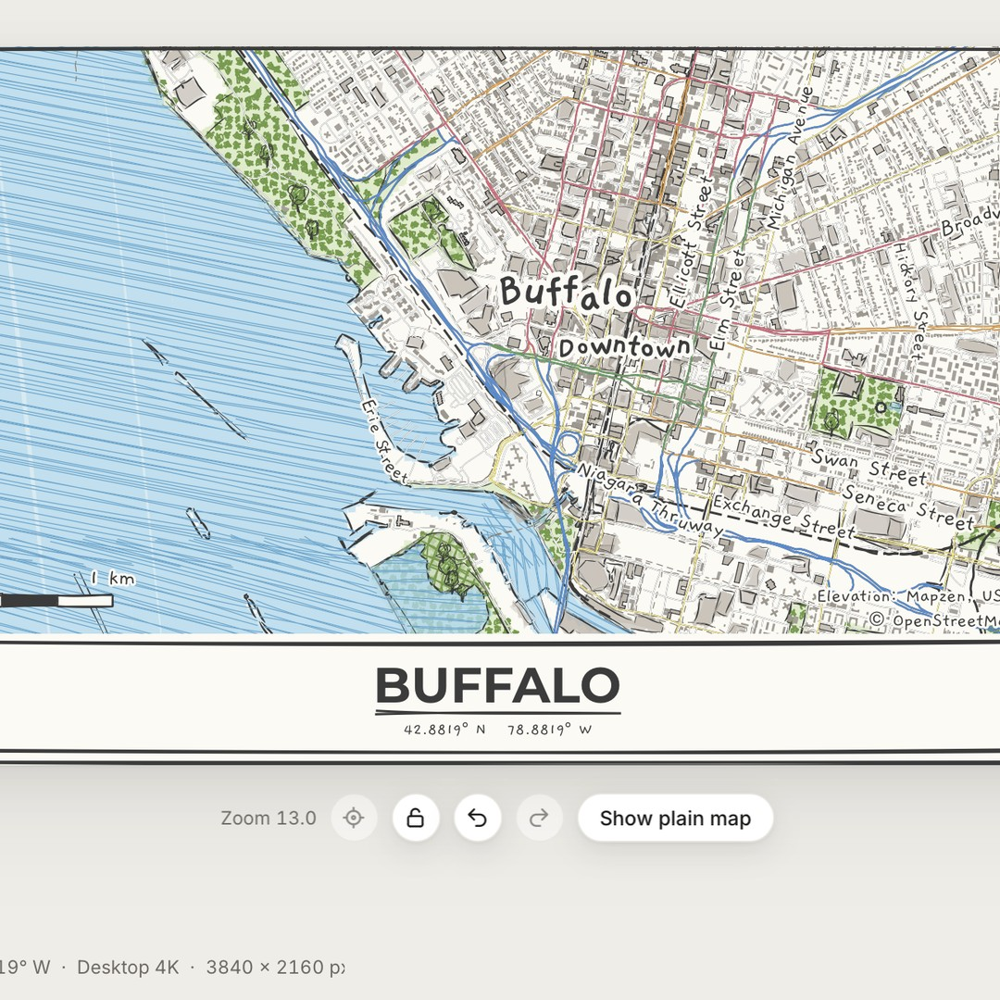

# Geoawesome reposts, 2026-11-24

1 post(s) ready. Each has a 1080×1080 image and its own text for Facebook, Instagram and X. Nothing has been posted.

**To publish:** tick the box under a post. It is queued for the next free time slot and posted to Facebook and Instagram; a comment here confirms the time. Edit a text in this issue first if you want to change it (what is in the box is what gets posted). Untick before the slot to cancel. When it is live, a comment @mentions you with the X text for Buffer.

---

## 1. Maps styled as roughly drawn sketches

<!-- post:2026-11-24-6-maps-styled-as-roughly-drawn-sketches -->
- [ ] **Publish on Facebook + Instagram**



[Download square image](https://raw.githubusercontent.com/walczakagh/geoawesome-social-agent/main/drafts/images/2026-11-24-6-maps-styled-as-roughly-drawn-sketches.jpg) · square crop, from 1294px of source width

**Source:** [FlowingData](https://flowingdata.com/2026/11/23/maps-styled-as-roughly-drawn-sketches/) · score 7.0/10 · Sketch-styled maps of Venice, Kyoto, Dolomites; striking visual map tool with cartographic appeal.
**Rights:** Someone else's map: the credit line names them; ask them first if unsure. Licence on page: not stated.

**What it shows:** A map produced with roughMaps, a free web tool by Alessio Coci that styles a map of a chosen location like a roughly drawn sketch. Users enter a location, select styles and download the result as a poster or wallpaper in various formats and sizes. The page text does not say which place the featured image shows.

**Check before posting:**
- Source reuse policy is 'link_only' and the image licence is not stated (page says only '2007-Present FlowingData. All rights reserved.'). Check whether the image can be reposted before publishing.
- I cannot tell which location or style the square image shows, so the captions describe the tool, not the specific map.
- No data source for the underlying map (e.g. OpenStreetMap) is stated, so none is named.
- The credit names the tool's maker and the blog, following the blog-map convention, rather than the page's verbatim copyright line.
- Alt text is generic because the image content is not described in the source.

**Rule problems left after one fix attempt:**
- Facebook: #GitHub is not a single word

**Facebook**

```text
A free web tool redraws any place you type in as a rough, hand-sketched map.

roughMaps, made by Alessio Coci, lets you enter a location, choose your styles and download the result in various file formats and sizes, as a poster or wallpaper. FlowingData files it under unitasking map tools, and the code is open on GitHub.

Read more: https://flowingdata.com/2026/11/23/maps-styled-as-roughly-drawn-sketches/
Map: roughMaps by Alessio Coci via FlowingData
#Geoawesome #Cartography #Maps #GitHub #Design
```

**Instagram**

```text
Your chosen place, redrawn as if someone sketched it by hand.

That is what roughMaps does: type in a location, pick your styles and download the map as a poster or wallpaper. Alessio Coci's tool is free, offers various file formats and sizes, and the code is on GitHub.

Find out more: https://flowingdata.com/2026/11/23/maps-styled-as-roughly-drawn-sketches/
Map: roughMaps by Alessio Coci via FlowingData
#Geoawesome #Maps #Cartography #Poster #Design
```

**X (via Buffer)**

```text
Type a place, pick a style, get a map that looks roughly sketched by hand.
https://flowingdata.com/2026/11/23/maps-styled-as-roughly-drawn-sketches/
Map: roughMaps by Alessio Coci via FlowingData
#Geoawesome #Maps #Cartography
```

**Alt text:** A map of a location drawn in a rough, hand-sketched style.

---

### Skipped after reading the page
- [Fresh satellite imagery analysis by an Indian geospatial AI deep tech start-up incubated at ...](https://www.facebook.com/TimesofIndia/posts/fresh-satellite-imagery-analysis-by-an-indian-geospatial-ai-deep-tech-start-up-i/1613232547517593/): No image was found on the page, and the source is a truncated Facebook post snippet (link_only) with no stated sensor, date, location detail or visual to explain without guessing.
- [What strike on Russian ship in Libya says about spread of Ukraine war - BBC](https://www.bbc.com/news/articles/cm894p88jzxpo): BBC news analysis of a military strike with no map or Earth observation visual; no image credit found, licence not stated, source is link_only, and the image is a low-resolution upscaled crop that cannot be described without guessing.
- [Ukraine says it sank Russian warship off coast of Libya, far from front line](https://www.washingtonpost.com/world/2026/11/23/ukraine-says-it-sank-russian-warship-off-coast-libya-far-front-line/): No image was found on the page, the credit is missing, the licence is not stated and the reuse policy is link_only; the only visual detail is a one-line snippet about a Planet Labs image, and the claim comes from Ukraine and is unverified.
- [Josep Ferrer on X: "Finland looks twice as big as Spain on a web map, but it's actually a third ...](https://x.com/iamjosepferrer/status/2124818862428618922): The title is cut off mid-claim and the page text is only X boilerplate, so the image content, the comparison and the credit cannot be confirmed without guessing.
- [Heaton Moor Park - X](https://x.com/heatonmoorpark/status/2124854830799995329): The source is an X profile/status page for Heaton Moor Park with no usable text, no stated image, no credit and no evidence of a map or Earth observation visual; nothing can be explained without guessing.
- [Tracking the 2026 Anf Big T Wcsl Rx Fire in California | WFCA Fire Map](https://wfca.com/fire-map/california/2026_anf_big_t_wcsl_rx): No image was found on the page and the text only says the fire is 0 acres, so there is no striking visual to repost and nothing to explain without guessing.

---

### Sources checked
- Google Alerts #1: 20 in feed, 20 new
- Google Alerts #2: 20 in feed, 20 new
- Google Alerts #3: 20 in feed, 20 new
- Google Alerts #4: 20 in feed, 20 new
- Google Alerts #5: 20 in feed, 20 new
- Google Alerts #6: 20 in feed, 5 new, 15 already found via another source
- Google Alerts #7: 20 in feed, 20 new
- Google Alerts #8: 0 in feed, 0 new
- NASA Earth Observatory: 10 in feed, 1 new
- ESA Observing the Earth: failed: https://www.esa.int/rssfeed/Applications/Observing_the_Earth: HTTP 404
- EUMETSAT: 10 in feed, 1 new
- Copernicus Atmosphere Monitoring Service: 10 in feed, 0 new
- NASA JPL: 100 in feed, 1 new
- Planet Pulse: 50 in feed, 1 new
- Maps Mania: 25 in feed, 1 new
- Visual Capitalist (maps): 10 in feed, 1 new
- FlowingData: 10 in feed, 2 new
- Google Maps blog: 20 in feed, 0 new
- Google Research blog: 100 in feed, 1 new
- Overture Maps blog: 20 in feed, 0 new
- Bellingcat: 10 in feed, 0 new
- Reddit r/MapPorn: failed: https://www.reddit.com/r/MapPorn/top/.rss?t=day: HTTP 404
- Reddit r/dataisbeautiful: failed: https://www.reddit.com/r/dataisbeautiful/top/.rss?t=day: HTTP 429
