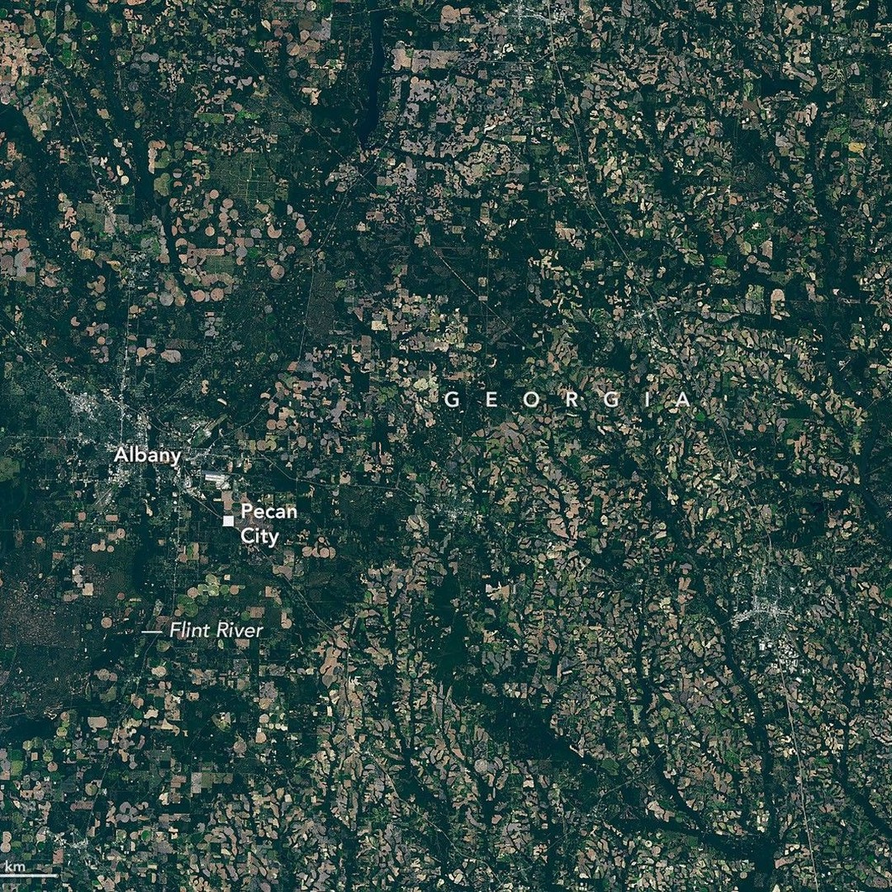

# Geoawesome reposts, 2026-11-25

1 post(s) ready. Each has a 1080×1080 image and its own text for Facebook, Instagram and X. Nothing has been posted.

**To publish:** tick the box under a post. It is queued for the next free time slot and posted to Facebook and Instagram; a comment here confirms the time. Edit a text in this issue first if you want to change it (what is in the box is what gets posted). Untick before the slot to cancel. When it is live, a comment @mentions you with the X text for Buffer.

---

## 1. Georgia’s Pecan Belt

<!-- post:2026-11-25-8-georgia-s-pecan-belt -->
- [ ] **Publish on Facebook + Instagram**



[Download square image](https://raw.githubusercontent.com/walczakagh/geoawesome-social-agent/main/drafts/images/2026-11-25-8-georgia-s-pecan-belt.jpg) · square crop, from 1066px of source width

**Source:** [NASA Earth Observatory](https://science.nasa.gov/earth/earth-observatory/georgias-pecan-belt/) · score 7.0/10 · NASA Earth Observatory satellite image of Georgia pecan orchards; credited space-agency imagery with a clear geo subject.
**Rights:** Publisher allows reuse with credit. Licence on page: NASA imagery, generally free to reuse with credit.

**What it shows:** A Landsat 8 OLI image of the area around Albany (Dougherty County) and neighbouring counties in southwest Georgia, captured on 23 October 2026 during pecan harvest season. The page says Landsat observations feed the USDA Cropland Data Layer, whose 2025 map shows pecan groves clustered along the Flint River. Pecans share the area with peanuts, cotton and corn.

**Check before posting:**
- Band combination and what the colours represent are not stated in the text provided; the caption does not interpret colours.
- The image itself was not available to check: confirm the square shows the Landsat scene and not the Cropland Data Layer map before posting, and adjust the alt text if needed.
- The IMAGE CREDIT field was cut off ('...from the U'). The full credit is taken from the story's closing credit line: 'NASA Earth Observatory images by Lauren Dauphin, using Landsat data from the U.S. Geological Survey.'
- The page gives no resolution or scene extent for the image.
- The 'over 100 million pounds' figure is attributed on the page to USDA numbers for 2023-2025.

**Facebook**

```text
Georgia went from fewer than 100 acres of pecans in the late 1800s to more than 100 million pounds a year in 2023-2025.

Landsat 8 (OLI) imaged the orchards around Albany, Dougherty County, on 23 October 2026, mid-harvest. Landsat feeds the USDA Cropland Data Layer, whose 2025 map puts pecan groves along the Flint River, on sandy soils above the Floridan aquifer.

Read more: https://science.nasa.gov/earth/earth-observatory/georgias-pecan-belt/
Image: NASA Earth Observatory images by Lauren Dauphin, using Landsat data from the U.S. Geological Survey.

#Geoawesome #Landsat #Agriculture #Georgia #NASA
```

**Instagram**

```text
Pecan harvest season, seen by Landsat 8 over southwest Georgia on 23 October 2026.

The scene covers the area around Albany, in Dougherty County, and its neighbours, where pecans share the land with peanuts, cotton and corn. The orchards trace back to an early-1900s planting boom, when thousands of acres were planted in Dougherty and Mitchell counties.

Find out more: https://science.nasa.gov/earth/earth-observatory/georgias-pecan-belt/
Image: NASA Earth Observatory images by Lauren Dauphin, using Landsat data from the U.S. Geological Survey.

#Geoawesome #Landsat #Farmland #Georgia #Pecans
```

**X (via Buffer)**

```text
Georgia has topped 100 million pounds of pecans a year since 2023. Landsat 8 over Albany, 23 October 2026.
https://science.nasa.gov/earth/earth-observatory/georgias-pecan-belt/
Image: NASA Earth Observatory, Landsat/USGS
#Geoawesome #Landsat #Agriculture
```

**Alt text:** Landsat 8 satellite image of farmland and surrounding land around Albany in southwest Georgia, United States, captured in October 2026.

---

### Skipped after reading the page
- [Satellite images show an eruption added 125 acres, about 90 football fields, to Iwo Jima's ...](https://www.facebook.com/12NewsNow/posts/satellite-images-show-an-eruption-added-125-acres-about-90-football-fields-to-iw/1643755434461131/): No image was found on the page, the credit is missing and the source is only a one-line headline on a Facebook post (link_only), so there is no visual to share and no sensor, date or original source to cite without guessing.
- [Fresh Construction At China Mother Of All Dams Geospatial Survey Shows - NDTV](https://www.ndtv.com/india-news/fresh-construction-at-china-mother-of-all-dams-geospatial-survey-shows-12370718): No image found on the page and the source gives only a one-line teaser, so there is no striking visual to repost and nothing to caption without guessing.
- [China's Rs 15,623,605,200,000 super dam project near Arunachal working at fast pace ...](https://m.economictimes.com/news/new-updates/chinas-rs-15623605200000-super-dam-near-arunachal-working-at-fast-pace-satellite-images-show-site-cleared-river-diverted-in-less-than-a-year/articleshow/136118332.cms): The only image on the page is captioned 'representative image created by AI', not a real satellite scene. The page text gives no sensor, date, credit or licence for any actual satellite imagery.
- [Driving Boston to Provincetown, from Sentinel-2 satellite imagery. 16 miles and 2 hours ... - Instagram](https://www.instagram.com/reel/DgIci73IfdL/): No image could be retrieved (Instagram reel, link_only reuse policy), no creator credit or licence is given, and the snippet is truncated and internally inconsistent.
- [Satellite images show an eruption added 125 acres, about 90 football fields, to Iwo Jima's ...](https://www.instagram.com/reel/DgI0eudDmUk/): No image was found on the page, no credit is given, the licence is not stated and the reuse policy is link_only, so there is no visual to repost. The source is an Instagram reel and the page text is only a snippet.
- [King Tides Threaten LA County Coast This Week: When, Where Flooding Could Be Worst](https://patch.com/california/los-angeles/amp/35267731/king-tides-threaten-la-county-coast-this-week-when-where-flooding-could-be-worst): No image or map on the source page (IMAGE NOTE: no image found), and the item is a local news article about a tide forecast, so there is no striking visual to repost.
- [Tracking the E Shivley Fire in Oregon | WFCA Fire Map](https://wfca.com/fire-map/oregon/e_shivley?name=E+Shivley): No image found on the page and the only text is a one-line fire size (75 acres); no striking visual to repost and nothing more to ground a caption in.

---

### Sources checked
- Google Alerts #1: 20 in feed, 20 new
- Google Alerts #2: 11 in feed, 10 new
- Google Alerts #3: 20 in feed, 19 new, 1 from excluded sites
- Google Alerts #4: 20 in feed, 20 new
- Google Alerts #5: 20 in feed, 20 new
- Google Alerts #6: 15 in feed, 6 new, 5 already found via another source
- Google Alerts #7: 20 in feed, 20 new
- Google Alerts #8: 3 in feed, 0 new
- NASA Earth Observatory: 10 in feed, 1 new
- ESA Observing the Earth: failed: https://www.esa.int/rssfeed/Applications/Observing_the_Earth: HTTP 404
- EUMETSAT: 10 in feed, 0 new
- Copernicus Atmosphere Monitoring Service: 10 in feed, 0 new
- NASA JPL: 100 in feed, 0 new
- Planet Pulse: 50 in feed, 0 new
- Maps Mania: 25 in feed, 2 new
- Visual Capitalist (maps): 10 in feed, 2 new
- FlowingData: 10 in feed, 1 new
- Google Maps blog: 20 in feed, 0 new
- Google Research blog: 100 in feed, 0 new
- Overture Maps blog: 20 in feed, 0 new
- Bellingcat: 10 in feed, 0 new
- Reddit r/MapPorn: failed: https://www.reddit.com/r/MapPorn/top/.rss?t=day: HTTP 404
- Reddit r/dataisbeautiful: failed: https://www.reddit.com/r/dataisbeautiful/top/.rss?t=day: HTTP 429
