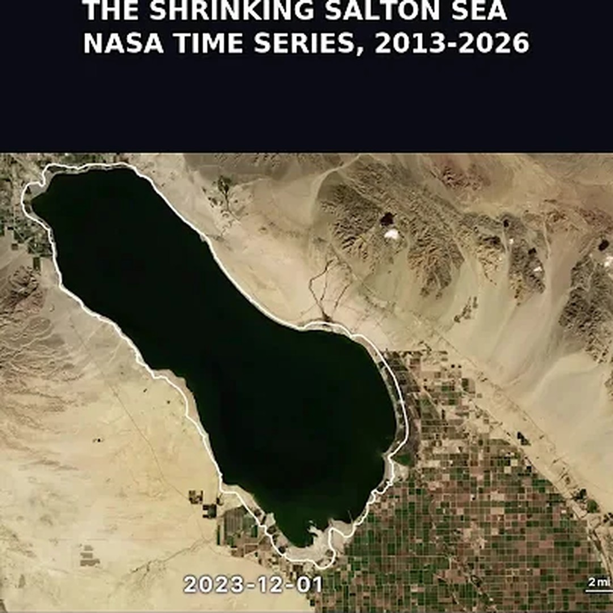
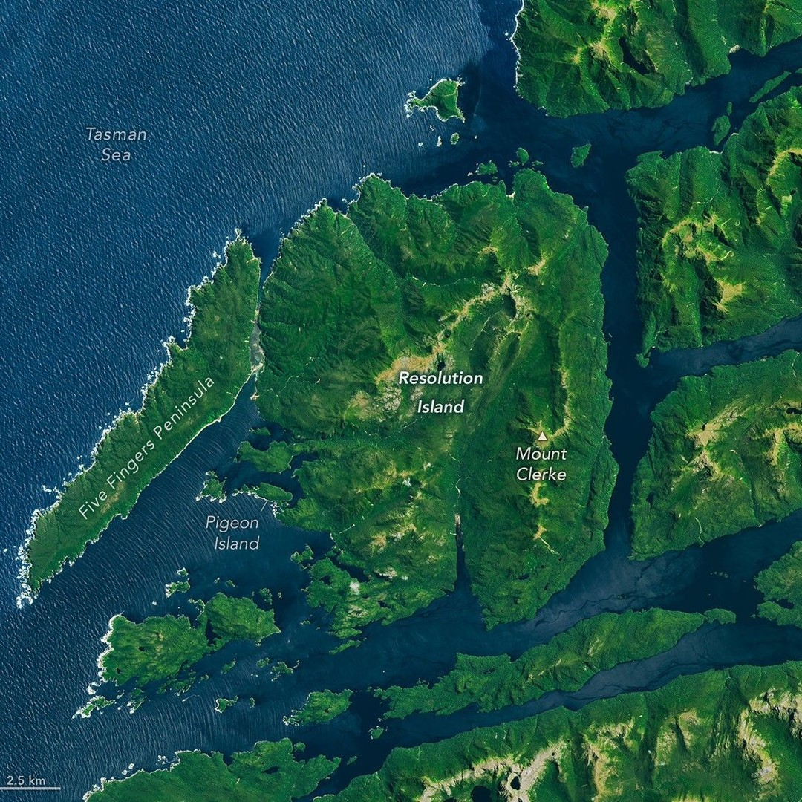
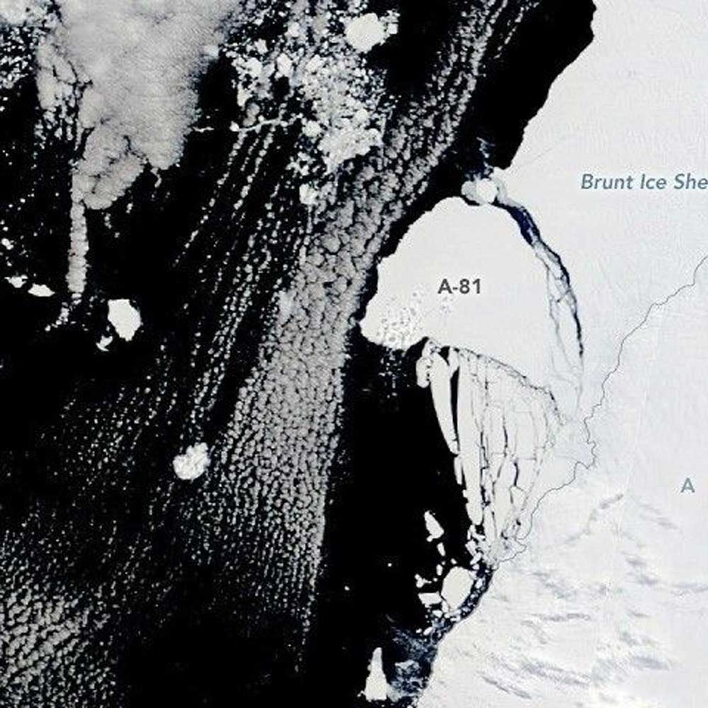

# Geoawesome reposts, 2026-11-26

3 post(s) ready. Each has a 1080×1080 image and its own text for Facebook, Instagram and X. Nothing has been posted.

**To publish:** tick the box under a post. It is queued for the next free time slot and posted to Facebook and Instagram; a comment here confirms the time. Edit a text in this issue first if you want to change it (what is in the box is what gets posted). Untick before the slot to cancel. When it is live, a comment @mentions you with the X text for Buffer.

---

## 1. The Shrinking Salton Sea in Landsat and Sentinel-2 Imagery, 2013 to 2026: NASA Visualization

<!-- post:2026-11-26-1-the-shrinking-salton-sea-in-landsat-and -->
- [ ] **Publish on Facebook + Instagram**



[Download square image](https://raw.githubusercontent.com/walczakagh/geoawesome-social-agent/main/drafts/images/2026-11-26-1-the-shrinking-salton-sea-in-landsat-and.jpg) · square crop, from 405px of source width (low resolution: upscaled, check sharpness)

**Source:** [Google Alerts #3](https://www.youtube.com/shorts/mpn675art4Y) · score 8.0/10 · NASA Salton Sea time series, Landsat and Sentinel-2; shrinking lake from space, strong climate story.
**Rights:** Someone else's map: the credit line names them; ask them first if unsure. Licence on page: not stated.

**What it shows:** A time series of the Salton Sea in Southern California, 2013 to 2026, from NASA's Scientific Visualization Studio. It is built from Harmonized Landsat and Sentinel-2 (HLS) data and shows the lake shrinking. The source gives no colour key, no shrinkage figures and no specific frame dates.

**Check before posting:**
- Reuse policy is link_only and the image licence is not stated: check that a square crop of a frame is allowed before posting, or ask NASA SVS.
- The page gives no image credit. The credit used is taken from the page text ('NASA's Scientific Visualization Studio'). Confirm the YouTube Short is really from NASA or SVS.
- The source is a YouTube Short and the image is a 405px crop, upscaled: check sharpness.
- Which frame or year the square shows is unknown, and the alt text is generic for that reason. Adjust it once the frame is chosen.
- The source does not say what the colours mean (likely true or false colour, unconfirmed), how much the lake has shrunk, or which dates are in the series.
- The source gives only the title and a snippet of page text, with no cause for the shrinking, so none is stated.

**Facebook**

```text
Thirteen years of the Salton Sea, 2013 to 2026, run as a single satellite time series.

NASA's Scientific Visualization Studio built it from Harmonized Landsat and Sentinel-2 (HLS) data, so imagery from both missions feeds one record of the Southern California lake as it shrinks. The clip gives no colour key or shrinkage figures, but the retreat of the water is plain to see.

Read more: https://www.youtube.com/shorts/mpn675art4Y
Image: NASA Scientific Visualization Studio

#Geoawesome #Landsat #Sentinel2 #California #Satellite
```

**Instagram**

```text
The Salton Sea gets smaller, frame by frame, in Landsat and Sentinel-2 imagery from 2013 to 2026.

This NASA Scientific Visualization Studio time series uses Harmonized Landsat and Sentinel-2 (HLS) data over Southern California. Watch the water's edge pull back across the years.

Full story: https://www.youtube.com/shorts/mpn675art4Y
Image: NASA Scientific Visualization Studio

#Geoawesome #Landsat #Sentinel2 #Timelapse #California
```

**X (via Buffer)**

```text
The Salton Sea, 2013 to 2026, in Landsat and Sentinel-2 data. A NASA time series of a shrinking lake.
https://www.youtube.com/shorts/mpn675art4Y
Image: NASA Scientific Visualization Studio
#Geoawesome #Landsat #Sentinel2
```

**Alt text:** Satellite image of the Salton Sea in Southern California, taken from a NASA time series of Landsat and Sentinel-2 data showing the lake shrinking over time.

---

## 2. Seeking Refuge on Resolution Island

<!-- post:2026-11-26-4-seeking-refuge-on-resolution-island -->
- [ ] **Publish on Facebook + Instagram**



[Download square image](https://raw.githubusercontent.com/walczakagh/geoawesome-social-agent/main/drafts/images/2026-11-26-4-seeking-refuge-on-resolution-island.jpg) · square crop, from 1155px of source width

**Source:** [NASA Earth Observatory](https://science.nasa.gov/earth/earth-observatory/seeking-refuge-on-resolution-island/) · score 8.0/10 · NASA Earth Observatory satellite image of Resolution Island; strong scene, credited, high editor pick rate.
**Rights:** Publisher allows reuse with credit. Licence on page: not stated.

**What it shows:** A Landsat 9 OLI image acquired on 12 December 2025 of Resolution Island, the largest of about 90 islands in Fiordland National Park, on the southwest edge of New Zealand's South Island. It shows the uninhabited island rising to Mount Clerke (1,069 m) amid glacier-carved valleys now flooded by the sea. The page does not say which bands or colour rendering were used.

**Check before posting:**
- Band combination and colour rendering are not stated, so the captions do not say what the colours mean.
- No resolution is given for the image.
- The credit field says NOT FOUND (fallback: NASA Earth Observatory). The page text itself reads 'NASA Earth Observatory image by Michala Garrison, using Landsat data from the U.S. Geological Survey'. Consider using that fuller credit.
- The image licence is not stated on the page (source type is marked 'reuse').
- The source image is 1155 px wide, so the 1080 px square crop is close to native size.

**Facebook**

```text
Stoats can swim, and that undid the plan to make Resolution Island a predator-free refuge for kiwi and kākāpō.

This Landsat 9 (OLI) image from 12 December 2025 shows the island in Fiordland, rising from sea level to Mount Clerke at 1,069 metres amid glacier-carved valleys flooded by the sea. Mustelids were spotted there in 1900, and a Department of Conservation stoat control programme has run since 2008.

Read more: https://science.nasa.gov/earth/earth-observatory/seeking-refuge-on-resolution-island/
Image: NASA Earth Observatory
#Geoawesome #Landsat #Fiordland #Conservation #Islands
```

**Instagram**

```text
In the late 1800s, caretaker Richard Henry rowed more than 700 birds, mostly kiwi and kākāpō, to Resolution Island and other nearby sanctuaries.

Landsat 9 (OLI) captured the uninhabited island on 12 December 2025, rising to Mount Clerke at 1,069 metres among valleys carved by glaciers and now inundated by the ocean. The refuge had a flaw: the island is within swimming distance for stoats, and mustelids were seen there by 1900.

Find out more: https://science.nasa.gov/earth/earth-observatory/seeking-refuge-on-resolution-island/
Image: NASA Earth Observatory
#Geoawesome #Landsat #Fiordland #Wildlife #Satellite
```

**X (via Buffer)**

```text
Landsat 9 over Fiordland, 12 December 2025: Resolution Island, once meant as a stoat-free refuge for kiwi and kākāpō. Stoats can swim.
https://science.nasa.gov/earth/earth-observatory/seeking-refuge-on-resolution-island/
Image: NASA Earth Observatory
#Geoawesome #Landsat #Fiordland
```

**Alt text:** Satellite image of Resolution Island, a large mountainous island in New Zealand's Fiordland, surrounded by sea and steep-sided fiords.

---

## 3. Mapping 25 Years of Cracks in Antarctica's Ice Shelves - Geography Realm

<!-- post:2026-11-26-8-mapping-25-years-of-cracks-in-antarctica -->
- [ ] **Publish on Facebook + Instagram**



[Download square image](https://raw.githubusercontent.com/walczakagh/geoawesome-social-agent/main/drafts/images/2026-11-26-8-mapping-25-years-of-cracks-in-antarctica.jpg) · square crop, from 1000px of source width

**Source:** [Google Alerts #3](https://www.geographyrealm.com/mapping-cracks-antarctica-ice-shelves/) · score 7.0/10 · Disaster/ice-loss theme with a 170-map dataset of fractures on famous ice shelves.
**Rights:** Someone else's map: the credit line names them; ask them first if unsure. Licence on page: CC BY 4.0..

**What it shows:** A map from a new dataset of surface damage (crevasses and rifts) on Antarctic ice shelves. The dataset has 170 maps at 30 m resolution covering nine shelves from 1999 to 2024, made from Landsat imagery with machine learning (Tang, Bamber, Li and Qiao, Earth System Science Data, November 2026). The page text does not say which shelf or date the lead image shows, or what its colours mean.

**Check before posting:**
- The page names no image credit. The posts credit the publisher, Geography Realm, rather than guessing the map's maker. Check the page and the paper (DOI 10.5194/essd-18-8591-2026) to see whether the image comes from the paper.
- I could not see the image and the source text does not describe it. Check which shelf and date it shows and what the colours mean, then correct the alt text.
- The source gives no individual Landsat sensor names or the scene dates behind the lead image.
- The source says the study was published in November 2026 but gives no day.
- The source link is link_only, so the post should rely on the link and not reuse page text beyond the facts summarised here. Licence is stated as CC BY 4.0, which is worth confirming applies to the image.

**Facebook**

```text
Pine Island's ice shelf once shed a large iceberg every four to six years and now calves almost every year.

A new Landsat-based dataset tracks surface damage on nine Antarctic ice shelves: 170 maps at 30 metre resolution, covering 1999 to 2024, made with machine learning. Pine Island, Thwaites and Scar Inlet changed most. One limit: optical imagery can miss snow-covered cracks and only covers sunlit months.

Read more: https://www.geographyrealm.com/mapping-cracks-antarctica-ice-shelves/
Map: Geography Realm
#Geoawesome #Antarctica #Landsat #Glaciers #Cryosphere
```

**Instagram**

```text
170 maps at 30 metres, 25 years of cracks across nine Antarctic ice shelves.

Landsat imagery and machine learning pick out crevasses and rifts, some of which cut through the full thickness of a shelf. On Brunt, the maps follow rifts in the years before the 1,550 square kilometre iceberg A-81 broke away on 22 January 2023. The data is free on Zenodo as GeoTIFF (EPSG:3031).

Find out more: https://www.geographyrealm.com/mapping-cracks-antarctica-ice-shelves/
Map: Geography Realm
#Geoawesome #Antarctica #Satellite #Cryosphere
```

**X (via Buffer)**

```text
25 years of Antarctic ice shelf cracks, mapped from Landsat. 170 maps at 30 m cover nine shelves.
https://www.geographyrealm.com/mapping-cracks-antarctica-ice-shelves/
Map: Geography Realm
#Geoawesome #Antarctica #Landsat
```

**Alt text:** Satellite-derived map of fractures on an Antarctic ice shelf, from a Landsat-based dataset of ice shelf surface damage.

---

### Skipped after reading the page
- [A Category 4 hurricane seen from space #Shorts - YouTube](https://www.youtube.com/shorts/bBDJihXF2x4): Reuse policy is link_only, no image credit or licence is stated, and the square would be an upscaled 405px frame from a YouTube Short, so it cannot be reposted as a credited image.
- [Dubai's coast seen by Landsat on Nov 19, 2000, Sep 30, 2002, Oct 14, 2... | TikTok](https://www.tiktok.com/@strangeearthclips/video/7712189033333411085): No image was found on the page, the reuse policy is link_only, no credit or licence is stated, and the title is truncated, so there is no visual to repost and the dates and imagery can't be confirmed.
- [Yemen's Houthi rebels attack Saudi Arabia's largest oil refinery - NBC News](https://www.nbcnews.com/world/saudi-arabia/yemen-houthi-rebels-attack-saudi-arabia-largest-oil-refinery-rcna611319): News article on an attack; the image is not described, has no credit or licence, is low resolution, and the source policy is link_only, so I could not say what it shows without guessing.
- [Carlow town and the surrounding area viewed from the Copernicus Sentinel 2 satellite over ...](https://www.facebook.com/smcgarr/videos/carlow-town-and-the-surrounding-area-viewed-from-the-copernicus-sentinel-2-satel/1820499735899231/): Source is a Facebook video post of a Sentinel-2 time-lapse with a truncated one-line description, no named creator or image credit, no licence, and a link_only reuse policy, so the still can't be reposted or described without guessing.
- [Some brainless creatures are so successful they can even be seen from space . Like a city of ...](https://www.facebook.com/NatGeoAnimals/videos/some-brainless-creatures-are-so-successful-they-can-even-be-seen-from-space-like/1541203764723704/): Truncated Facebook video teaser from NatGeoAnimals with no place, sensor, date or image credit, a link_only reuse policy and a 405px source image, so a caption would need guesswork.

---

### Sources checked
- Google Alerts #1: 7 in feed, 7 new
- Google Alerts #2: 20 in feed, 19 new
- Google Alerts #3: 20 in feed, 20 new
- Google Alerts #4: 20 in feed, 20 new
- Google Alerts #5: 20 in feed, 20 new
- Google Alerts #6: 20 in feed, 6 new, 14 already found via another source
- Google Alerts #7: 19 in feed, 19 new
- Google Alerts #8: 9 in feed, 0 new
- NASA Earth Observatory: 10 in feed, 1 new
- ESA Observing the Earth: failed: https://www.esa.int/rssfeed/Applications/Observing_the_Earth: HTTP 404
- EUMETSAT: 10 in feed, 1 new
- Copernicus Atmosphere Monitoring Service: 10 in feed, 0 new
- NASA JPL: 100 in feed, 1 new
- Planet Pulse: 50 in feed, 0 new
- Maps Mania: 25 in feed, 1 new
- Visual Capitalist (maps): 10 in feed, 1 new
- FlowingData: 10 in feed, 1 new
- Google Maps blog: 20 in feed, 0 new
- Google Research blog: 100 in feed, 1 new
- Overture Maps blog: 20 in feed, 0 new
- Bellingcat: 10 in feed, 0 new
- Reddit r/MapPorn: failed: https://www.reddit.com/r/MapPorn/top/.rss?t=day: HTTP 404
- Reddit r/dataisbeautiful: failed: https://www.reddit.com/r/dataisbeautiful/top/.rss?t=day: HTTP 429
