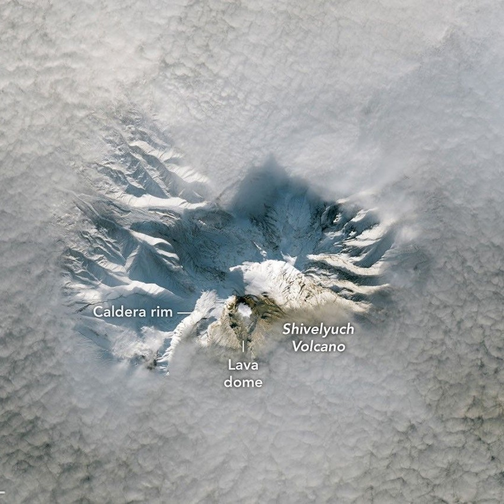
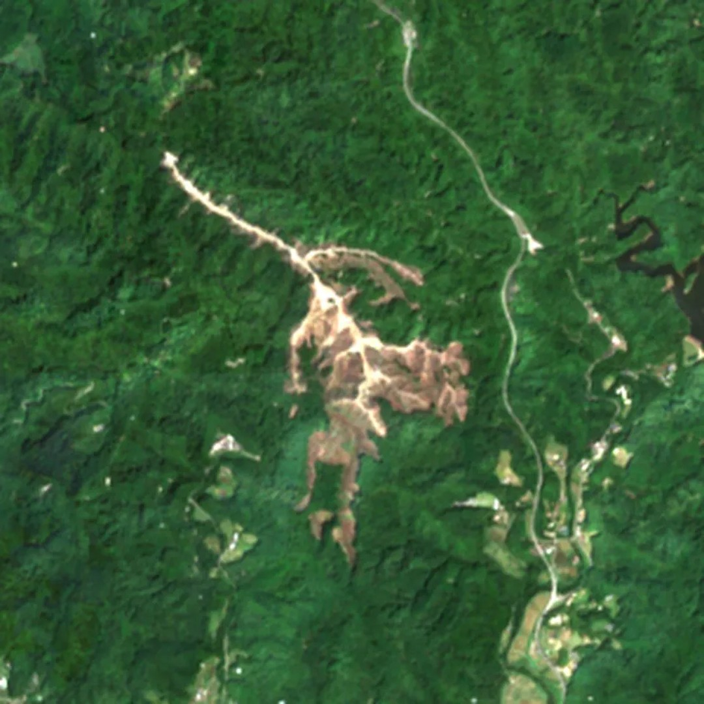
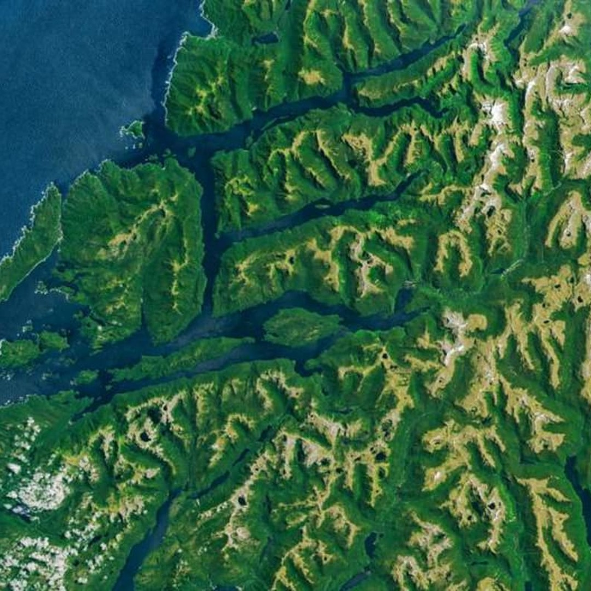
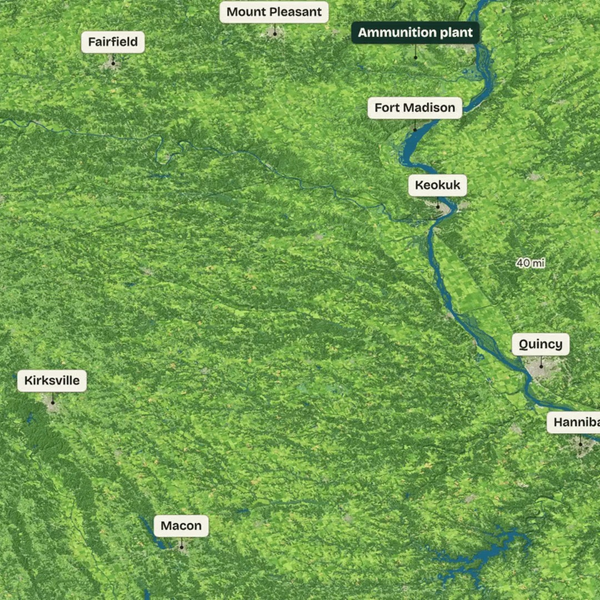

# Geoawesome reposts, 2026-11-27

4 post(s) ready. Each has a 1080×1080 image and its own text for Facebook, Instagram and X. Nothing has been posted.

**To publish:** tick the box under a post. It is queued for the next free time slot and posted to Facebook and Instagram; a comment here confirms the time. Edit a text in this issue first if you want to change it (what is in the box is what gets posted). Untick before the slot to cancel. When it is live, a comment @mentions you with the X text for Buffer.

---

## 1. Shivelyuch Socked In

<!-- post:2026-11-27-1-shivelyuch-socked-in -->
- [ ] **Publish on Facebook + Instagram**



[Download square image](https://raw.githubusercontent.com/walczakagh/geoawesome-social-agent/main/drafts/images/2026-11-27-1-shivelyuch-socked-in.jpg) · square crop, from 853px of source width

**Source:** [NASA Earth Observatory](https://science.nasa.gov/earth/earth-observatory/shivelyuch-socked-in/) · score 8.0/10 · Earth Observatory satellite view of Kamchatka volcano under cloud; strong visual, NASA credit.
**Rights:** Publisher allows reuse with credit. Licence on page: not stated.

**What it shows:** A Landsat 9 OLI image of Shivelyuch (Shiveluch) volcano on Russia's Kamchatka Peninsula, captured on 8 November 2026. Clouds ring the snowy flanks below the 3,283 m peak, leaving the 9 km wide caldera and northern upper slopes clear. The dark area inside the caldera is a lava dome. The source does not give a band combination.

**Check before posting:**
- Image credit field was NOT FOUND on the page, so the fallback 'NASA Earth Observatory' is used. The page text also names Lauren Dauphin (image) and USGS (Landsat data), which the editor may prefer to credit.
- Image licence not stated on the page.
- Square crop from only 853px of source width, so it is lower resolution than a full 1080px square.
- Band combination and image resolution are not given.
- The July 2026 ash plume into Alaskan airspace is attributed to news reports in the source, so it is left out of the posts.

**Facebook**

```text
Clouds ringed Shivelyuch on Kamchatka but left its 9-kilometre-wide caldera in the clear.

Landsat 9 (OLI) captured the scene on 8 November 2026, with cloud hovering beneath the 3,283-metre summit. The dark patch inside the caldera is a lava dome, which goes through cycles of growth and collapse. KVERT reported a resuspended ash plume drifting 120 kilometres east that day, relatively tame for this volcano.

Read more: https://science.nasa.gov/earth/earth-observatory/shivelyuch-socked-in/
Image: NASA Earth Observatory

#Geoawesome #Landsat #Volcano #Kamchatka #Satellite
```

**Instagram**

```text
Shivelyuch is chronically cloud-covered, and this Landsat 9 pass caught a gap right over the top.

Snowy flanks sit under a cloud layer, while the 9-kilometre caldera, open to the south, is clearly visible. The dark area inside is a lava dome. Captured on 8 November 2026 on the Kamchatka Peninsula, after months of ongoing eruptive activity reported by KVERT.

Find out more: https://science.nasa.gov/earth/earth-observatory/shivelyuch-socked-in/
Image: NASA Earth Observatory

#Geoawesome #Landsat9 #Volcano #Kamchatka #Satellites
```

**X (via Buffer)**

```text
Cloud wrapped Shivelyuch, but its 9 km wide caldera stayed clear for Landsat 9 on 8 Nov 2026. The dark patch inside is a lava dome.
https://science.nasa.gov/earth/earth-observatory/shivelyuch-socked-in/
Image: NASA Earth Observatory
#Geoawesome #Landsat #Volcano
```

**Alt text:** Satellite image of a snow-covered volcano on the Kamchatka Peninsula with a layer of cloud around its flanks and a clear summit caldera containing a dark lava dome.

---

## 2. Japan's solar farms on cleared forest: a satellite map of 139 sites since 2024 | Orteliana

<!-- post:2026-11-27-4-japan-s-solar-farms-on-cleared-forest-a -->
- [ ] **Publish on Facebook + Instagram**



[Download square image](https://raw.githubusercontent.com/walczakagh/geoawesome-social-agent/main/drafts/images/2026-11-27-4-japan-s-solar-farms-on-cleared-forest-a.jpg) · square crop, from 960px of source width

**Source:** [Google Alerts #3](https://orteliana.com/articles/forest-to-solar-japan/) · score 7.0/10 · Satellite map of 139 solar sites cleared from Japanese forest; before/after land change story.
**Rights:** Someone else's map: the credit line names them; ask them first if unsure. Licence on page: not stated.

**What it shows:** Orteliana's interactive map of new solar plants in Japan, detected monthly in Copernicus Sentinel-2 imagery. Orange dots mark plants built on former forest and blue dots mark plants on farmland, grassland or open land. Between January 2024 and November 2026 it lists 139 forest sites (about 662 hectares, 6.6 km²), each checked by hand on satellite and aerial images. The article also shows a before/after slider for Sendatsuyama (Fukushima), detected 27 March 2025.

**Check before posting:**
- The page names no image credit, so the credit is the publisher (Orteliana). The image licence is not stated and the reuse policy is link_only, so check permission before posting the image.
- It is not clear which visual the 960px square crop comes from (map view, Sendatsuyama frame or Kamogawa slider). The alt text is generic and should be adjusted to the actual crop.
- The Sendatsuyama figures differ: Fukushima Prefecture records give a site of about 345 hectares and roughly 40 MW, while Orteliana's detection counts two sites of 28.2 and 14.4 hectares. The posts use only the Orteliana figures.
- Orteliana is the source for the 139-site count and 662-hectare total (its own detection and hand checks). The article gives no detection accuracy.
- The article says 'one satellite image a year' composited from April to November, but the exact Sentinel-2 dates of the frames are not given.

**Facebook**

```text
Japan has 139 new solar sites on former forest since January 2024, together about 662 hectares.

Orteliana scans Sentinel-2 images every month for new solar plants, then checks by hand whether the land was forest. Fukushima (24), Ibaraki (17) and Tochigi (16) hold 57 of the 139. On the interactive map, orange dots mark former forest, and a slider compares the previous summer's image with the latest.

Read more: https://orteliana.com/articles/forest-to-solar-japan/

Map: Orteliana

#Geoawesome #Sentinel2 #Solar #Forests #Japan
```

**Instagram**

```text
A hill near Fukushima city was bare by 2024 and carried solar panels in 2025.

Orteliana's map detected the Sendatsuyama plant on 27 March 2025, as two sites of 28.2 and 14.4 hectares, both on former forest. It is the second largest of 139 forest-to-solar sites the project has logged in Japan since January 2024. Drag the slider to compare the images.

Find out more: https://orteliana.com/articles/forest-to-solar-japan/

Map: Orteliana

#Geoawesome #Sentinel2 #Solar #Forests
```

**X (via Buffer)**

```text
Forest to solar in Japan, tracked with Sentinel-2: 139 sites since January 2024, about 662 hectares. Four in ten are in Fukushima, Ibaraki and Tochigi.
https://orteliana.com/articles/forest-to-solar-japan/
Map: Orteliana
#Geoawesome #Solar #Forests #Japan
```

**Alt text:** Satellite imagery or map from Orteliana's tracker of new solar plants in Japan built on former forest.

---

## 3. A remote island in New Zealand was supposed to be a safe haven for wildlife - AOL.com

<!-- post:2026-11-27-5-a-remote-island-in-new-zealand-was-suppo -->
- [ ] **Publish on Facebook + Instagram**



[Download square image](https://raw.githubusercontent.com/walczakagh/geoawesome-social-agent/main/drafts/images/2026-11-27-5-a-remote-island-in-new-zealand-was-suppo.jpg) · square crop, from 791px of source width

**Source:** [Google Alerts #3](https://www.aol.com/articles/remote-island-zealand-supposed-safe-174949000.html) · score 7.0/10 · Landsat 9 image of a glacier-shaped remote New Zealand island; pictorial satellite scene, credit implied.
**Rights:** Someone else's map: the credit line names them; ask them first if unsure. Licence on page: not stated.

**What it shows:** A Landsat 9 (Operational Land Imager) image of Resolution Island, the largest island in Fiordland National Park off the southwestern coast of New Zealand's South Island, captured on 12 December 2025. It is NASA Earth Observatory's Image of the Day. The source does not say how the colours were rendered, but describes deep blue water and dense vegetation. The story is about the island's failed history as a bird refuge, since stoats swam across the channels.

**Check before posting:**
- Band combination and colour rendering are not stated; the source only mentions deep blue water and dense vegetation.
- Spatial resolution of the crop is not given; the crop is made from only 791px of source width, so check it is sharp enough at 1080px.
- Image licence is not stated on the page, and the reuse policy is link_only. Check NASA Earth Observatory's terms before posting.
- The page text ends with a truncated credit ('NASA Earth Observatory / Michala Garrison, using Landsat da...'). The posts use the credit field 'NASA Earth Observatory'; check the original page if you want the fuller credit.
- The page is an AOL.com repost of the NASA Earth Observatory item, so you may prefer to link the original.

**Facebook**

```text
By 1900, stoats had swum the channels to Resolution Island, undoing years of work to make it a bird refuge.

Landsat 9 (Operational Land Imager) imaged the island in Fiordland National Park, New Zealand, on 12 December 2025. Caretaker Richard Henry had moved more than 700 birds, mostly kiwi and kākāpō, to it and nearby islands. The Department of Conservation launched a predator management programme there in 2008.

Find out more: https://www.aol.com/articles/remote-island-zealand-supposed-safe-174949000.html

Image: NASA Earth Observatory

#Geoawesome #Landsat9 #Wildlife #Conservation #Fiordland
```

**Instagram**

```text
Dense forest, fjord-cut coastline and a summit of 3,507 feet: Resolution Island looks untouched from orbit.

This Landsat 9 view from 12 December 2025 shows the largest island in Fiordland National Park, off New Zealand's southwestern coast. Glaciers carved the valleys that rising seas later flooded into fjords. Beneath the canopy lies a century of efforts to keep invasive predators away from native birds.

Learn more: https://www.aol.com/articles/remote-island-zealand-supposed-safe-174949000.html

Image: NASA Earth Observatory

#Geoawesome #Landsat #Fjords #Wilderness #Island
```

**X (via Buffer)**

```text
Stoats reached Resolution Island within a decade of it becoming a bird reserve.
Landsat 9 view, 12 Dec 2025.
https://www.aol.com/articles/remote-island-zealand-supposed-safe-174949000.html
Image: NASA Earth Observatory
#Geoawesome #Landsat #Fiordland #Conservation
```

**Alt text:** Satellite view of a mountainous, forested island with inlets and fjords along its coast, surrounded by deep blue water.

---

## 4. Mapping the Iowa Lead Explosion

<!-- post:2026-11-27-7-mapping-the-iowa-lead-explosion -->
- [ ] **Publish on Facebook + Instagram**



[Download square image](https://raw.githubusercontent.com/walczakagh/geoawesome-social-agent/main/drafts/images/2026-11-27-7-mapping-the-iowa-lead-explosion.jpg) · square crop, from 763px of source width

**Source:** [Maps Mania](http://googlemapsmania.blogspot.com/2026/11/mapping-iowa-lead-explosion.html) · score 7.0/10 · Maps Mania map of lead dust plume after Iowa detonation; map hook, disaster-adjacent, favourite site.
**Rights:** Someone else's map: the credit line names them; ask them first if unsure. Licence on page: not stated.

**What it shows:** A screenshot-style crop from an interactive map, Where the Lead Will Go, which attempts to simulate millions of airborne particles using weather forecasts after the US Army detonated 68 drums (about 9,500 pounds) of degraded lead azide at the Iowa Army Ammunition Plant near Middletown. Users can step through five days of predictions or press play, and colour bands separate lead still airborne from lead that has settled on the ground.

**Check before posting:**
- The page text is cut off mid-sentence (scenarios of '100%, 50% or 10...'), so what the scenario percentages mean is unknown and left out.
- The map's creator is not named in the source; credit uses the map title plus Maps Mania. Check the map page for a maker.
- The source describes two maps but only the first, Where the Lead Will Go, in the available text. Check the square really comes from that one.
- No weather model, particle model, units or colour scale are stated.
- The detonation date is given only as 'yesterday' relative to the blog post, so no date is used.
- Image licence is not stated and the reuse policy is link only: confirm before posting.
- No result is reported on where the lead actually went; the map is a simulation and the posts say so.

**Facebook**

```text
A controlled detonation of 68 drums holding about 9,500 pounds of degraded lead azide in Iowa has prompted a map that tries to follow the dust.

Where the Lead Will Go uses weather forecasts to simulate millions of airborne particles from the Iowa Army Ammunition Plant near Middletown. Move through five days of predictions or press play: colour bands separate lead still airborne from lead that has settled on the ground.

Read more: http://googlemapsmania.blogspot.com/2026/11/mapping-iowa-lead-explosion.html

Map: Where the Lead Will Go via Maps Mania

#Geoawesome #Mapping #Iowa #Simulation #Weather
```

**Instagram**

```text
Millions of simulated particles, coloured by whether they are still airborne or already on the ground.

After the US Army detonated 68 drums of degraded lead azide (about 9,500 pounds) near Middletown, Iowa, the map Where the Lead Will Go set out to show where the dust could end up. Press play on five days of weather-forecast predictions, or switch between scenarios.

Find out more: http://googlemapsmania.blogspot.com/2026/11/mapping-iowa-lead-explosion.html

Map: Where the Lead Will Go via Maps Mania

#Geoawesome #Mapping #Particles #Weather #Iowa
```

**X (via Buffer)**

```text
Millions of simulated particles show where lead dust from an Iowa detonation could settle. Scrub through five days of forecasts.
http://googlemapsmania.blogspot.com/2026/11/mapping-iowa-lead-explosion.html
Map: Where the Lead Will Go via Maps Mania
#Geoawesome #Mapping #Iowa #Weather
```

**Alt text:** Interactive map simulating airborne lead particles, with colour bands distinguishing lead still in the air from lead that has settled on the ground.

---

### Skipped after reading the page
- [Entire villages cleared, river diverted as China builds world's largest dam on India's ...](https://www.tibetanreview.net/entire-villages-cleared-river-diverted-as-china-builds-worlds-largest-dam-on-indias-doorstep-on-war-footing/): The source material does not say what the image shows (satellite scene, map or photo), has no image credit or licence, and the crop is upscaled from 651px, so a caption and alt text would be guesswork.
- [Tracking the Ouachita 358 Fire in Arkansas | WFCA Fire Map](https://wfca.com/fire-map/arkansas/ouachita_358?name=Ouachita+358): No image was found on the page, and the only text is a one-line acreage figure (30 acres), so there is no striking visual to repost and nothing more to say without guessing.
- [ArcGIS StoryMaps - X](https://x.com/ArcGISStoryMaps/status/2126090147452322095): The source is an X post link with no usable text: the only page text is X's generic sign-in blurb, so the image, place, data and date cannot be described without guessing.
- [Huge plume of black smoke seen from space after Houthis claim strike on Saudi's biggest oil refinery](https://www.reddit.com/r/oil/comments/1y6ftdr/huge_plume_of_black_smoke_seen_from_space_after/): No image was found on the page, no credit or licence is given, and the reuse policy is link_only. The only detail is a snippet mentioning Sentinel-2 imagery, and the strike itself is a Houthi claim the source does not verify.

---

### Sources checked
- Google Alerts #1: 20 in feed, 20 new
- Google Alerts #2: 6 in feed, 5 new
- Google Alerts #3: 20 in feed, 19 new, 1 from excluded sites
- Google Alerts #4: 20 in feed, 19 new, 1 from excluded sites
- Google Alerts #5: 20 in feed, 20 new
- Google Alerts #6: 18 in feed, 12 new, 5 already found via another source
- Google Alerts #7: 20 in feed, 20 new
- Google Alerts #8: 5 in feed, 0 new
- NASA Earth Observatory: 10 in feed, 1 new
- ESA Observing the Earth: failed: https://www.esa.int/rssfeed/Applications/Observing_the_Earth: HTTP 404
- EUMETSAT: 10 in feed, 1 new
- Copernicus Atmosphere Monitoring Service: 10 in feed, 0 new
- NASA JPL: 100 in feed, 0 new
- Planet Pulse: 50 in feed, 0 new
- Maps Mania: 25 in feed, 1 new
- Visual Capitalist (maps): 10 in feed, 0 new
- FlowingData: 10 in feed, 1 new
- Google Maps blog: 20 in feed, 0 new
- Google Research blog: 100 in feed, 0 new
- Overture Maps blog: 20 in feed, 0 new
- Bellingcat: 10 in feed, 0 new
- Reddit r/MapPorn: failed: https://www.reddit.com/r/MapPorn/top/.rss?t=day: HTTP 404
- Reddit r/dataisbeautiful: failed: https://www.reddit.com/r/dataisbeautiful/top/.rss?t=day: HTTP 429
