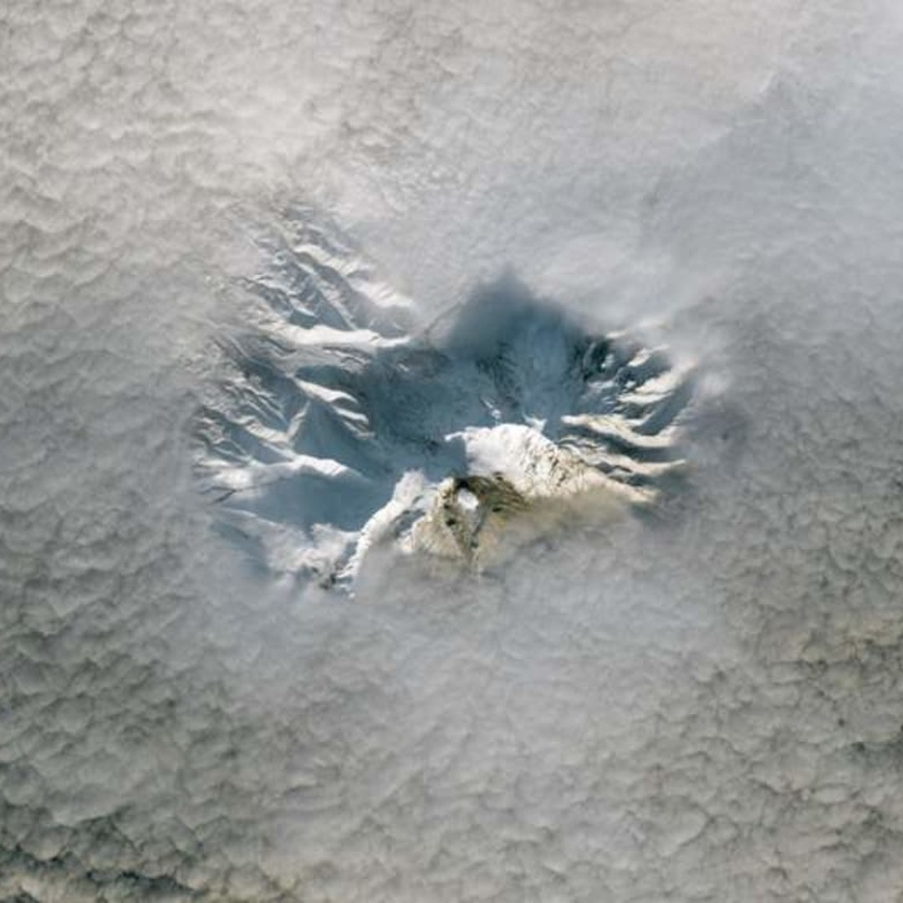
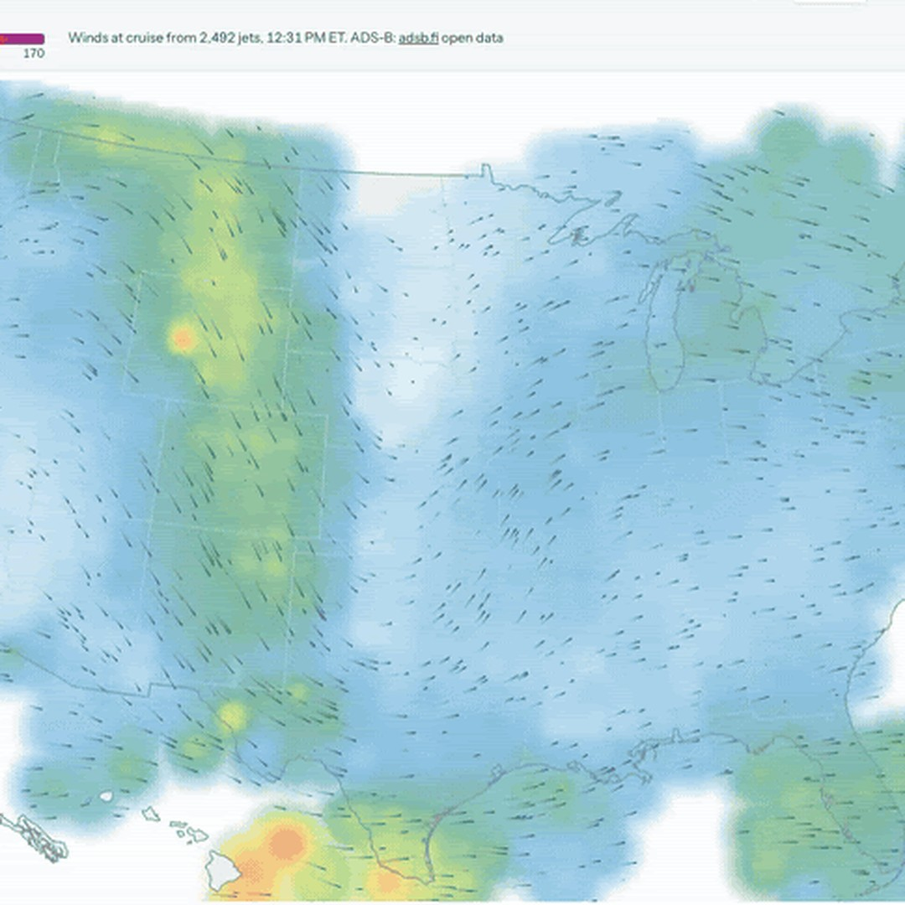
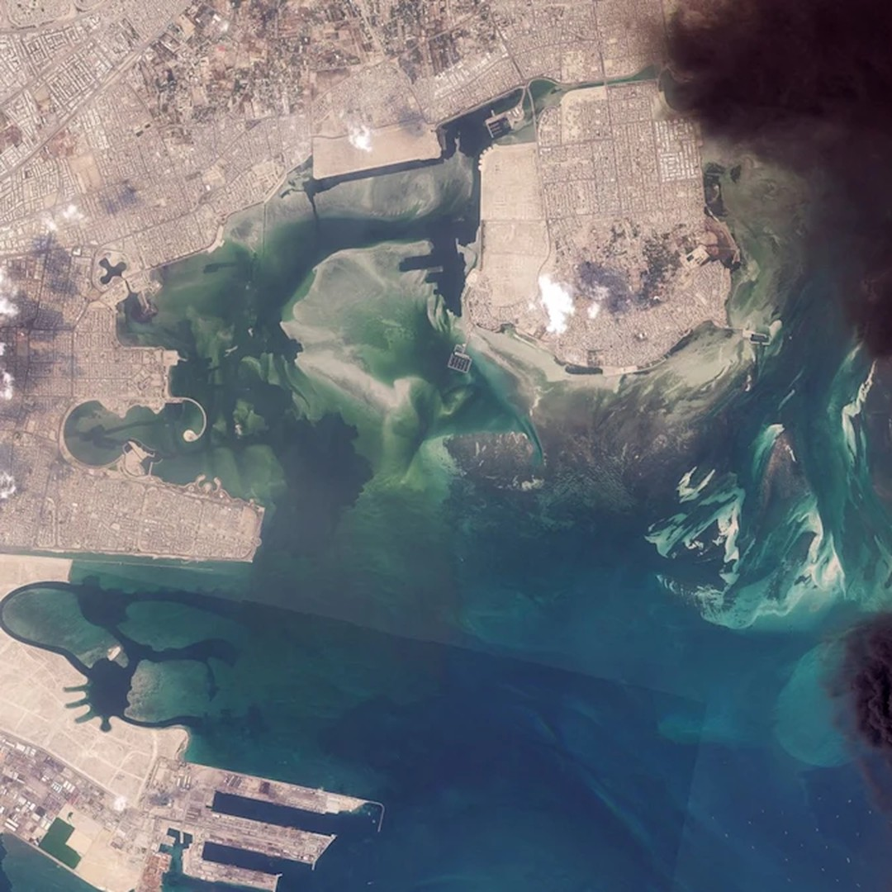

# Geoawesome reposts, 2026-11-28

3 post(s) ready. Each has a 1080×1080 image and its own text for Facebook, Instagram and X. Nothing has been posted.

**To publish:** tick the box under a post. It is queued for the next free time slot and posted to Facebook and Instagram; a comment here confirms the time. Edit a text in this issue first if you want to change it (what is in the box is what gets posted). Untick before the slot to cancel. When it is live, a comment @mentions you with the X text for Buffer.

---

## 1. One of Russia's most active volcanoes rises above a sea of clouds - AOL.com

<!-- post:2026-11-28-1-one-of-russia-s-most-active-volcanoes-ri -->
- [ ] **Publish on Facebook + Instagram**



[Download square image](https://raw.githubusercontent.com/walczakagh/geoawesome-social-agent/main/drafts/images/2026-11-28-1-one-of-russia-s-most-active-volcanoes-ri.jpg) · square crop, from 789px of source width

**Source:** [Google Alerts #3](https://www.aol.com/articles/one-russia-most-active-volcanoes-173512000.html) · score 8.0/10 · Landsat 9 image of Shivelyuch volcano above clouds; vivid satellite scene, Earth-observation hook.
**Rights:** Someone else's map: the credit line names them; ask them first if unsure. Licence on page: not stated.

**What it shows:** A Landsat 9 (Operational Land Imager) view of Shiveluch on Russia's Kamchatka Peninsula, acquired on 8 November 2026. Snow covers the upper slopes and a dark lava dome shows near the summit, while clouds hide most of the surrounding landscape. The source does not state the band combination, but the dark dome against snow is described as the volcanic rock.

**Check before posting:**
- Image licence is not stated on the page and the reuse policy is link_only: check the image can be reposted, or link to NASA Earth Observatory directly.
- The page's fuller credit reads 'NASA Earth Observatory / Lauren Dauphin, using Landsat data from the U.S. Geological Survey'. The credit field only says 'NASA Earth Observatory', which is what the posts use.
- Band combination, resolution and scale are not given, so the posts do not say whether it is natural colour.
- The source spells the name both 'Shivelyuch' and 'Shiveluch'. The posts use Shiveluch.
- The page is an AOL repost of what appears to be a NASA Earth Observatory Image of the Day, so the original may be better to link.
- The article says ash from Shiveluch reached Alaskan airspace in July 2026. This is not verified here and was left out.
- The image is a square crop from a 789px-wide source, so quality at 1080px may be soft.

**Facebook**

```text
Clouds hide most of Kamchatka, but Shiveluch's snowy summit and dark lava dome break through.

Landsat 9's Operational Land Imager captured this on 8 November 2026. The dome sits inside a caldera about 9 kilometres across, and the Smithsonian's Global Volcanism Program has documented at least 60 major eruptions here in the Holocene. Activity had persisted for several months when the image was taken.

Read more: https://www.aol.com/articles/one-russia-most-active-volcanoes-173512000.html

Image: NASA Earth Observatory

#Geoawesome #Landsat #Volcano #Kamchatka #NASA
```

**Instagram**

```text
Dark rock against white snow: a lava dome on Shiveluch, one of the most active volcanoes in Russia, seen above the clouds.

Landsat 9 acquired the scene on 8 November 2026. Thick lava builds domes like this around the vent instead of flowing away, and sections can collapse and trigger pyroclastic flows. Clouds covered the surrounding landscape, but the summit stayed visible.

Find out more: https://www.aol.com/articles/one-russia-most-active-volcanoes-173512000.html

Image: NASA Earth Observatory

#Geoawesome #Volcano #Landsat #Kamchatka #Satellite
```

**X (via Buffer)**

```text
Shiveluch's dark lava dome pokes through a cloud deck over Kamchatka (Landsat 9, 8 Nov 2026). The caldera is about 9 km across.
https://www.aol.com/articles/one-russia-most-active-volcanoes-173512000.html
Image: NASA Earth Observatory
#Geoawesome #Volcano #Landsat
```

**Alt text:** Satellite view of a snow-covered volcanic summit with a dark lava dome near the top, rising above a layer of white cloud.

---

## 2. Mapping the Wind with Planes

<!-- post:2026-11-28-2-mapping-the-wind-with-planes -->
- [ ] **Publish on Facebook + Instagram**



[Download square image](https://raw.githubusercontent.com/walczakagh/geoawesome-social-agent/main/drafts/images/2026-11-28-2-mapping-the-wind-with-planes.jpg) · square crop, from 485px of source width (low resolution: upscaled, check sharpness)

**Source:** [Maps Mania](http://googlemapsmania.blogspot.com/2026/11/mapping-wind-with-planes.html) · score 8.0/10 · Live flight map inferring wind from aircraft data; striking, map-driven, with editor-favourite source.
**Rights:** Someone else's map: the credit line names them; ask them first if unsure. Licence on page: not stated.

**What it shows:** Tailodds' 'Flights in the Air Right Now' map shows live aircraft positions over the United States plus wind at cruising altitude. The wind is inferred by comparing each aircraft's heading with its ground track, using ADS-B data from adsb.fi and the World Magnetic Model, not conventional weather data. About 2,500 airliners over 30 minutes feed estimates for roughly 750 one-degree areas, refreshed every 30 minutes.

**Check before posting:**
- The 'featured map lives at' link points to a KNMI report on ADS-B/Mode-S winds, not the Tailodds map. The Tailodds URL is not given in the source, so the posts link to the Maps Mania article.
- Credit is built as 'Map: Tailodds via Maps Mania' because the page names no image credit. Check that Tailodds is the right maker to name.
- Image licence is not stated and the reuse policy is link_only, so check before posting the image.
- The image is low resolution (485px wide, upscaled), so check sharpness.
- The date and time of the screenshot are not given, and the source does not explain the colours or symbols on the map.
- I could not see the image. The alt text is based on the page description, so check it against the square.
- The source does not say how the inferred winds compare with official weather data, so no accuracy claim is made.
- The KNMI mention is kept to the source's wording: the institute researched and implemented such systems for forecasting.

**Facebook**

```text
This wind map uses no weather data, only the aircraft crossing the sky.

Tailodds' Flights in the Air Right Now compares each airliner's heading with its ground track (the 'crabbing' needed in a crosswind) to infer wind at cruising altitude over the United States. About 2,500 aircraft over 30 minutes feed estimates for roughly 750 one-degree areas, refreshed every 30 minutes.

Read more: http://googlemapsmania.blogspot.com/2026/11/mapping-wind-with-planes.html

Map: Tailodds via Maps Mania

#Geoawesome #Wind #ADSB #Aviation #Weather
```

**Instagram**

```text
About 2,500 airliners are acting as flying weather stations on this live map of the United States.

Pilots point the nose slightly into the wind to hold their course ('crabbing'). The gap between heading and ground track reveals wind direction and speed at cruising altitude, using ADS-B data from adsb.fi and refreshed every 30 minutes.

Find out more: http://googlemapsmania.blogspot.com/2026/11/mapping-wind-with-planes.html

Map: Tailodds via Maps Mania

#Geoawesome #Wind #Aviation #ADSB
```

**X (via Buffer)**

```text
This US wind map comes from airliners, not a weather service. Heading versus ground track gives the wind at cruising altitude.
http://googlemapsmania.blogspot.com/2026/11/mapping-wind-with-planes.html
Map: Tailodds via Maps Mania
#Geoawesome #Wind #ADSB
```

**Alt text:** Map of the United States showing live aircraft positions and wind conditions at cruising altitude.

---

## 3. Middle East conflict: Smoke seen from space after attack on key Saudi Arabia oil hub - Nine

<!-- post:2026-11-28-7-middle-east-conflict-smoke-seen-from-spa -->
- [ ] **Publish on Facebook + Instagram**



[Download square image](https://raw.githubusercontent.com/walczakagh/geoawesome-social-agent/main/drafts/images/2026-11-28-7-middle-east-conflict-smoke-seen-from-spa.jpg) · square crop, from 675px of source width (low resolution: upscaled, check sharpness)

**Source:** [Google Alerts #3](https://www.nine.com.au/world-news/middle-east/saudi-arabia-houthi-conflict-rebels-claim-to-have-attacked-kingdoms-largest-oil-refinery-20261127-p61hqh.html) · score 7.0/10 · Satellite image of a huge smoke plume over a Saudi oil hub; striking, though conflict-driven.
**Rights:** Someone else's map: the credit line names them; ask them first if unsure. Licence on page: not stated.

**What it shows:** A satellite image of a large plume of black smoke over the Ras Tanura peninsula and refinery in Saudi Arabia, after Yemen's Houthi rebels claimed an attack on it. The caption credits Planet Labs PBC/Reuters via CNN. The sensor, acquisition date and any colour treatment are not stated.

**Check before posting:**
- The IMAGE CREDIT field says NOT FOUND. The credit used comes from the satellite photo caption in the page text ('2026 PLANET LABS PBC/Reuters via CNN'). Confirm the square was cut from that satellite image and not from the Sanaa (AFP/Getty) or Riyadh tower (Saudi Press Agency) photos on the same page.
- Image licence is not stated and the source is marked link_only (Planet Labs/Reuters via CNN, found through Nine). Check that reposting the image is acceptable before publishing.
- The source is only 675px wide, so the square is upscaled. Check sharpness.
- Sensor, acquisition date, resolution and scale are not given.
- The attack is a Houthi claim. CNN says oil loadings were suspended (via a shipping source) and it is unclear whether they have resumed. Aramco had been approached for comment.
- CNN says it could not independently verify the Saudi-led airstrikes in Yemen. The captions avoid presenting either side's claims as fact.

**Facebook**

```text
Black smoke over Ras Tanura is visible from orbit after Houthi rebels claimed an attack on Saudi Arabia's biggest oil refinery.

A satellite image credited to Planet Labs shows a large plume over the facility, which has a refining capacity of 550,000 barrels per day. The Houthis say the strikes caused a fire. The image date and sensor are not stated.

Read more: https://www.nine.com.au/world-news/middle-east/saudi-arabia-houthi-conflict-rebels-claim-to-have-attacked-kingdoms-largest-oil-refinery-20261127-p61hqh.html

Image: 2026 PLANET LABS PBC/Reuters via CNN

#Geoawesome #Satellite #Oil #Saudi #Imagery
```

**Instagram**

```text
A column of black smoke rises over the Ras Tanura peninsula in a satellite image, part of one of the world's largest crude oil export terminals.

The image is credited to Planet Labs and follows a Houthi claim of strikes on the refinery. A shipping source told CNN oil loadings were suspended, and it is unclear whether they have resumed.

Find out more: https://www.nine.com.au/world-news/middle-east/saudi-arabia-houthi-conflict-rebels-claim-to-have-attacked-kingdoms-largest-oil-refinery-20261127-p61hqh.html

Image: 2026 PLANET LABS PBC/Reuters via CNN

#Geoawesome #Satellite #Smoke #Energy
```

**X (via Buffer)**

```text
Smoke over the Ras Tanura refinery, seen from orbit after the Houthis claimed an attack. Capacity: 550,000 barrels per day.
https://www.nine.com.au/world-news/middle-east/saudi-arabia-houthi-conflict-rebels-claim-to-have-attacked-kingdoms-largest-oil-refinery-20261127-p61hqh.html
Image: Planet Labs PBC/Reuters via CNN
#Geoawesome #Satellite #Oil
```

**Alt text:** Satellite view of a large dark plume of smoke rising from a coastal oil refinery complex on the Ras Tanura peninsula in Saudi Arabia.

---

### Skipped after reading the page
- [Tracking the South Creek Fire in Florida | WFCA Fire Map](https://wfca.com/fire-map/florida/south_creek?name=South+Creek): No image was found on the page, the reuse policy is link_only, and the only fact is a one-line fire size (50 acres), so there is no striking visual to repost.
- [Tracking the Booger Hill Fire in Kentucky | WFCA Fire Map - Western Fire Chiefs Association](https://wfca.com/fire-map/kentucky/booger_hill): No image was found on the page, and the text is a one-line auto-generated status (1 acre, 0% contained) with no visual, sensor, date or map detail to explain.
- [Landsat sees Resolution Island, New Zealand's early bird refuge that stoats reached - YouTube](https://www.youtube.com/shorts/wd2IJBFspWE): Cannot be credited or reused safely: the source is link_only, no image credit or licence is given, the YouTube channel is unidentified (the publisher is only a Google Alert), and the 405px image would be upscaled to 1080.
- [Brazil's Christ the Redeemer Appears To Float Above a Sea of Clouds, Leaving Viewers ...](https://www.ibtimes.co.uk/brazils-christ-redeemer-appears-float-above-sea-clouds-leaving-viewers-questioning-reality-1835198): No image credit on the page and no way to tell which photographer's footage the crop comes from; the story is also a weather-photo news item with no EO, GIS or map content, and the source says some circulating versions may be AI-generated or altered.

---

### Sources checked
- Google Alerts #1: 13 in feed, 13 new
- Google Alerts #2: 17 in feed, 15 new
- Google Alerts #3: 20 in feed, 18 new, 1 already found via another source, 1 from excluded sites
- Google Alerts #4: 20 in feed, 20 new
- Google Alerts #5: 20 in feed, 20 new
- Google Alerts #6: 16 in feed, 5 new, 11 already found via another source
- Google Alerts #7: 20 in feed, 20 new
- Google Alerts #8: 9 in feed, 0 new
- NASA Earth Observatory: 10 in feed, 0 new
- ESA Observing the Earth: failed: https://www.esa.int/rssfeed/Applications/Observing_the_Earth: HTTP 404
- EUMETSAT: 10 in feed, 0 new
- Copernicus Atmosphere Monitoring Service: 10 in feed, 0 new
- NASA JPL: 100 in feed, 0 new
- Planet Pulse: 50 in feed, 0 new
- Maps Mania: 25 in feed, 1 new
- Visual Capitalist (maps): 10 in feed, 2 new
- FlowingData: 10 in feed, 0 new
- Google Maps blog: 20 in feed, 0 new
- Google Research blog: 100 in feed, 0 new
- Overture Maps blog: 20 in feed, 0 new
- Bellingcat: 10 in feed, 0 new
- Reddit r/MapPorn: failed: https://www.reddit.com/r/MapPorn/top/.rss?t=day: HTTP 404
- Reddit r/dataisbeautiful: failed: https://www.reddit.com/r/dataisbeautiful/top/.rss?t=day: HTTP 429
